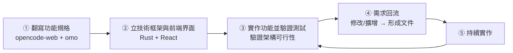
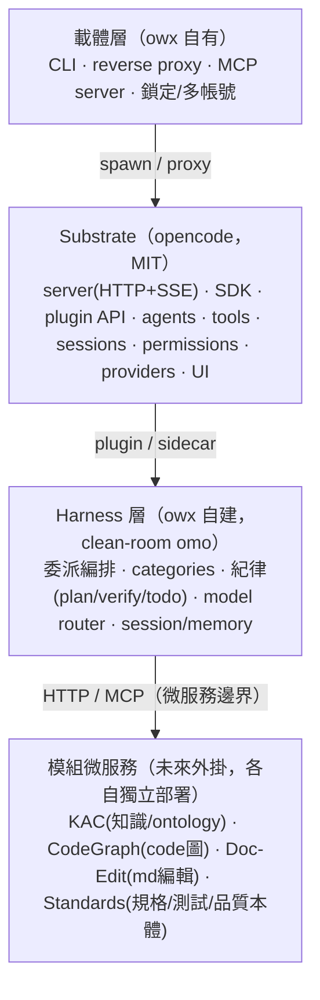

# owx — opencode-web eXperiment（根知識庫）

> 本檔是 owx 的**唯一全專案入口**與 AI agent 共同合約。規範衝突時，優先序：**本檔 §2 授權治理 ＞ ADR ＞ docs/standards ＞ 其他**。

| 項目 | 說明 |
|------|------|
| **名稱** | owx（opencode-web experiment）|
| **狀態** | **第一階段**（2026-10-17 起）；尚無程式碼，進行「翻寫規格 → 立框架 → 實作驗證 → 需求回流 → 持續實作」 |
| **一句話** | 以 opencode + omo 為基礎核心，重做一個**文件優先**的 agent 執行環境 |
| **授權** | 自有（Proprietary）；**交付物僅含 MIT / 自有程式碼**（見 §2）|
| **規範** | [`docs/standards/`](docs/standards/)（coding / document / governance）|
| **規格** | [`docs/spec/base-core-requirements.md`](docs/spec/base-core-requirements.md)（clean-room 回溯）|
| **決策** | [`docs/adr/`](docs/adr/) |

---

## 0. 專案性質與工作流

**owx 是包裝 + 自建 harness，不是重寫 AI 邏輯。** 沿用 `opencode`（MIT）為 substrate；`omo`（SUL-1.0）僅作**需求來源**，其功能以 **clean-room** 自建。

**開發工作流（修訂 2026-10-17；見 [ADR-0002](docs/adr/ADR-0002-iterative-spiral-workflow.md)）**——由「規格拍板後才動工」改為**迭代螺旋**：以可行性驗證驅動規格演化。



- **目前階段**：第一階段（① → ⑤，循環）。
- **規格與現實衝突時**：**以實作驗證為準**，回頭更新規格，不無依據選邊。
- **動工門檻**：**D1 已拍板**（見 §9）；每輪迭代結束**必須回寫規格**——規格落後於實作，視為該輪未完成。

---

## 1. 產品定位

> 未來 AI 開發是**工程問題**；這工程的基礎是**文件與知識**。**程式語言會變，需求不會變。**
> 因此真正該被 agent 操作的**原生物件是「文件／知識」**，coding 只是其特例。

- **主戰場**：文件編輯（初期 Markdown）、知識本體、GraphRAG（doc + code）與規格/測試/品質標準。
- **終局**：企業在「問題理清、案例研究、公司治理」的基礎工具。
- **差異化楔子**：requirements・docs・code **共用一張會演化的知識圖**，agent 以**標準為紀律**強制它 → 賣**可證的 traceability 與治理**。
- **不與 opencode/omo 競爭 coding**：owx 是**文件優先**；coding 是次要模式。

---

## 2. 授權治理（憲法級，違反 = 阻斷合併）

> 本專案的職業用途是**為企業導入 AI**，交付物**不得含非正式授權程式碼**。

| 來源 | 授權 | 處置 |
|---|---|---|
| **opencode** | MIT | ✅ 可重用/改/散布 |
| **owx 自有程式** | Proprietary | ✅ 自有 |
| **第三方（如 CodeGraph @ MIT）** | 需逐一查核 | ⚠️ 僅 MIT/Apache/BSD 可進交付物 |
| **omo（oh-my-openagent）** | **SUL-1.0**（source-available，非 OSI）| ❌ **不得進交付物**；僅可**黑箱回溯需求**，自建 |

**紅線**：
- ❌ 複製 omo 的**原始碼、prompt、skill 文字、文件**；❌ 沿用其**任何品牌名**（禁止字串清單以編碼保存於 `scripts/cleanroom-scan.mjs`）。
- ✅ 讀其**公開文件/可觀察行為** → 抽**功能需求** → 自己寫。
- 任何新增依賴（npm/cargo）須在 PR body 標明**授權**並確認可交付。
- 詳細流程見 [`docs/standards/governance/licensing.md`](docs/standards/governance/licensing.md)。

### omo 使用策略（2026-10-22 決策）

> 目標：**owx 的 omo 專用化，不影響其他專案在用的 opencode omo**；長期產品化以**自有 omo 全新開發**為終局。

**方案 A（現行，第一期）——owx 專用 omo（XDG 隔離 + vendored 副本）**：
- owx 專用環境以 **XDG 目錄隔離**（`XDG_CONFIG_HOME`/`XDG_STATE_HOME`/`XDG_CACHE_HOME` 指向 `~/.owx/env/`），使 opencode **完全看不到全域 `~/.config/opencode`**；啟動器：`~/.owx/owx-env.sh`。
- 專用 `~/.owx/env/config/opencode/opencode.json` 宣告**本地 omo plugin**（`file://~/.owx/omo/…/index.js`，含全部依賴的 vendored 副本），**不載入**全域 npm 版。
- owx 專案 `.omo/omo.jsonc`（project scope）覆寫 agent 顯示名稱（如 `sisyphus → owx`）與 prompt；**只影響 owx**，其他專案零影響。
- ⚠️ **授權**：omo 副本位於 **repo 外**（`~/.owx/omo/`），SUL-1.0 僅限**內部/個人使用**（SUL 授權允許複製＋修改），**不進 repo／交付物**；修改副本時保留「已修改」聲明。owx repo 內僅含**自有**設定檔（`.omo/omo.jsonc`）。
- ⚠️ **功能限制**：v1.18.35 之 opencode **不支援**專案層級停用全域 plugin（`-` 前綴為 v2 語法）；`OPENCODE_CONFIG_DIR` 亦無法排除全域 plugin——故「不動全域」唯一可行即上述 XDG 隔離。

**owx 專用環境的設定同步（2026-10-22 已實作）**：
- `~/.owx/env/config/opencode/opencode.json` 除本地 omo plugin 外，亦含 **dllm provider、pcm／notion MCP、skills paths**（複製自全域）。
- `~/.owx/env/config/opencode/skills/`（28 個 arkcli-*／測試／需求）與 `plugins/hermes.js`（含 `@opencode-ai/plugin` 依賴）複製自全域。
- `~/.owx/env/state/opencode/auth.json`（8 個 provider 憑證）複製自 `~/.local/share/opencode/auth.json`。
- ⚠️ **維護注意**：上述設定含 **API key／token**（dllm、pcm、notion、nvidia 等），**不進版控**；日後更換任一 provider 憑證須**同步更新兩邊**（全域 + owx 專用）。

**方案 C（終局）——自有 omo 全新開發（clean-room）**：
- 長遠以 owx **自有程式**重做 omo 之能力（委派編排、categories、紀律、model router 等），不依賴 omo 本體（SUL 不得進交付物）。
- 路徑：`omo 公開行為 → 自寫功能規格（docs/spec/）→ 自有 Rust/React 實作`；omo 本體僅作**需求標的與行為對照**，不抄原始碼/prompt/skill 文字。
- 方案 A 的 vendored 副本即為 clean-room 之**行為參考標的**（僅本機、不散布）。

---

## 3. 架構（三層 + 微服務）



**架構決策（不可違反）**：
- **不擴充 substrate 行為**：opencode 以包裝/外掛使用，不改其原始碼。
- **核心與模組解耦**：模組以獨立微服務邊界（HTTP / MCP）外掛，可獨立替換/部署。
- **授權邊界即架構邊界**：SUL 元件（omo）不得越過 harness 邊界進入交付物。

---

## 4. 技術棧

> **D1 已凍結**（2026-10-17；見 [ADR-0003](docs/adr/ADR-0003-harness-rust-core-react-frontend.md)）：**Harness 核心＝Rust、前端＝React**。D2–D5（§9）仍待決，於迭代中就地決策並記 ADR。

| 層 | 方向 | 狀態 |
|---|---|---|
| **Harness 核心** | **Rust**（orchestrator / provider client / tools / router / MCP client / session）| ✅ 凍結（ADR-0003）|
| **Substrate** | opencode（TypeScript，MIT）| 定 |
| **前端** | **React**（標準聊天視窗）| ✅ 凍結（ADR-0003）|
| **模組** | Rust（KAC 已為 Rust/axum）；外部以 HTTP/MCP 接 | 定 |

- Rust：`edition 2021`、`cargo` workspace；lint 以 `cargo clippy`（`-D warnings`）；格式化 `cargo fmt`。
- TS：strict 模式；格式化 Prettier（`.prettierrc.json`）；lint 目標 ESLint（待落地）。
- 版本：Node ≥22；pnpm 10（若非 Rust-only 前端）。

---

## 5. AI 開發紀律（違反 = 視同未完成）

> 改寫自 KAC/ASM 之 AI 開發紀律，僅保留適用 owx 者。

### 5.1 核心哲學

1. **測試是唯一合約與驗收機制**：沒測試 = 沒做完；可測試性 > 可讀性 > 一致性 > 明確性。
2. **Bug fix 必附重現測試**：先有失敗測試證明 bug，修後轉綠。
3. **複用 > 新增**：新增檔案/模組前，先檢索確無現有實作可複用。

### 5.2 查閱優先（每次建立/修改前）

```
Step 1 查規格 → docs/spec/ + 本檔，確認功能與驗收條件
Step 2 查授權 → 新元件是否越過 §2 紅線？（尤以回溯 omo 時）
Step 3 代碼檢索 → 確認現有實作/pattern，決定修改、擴充或新增
Step 4 才動手 → commit message 標明依據的規格/決策
```

### 5.3 禁止硬編碼

- ❌ magic number inline、URL/IP/Port、設定值、業務字串寫死 → 命名常數 / config / 環境變數。
- 例外：測試 fixture、API 契約強制值。

### 5.4 Git 鐵則

- **回滾類操作**（`reset`/`revert`/`checkout --`/`restore`/`rebase`/`stash drop`）：**先輸出指令、經確認後才執行**，AI 不得自行執行。
- Conventional Commits：`type(scope): subject`，subject ≤72 字、首字小寫、句末無句點，body 解釋「為何」。
- 未經明確要求不 commit；不 force-push。

### 5.5 宣稱「完成」前的強制驗證

| 宣稱 | 必須提出的證據 |
|---|---|
| 功能完成 | 型別/lint 通過 + 相關測試轉綠 + 新功能含對應測試 |
| Bug 修好 | 先失敗測試重現 → 修後綠，兩者對比 |
| Rust 改動 | `cargo fmt --check` + `cargo clippy -D warnings` + `cargo test` |
| 授權相關改動 | 明列元件授權表，確認未觸 §2 紅線 |

- 「應該會過」不算驗證；空輸入／邊界／error 路徑須實際涵蓋。
- 改檔後以 `lsp_diagnostics` 確認無新增錯誤；pre-existing 另計不代修。
- 覆蓋率門檻：Rust 目標 ≥80%（關鍵：orchestrator、授權、clean-room 邊界）；逐步達標，**不刪測試求綠**。

---

## 6. 文件標準

所有文件（規格、ADR、規範、知識庫）遵循 [`docs/standards/document-standards.md`](docs/standards/document-standards.md)：
- Markdown、檔名 kebab-case 或既定前綴（`ADR-NNNN-`、`SRS-`）、每檔帶版本/日期/狀態表頭。
- **文件即知識資產**：可 diff、可審核、可進 git、可被 RAG 佐證（本專案的存在理由）。
- 語言：繁體中文為主，技術名詞保留英文。

---

## 7. 目錄結構

```
owx/
├── AGENTS.md                 # 本檔（唯一全專案入口）
├── README.md
├── docs/
│   ├── standards/            # 開發規範（coding / document / governance）
│   ├── spec/                 # 需求規格（clean-room 回溯）
│   ├── design/               # 技術設計（模組/介面/資料/前端/測試）
│   └── adr/                  # 架構決策記錄
├── crates/                   # Rust harness（owx-core / owx-boundary / owx-harnessd）
├── packages/                 # TypeScript（opencode-plugin-owx shim）
├── apps/web/                 # React 前端（Vite）
├── owx-sample/               # 標準／範本庫（owx-Standard.json + standards/；種子，部署至 OWX_SAMPLE_DIR）
└── scripts/                  # 閘門與工具（clean-room／license／doc-link／sbom／gen-standards）
```
> 規則：子目錄複雜度達門檻才增設子 `AGENTS.md`，子檔不得重複本檔內容。

---

## 8. 指令

```bash
# 文件/規範
git status

# Rust harness（crates/）
cargo fmt --all --check
cargo clippy --workspace --all-targets --all-features -- -D warnings
cargo test --workspace

# 前端 / shim（pnpm workspace）
pnpm install
pnpm -r typecheck
pnpm -r build
```

```bash
# Harness sidecar（loopback；前端 /rpc/* 經 dev proxy 轉此，見 apps/web/vite.config.ts）
cargo build -p owx-harnessd
cargo run -p owx-harnessd            # 127.0.0.1:13110（OWX_HARNESS_PORT）

# （dev）指向 repo 樣本庫，讓「依循規範／基礎目錄」有資料
OWX_SAMPLE_DIR="$PWD/owx-sample" cargo run -p owx-harnessd
```

> **harness 環境變數**：`OWX_HARNESS_PORT`（預設 13110）、`OWX_KNOWLEDGE_DIR`（預設 `~/knowledge`）、`OWX_SAMPLE_DIR`（預設 `~/owx-sample`）、`OWX_STANDARD_FILE`（預設 `$OWX_SAMPLE_DIR/owx-Standard.json`）、`OWX_CONFIG_DIR`、`OWX_OPENCODE_URL`。
> **⚠️ 新增／修改 `/rpc/*` 路由後須「重建並重啟」harness**（`cargo build -p owx-harnessd` → 重啟行程）；否則前端對新路由會回 **404**（跑的是舊 binary）。

> 目前為 **step② 完成**：9 個 Rust crate（`owx-*`）、`opencode-plugin-owx` shim、`apps/web`、閘門（clean-room/license/doc-link/SBOM）與 CI 已建；決策全數定案（見 §9）。

---

## 9. 待決（迭代中就地決策並記 ADR）

| # | 決策 | 影響 |
|---|---|---|
| ~~D1~~ | **✅ 已定案（2026-10-17）：Harness 核心＝Rust、前端＝React**（[ADR-0003](docs/adr/ADR-0003-harness-rust-core-react-frontend.md)）| 已消解 |
| ~~D2~~ | **✅ 定案（2026-10-17）：初期只 md**（參照 opencode-web 文件存取）；Doc-Edit 外掛先不實作 | 已消解 |
| ~~D3~~ | **✅ 定案：標準本體屬外掛、第一階段先不實作**；核心不含 | 已消解 |
| ~~D4~~ | **✅ 定案：外掛介面＝MCP / HTTPS；先不實作外掛**（[ADR-0006](docs/adr/ADR-0006-module-interface-mcp-https.md)）| 已消解 |
| ~~D5~~ | **✅ 定案：以 `scripts/sbom.mjs` 產出元件授權表**（[licensing](docs/standards/governance/licensing.md) §6）| 已消解 |

---

## 10. 對外存取（Cloudflare Tunnel）

> owx 的對外入口由 **Cloudflare Tunnel** 提供（與載體 `opencode-web` 共用同一 tunnel）。

**本機埠對映**

| 服務 | 本機 | 公開 | 說明 |
|---|---|---|---|
| **前端 UI（React `apps/web`）** | `127.0.0.1:13100` | ✅ `owx.aiconn.ai` | `pnpm --filter @owx/web dev`（env `OWX_WEB_PORT`；dev proxy → opencode 13001；vite `allowedHosts` 含 `owx.aiconn.ai`）|
| opencode（substrate）API | `127.0.0.1:13001` | 內網 | pipeline 處理（session／tool／provider）|
| owx harness sidecar | `127.0.0.1:13110` | 內網 | `/health`、`/rpc/*`、`/mcp`（env `OWX_HARNESS_PORT`；**不對外**）|

**公開主機名**

| 公開主機名 | 目標（本機）| 用途 |
|---|---|---|
| `owx.aiconn.ai` | `http://127.0.0.1:13100` | **前端 UI**（對人看）；harness sidecar 不公開 |

- **tunnel 類型**：**remote-managed**（`cloudflared tunnel run --token`，systemd `cloudflared.service`）；**ingress（公開主機名 → 服務）在 Cloudflare Zero Trust dashboard 設定**，本機無 `config.yml`。
- **設定步驟（dashboard）**：Zero Trust → Networks → Tunnels → 選該 tunnel → **Public Hostname** → Add：Subdomain `owx`、Domain `aiconn.ai`、Service `HTTP` → `127.0.0.1:13100`（前端）；儲存即生效（DNS CNAME 由 Cloudflare 自動建立）。
- ❗ **憑證**：tunnel token 為機密，**嚴禁寫入版控或文件**（本節只記主機名與埠對映）。
- ⚠️ **安全**：公開的是**前端 dev server（Vite，13100）**，非正式站；harness sidecar 已改 loopback `13110`、**不對外**（13100 讓給前端）。上線前仍建議改用**正式建置（`pnpm -r build` 產物）＋存取控制**。

**上線前待調整（go-live TODO；先附記，部署時處理）**
1. **存取控制**：對 `owx.aiconn.ai` 加 Cloudflare Access（SSO/OTP），或改走載體（`opencode-web` 4096，鎖定＋Basic）。
2. **對外入口**：目前公開的是**前端 dev server（13100）**；上線應改為**正式建置靜態站**或載體 proxy（FR-I-1），並加存取控制。
3. **sidecar 輕量驗證（可選）**：為 `/rpc/*` 加 bearer（如 `OWX_TOKEN`），未帶則 401。
4. **環境**：Node 升 ≥22（前端）；瀏覽器直連時的 CORS / allowed origins。
5. **SBOM 交付**：上線前以 `scripts/sbom.mjs` 產出元件授權表。

---

## 11. 變更紀錄

| 日期 | 版本 | 變更 |
|---|---|---|
| 2026-10-22 | v0.9 | §2 增 **omo 使用策略（方案 A／C）**：owx 專用 omo 以 **XDG 隔離 + vendored 副本**（`~/.owx/`）達成「不影響其他專案」；長期以**自有 omo 全新開發（clean-room）**為終局。同步 owx 專用環境設定（dllm／MCP／skills／auth）。 |
| 2026-10-20 | v0.8 | §8 補 **harness sidecar 啟動指令與環境變數**（`OWX_HARNESS_PORT`／`OWX_KNOWLEDGE_DIR`／`OWX_SAMPLE_DIR`／`OWX_STANDARD_FILE`），並註明**改 `/rpc/*` 路由後須重建＋重啟**（否則 404）。 |
| 2026-10-20 | v0.7 | §7 目錄結構補 **`owx-sample/`**（標準／範本庫種子）與 **`scripts/`**；同步「專案屬性設定」規格與規範目錄（[`ADR-0011`](docs/adr/ADR-0011-project-metadata-and-standards-catalog.md)）。 |
| 2026-10-17 | v0.6 | §10 佈局調整：**前端 UI 移至 13100（公開）**、harness sidecar 移至 `13110`（內網，不對外）、opencode 13001；`owx.aiconn.ai → 13100`（前端）。 |
| 2026-10-17 | v0.5 | §10 增「上線前待調整（go-live TODO）」：存取控制、入口決策、sidecar 驗證、Node ≥22、SBOM——先附記、部署時處理。 |
| 2026-10-17 | v0.4 | 新增 §10「對外存取（Cloudflare Tunnel）」：`owx.aiconn.ai → 127.0.0.1:13100`，remote-managed tunnel 之 dashboard 設定步驟與安全警示；§8 現況更新為 step② 完成。 |
| 2026-10-17 | v0.3 | 決策原則定為「參照 opencode／opencode-web」；**D2–D5 全部定案**（§9）；新增 ADR-0005（模型注入，Accepted）、ADR-0006（外掛介面＝MCP/HTTPS，先不實作外掛）。 |
| 2026-10-17 | v0.2 | 工作流由「規格拍板後才動工」改為**迭代螺旋**（§0；ADR-0002）；**D1 定案：Rust 核心＋React 前端**（§4/§9；ADR-0003）；§3 架構圖遷為 Mermaid（依文件標準 §6）。 |
| 2026-10-17 | v0.1 | 初版：專案建立（Inception）。定四階段工作流、授權治理（§2）、三層+微服務架構、AI 開發紀律、文件標準入口、待決清單。改寫自 ASM `AGENTS.md` 模式，依 owx（文件優先、企業交付、clean-room omo）調整。 |
