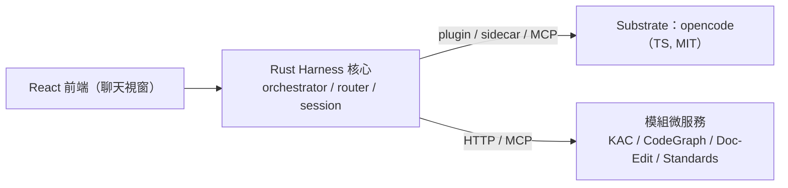

# ADR-0003：Harness 核心採 Rust、前端採 React

- **Status**：Accepted
- **Date**：2026-10-17
- **Deciders**：Daniel（專案負責人）

## Context

D1（`AGENTS.md` §9）為「自建 harness 的語言/邊界」（Rust 核心 vs 沿用 opencode TS plugin），是全清單中**影響最大**的一題（2x+ 工作量差異；架構走向）。相關前提：

1. harness 為 **clean-room 自建**，承載委派編排、categories、紀律（plan/verify/todo）、model router、session/memory。
2. 授權要求（§2）：交付物**僅 MIT / 自有**；**omo（SUL-1.0）不得進交付物**，其功能須**原創重寫**。
3. 既有現況：**KAC 已為 Rust/axum**；substrate opencode 為 **TypeScript（MIT）**。

## Decision

- **Harness 核心以 Rust 實作**：orchestrator / provider client / tools / router / MCP client / session。
- **前端以 React 實作**：標準聊天視窗。
- **Substrate 維持 opencode（TypeScript）**，以**包裝 / 外掛**方式使用，**不改其原始碼**（包裝不擴充）。
- **邊界**：Rust 核心 ↔ substrate 以 **plugin / sidecar / MCP** 互動；外部模組（KAC / CodeGraph / Doc-Edit / Standards）以 **HTTP / MCP** 外掛。

## Consequences

**正面**
- **授權潔淨**：核心為自有 Rust，無 SUL 汙染，清楚劃出 clean-room 邊界。
- 與 KAC（Rust）**同構**，模組整合容易；型別、效能、可測試性佳。
- 前端 React 與 substrate Web UI 生態一致，可 iframe 嵌入。

**負面 / 成本**
- **跨語言邊界**（Rust core ↔ TS substrate）需 MCP / sidecar 通訊，增加整合複雜度。
- harness 需**完全重寫**：omo 的調校 prompt/skill **不可抄**，須自行重養（**最大成本**）。
- Rust 相對 TS 開發速度慢，人才門檻高。

## Alternatives

| 方案 | 為何否決 |
|---|---|
| 沿用 opencode TS plugin 實作 harness | 起步快、與 substrate 同語言；但 harness 與 substrate 邊界模糊，易受 substrate 改動牽動，且**難以凸顯自有核心的授權邊界** |
| 純 TS 自建 harness | 同上，且與 KAC（Rust）不同構 |
| Rust 全包（連 substrate 也以 Rust 重寫）| 違反「不重造輪子」「包裝不擴充」，成本極高 |

## Refs

- `AGENTS.md` §2 §3 §4 §9
- `docs/standards/governance/licensing.md`
- [`ADR-0001`](ADR-0001-substrate-opencode-cleanroom-omo.md)、[`ADR-0002`](ADR-0002-iterative-spiral-workflow.md)
