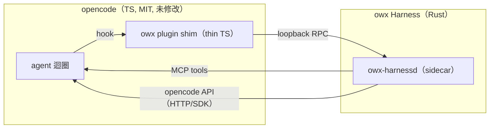

# ADR-0004：Harness↔opencode 整合邊界（Rust sidecar ＋ thin TS plugin shim）

- **Status**：Accepted
- **Date**：2026-10-17
- **Deciders**：Daniel（專案負責人）

## Context

Harness 為 owx 以 Rust clean-room 自建（[`ADR-0003`](ADR-0003-harness-rust-core-react-frontend.md)），須在不修改 opencode 原始碼（NFR-3、FR-SUB-5）的前提下，取得對 agent 迴圈的**攔截能力**：意圖閘門、todo 紀律、plan/verify、續作、模型鏈注入、權限政策。

可選掛載面有三：(a) sidecar ＋ TS plugin shim；(b) MCP server；(c) 載體 reverse proxy 路由。分析：

- opencode 的 plugin hook（`chat.params`／`tool.execute.*`／`event`／`permission.ask`，FR-G-1）是**唯一**能攔截內部迴圈的表面。
- MCP 只能**提供工具**給模型選用，**無法強制**紀律。
- reverse proxy 只看得到 opencode 的 HTTP API，看不到工具執行與 chat params，無從介入。

## Decision

採 **(a) 為主幹**：

- **Rust sidecar daemon**（`owx-harnessd`）承載全部 harness 邏輯。
- **Thin TS plugin shim**（`packages/opencode-plugin-owx/`）以 opencode 的 MIT plugin API 掛載 hook，經 **loopback RPC** 轉呼叫 sidecar。
- 同一 sidecar **另暴露 MCP server**（供 opencode 模型呼叫 harness 工具），並**作為 opencode server API 的客戶端**（驅動 sub-session、注入 prompt、設定 model）。
- 載體層（`opencode-web`）**監督** sidecar（per-profile、launchd KeepAlive）；reverse proxy **非 harness 邊界**。

Crate 分解（依賴單向、無環）：`owx-core`（型別／特徵，無 I/O）→ `owx-config`／`owx-provider`／`owx-session`／`owx-tools`／`owx-modules` → `owx-router`／`owx-discipline` → `owx-orchestrator` → `owx-boundary` → `owx-harnessd`（bin）／`owx-cli`（bin）。細部見 [`../design/harness-architecture.md`](../design/harness-architecture.md)。

## Consequences

**正面**
- 取得完整攔截面，紀律與路由得以**強制**；opencode 原始碼不動（授權潔淨）。
- 邊界集中於 `owx-boundary`，opencode 版本漂移被隔離於單一模組。

**負面 / 成本**
- 每次 prompt／工具呼叫**跨語言往返** sidecar，增延遲與失敗耦合。
- 多一條常駐行程需被監督（launchd）。
- 需自養 thin shim（自有 TS）。

**風險與緩解**
- hook 覆蓋不足／API 漂移 → 以 walking skeleton 先驗證 hook；pin 版本；漂移隔離於 `owx-boundary`。
- **模型注入路徑缺口**（1.18.x 已驗證）：`chat.params` 的 output 不含 model → 模型鏈／fallback（FR-HAR-12/13）須改由 agent 設定／SDK 設定 session model／provider hook 達成；列為待決。
- sidecar 故障耦合 → 非關鍵 hook **fail-open**，安全關鍵（permission）**fail-closed**；逾時＋健康檢查。
- 與 opencode 既有 agent／session／task **雙重編排** → opencode 擁有訊息／session 儲存；harness 只存**政策與 boulder 狀態**，以 session id 為鍵。
- 與 opencode provider fallback 重疊 → harness router 擁有鏈選擇，經 `chat.params` 下傳解析後 model。

## Alternatives

| 方案 | 為何否決 |
|---|---|
| (b) 純 MCP server | 只能提供工具、無法攔截迴圈，無法強制紀律 |
| (c) 純 proxy 路由 | 看不到工具執行／chat params／permission，無從介入 |
| 純 TS 自建 harness | 與 ADR-0003（Rust 核心）衝突，且與 KAC（Rust）不同構 |

## Refs

- `AGENTS.md` §2 §3
- [`ADR-0001`](ADR-0001-substrate-opencode-cleanroom-omo.md)、[`ADR-0003`](ADR-0003-harness-rust-core-react-frontend.md)
- [`../design/harness-architecture.md`](../design/harness-architecture.md)、[`../design/interfaces.md`](../design/interfaces.md)
- `docs/spec/base-core-requirements.md` NFR-3、FR-SUB-5
