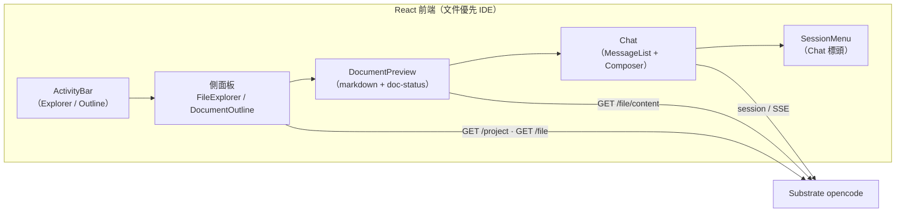

# ADR-0007：前端採文件優先 IDE 版面（三區）

- **Status**：Accepted
- **Date**：2026-10-19
- **Deciders**：Daniel（專案負責人）

## Context

[`ADR-0003`](ADR-0003-harness-rust-core-react-frontend.md) 凍結前端為 **React**，但把版面框定為「**標準聊天視窗**」。迭代推進時，owx 的**文件優先**定位（`AGENTS.md` §1）要求前端不只是對話視窗，而是**以文件為中心的 IDE**：

1. **定位落差**：`docs/design/frontend.md` §1.1 原稱前端「**不是**文件瀏覽器」；此與「文件優先」目標牴觸，須以實作驗證為準回寫（[`ADR-0002`](ADR-0002-iterative-spiral-workflow.md)）。
2. **既有可重用規格**：文件狀態聚合（FR-CARRIER-10）與統一檔案選擇器（FR-CARRIER-11）**已規格化**，本輪**重用**、不重造。
3. **覆蓋缺口**：檔案總管、文件大綱、文件預覽在既有文件中**零覆蓋**（見 `docs/design/frontend.md` §11）。
4. **substrate 能力已具備**：opencode 提供 `GET /project`（專案清單）與 `GET /file`（目錄列舉，entries 含 `{name,path,absolute,type,ignored}`），足以支撐檔案樹。

## Decision

採**文件優先 IDE 版面**，分**三區**：

- **版面＝三區**：`[ActivityBar + 側面板] | DocumentPreview | Chat`。
- **ActivityBar**（VS Code 式圖示列）切換側面板於 **Explorer** 與 **Outline** 之間。
- **session 清單移入 Chat 標頭**（下拉選單），**不再**置於側面板。
- **Explorer＝專案檔案樹**：專案切換器（`GET /project`）＋**延遲載入**的目錄樹（`GET /file?path=<dir>&directory=<root>`；entries 為 `{name,path,absolute,type,ignored}`）。預設／初始專案＝**當前作用中專案**，可設定，初始為 **owx**。
- **Outline＝markdown 標題 H1–H6**：解析**當前預覽文件**的標題，於 **client 端**解析；點擊標題捲動預覽。
- **DocumentPreview＝client 端 markdown 渲染**（react-markdown），含標題錨點＋**doc-status 徽章**（**重用 FR-CARRIER-10 語意**）。
- **Chat＝既有對話**（MessageList ＋ Composer，含 `/` 指令與 `@` 檔案）＋標頭內的 **session 選擇器 ＋ agent／model／status**。
- **取代範圍**：本 ADR **取代 ADR-0003 的「標準聊天視窗」版面框定**；**ADR-0003 的 React 決策不變**，僅版面框定被取代。

## Consequences

**正面**
- 前端**對齊文件優先定位**：文件（樹／大綱／預覽）成為一等公民，而非僅對話。
- **重用既有規格**：doc-status（FR-CARRIER-10）與統一選擇器（FR-CARRIER-11）不重造，維持單一來源。
- **substrate 能力即用**：`GET /project`、`GET /file` 已存在，無須擴充 substrate（NFR-3）。
- 版面與主流 IDE 心智一致，降低學習成本。

**負面 / 成本**
- **版面複雜度上升**：三區＋ActivityBar 的狀態（當前側面板、當前專案、當前文件）須納入 client state 管理。
- **延遲載入與快取**：目錄樹 lazy load 需處理載入／錯誤／空狀態與快取失效。
- **大綱解析為 client 端**：markdown 標題解析在瀏覽器進行，須與預覽渲染保持一致（同一份 markdown 來源）。

## Alternatives

| 方案 | 為何否決 |
|---|---|
| 維持「標準聊天視窗」（ADR-0003 原框定） | 與文件優先定位牴觸；文件樹／大綱／預覽無處安放 |
| session 清單留在側面板 | 側面板讓位給 Explorer／Outline；session 屬對話脈絡，宜隨 Chat 標頭 |
| 大綱改由 server 解析 | 增加端點與往返；client 端解析已足夠且與預覽同源 |
| 檔案樹一次全載（非延遲） | 大專案成本高；延遲載入對齊 `GET /file` 的目錄列舉語意 |

## Refs

- `AGENTS.md` §1 §3 §4
- [`ADR-0002`](ADR-0002-iterative-spiral-workflow.md)、[`ADR-0003`](ADR-0003-harness-rust-core-react-frontend.md)
- `docs/spec/base-core-requirements.md` §3 FR-H-12／13／14
- `docs/spec/functional-spec.md` FR-CARRIER-10、FR-CARRIER-11
- `docs/design/frontend.md` §1 §2 §3 §7
