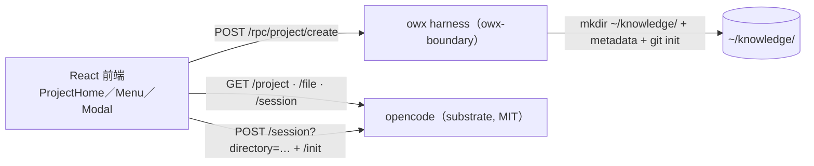

# ADR-0008：專案生命週期由 owx harness 擁有（`~/knowledge` 為文件專案根）

- **Status**：Accepted
- **Date**：2026-10-19
- **Deciders**：Daniel（專案負責人）

## Context

owx 為**文件優先**環境，需要一個「**文件專案**」的一級概念：使用者能建立、開啟、關閉專案，並以專案為單位瀏覽文件（Explorer／Outline／Preview，見 [`ADR-0007`](ADR-0007-document-first-ide-layout.md)）。

迭代中實測確認 **opencode 沒有任何「建立專案／目錄」的 API**：

- `POST /project` **不存在**（未匹配路由 → 回 SPA catch-all HTML；`GET /doc` 只有 `GET /project`）。
- `POST /project/git/init` 存在，但**不會建立目錄**（對不存在路徑呼叫後目錄仍不存在）。
- 載體 `owx-proxy` 於鎖定模式甚至**攔截** `POST /project`（回 403），佐證「新增專案」屬 opencode 之寫入面。
- owx harness sidecar（`owx-boundary`，loopback）原本亦無專案 RPC。

因此「新增專案」**無既有後端可用**，須由 owx 自有邊界提供。

## Decision

**專案生命週期歸 owx harness 擁有**，`~/knowledge` 為**文件專案根**：

- **建立**：harness 新增 loopback RPC **`POST /rpc/project/create`**（body `{ name, slug, tags[] }`）：
  - 於 `OWX_KNOWLEDGE_DIR`（預設 `~/knowledge`）建立 `<slug>/`；
  - 寫中繼資料 `.owx-project.json`（`{ id, name, slug, tags, created }`，`id`＝系統生成專案編號，`created`＝epoch ms）；
  - 執行 `git init`（best-effort）；
  - 回傳 `{ id, name, slug, tags, created, worktree }`；錯誤：`400 invalid_slug`、`409 already_exists`。
  - 契約見 [`interfaces.md`](../design/interfaces.md) §2.5。
- **前端**（[`frontend.md`](../design/frontend.md)）：
  - Explorer 標頭顯示當前專案名，右側「⋯」`ProjectMenu`：**開啟／新增／關閉專案**。
  - **關閉專案 → 全頁專案入口 `ProjectHome`**（無側欄／chat）：卡片網格列出 `GET /project` 之所有專案，點卡片開啟。
  - **新增專案 → `NewProjectModal`**（名稱／文件英文名／標籤），成功後**開啟該專案並執行 opencode `/init`**。
- opencode **未被擴充**（NFR-3）：建立能力在 **owx 邊界**（harness）內，opencode 仍只作為 substrate。

## Consequences

**正面**
- 取得 opencode 沒有的**專案建立**能力，且落在 owx 自有邊界（授權潔淨、不擴充 substrate）。
- 文件專案有**單一根**（`~/knowledge`）與**中繼資料**，利於治理、稽核與未來 GraphRAG。
- 前端有明確的「無專案」狀態（全頁入口），對齊文件優先定位。

**負面 / 成本**
- 新增一條常駐邊界契約（前端 → sidecar），需契約測試與版本策略。
- harness 需被重啟以載入新 RPC；多一個監督面。

**風險與緩解**
- **公開暴露**：`/rpc` 經前端（公開網域）可達 → 上線前須加 **bearer／存取控制**（`AGENTS.md` §10 go-live；介面 §2.5 註記）。
- `slug` 穿越風險 → 以 `^[a-z0-9][a-z0-9-]*$`（≤64）驗證並限制於 `OWX_KNOWLEDGE_DIR` 之下。
- `git` 不可用 → `git init` best-effort，不阻斷建立。

## Alternatives

| 方案 | 為何否決 |
|---|---|
| 用 opencode `POST /project` | 1.18.x **不存在**（SPA catch-all）；載體鎖定模式還攔它 |
| 用 `POST /project/git/init` 建立 | **不建目錄**，無法產生新專案 |
| 前端直接建立目錄 | 瀏覽器無檔案系統寫入權 |
| 併入載體（opencode-web proxy） | 屬另一 repo；owx 邊界已存在（[`ADR-0004`](ADR-0004-harness-opencode-boundary.md)）且更適合 |

## Refs

- `AGENTS.md` §2 §3 §10
- [`ADR-0002`](ADR-0002-iterative-spiral-workflow.md)、[`ADR-0004`](ADR-0004-harness-opencode-boundary.md)、[`ADR-0007`](ADR-0007-document-first-ide-layout.md)
- [`../design/interfaces.md`](../design/interfaces.md) §2.5、[`../design/frontend.md`](../design/frontend.md) §2
- `docs/spec/base-core-requirements.md` FR-H-16／FR-H-17
