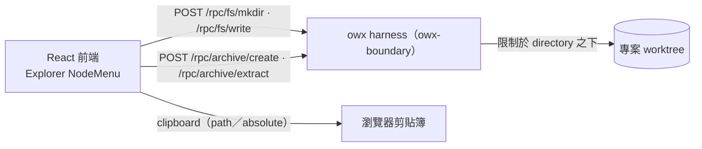

# ADR-0009：檔案樹節點操作（建立／複製／封裝）由 owx harness 提供

- **Status**：Accepted
- **Date**：2026-10-19
- **Deciders**：Daniel（專案負責人）

## Context

文件優先 IDE 的 Explorer（[`ADR-0007`](ADR-0007-document-first-ide-layout.md)）需要對**專案檔案**做**寫入與封裝**：

- 於目錄下**建立資料夾／文檔**；
- **複製**節點的相對／絕對路徑；
- 對目錄或檔案**打包**（壓縮）與對壓縮檔**解封裝**。

但 substrate **opencode 只提供讀取面**（`GET /file` 目錄列舉、`GET /file/content` 讀檔、`GET /find/*`），**無檔案寫入、無封裝 API**（同 [`ADR-0008`](ADR-0008-project-lifecycle-owned-by-owx-harness.md) 的「建立專案」缺口）。前端（瀏覽器）亦無檔案系統存取權。因此**寫入與封裝須由 owx 自有邊界（harness）提供**。

## Decision

harness（`owx-boundary`，loopback sidecar）新增 **fs 與 archive 管理 RPC**：

| RPC | 用途 |
|---|---|
| `POST /rpc/fs/mkdir` | 建立資料夾 |
| `POST /rpc/fs/write` | 建立／寫入文檔 |
| `POST /rpc/fs/rename` | 重新命名（同層、不覆蓋） |
| `POST /rpc/fs/copy` | 複製副本（遞迴、不覆蓋） |
| `POST /rpc/fs/move` | 移動／改名至其他路徑 |
| `POST /rpc/fs/delete` | 刪除（預設移至 `.owx-trash`；`trash:false` 永久刪除） |
| `GET /rpc/fs/info` | 節點資訊（型別／大小／項目數／修改時間） |
| `POST /rpc/archive/create` | 打包（zip／tar.gz／tar） |
| `POST /rpc/archive/extract` | 解封裝（依副檔名偵測） |

契約見 [`interfaces.md`](../design/interfaces.md) §2.6。

**安全邊界（強制）**：所有 `path` 皆**相對** `directory`（專案 worktree）；正規化後須落在 `directory` 之下，拒絕 `..`／絕對路徑／逃逸（回 `400 outside_worktree`）。與 [ADR-0008] 一致，寫入能力只落在 owx 邊界，opencode 不擴充（NFR-3）。

**前端**：Explorer 樹節點 **hover 後按右鍵（contextmenu）** 顯示 `NodeMenu`；**複製相對／絕對路徑為純前端**（clipboard，取節點的 `path`／`absolute`）；建立／解封裝以輸入／對話框；打包以格式選擇。**資源上限**：上傳／封裝預設 **50MB**（系統參數，env `OWX_MAX_UPLOAD_BYTES` 可調）。

**格式**：打包預設 `zip`，另支援 `tar.gz`／`tar`；解封裝依副檔名偵測（`.zip`／`.tar.gz`／`.tgz`／`.tar`）。

## Consequences

**正面**
- 取得 opencode 沒有的**寫入與封裝**能力，落於自有邊界（授權潔淨、不擴充 substrate）。
- 文件專案可**就地開發**（新增資料夾／文檔）與**交換**（打包／解包）。

**負面 / 成本**
- 新增 4 條 RPC 與契約／整合測試。
- **寫入為高風險面**：需嚴格路徑邊界，且上線前須授權（見風險）。

**風險與緩解**
- **路徑逃逸** → `path` 正規化 + `directory` 前綴檢查；拒絕 `..`／絕對路徑。
- **壓縮炸彈 / 資源耗盡** → 限制解壓後大小與檔案數（門檻待決）。
- **打包耗時 / 過大** → 設定大小上限與逾時（待決）。
- **公開暴露** → `/rpc` 經前端可達；上線前加 bearer／存取控制（`AGENTS.md` §10 go-live）。

## Alternatives

| 方案 | 為何否決 |
|---|---|
| 用 opencode 寫入 API | 1.18.x **無**寫入／封裝端點（僅讀取面） |
| 前端直接寫檔 | 瀏覽器無檔案系統存取 |
| 併入載體 proxy | 屬另一 repo；owx 邊界已存在（[`ADR-0004`](ADR-0004-harness-opencode-boundary.md)）且更適合 |

## Refs

- `AGENTS.md` §2 §3 §10
- [`ADR-0004`](ADR-0004-harness-opencode-boundary.md)、[`ADR-0007`](ADR-0007-document-first-ide-layout.md)、[`ADR-0008`](ADR-0008-project-lifecycle-owned-by-owx-harness.md)
- [`../design/interfaces.md`](../design/interfaces.md) §2.6、[`../design/frontend.md`](../design/frontend.md) §2
- `docs/spec/base-core-requirements.md` FR-H-18／FR-H-19
