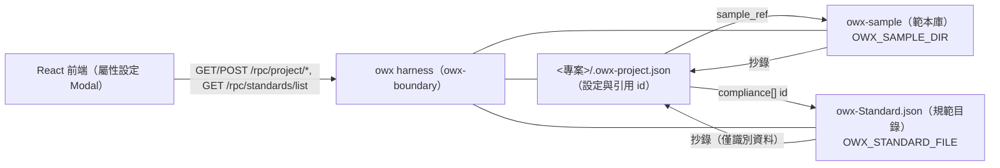

# ADR-0011：專案屬性、中繼資料 schema 與外部範本／規範庫（`owx-sample`／`owx-Standard.json`）

- **Status**：Accepted（2026-10-20 實作完成）
- **Date**：2026-10-20
- **Deciders**：Daniel（專案負責人）

## Context

[`ADR-0008`](ADR-0008-project-lifecycle-owned-by-owx-harness.md) 已定案：專案生命週期歸 owx harness 擁有，`~/knowledge` 為文件專案根，建立經 `POST /rpc/project/create` 並寫 `.owx-project.json`（`{ id, name, slug, tags, created }`）。

迭代需求（[`project-properties-requirements.md`](../spec/project-properties-requirements.md)）新增「**專案屬性設定**」：以 modal（四 tabs）編輯專案屬性、基礎目錄、文件撰寫規範（含**依循規範**）與參數。這帶來三個**跨專案的共用資料**問題：

1. **基礎目錄範本**（依專案屬性建議的目錄骨架）不應複製進每個專案的中繼資料，而應為**共用可維護的範本**。
2. **文件撰寫規範**需可**依循外部標準**（國際安全規範為必要；另如 SRS 參考規範、ESG `ISO 14067`、公司治理…）——這是一份**標準清單**，需集中管理、可增修而不改碼。
3. **標準受著作權保護**——只能收錄**識別資料**（名稱／編號／發行機構），**不得複製原文**。

同時新增需求要求「範本保存到 `owx-sample`」「標準放在 `owx-Standard.json`」「從專案裡選擇後抄錄」。

## Decision

採**三層資料分離**，並以 `ADR-0011` 固化：

1. **專案中繼資料**——`<專案>/.owx-project.json`：僅存**設定與選擇（引用 id）**，**加法擴充**（`name_en`／`properties[]`／`base_dirs`／`writing_standard`／`params`），向後相容（未知欄位忽略）。
   - `properties` 以**陣列**表示（支援**分組多選**；Phase 1 單選，資料形狀不相容變化）。
   - `writing_standard.compliance[]` 存**標準 id**（引用，非內文）。
2. **範本庫**——`OWX_SAMPLE_DIR`（預設 `owx-sample`）：`base-dirs/*.json`、`doc-templates/*.md`、`standards/*.md`（抄錄用引導範本）。
3. **規範目錄**——`OWX_STANDARD_FILE`（`owx-Standard.json`）：**標準清單，僅識別資料**（`id`／`name`／`title`／`issuer`／`year`／`required`／`license`／**`acquisition`（收錄形式：`full`／`summary`／`byo`）**／`full_text_allowed`／`source_url`／`summary`），依**分類**組織。
   - **repo 種子**：本 repo 之 `owx-sample/`（[`owx-Standard.json`](../../owx-sample/owx-Standard.json) ＋ `standards/<id>.md`——**每項標準一份**，由 [`scripts/gen-standards.mjs`](../../scripts/gen-standards.mjs) 產生），部署時複製至 `OWX_SAMPLE_DIR`／`OWX_STANDARD_FILE`。
   - **現況**：受限（`restricted`）／付費（`proprietary`）標準以 `acquisition: summary` 佔位（**不錄原文**）；`public-domain`／`open` 者 `full_text_allowed: true`，待取得後可轉 `full`。

**同步新增 harness 管理 RPC**（契約落於 [`interfaces.md`](../design/interfaces.md)）：
- `GET /rpc/project/get?directory=<abs>`、`POST /rpc/project/update`（[`interfaces.md`](../design/interfaces.md) §2.5 相鄰條目；定案後補）。
- `GET /rpc/standards/list`（讀取 `owx-Standard.json`）。

**抄錄（copy-in）**：選定範本／規範於**儲存後**由 harness 冪等寫入專案（預設 `<專案>/standards/<id>.md`），**僅識別資料＋引導範本，不含標準原文**。

**授權邊界**：標準名稱／編號屬事實性識別資料，可收錄；**嚴禁**複製標準條文（NFR-22）。opencode **未被擴充**（NFR-3）。

## Consequences

**正面**
- **單一來源**：範本與標準集中管理，新增標準**只改資料檔、不改碼**（NFR-16）。
- **輕量中繼資料**：專案只存引用，易 diff／審核／版控；利於未來 GraphRAG／治理。
- **授權潔淨**：只索引標準識別資料，**不複製原文**（NFR-22）。
- **前向相容**：`properties` 用陣列，Phase 1 單選未來可平滑轉多選。

**負面 / 成本**
- 新增兩個外部資料位置（範本庫／規範目錄）與其環境變數，多一個監督面。
- 新增讀取／更新／規範清單 RPC，需契約測試與版本策略。

**風險與緩解**
- **公開暴露**：`/rpc/*` 經前端（公開網域）可達 → 上線前加 bearer／存取控制（[`AGENTS.md`](../../AGENTS.md) §10 go-live）。
- **標準清單時效**：標準改版頻繁 → 目錄標 `updated` 與 `year`，由人工週期性校訂（列入缺口）。
- **路徑未定**：`owx-sample`／`owx-Standard.json` 實體路徑待確認（D-PPS-16）；範本庫若置於 `~/knowledge` 之下須以 `.` 前綴避免被列為專案。
- **抄錄落點**：預設 `<專案>/standards/`，待確認（D-PPS-17）。

## Alternatives

| 方案 | 為何否決 |
|---|---|
| 範本／規範全塞進每個 `.owx-project.json` | 複製膨脹、難維護、標準原文有授權風險 |
| 標準清單**硬編碼**於前端／後端 | 新增標準即改碼，違反 NFR-16 與可維護性 |
| 直接**內嵌標準原文**於目錄 | 侵犯發行機構著作權（NFR-22） |
| 以 **opencode** 承載屬性／規範 | opencode 為 substrate、無此 API 且不得擴充（NFR-3、[`ADR-0004`](ADR-0004-harness-opencode-boundary.md)） |
| 屬性維持**單選**（不支援分組多選） | 使用者已確認需分組多選；陣列模型可兼顧 |

## Refs

- `AGENTS.md` §2 §3 §5.3 §10
- [`project-properties-requirements.md`](../spec/project-properties-requirements.md)（FR-H-33～55、附錄 A）
- [`ADR-0008`](ADR-0008-project-lifecycle-owned-by-owx-harness.md)、[`ADR-0004`](ADR-0004-harness-opencode-boundary.md)
- [`../design/interfaces.md`](../design/interfaces.md) §2.5、§2.9、[`../design/frontend.md`](../design/frontend.md) §2.9／§2.10／§2.13
- `docs/spec/base-core-requirements.md` FR-H-16／FR-H-17
