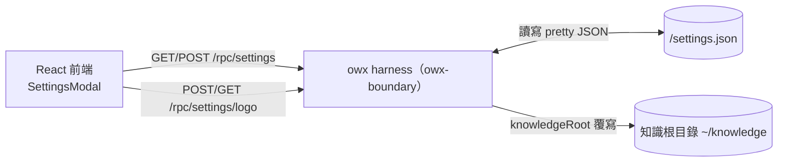

# ADR-0012：設定（settings）由 owx harness 擁有並持久化於 config dir

- **Status**：Accepted
- **Date**：2026-10-20
- **Deciders**：Daniel（專案負責人）

## Context

owx 需要一組**系統／UI 設定**：全域（系統名稱、知識根目錄、Logo、品牌主色、預設 provider／model／agent）與個人（主題：深／淺／隨系統）。設定 modal 開啟時載入、儲存後生效（FR-H-27／FR-H-28）。問題是：**這些設定該存哪、由誰擁有？**

候選：
1. **owx harness**（`owx-boundary` sidecar）寫入 `<config_dir>/settings.json`；
2. 前端 **localStorage**；
3. 寫入 substrate **opencode** 的設定目錄（`~/.config/opencode/`）。

既有限制：
- **FR-F-3 五根隔離**（data／config／state／tmp／cache）已為 harness 概念；`config` 根即設定歸屬地。
- **AGENTS §3**：opencode 以**包裝／外掛**使用，**不擴充 substrate 行為**（不改其原始碼、不寄生其設定）。
- **NFR-3**（不擴充 substrate）、**NFR-1**（可交付）與既有 harness RPC 模式（[`ADR-0008`](ADR-0008-project-lifecycle-owned-by-owx-harness.md)、[`ADR-0009`](ADR-0009-filetree-node-operations-via-harness.md)、[`ADR-0010`](ADR-0010-document-lifecycle-via-harness.md)）皆指向由 owx 邊界提供管理面能力。

## Decision

**owx 設定由 owx harness 擁有**，持久化為 **`<config_dir>/settings.json`**（pretty JSON，camelCase）。`config_dir` 解析序：`OWX_CONFIG_DIR` → `$XDG_CONFIG_HOME/owx` → `$HOME/.config/owx`。

- 型別與存取落於 **`owx-config`**（`Settings`／`GlobalSettings`／`PersonalSettings`／`Theme`、`load`／`save`／`validate`、`config_dir`）。
- 契約端點（[`interfaces.md`](../design/interfaces.md) §2.8）：

| RPC | 用途 |
|---|---|
| `GET /rpc/settings` | 讀取設定（缺失／損毀回預設值） |
| `POST /rpc/settings` | 驗證並寫入設定（`accent` 須 `^#[0-9a-fA-F]{6}$`） |
| `POST /rpc/settings/logo` | 上傳 Logo（base64，≤2MB，存 config dir） |
| `GET /rpc/settings/logo` | 讀取當前 Logo bytes |

- **未知鍵刻意忽略**（不 `deny_unknown_fields`）：設定檔須**向前相容**，舊版程式讀到新版寫入的額外欄位不應失敗（與 FR-F-1 之「未知鍵硬失敗」**刻意不同**：FR-F-1 為 opencode 分層設定之嚴格契約，本處為 owx 自有 UI 設定之演化容忍）。
- **知識根目錄**：`global.knowledgeRoot` 覆寫 `OWX_KNOWLEDGE_DIR`（預設 `~/knowledge`），供 `GET /rpc/knowledge/list` 與 `POST /rpc/project/create`。

## Consequences

**正面**
- 設定落於**自有邊界**（授權潔淨、不擴充 substrate；NFR-1／NFR-3）。
- **可測試**：`owx-config` 純函式 + 臨時目錄單元測試；boundary handler 測試。
- **跨瀏覽器／跨裝置一致**：非綁單一瀏覽器 profile。
- 與既有 harness 管理 RPC 模式一致（[`ADR-0008`](ADR-0008-project-lifecycle-owned-by-owx-harness.md)）。
- 對齊 FR-F-3 之 **config 根**語意。

**負面 / 成本**
- 新增 4 條 RPC 與契約／整合測試。
- 個人偏好（如主題）存於伺服器端，於**單人多裝置**情境尚可；真正**多使用者**隔離需待登入／profile 分離（FR-F-4）。

**風險與緩解**
- **設定檔損毀** → `load` 對缺失／無法解析一律回**預設值**（永不 panic）；寫入為覆寫整檔（前端送完整狀態）。
- **Logo 資源濫用** → 限 2MB、限副檔名（png／jpg／jpeg／svg／webp）。
- **公開暴露** → `/rpc` 經前端可達；上線前須加 bearer／存取控制（`AGENTS.md` §10 go-live）。

## 附錄：模型目錄來源與 Provider 連線（FR-H-31／FR-H-32，2026-10-20）

**模型下載清單（FR-H-31）**：由 **harness `GET /rpc/models`** 提供，**讀取 opencode 就其預設 registry URL 維護的快取**（`OPENCODE_MODELS_URL`，預設 `https://models.opencode.ai`；檔案解析序 `OPENCODE_MODELS_PATH` → `$XDG_CACHE_HOME/opencode/models.json` → `$HOME/.cache/opencode/models.json`）。

**為何讀快取而非由 harness 直抓 URL**：Rust 端直抓 `https://…` 需引入 TLS 後端，而本專案 **授權閘門（`scripts/license-check.mjs`）禁止 MPL-2.0／OpenSSL 類授權**（如 `webpki-roots`），且 `aws-lc-rs`／`ring` 會帶來重型 C 建置；opencode 已由其預設 URL 定期（TTL 5 分）維護該快取，內容等價、離線可用、可測。若日後需即時抓取，另議 TLS 後端（並補授權對映）。

**Provider 連線（FR-H-32；等同 opencode `/connect`）**：走 **substrate opencode API**（`PUT /auth/{id}` `{type:"api",key}`、`DELETE /auth/{id}`、`GET /provider`、`PATCH /global/config` 寫 `provider.<id>.options.baseURL`）。**owx 不自行保存 provider 憑證**——憑證歸 opencode `auth.json`（符合 FR-F-5「真 token 只存 auth.json」）；`base_url` 屬 opencode 全域設定，經 `PATCH /global/config` 寫入（深合併，不動 `opencode.json`）。

## Alternatives

| 方案 | 為何否決 |
|---|---|
| 前端 **localStorage** | 不符「在系統 `.config` 保存」；換瀏覽器／裝置不共享；與 server 狀態不同步 |
| 寫入 **opencode 設定目錄**（`~/.config/opencode/`） | 違反 AGENTS §3「不擴充 substrate」：owx 設定不應寄生 substrate 設定；語意與生命週期不屬 opencode |
| 併入載體 proxy | 屬另一 repo；owx 邊界已存在（[`ADR-0004`](ADR-0004-harness-opencode-boundary.md)）且更適合 |

## Refs

- `AGENTS.md` §2 §3 §10
- [`ADR-0004`](ADR-0004-harness-opencode-boundary.md)、[`ADR-0008`](ADR-0008-project-lifecycle-owned-by-owx-harness.md)、[`ADR-0009`](ADR-0009-filetree-node-operations-via-harness.md)、[`ADR-0010`](ADR-0010-document-lifecycle-via-harness.md)
- [`../design/interfaces.md`](../design/interfaces.md) §2.8、[`../design/frontend.md`](../design/frontend.md) §2.7
- `docs/spec/base-core-requirements.md` FR-H-27／FR-H-28、FR-H-31／FR-H-32、FR-F-1／FR-F-3／FR-F-4／FR-F-5
