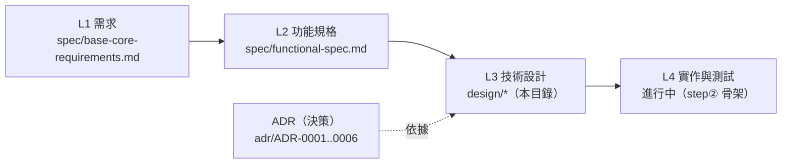

# owx L3 設計文件索引（docs/design）

> 版本：v0.2　|　日期：2026-10-17　|　狀態：Draft
> 來源：彙整自 [`../spec/`](../spec/)、[`../adr/`](../adr/) 與 [`../standards/document-standards.md`](../standards/document-standards.md) §4.4。

## 0. 定位與關聯

- **本檔是**：owx **L3 技術設計**文件的索引與導覽。
- **本檔不是**：需求（屬 [`../spec/`](../spec/)）、決策記錄（屬 [`../adr/`](../adr/)）或實作。
- 各設計文件遵循 [`document-standards.md`](../standards/document-standards.md) §4.4。

## 1. 分層關係

## 2. 文件清單

| 文件 | 內容 | 主要依據 |
|---|---|---|
| [harness-architecture.md](harness-architecture.md) | 分層與邊界拓撲、Rust crate 分解、執行期資料流、風險與緩解 | ADR-0004、NFR-3、FR-A／C／E |
| [interfaces.md](interfaces.md) | 邊界契約（hook RPC／MCP tools／opencode API）、內部 Rust 介面、錯誤模型 | ADR-0004、FR-G、FR-A |
| [data-and-state.md](data-and-state.md) | 資料模型（ER）、狀態機（session／委派／fallback） | FR-D、FR-A、FR-C、FR-E |
| [frontend.md](frontend.md) | React 前端：畫面、元件樹、狀態、SSE、iframe、a11y | FR-H、FR-CARRIER |
| [testing.md](testing.md) | 測試策略、FR→TC 全對映（157）、覆蓋率、TDD、clean-room 掃描、CI | AGENTS.md §5.5、coding／document／licensing |

## 3. 建議閱讀順序

1. [harness-architecture.md](harness-architecture.md)（先懂邊界與分解）
2. [interfaces.md](interfaces.md)（契約）
3. [data-and-state.md](data-and-state.md)（資料與生命週期）
4. [frontend.md](frontend.md)（UI）
5. [testing.md](testing.md)（如何驗證）

## 4. 上游與決策連結

- 需求（L1）：[`../spec/base-core-requirements.md`](../spec/base-core-requirements.md)
- 功能（L2）：[`../spec/functional-spec.md`](../spec/functional-spec.md)
- 決策（ADR）：[`ADR-0001`](../adr/ADR-0001-substrate-opencode-cleanroom-omo.md)、[`ADR-0002`](../adr/ADR-0002-iterative-spiral-workflow.md)、[`ADR-0003`](../adr/ADR-0003-harness-rust-core-react-frontend.md)、[`ADR-0004`](../adr/ADR-0004-harness-opencode-boundary.md)、[`ADR-0005`](../adr/ADR-0005-model-chain-injection-path.md)、[`ADR-0006`](../adr/ADR-0006-module-interface-mcp-https.md)
- 規範：[document-standards](../standards/document-standards.md)、[coding-standards](../standards/coding-standards.md)、[licensing](../standards/governance/licensing.md)

## 5. 缺口與待決

- **D2–D5 已定案**（[`AGENTS.md`](../../AGENTS.md) §9）：只 md；標準本體屬外掛；外掛介面＝MCP/HTTPS 且**先不實作**（[`ADR-0006`](../adr/ADR-0006-module-interface-mcp-https.md)）；可交付清單以 `scripts/sbom.mjs` 產出。
- **模型注入**已定案（[`ADR-0005`](../adr/ADR-0005-model-chain-injection-path.md)，Accepted）。
- 各設計文件內的「缺口與待決」節為權威。

## 6. 變更紀錄

| 日期 | 版本 | 變更 |
|---|---|---|
| 2026-10-17 | v0.2 | 對齊 ADR-0005/0006 與實作：L4 狀態改「進行中（step② 骨架）」；ADR 清單補 0005/0006；D2–D5 標為已定案。 |
| 2026-10-17 | v0.1 | 初版：L3 設計索引（harness-architecture／interfaces／data-and-state／frontend／testing）與分層導覽。 |
