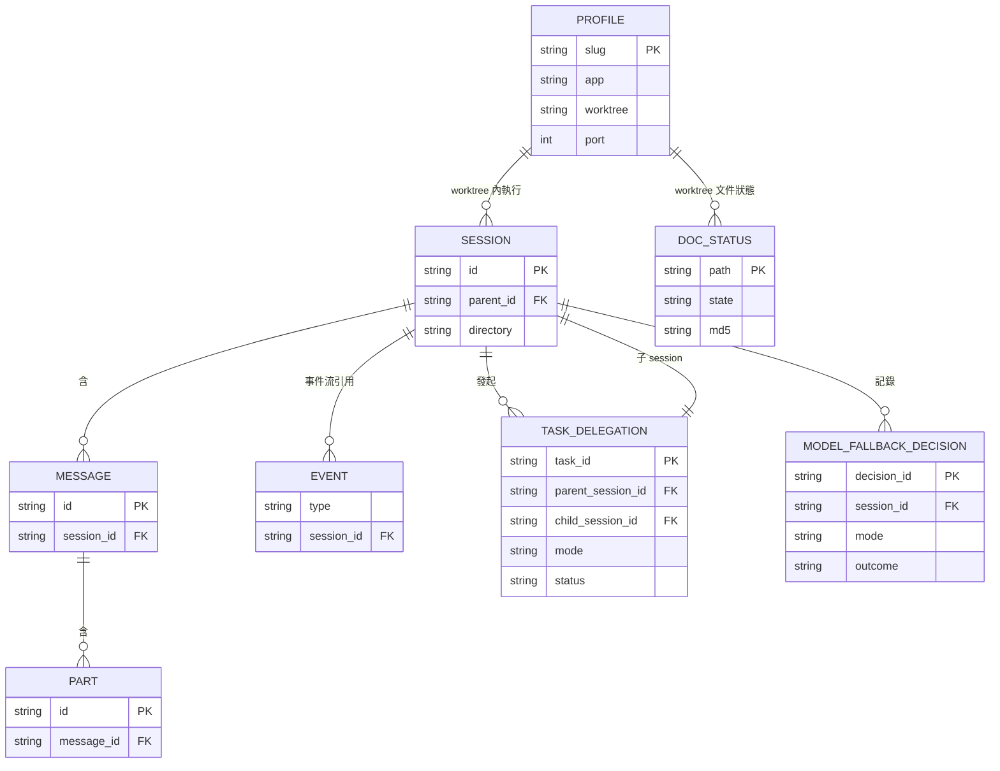
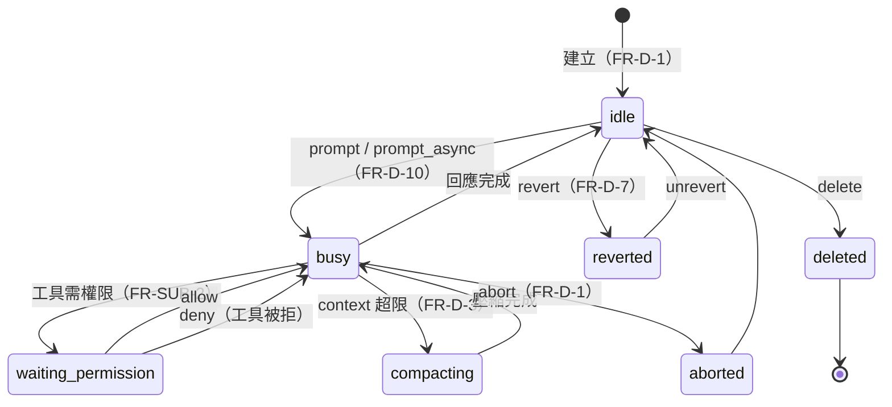
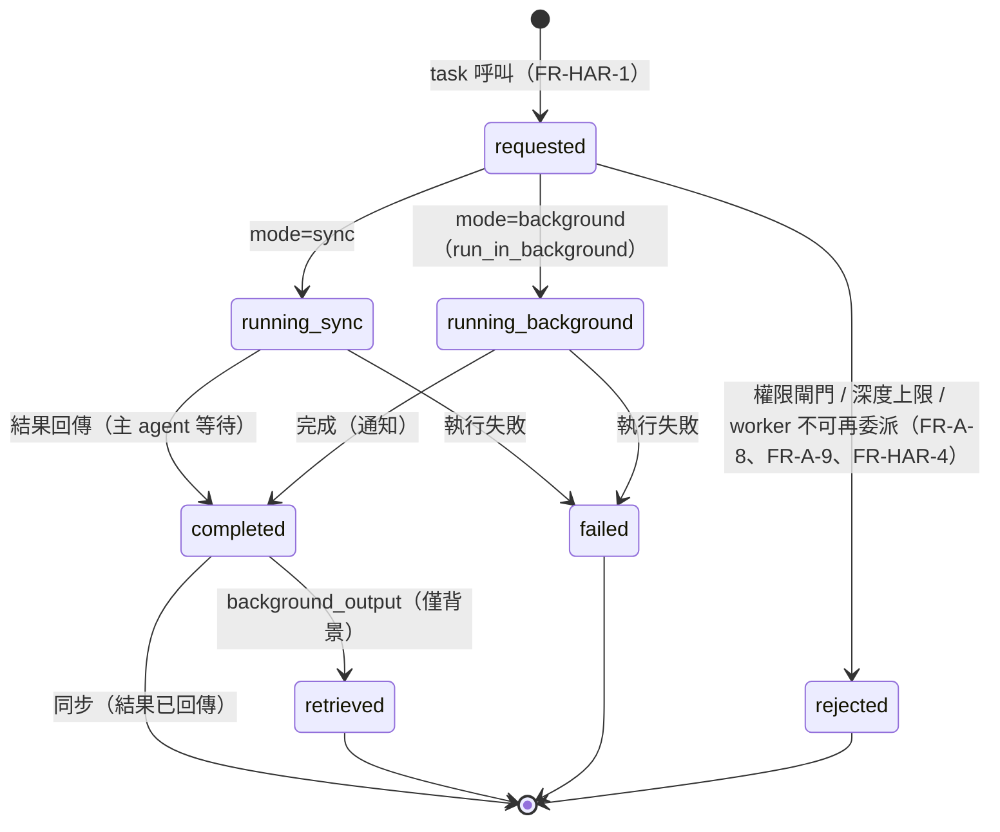
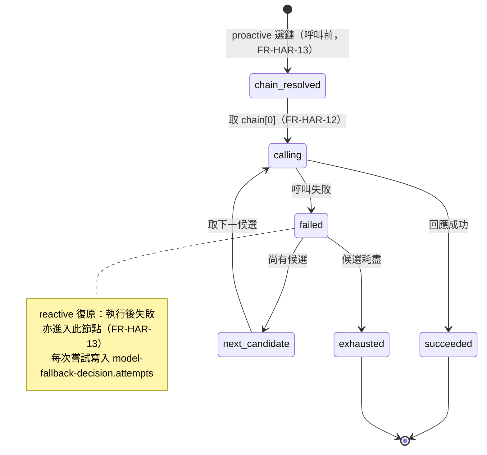
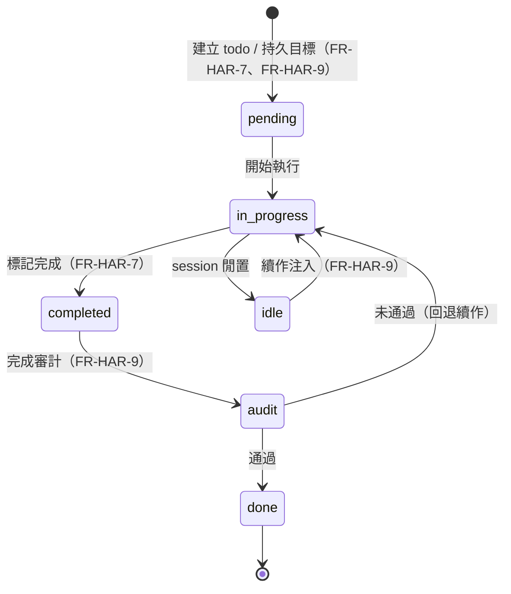
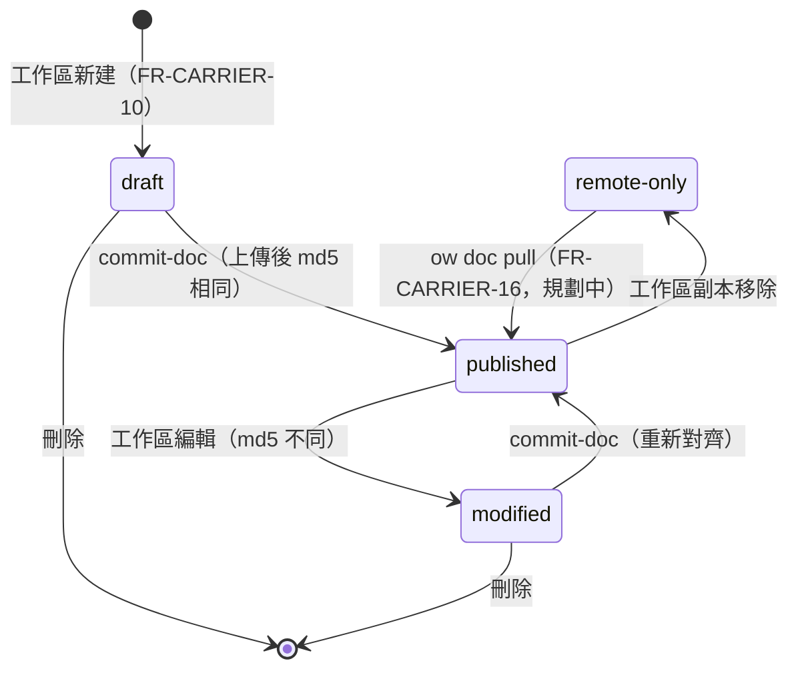

# owx L3 設計：資料模型與狀態機（data-and-state.md）

> 版本：v0.1　|　日期：2026-10-17　|　狀態：Draft
> 來源：整合自 [`base-core-requirements.md`](../spec/base-core-requirements.md)、[`functional-spec.md`](../spec/functional-spec.md)、[`ADR-0003`](../adr/ADR-0003-harness-rust-core-react-frontend.md)、[`document-standards.md`](../standards/document-standards.md)，以及載體 repo `opencode-web` 之規格（`docs/spec/ow-workspace-layout.md`、`docs/spec/ow-document-access.md`、`docs/mcp.md`）。

---

## 0. 定位與關聯

### 0.1 定位聲明

- **本檔是**：owx 的 **L3（詳細設計）資料模型與生命週期權威**。定義 owx 自建結構（Harness 與載體層）的完整欄位與狀態機；對 opencode 既有結構，只定義 owx 依賴的介面面，並以連結指向其權威文件。
- **本檔不是**：
  - **不是** HTTP 端點契約（路由、請求／回應、錯誤碼）→ 見 [`interfaces.md`](interfaces.md)。
  - **不是** 模組分解與元件邊界 → 見 [`harness-architecture.md`](harness-architecture.md)。
  - **不是** 需求清單 → 見 [`base-core-requirements.md`](../spec/base-core-requirements.md) 與 [`functional-spec.md`](../spec/functional-spec.md)。
  - **不是** 載體層行為規格 → 權威在 carrier repo（連結見 §0.2）。

### 0.2 文件關聯

| 文件 | 角色 | 連結 |
|---|---|---|
| `base-core-requirements.md` | 上游：core 需求（FR-A 至 FR-I、NFR-*） | [`../spec/base-core-requirements.md`](../spec/base-core-requirements.md) |
| `functional-spec.md` | 上游：整合功能規格（FR-CARRIER／SUB／HAR、TC-*） | [`../spec/functional-spec.md`](../spec/functional-spec.md) |
| `harness-architecture.md` | 同層：模組分解與邊界（本檔不重複） | [`harness-architecture.md`](harness-architecture.md) |
| `interfaces.md` | 同層：HTTP 端點契約（本檔不重複） | [`interfaces.md`](interfaces.md) |
| carrier `ow-workspace-layout.md` | 載體層權威：profile 與工作區佈局 | [`../../../opencode-web/docs/spec/ow-workspace-layout.md`](../../../opencode-web/docs/spec/ow-workspace-layout.md) |
| carrier `ow-document-access.md` | 載體層權威：文件存取與 doc-status | [`../../../opencode-web/docs/spec/ow-document-access.md`](../../../opencode-web/docs/spec/ow-document-access.md) |
| carrier `mcp.md` | 載體層權威：MCP 工具契約 | [`../../../opencode-web/docs/mcp.md`](../../../opencode-web/docs/mcp.md) |

### 0.3 授權狀態

| 元件 | 授權 | 在本檔的角色 | 處置 |
|---|---|---|---|
| **opencode** | **MIT** | Substrate；session／message／part／event 結構來源 | 可重用／改／散布；本檔連結指向，不重抄 |
| **owx 自有程式** | **Proprietary** | Harness 與載體層；task-delegation／model-fallback-decision／profile／doc-status | 自有；本檔完整定義 |
| **opencode-web（ow）** | **自有（Proprietary）** | 載體層來源 | 可自由改 |
| **CodeGraph** | **MIT（非自有）** | 未來 code 圖模組（本檔未展開） | 可用；標註非自有 |
| **omo（oh-my-openagent）** | **SUL-1.0** | **需求來源，非程式碼來源** | 不進交付物；僅黑箱回溯 |

> 紅線與 PR 閘門見 [`licensing.md`](../standards/governance/licensing.md) §4、§5。

---

## 1. 範圍與所有權原則

### 1.1 IN / OUT

| 面向 | 內容 |
|---|---|
| **IN** | 八個核心實體的欄位定義（session／message／part／event／task-delegation／model-fallback-decision／profile／doc-status）；五組狀態機（session／delegation／model fallback／task-continuation／doc-status）；所有權與單一來源對映 |
| **OUT** | HTTP 端點契約（`interfaces.md`）；模組分解（`harness-architecture.md`）；載體層行為細節（carrier repo）；外掛模組（KAC／CodeGraph／Doc-Edit／Standards）內部資料模型 |

### 1.2 兩類結構

| 類別 | 結構 | 處置 |
|---|---|---|
| **opencode 既有**（Substrate，MIT） | session／message／part／event | 以連結指向 [opencode 官方文件](https://opencode.ai/docs)；本檔僅列 owx 依賴的介面面，**不重抄**完整 schema；owx 不擴充其結構（NFR-3） |
| **owx 自建**（自有） | task-delegation／model-fallback-decision（Harness）；profile／doc-status（載體層） | **完整定義**欄位與狀態機；行為權威在 carrier repo 者以連結標明 |

> 原則：**授權邊界即架構邊界**（[`AGENTS.md`](../../AGENTS.md) §3）。opencode 既有結構的權威在 opencode；owx 自建結構的權威在本檔（或 carrier repo）。

---

## 2. 資料模型

### 2.0 ER 總覽

下圖為八個實體的關聯總覽。opencode 既有實體僅列識別鍵與關聯鍵（完整 schema 連結指向）；owx 自建實體列關鍵欄位（完整欄位見各節表格）。

圖說：`PROFILE` 為載體層的隔離單位，session 在其 worktree 內執行；`TASK_DELEGATION` 一對一連結子 session；`MODEL_FALLBACK_DECISION` 與 `DOC_STATUS` 為 owx 自建的觀測／狀態結構。

### 2.1 session（opencode 既有）

> **歸屬**：**opencode 既有（以連結指向其文件，不重抄）**。完整 schema 以 [opencode 官方文件](https://opencode.ai/docs)為準，本檔僅列 owx 依賴的介面面。**owx 自建欄位：無**（NFR-3：不擴充 substrate 結構）。

| 欄位 | 型別 | 必填 | 說明 | 歸屬 |
|---|---|---|---|---|
| `id` | string | ✅ | session 識別碼（`ses_*`） | opencode 既有 |
| `parent_id` | string | | 父 session；子 session 導覽（FR-A-10） | opencode 既有 |
| `directory` | string | ✅ | session 工作目錄；鎖定模式下由 proxy 改寫為 `OW_WORKTREE`（FR-CARRIER-7） | opencode 既有 |
| `title` | string | | 標題；可由 small_model 產生（FR-E-6） | opencode 既有 |
| `time.created` / `time.updated` | number | ✅ | 建立／更新時間 | opencode 既有 |
| `share` | object | | 分享狀態（FR-D-5） | opencode 既有 |
| `revert` | object | | revert 狀態（FR-D-7） | opencode 既有 |
| `summary` | object | | 摘要／compaction 狀態（FR-D-3） | opencode 既有 |

> owx 側關聯：session 與 profile 的關聯經 `directory`（worktree 路徑）推導，不新增欄位；slug 由 worktree basename 推導（FR-CARRIER-3）。

### 2.2 message（opencode 既有）

> **歸屬**：**opencode 既有（以連結指向其文件，不重抄）**。**owx 自建欄位：無**。

| 欄位 | 型別 | 必填 | 說明 | 歸屬 |
|---|---|---|---|---|
| `id` | string | ✅ | 訊息識別碼 | opencode 既有 |
| `session_id` | string | ✅ | 所屬 session | opencode 既有 |
| `role` | string | ✅ | `user` / `assistant` | opencode 既有 |
| `time` | object | ✅ | 建立時間 | opencode 既有 |
| `summary` / `error` | object | | 摘要與錯誤；為 FR-C-6 復原的觀察對象 | opencode 既有 |

### 2.3 part（opencode 既有）

> **歸屬**：**opencode 既有（以連結指向其文件，不重抄）**。**owx 自建欄位：無**。

| 欄位 | 型別 | 必填 | 說明 | 歸屬 |
|---|---|---|---|---|
| `id` | string | ✅ | part 識別碼 | opencode 既有 |
| `message_id` | string | ✅ | 所屬訊息 | opencode 既有 |
| `type` | string | ✅ | `text` / `tool` / `reasoning` / `file` 等；工具結果與 thinking block 為 FR-C-6 復原對象 | opencode 既有 |
| `tool` / `state` | object | | 工具呼叫與執行狀態（`type=tool` 時） | opencode 既有 |

### 2.4 event（SSE）（opencode 既有）

> **歸屬**：**opencode 既有（以連結指向其文件，不重抄）**。事件流為即時狀態來源（FR-SUB-1）；載體層只轉發，不新增自製事件。**owx 自建欄位：無**。

| 欄位 | 型別 | 必填 | 說明 | 歸屬 |
|---|---|---|---|---|
| `type` | string | ✅ | 事件類型 | opencode 既有 |
| `properties` | object | ✅ | 事件內容（含 session／message 識別） | opencode 既有 |

owx 依賴的事件類別（介面面，非完整清單）：

| 類別 | 用途 | 需求 |
|---|---|---|
| `session.*` | session 生命週期觀察 | FR-D-2、FR-SUB-1 |
| `message.*` | 訊息與 part 串流 | FR-D-2、FR-SUB-1 |
| `permission.*` | 權限請求可觀察（allow／deny） | FR-SUB-2 |

### 2.5 task-delegation（owx 自建，Harness）

> **歸屬**：**owx 自建（需完整定義）**（自有，Rust Harness）。來源需求：FR-HAR-1、FR-A-1／2／8／9、FR-HAR-4。

| 欄位 | 型別 | 必填 | 說明 |
|---|---|---|---|
| `task_id` | string | ✅ | 委派識別碼；背景委派立即回傳給主 agent（FR-HAR-1） |
| `parent_session_id` | string | ✅ | 發起委派的主 session |
| `child_session_id` | string | ✅ | 子 session；供 parent／child 導覽（FR-A-10） |
| `parent_task_id` | string | | 上層委派；巢狀時指向父委派（FR-A-8） |
| `depth` | number | ✅ | 巢狀深度（主 agent 為 0）；上限由 `subagent_depth` 控制（FR-A-8） |
| `mode` | enum(`sync` / `background`) | ✅ | 同步或背景（`run_in_background`）（FR-HAR-1） |
| `agent` | string | ✅ | 目標 sub-agent |
| `category` | string | | 領域預設；決定 model chain 與 tool policy（FR-HAR-2） |
| `skills` | string[] | | 注入的知識／工具（FR-HAR-2） |
| `status` | enum | ✅ | 見 §3.2 狀態機（`requested` / `rejected` / `running_sync` / `running_background` / `completed` / `failed` / `retrieved`） |
| `created_at` | timestamp | ✅ | 建立時間 |
| `completed_at` | timestamp | | 完成時間 |
| `result_ref` | string | | 結果取回參照；背景完成後以 `background_output` 取回（FR-HAR-1） |
| `error` | object | | 失敗或拒絕原因（權限閘門 FR-A-9、深度上限 FR-A-8、worker 不可再委派 FR-HAR-4） |

### 2.6 model-fallback-decision（owx 自建，Harness）

> **歸屬**：**owx 自建（需完整定義）**（自有，Rust Harness）。來源需求：FR-HAR-12、FR-HAR-13、FR-E-2／3。

| 欄位 | 型別 | 必填 | 說明 |
|---|---|---|---|
| `decision_id` | string | ✅ | 決策識別碼 |
| `session_id` | string | ✅ | 所屬 session |
| `message_id` | string | | 觸發的訊息（reactive 復原時） |
| `mode` | enum(`proactive` / `reactive`) | ✅ | proactive：呼叫前選鏈；reactive：執行後失敗復原（FR-HAR-13） |
| `chain` | `model_ref[]` | ✅ | 有序候選鏈（primary + fallback）（FR-HAR-12） |
| `selected` | `model_ref` | | 最終成功者 |
| `attempts` | `attempt[]` | ✅ | 每次嘗試：`{ model_ref, provider, error, at }` |
| `outcome` | enum(`succeeded` / `exhausted`) | ✅ | 結果 |
| `created_at` | timestamp | ✅ | 建立時間 |

`model_ref` 形狀：`{ provider, model, variant? }`（per-agent／per-category 指定，FR-E-4；variants 為推理強度預設，FR-E-7）。

### 2.7 profile（owx 自建，載體層）

> **歸屬**：**owx 自建（需完整定義）**（載體層，自有）。行為與檔案佈局權威在 carrier repo [`ow-workspace-layout.md`](../../../opencode-web/docs/spec/ow-workspace-layout.md) §4.2；本節定義資料形狀。來源需求：FR-CARRIER-1 至 FR-CARRIER-4。

| 欄位 | 型別 | 必填 | 說明 |
|---|---|---|---|
| `slug` | string | ✅ | 單一識別碼；目錄名／分支名／profile 名／SeaweedFS 子路徑四者同名（FR-CARRIER-3） |
| `app` | string | ✅ | app 名；工作區為 `<root>/<app>/<slug>`（FR-CARRIER-12） |
| `worktree` | string | ✅ | 工作區路徑（`~/.ow-workspace/<app>/<slug>`） |
| `port` | number | ✅ | 對外 port |
| `dataDir` / `configDir` / `stateDir` / `tmpDir` | string | ✅ | 五根隔離（cache 刻意共用）（FR-CARRIER-1） |
| `pid` | number | | 行程識別 |

> **安全不變量**：真 token **不在**本結構；只存 profile 的 `auth.json`（FR-CARRIER-3）。

### 2.8 doc-status（owx 自建，載體層）

> **歸屬**：**owx 自建（需完整定義）**（載體層，自有）。狀態判定與 wire 契約權威在 carrier repo [`ow-document-access.md`](../../../opencode-web/docs/spec/ow-document-access.md) §3.1、§9.4；端點契約見 [`interfaces.md`](interfaces.md)。本節定義資料形狀。來源需求：FR-CARRIER-10。

**entry（單檔狀態）**：

| 欄位 | 型別 | 必填 | 說明 |
|---|---|---|---|
| `path` | string | ✅ | 相對 worktree、正斜線；僅 `.docs/**` 與根 `AGENTS.md` |
| `state` | enum(`draft` / `published` / `modified` / `remote-only`) | ✅ | 四態；見 §3.5 狀態機 |
| `md5` | string | | base64；workspace-only 時為 `null` |
| `fileSize` | number | ✅ | 檔案大小 |

**envelope（聚合）**：

| 欄位 | 型別 | 必填 | 說明 |
|---|---|---|---|
| `worktree` | string | ✅ | 聚合來源工作區 |
| `generatedAt` | timestamp | ✅ | 產生時間 |
| `filerReachable` | boolean | ✅ | filer 不可達時 `false`；entries 退為 workspace-only，端點不整體失敗 |
| `entries` | `entry[]` | ✅ | 檔案狀態清單 |

---

### 2.9 project-metadata（owx 自建，Harness）

`.owx-project.json`（位於 `~/knowledge/<slug>/`）；由 `POST /rpc/project/create` 建立、`POST /rpc/project/update` 更新。

| 欄位 | 型別 | 說明 |
|---|---|---|
| `id` | string | 系統生成編號（**不可變**） |
| `name` / `name_en` | string / string? | 顯示名（中／英） |
| `slug` | string | 目錄名（**不可變**） |
| `tags` | string[] | 標籤 |
| `created` | number | epoch ms |
| `properties` | string[] | 專案屬性（相容群組；Phase 1 單選） |
| `base_dirs` | `{ sample_ref?, enabled, dirs[] }` | 基礎目錄（來源 `owx-sample`） |
| `writing_standard` | `{ versioning, require_title, require_revision, require_change_log, confidentiality_default, compliance[], submit_checks{consistency,objectivity,audit} }` | 文件撰寫規範 |
| `params` | `{ show_hidden, autosave_minutes }` | 參數（專案層） |

不變量：`id`／`slug`／`created` **不可**由 patch 變更；寫入為**原子**（暫存＋rename）；未知欄位忽略（向前相容）。

### 2.10 standards-catalog（owx 自建，`owx-Standard.json`）

規範目錄：`{ categories:[{ id, name, required?, standards:[{ id, name, title?, issuer?, year?, required?, license, full_text_allowed, acquisition, source_url? }] }] }`。**僅識別資料**（NFR-22，不得收錄標準原文）；缺檔 → `{ categories: [] }`。抄錄產物落於 `<專案>/standards/<id>.md`（僅識別資料＋引導）。

---

## 3. 狀態機

### 3.1 session lifecycle（opencode 既有）

圖說：本圖為 owx 對 opencode 可觀察生命週期的整理，權威行為以 opencode 為準；owx 以 SSE 事件觀察（FR-SUB-1），不改變此狀態機。FR-C-6 的常見失敗復原（缺工具結果、thinking block 不匹配、空訊息、context 超限、JSON 解析錯誤）由 Harness 透明介入，對外不新增狀態。

### 3.2 delegation（sync vs background）（owx 自建）

圖說：`status` 欄位對應本圖狀態。同步委派在 `completed` 即終止（結果已回傳）；背景委派需經 `retrieved`（`background_output` 取回）才終止。`rejected` 為閘門拒絕（FR-A-8／9、FR-HAR-4），不建立子 session。

### 3.3 model fallback（proactive vs reactive）（owx 自建）

圖說：proactive 在呼叫前決定鏈（`chain_resolved`）；reactive 在執行後失敗時進入同一重試迴圈（`failed`）。每次嘗試皆記錄於 `model-fallback-decision`（§2.6），供 NFR-4 可觀測。

### 3.4 task / continuation state（owx 自建）

圖說：`idle` 為任務層閒置（session 閒置時觸發續作注入，FR-HAR-9）；`audit` 為完成審計，未通過則回退 `in_progress`。已驗證進度跨 session 保存（FR-HAR-10），故本狀態機不隨 session 結束而重置。

### 3.5 doc-status lifecycle（owx 自建，載體層）

圖說：四態由 md5 比對即時判定（非持久狀態，FR-CARRIER-10）；本圖描述語意上的轉換。`remote-only` 至 `published` 的轉換依賴 `ow doc pull`，目前尚未實作（FR-CARRIER-16）。

---

## 4. 所有權與單一來源

### 4.1 結構所有權

| 結構 | 擁有者 | 授權 | 權威來源 | 本檔角色 |
|---|---|---|---|---|
| session／message／part／event | opencode（Substrate） | MIT | [opencode 官方文件](https://opencode.ai/docs) | 僅列依賴介面面；連結指向，不重抄 |
| task-delegation | owx Harness | 自有 | 本檔 §2.5 | 完整定義 |
| model-fallback-decision | owx Harness | 自有 | 本檔 §2.6 | 完整定義 |
| profile | owx 載體層 | 自有 | carrier `ow-workspace-layout.md` §4.2 | 定義資料形狀；行為連結指向 |
| doc-status | owx 載體層 | 自有 | carrier `ow-document-access.md` §3.1、§9.4 | 定義資料形狀；wire 契約見 `interfaces.md` |

### 4.2 追溯表（FR / TC）

| 結構或狀態機 | 需求 | 測試 |
|---|---|---|
| session／message／part／event | FR-D-1 至 FR-D-3、FR-SUB-1、FR-SUB-2 | `TC-SUB-1`、`TC-SUB-2` |
| task-delegation（§2.5、§3.2） | FR-HAR-1、FR-A-1／2／8／9、FR-HAR-4 | `TC-HAR-1`、`TC-HAR-4` |
| model-fallback-decision（§2.6、§3.3） | FR-HAR-12、FR-HAR-13、FR-E-2／3 | `TC-HAR-12`、`TC-HAR-13` |
| profile（§2.7） | FR-CARRIER-1 至 FR-CARRIER-4 | `TC-CARRIER-1` 至 `TC-CARRIER-4` |
| doc-status（§2.8、§3.5） | FR-CARRIER-10、FR-CARRIER-16 | `TC-CARRIER-10`、`TC-CARRIER-16` |
| task／continuation（§3.4） | FR-HAR-7、FR-HAR-9、FR-HAR-10 | `TC-HAR-7`、`TC-HAR-9`、`TC-HAR-10` |

---

## 5. 缺口與待決

1. **Harness 尚未有程式碼**：task-delegation 與 model-fallback-decision 為 clean-room 設計；實作與測試待迭代螺旋後續輪次產出（承接 [`functional-spec.md`](../spec/functional-spec.md) §8.2）。
2. **opencode v2 差異**：session／event 結構以 v1 文件為準；v2 差異（無 session 分享、embedded SDK、background subagents）待迭代確認後回寫本檔。
3. **`ow doc pull` 尚未實作**（FR-CARRIER-16）：`remote-only` 至 `published` 轉換目前不可達，待實作後驗證。
4. **Team Mode 資料模型未展開**：共享信箱／共享任務清單／per-member worktree（FR-A-6）待 D4 決策後補入。

---

## 6. 變更紀錄

| 日期 | 版本 | 變更 |
|---|---|---|
| 2026-10-20 | v0.2 | 新增 §2.9 `project-metadata`（`.owx-project.json` 擴充欄位與不變量）與 §2.10 `standards-catalog`（`owx-Standard.json`，僅識別資料）；對齊 [`ADR-0011`](../adr/ADR-0011-project-metadata-and-standards-catalog.md) 與 [`project-properties-requirements.md`](../spec/project-properties-requirements.md)（FR-H-33～55）。 |
| 2026-10-17 | v0.1 | 初版：八實體資料模型（ER + 欄位表）、五組狀態機（session／delegation／model fallback／task-continuation／doc-status）、所有權與追溯對映。 |
