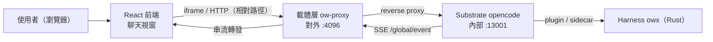
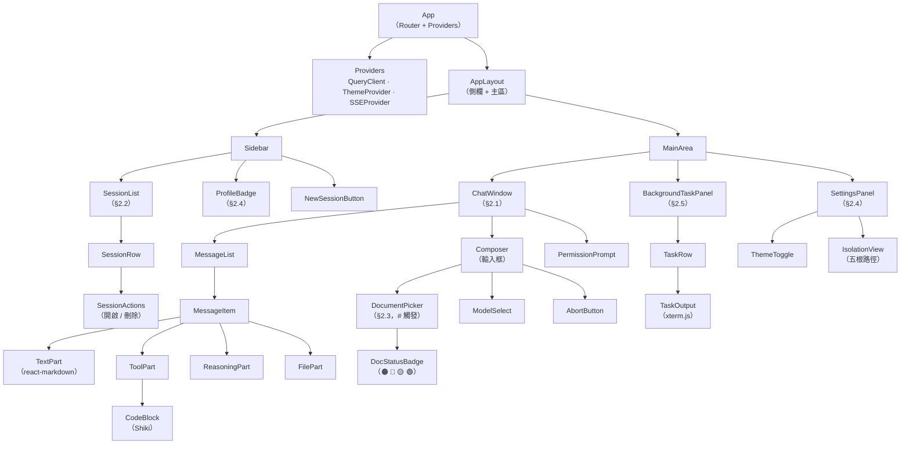
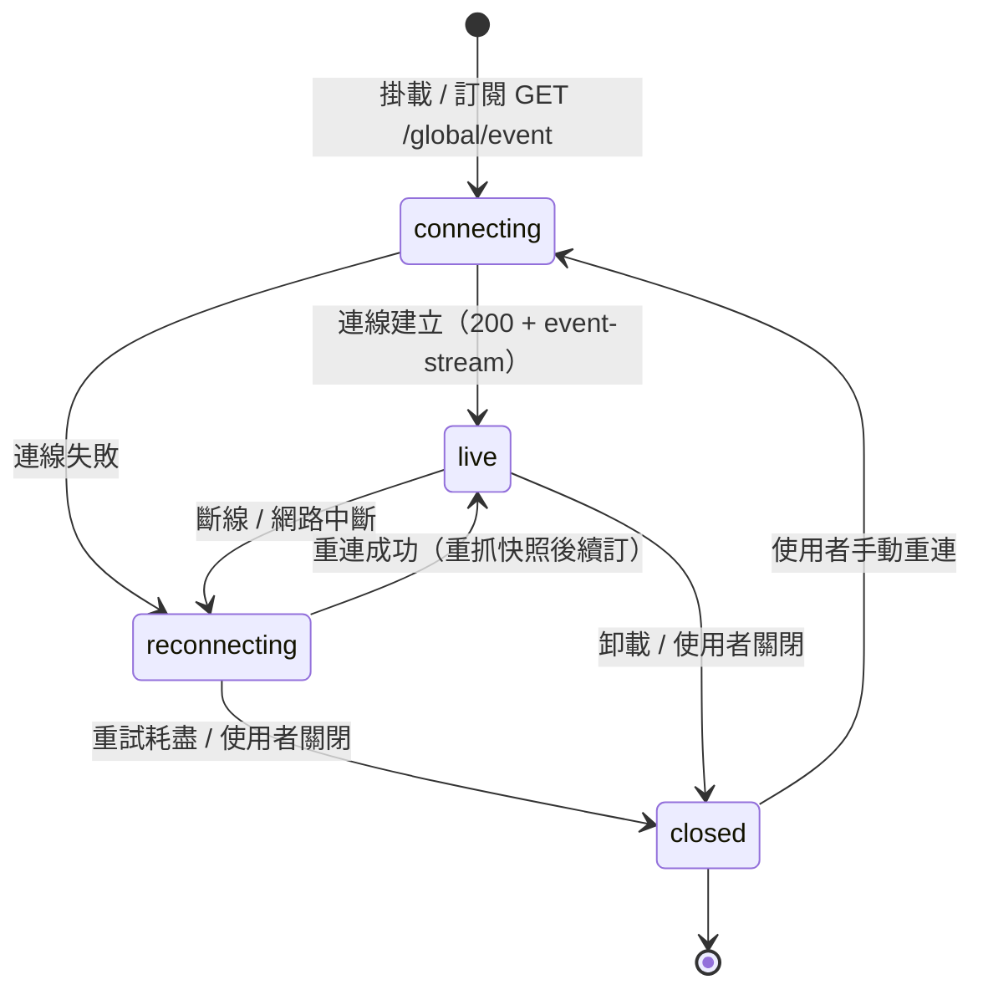

# owx L3 設計：前端（frontend.md）

> 版本：v0.1　|　日期：2026-10-17　|　狀態：Draft
> 來源：整合自 [`base-core-requirements.md`](../spec/base-core-requirements.md)、[`functional-spec.md`](../spec/functional-spec.md)、[`ADR-0003`](../adr/ADR-0003-harness-rust-core-react-frontend.md)、[`document-standards.md`](../standards/document-standards.md)，以及載體 repo `opencode-web` 之規格（`README.md`、`docs/spec/ow-document-access.md`、`docs/mcp.md`）。

---

## 0. 定位與關聯

### 0.1 定位聲明

- **本檔是**：owx 的 **L3（詳細設計）前端權威**。定義 React 前端的畫面清單、元件樹、狀態管理、SSE 綁定、iframe 嵌入契約、與載體層的介面、載入／錯誤／空／權限狀態，以及無障礙要求。
- **本檔不是**：
  - **不是** 像素稿或視覺 mockup（本檔只描述結構、狀態與契約，不含版面數值）。
  - **不是** HTTP 端點契約（路由、請求／回應、錯誤碼）→ 見 [`interfaces.md`](interfaces.md)。
  - **不是** 模組分解與元件邊界（Rust 核心側）→ 見 [`harness-architecture.md`](harness-architecture.md)。
  - **不是** 資料模型與狀態機權威 → 見 [`data-and-state.md`](data-and-state.md)。
  - **不是** 需求清單 → 見 [`base-core-requirements.md`](../spec/base-core-requirements.md) 與 [`functional-spec.md`](../spec/functional-spec.md)。
  - **不是** 載體層行為規格 → 權威在 carrier repo（連結見 §0.2）。

### 0.2 文件關聯

| 文件 | 角色 | 連結 |
|---|---|---|
| `base-core-requirements.md` | 上游：core 需求（FR-A 至 FR-I、NFR-*） | [`../spec/base-core-requirements.md`](../spec/base-core-requirements.md) |
| `functional-spec.md` | 上游：整合功能規格（FR-CARRIER／SUB／HAR、TC-*） | [`../spec/functional-spec.md`](../spec/functional-spec.md) |
| `harness-architecture.md` | 同層：模組分解與邊界（本檔不重複） | [`harness-architecture.md`](harness-architecture.md) |
| `interfaces.md` | 同層：HTTP 端點契約（本檔不重複） | [`interfaces.md`](interfaces.md) |
| `data-and-state.md` | 同層：資料模型與狀態機（本檔不重複） | [`data-and-state.md`](data-and-state.md) |
| carrier `README.md` | 載體層權威：Web UI、iframe、鎖定模式 | [`../../../opencode-web/README.md`](../../../opencode-web/README.md) |
| carrier `ow-document-access.md` | 載體層權威：文件存取與 doc-status | [`../../../opencode-web/docs/spec/ow-document-access.md`](../../../opencode-web/docs/spec/ow-document-access.md) |

### 0.3 授權狀態

| 元件 | 授權 | 在本檔的角色 | 處置 |
|---|---|---|---|
| **opencode** | **MIT** | Substrate；Web UI 與 server API 來源 | 可重用／改／散布；本檔連結指向，不重抄 |
| **owx 自有程式** | **Proprietary** | React 前端（聊天視窗） | 自有；本檔完整定義 |
| **opencode-web（ow）** | **自有（Proprietary）** | 載體層來源；iframe 宿主與 proxy | 可自由改 |
| **omo（oh-my-openagent）** | **SUL-1.0** | **需求來源，非程式碼來源** | 不進交付物；僅黑箱回溯 |

前端候選第三方 UI 函式庫（**全部 MIT，可進交付物**；未列者視為未定案，不得引入）：

| 函式庫 | 授權 | 用途 | 處置 |
|---|---|---|---|
| **React** | **MIT** | UI 執行環境（[`ADR-0003`](../adr/ADR-0003-harness-rust-core-react-frontend.md) 凍結） | 可用 |
| **Vite** | **MIT** | 建置與開發伺服器 | 可用 |
| **Zustand** | **MIT** | client state 容器 | 可用 |
| **TanStack Query** | **MIT** | server state 快取與重試 | 可用 |
| **Radix UI** | **MIT** | 無障礙互動 primitives（dialog／menu／tabs） | 可用 |
| **Tailwind CSS** | **MIT** | 樣式 | 可用 |
| **react-markdown** | **MIT** | Markdown 訊息渲染 | 可用 |
| **Shiki** | **MIT** | 程式碼區塊語法高亮 | 可用 |
| **xterm.js** | **MIT** | 背景任務終端輸出 | 可用 |

> 紅線與 PR 閘門見 [`licensing.md`](../standards/governance/licensing.md) §4、§5。任何新增依賴須於 PR body 標明授權並確認可交付（NFR-1、NFR-10）。

---

## 1. 前端定位與範圍

### 1.1 一句話定位

> owx 前端是一個**標準聊天視窗**：以 React 實作，疊在 opencode server 之上，嵌入載體層（opencode-web）並可被 iframe 驅動。它**不是**內容網站、**不是**文章清單、**不是**文件瀏覽器；文件與知識是 agent 操作的對象，前端只負責把對話、狀態與權限呈現給使用者。

### 1.2 IN / OUT

| 面向 | 內容 |
|---|---|
| **IN** | 五個畫面（主聊天視窗／session 清單／文件選擇器／設定 profile／背景任務檢視）；元件樹；client 與 server 狀態模型；SSE 綁定與連線生命週期；iframe 嵌入契約；與載體層的端點介面與鎖定模式效應；載入／錯誤／空／權限狀態；無障礙（WCAG 2.1 AA） |
| **OUT** | 像素稿與視覺設計；HTTP 端點契約（`interfaces.md`）；Rust 核心模組分解（`harness-architecture.md`）；資料模型與狀態機（`data-and-state.md`）；載體層行為細節（carrier repo）；外掛模組（KAC／CodeGraph／Doc-Edit／Standards）的前端 |

### 1.3 前端在架構中的位置

下圖描述前端如何經載體層抵達 Substrate，並以 SSE 取得即時狀態。前端**不直連** opencode 內部 port，一律經載體層 reverse proxy（FR-SUB-6、FR-CARRIER-9）。



圖說：前端只認載體層對外端點；SSE 事件由 Substrate 產生、載體層轉發（FR-SUB-1），前端不自行產生事件。

---

## 2. 畫面清單（screens）

> 每個畫面標明**目的**與**對應 FR ID**。畫面為邏輯單位，非像素稿；同一畫面可依視窗寬度重排（見 §9 無障礙與響應）。

### 2.1 主聊天視窗（main chat window）

- **目的**：承載一次對話的完整生命週期。顯示訊息串流（text／tool／reasoning／file part）、輸入框、模型選擇、權限請求提示、abort 控制。
- **核心行為**：送出 prompt（`prompt` 或 `prompt_async`）、串流渲染、工具呼叫可視化、權限 allow／deny、abort、context 壓縮提示。
- **對應 FR**：FR-H-1（TUI 與 Web UI 共用同一 server）、FR-D-1（session CRUD／messages／parts／abort）、FR-D-2（SSE 即時推送）、FR-D-10（非同步訊息）、FR-SUB-1（SSE 為即時狀態來源）、FR-SUB-2（權限請求可觀察）、FR-HAR-6（意圖閘門提示）、FR-HAR-7（todo 顯示）。

### 2.2 session 清單／歷史（session list / history）

- **目的**：列出 root session（時間降冪），支援開啟、切換、刪除、子 session 導覽。
- **核心行為**：載入清單（`GET /session?directory=<worktree>&roots=true`）、開啟舊 session、刪除（`DELETE /session/:id`）、parent／child 切換。
- **對應 FR**：FR-D-1（session CRUD）、FR-D-11（子 session 與 diff／stats）、FR-A-10（子 session 導覽）、FR-CARRIER-7（回應側改寫 session 頂層 `directory`）。

### 2.3 檔案／文件選擇器（# 統一選擇器）

- **目的**：以 `#` 觸發**單一**選擇器，範圍限 `.docs/**` 與根 `AGENTS.md`，每檔帶狀態徽章並依 🟠 → 🔵 → 🟡 → 🟢 排序；選取後插入帶狀態的結構化指示區塊（非 inline 全文）。
- **核心行為**：符號後不可有空格、前方需為邊界、無匹配則不彈；狀態徽章來自 doc-status 聚合。
- **對應 FR**：FR-CARRIER-11（統一檔案選擇器）、FR-CARRIER-10（文件狀態聚合）、FR-CARRIER-16（`remote-only` 唯讀引用）。

### 2.4 設定／profile（settings / profile）

- **目的**：顯示當前 profile 的隔離狀態（五根路徑）、模型選擇、主題（深淺）、權限設定檢視。
- **核心行為**：讀取 profile 狀態、切換模型（寫入 state 根）、切換主題（`opencode_get_theme`／`set_theme`）、顯示 provider 可用性。
- **對應 FR**：FR-CARRIER-1（五根隔離可觀察）、FR-CARRIER-4（路徑解析只讀 profile）、FR-E-4（per-agent／per-category 模型）、FR-H-8（主題與鍵綁）、FR-CARRIER-13（MCP `get_theme`／`set_theme`）。

### 2.5 背景任務／sub-agent 檢視（background-task / sub-agent view）

- **目的**：呈現背景委派（`run_in_background`）與 sub-agent 的執行狀態，支援取回結果與終端輸出檢視。
- **核心行為**：列出背景任務（`task_id`、狀態、agent、category）、取回結果（`background_output`）、顯示終端輸出（xterm.js）、巢狀深度提示。
- **對應 FR**：FR-HAR-1（委派 sync／background）、FR-HAR-2（category 與 skills）、FR-HAR-4（worker 不可再委派）、FR-A-8（巢狀深度控制）、FR-A-10（子 session 導覽）、FR-H-3（終端可視化）。

---

## 3. 元件樹

下圖為前端元件樹，自 `App` 逐層展開至葉節點。畫面（§2）對應樹中的路由層；葉節點為可重用呈現元件。



圖說：`Providers` 注入 server state 快取（TanStack Query）、主題與 SSE 連線；`ChatWindow` 為預設路由；`DocumentPicker` 掛在 `Composer` 內，由 `#` 觸發；`BackgroundTaskPanel` 與 `SettingsPanel` 為可切換的主區檢視。

---

## 4. 狀態管理

### 4.1 client state 模型

前端狀態分兩類，**不混用**：

| 類別 | 內容 | 容器 | 特性 |
|---|---|---|---|
| **client state** | 當前選取的 session、輸入框草稿、選擇器開合、主題、面板切換、連線狀態 | Zustand（記憶體內） | 前端擁有、可即時更新、不需伺服器確認 |
| **server state** | session 清單、message／part、權限請求、背景任務、doc-status、profile 狀態 | TanStack Query（快取）＋ SSE 增量 | 伺服器為權威、以事件流同步、需重試與失效策略 |

原則：**server state 不複製進 client state**；client state 只存「使用者意圖」（選了哪個 session、打了什麼字），不存伺服器資料的副本。

### 4.2 server state 經 SSE

server state 的即時面由 SSE 事件流驅動（FR-SUB-1）：事件到達時，以事件內容**增量更新** TanStack Query 快取，而非整批重抓。初次載入以 HTTP 取得快照，之後以 SSE 事件維持一致（見 §5）。

### 4.3 optimistic 與 authoritative

| 操作 | 策略 | 理由 |
|---|---|---|
| 送出 prompt | **optimistic**：立即把使用者訊息插入 `MessageList`，標記為 pending | 輸入延遲不可見；伺服器確認後以權威 message 取代 |
| 刪除 session | **optimistic**：先從清單移除，失敗則回滾並提示 | 清單操作需即時回饋 |
| 權限 allow／deny | **authoritative**：等待伺服器結果，不樂觀 | 權限為阻塞語意（FR-SUB-2），不可假設結果 |
| 模型切換 | **authoritative**：等待寫入確認 | 影響後續所有呼叫，不可樂觀 |
| 背景任務取回 | **authoritative**：等待 `background_output` 回傳 | 結果為一次性且冪等（FR-HAR-1） |

原則：**可逆且低風險者樂觀，不可逆或影響後續語意者權威**。樂觀更新一律附回滾路徑。

### 4.4 重連（reconnect）

SSE 斷線時，前端進入 `reconnecting`（見 §5.3），以指數退避重試訂閱 `GET /global/event`。重連成功後，**重新抓取受影響資源的快照**（session 清單、當前 session 的 message／part），因為斷線期間的事件已遺失；之後再以 SSE 增量維持。事件順序與 upstream 一致，前端不重排、不合併（FR-SUB-1）。

### 4.5 錯誤與重試（error / retry）

| 情境 | 前端行為 |
|---|---|
| HTTP 請求失敗（可重試） | TanStack Query 自動重試（有上限）；顯示重試按鈕 |
| SSE 斷線 | 指數退避重連；顯示連線狀態指示 |
| 403（路徑界外，FR-CARRIER-6） | 不重試；顯示「超出工作區範圍」提示 |
| 403（鎖定模式新增專案，FR-CARRIER-5） | 不重試；新增專案入口本就隱藏 |
| 模型鏈耗盡（FR-HAR-12） | 顯示明確錯誤，不無限重試 |
| session 復原失敗（FR-HAR-11） | 顯示可讀錯誤，不靜默吞錯 |

### 4.6 abort

使用者可中止執行中的 session（FR-D-1）。abort 為**權威操作**：送出後等待伺服器確認，UI 進入 `aborted` 狀態並停止串流渲染；已收到的 part 保留顯示，不回溯刪除。

---

## 5. SSE 綁定

### 5.1 訂閱

前端訂閱 `GET /global/event`（相對路徑，經載體層 base path 轉發）。載體層只轉發，不自行產生事件（FR-SUB-1）。事件流為 server state 的即時來源。

### 5.2 事件對映

下表把 SSE 事件類別對映到 UI 狀態更新。事件類別為介面面（非完整清單），完整 schema 以 opencode 官方文件為準（見 [`data-and-state.md`](data-and-state.md) §2.4）。

| 事件類別 | UI 狀態更新 | 對應 FR |
|---|---|---|
| `session.created` | 插入 session 清單（§2.2） | FR-D-1、FR-D-2 |
| `session.updated` | 更新 session 標題／時間／狀態 | FR-D-1、FR-D-2 |
| `session.deleted` | 從清單移除 | FR-D-1 |
| `message.created` | 插入 `MessageItem`（§2.1） | FR-D-2、FR-SUB-1 |
| `message.updated` | 更新訊息狀態（完成／錯誤） | FR-D-2、FR-C-6 |
| `part.created` | 插入 part（text／tool／reasoning／file） | FR-D-2、FR-SUB-1 |
| `part.updated` | 增量更新 part（串流文字、工具狀態） | FR-D-2、FR-SUB-1 |
| `permission.asked` | 顯示 `PermissionPrompt`（阻塞） | FR-SUB-2 |
| `permission.replied` | 關閉提示，更新工具狀態 | FR-SUB-2 |
| `session.idle` | 結束串流，回到可輸入 | FR-D-1、FR-HAR-9 |

圖說：事件到達時以識別鍵（`session_id`／`message_id`／`part_id`）定位快取節點並增量更新；未知事件類別忽略，不報錯。

### 5.3 連線生命週期

下圖描述 SSE 連線的狀態轉移。`connecting` 為初始訂閱；`live` 為已連線並接收事件；斷線進入 `reconnecting`（指數退避）；重試耗盡或使用者關閉則 `closed`。



圖說：`reconnecting` 期間 UI 顯示連線狀態指示並停用需即時性的操作；重連成功後先重抓快照（§4.4）再續訂，避免斷線期間事件遺失造成狀態漂移。

---

## 6. iframe 嵌入契約

> 前端可被載體層或其他 app 以 iframe 嵌入（FR-H-2、FR-SUB-3）。本節定義嵌入契約；載體層權威見 carrier repo [`README.md`](../../../opencode-web/README.md)。

### 6.1 環境感知 URL

嵌入方以**環境感知 URL** 避免 mixed content（https 頁面不得嵌 http iframe，FR-SUB-3）：

```tsx
const OW_URL =
  import.meta.env.VITE_OPENCODE_WEB_URL ??
  (window.location.protocol === "https:"
    ? "https://<tunnel-domain>"
    : "http://localhost:4096");
```

- https 環境指向 https 端點（如 Cloudflare Tunnel）。
- http 環境指向 localhost。
- 前端自身以**相對路徑**呼叫 API 與 SSE，不寫死 host／port（避免硬編碼，見 [`AGENTS.md`](../../AGENTS.md) §5.3）。

### 6.2 postMessage 契約

嵌入方與前端以 `postMessage` 溝通。訊息一律帶 `type` 與 `source` 標記，前端只回應來自允許 origin 的訊息。

| 方向 | `type` | payload | 用途 |
|---|---|---|---|
| 宿主 → 前端 | `owx:set-scope` | `{ worktree, slug }` | 注入工作區範圍提示（見 §6.4） |
| 宿主 → 前端 | `owx:open-session` | `{ sessionId }` | 要求開啟指定 session |
| 宿主 → 前端 | `owx:set-theme` | `{ theme: "light" \| "dark" }` | 同步主題 |
| 前端 → 宿主 | `owx:ready` | `{ version }` | 前端載入完成 |
| 前端 → 宿主 | `owx:resize` | `{ height }` | 內容高度變更（見 §6.3） |
| 前端 → 宿主 | `owx:error` | `{ code, message }` | 可回報的錯誤 |

原則：**origin 白名單**（對齊 CORS 由 upstream 提供，FR-SUB-4）；未知 `type` 忽略；payload 以結構化物件傳遞，不傳 HTML 字串。

### 6.3 resize

前端在內容高度變更時（訊息新增、面板切換）以 `owx:resize` 通知宿主，宿主據以調整 iframe 高度。前端不主動改宿主 DOM；resize 為**建議值**，最終由宿主決定。

### 6.4 scope 注入提示

宿主可經 `owx:set-scope` 提示當前工作區範圍（`worktree`／`slug`）。此提示僅供 UI 顯示（如側欄 profile 徽章），**不作為安全邊界**：真正的邊界強制在載體層 proxy（FR-CARRIER-6、FR-CARRIER-7），前端不信任自身收到的 scope 值。

---

## 7. 與載體層介面

### 7.1 前端呼叫的端點

前端一律經載體層 reverse proxy（對外 :4096）呼叫，不直連 opencode 內部 port（FR-SUB-6）。端點契約權威見 [`interfaces.md`](interfaces.md)；下表為前端使用面。

| 端點 | 方法 | 用途 | 對應 FR |
|---|---|---|---|
| `/global/event` | GET（SSE） | 訂閱事件流 | FR-SUB-1 |
| `/session` | GET | session 清單（`?directory=<worktree>&roots=true`） | FR-D-1、FR-CARRIER-7 |
| `/session/:id` | GET | 單一 session（頂層 `directory` 由 proxy 改寫） | FR-CARRIER-7 |
| `/session/:id` | DELETE | 刪除 session | FR-D-1 |
| `/session/:id/message` | POST | 送出 prompt | FR-D-1、FR-D-10 |
| `/session/:id/abort` | POST | 中止執行 | FR-D-1 |
| `/project` | GET | 專案清單（`worktree` 由 proxy 改寫） | FR-CARRIER-7 |
| `/project` | POST | 新增專案（鎖定模式回 403） | FR-CARRIER-5 |
| `/__ow-doc-status` | GET | 文件狀態聚合（僅 `LOCKED` 掛載） | FR-CARRIER-10 |
| `/__ow-inject.js` | GET | 注入腳本（繞 CSP inline 限制） | FR-CARRIER-9 |

### 7.2 鎖定模式效應

`OW_LOCK=1` 時，前端行為受載體層影響（FR-CARRIER-5）：

| 效應 | 前端表現 | 對應 FR |
|---|---|---|
| 隱藏「新增專案」UI | 注入腳本隱藏入口；前端不渲染新增專案按鈕 | FR-CARRIER-5 |
| 攔截 `POST /project` | 回 403；前端不重試、不顯示錯誤彈窗 | FR-CARRIER-5 |
| 注入預選 worktree | 前端以注入的 `directory` 為根（權威鍵 `opencode.global.dat:server`） | FR-CARRIER-8 |
| 內部 port 只綁 loopback | 前端只認對外 proxy 端點 | FR-SUB-6 |

原則：**鎖定模式為載體層強制，前端只反映其結果**；前端不自行實作邊界判斷（避免兩套判定漂移，對齊 FR-CARRIER-10 的單一來源原則）。

---

## 8. 載入／錯誤／空／權限狀態

每個畫面須明確定義四類狀態，不得只做 happy path。

| 狀態 | 主聊天視窗 | session 清單 | 文件選擇器 | 背景任務 |
|---|---|---|---|---|
| **載入** | 骨架訊息列 | 骨架列 | 載入中指示 | 骨架列 |
| **錯誤** | 可讀錯誤 + 重試 | 可讀錯誤 + 重試 | 靜默不彈（無匹配） | 可讀錯誤 + 重試 |
| **空** | 引導輸入提示 | 「尚無 session」 | 無匹配則不彈 | 「無背景任務」 |
| **權限** | `PermissionPrompt`（阻塞） | 不適用 | 不適用 | 不適用 |

補充規則：

- **錯誤不靜默**：所有錯誤須可觀察（NFR-4），不得吞錯（對齊 FR-HAR-11）。
- **空狀態可行動**：空狀態提供下一步引導，不顯示空白。
- **權限阻塞**：`PermissionPrompt` 出現時，相關工具不執行（FR-SUB-2）；allow／deny 後才續行。
- **降級**：doc-status 聚合在 filer 不可達時退為 workspace-only（FR-CARRIER-10），前端顯示部分可用而非整體失敗。

---

## 9. 無障礙（a11y）

前端以 **WCAG 2.1 AA** 為門檻。

### 9.1 鍵盤

- 所有互動元素可經鍵盤抵達與操作（Tab／Shift+Tab／Enter／Space）。
- `#` 選擇器支援上下鍵移動、Enter 選取、Esc 關閉。
- 提供跳至主內容的 skip link。
- 快捷鍵不與瀏覽器／輔助技術衝突（FR-H-8 鍵綁）。

### 9.2 焦點

- 焦點順序與視覺順序一致。
- 對話框（dialog／menu）開啟時鎖定焦點於其內，關閉後歸還觸發元素。
- 焦點可見（focus ring），不得以 `outline: none` 移除而不提供替代。

### 9.3 ARIA

- 訊息串流以 `role="log"` 與 `aria-live="polite"` 標記，串流更新可被螢幕閱讀器朗讀。
- 權限提示以 `role="alertdialog"` 標記，需明確回應。
- 連線狀態（§5.3）以 `aria-live` 播報狀態變更。
- 圖示按鈕提供 `aria-label`（如「新增工作階段」）。

### 9.4 對比

- 文字與背景對比達 WCAG 2.1 AA（一般文字 ≥ 4.5:1，大字 ≥ 3:1）。
- 狀態徽章（🟠 🔵 🟡 🟢）**不單靠顏色**傳達狀態，須附文字或圖示標籤（色盲可辨）。
- 深淺主題皆須通過對比檢查（FR-H-8）。

---

## 10. 依據 ID

| 設計面向 | 依據 FR／ADR／NFR |
|---|---|
| 前端技術選型（React） | [`ADR-0003`](../adr/ADR-0003-harness-rust-core-react-frontend.md) |
| 主聊天視窗 | FR-H-1、FR-D-1、FR-D-2、FR-D-10、FR-SUB-1、FR-SUB-2、FR-HAR-6、FR-HAR-7 |
| session 清單／歷史 | FR-D-1、FR-D-11、FR-A-10、FR-CARRIER-7 |
| 文件選擇器 | FR-CARRIER-11、FR-CARRIER-10、FR-CARRIER-16 |
| 設定／profile | FR-CARRIER-1、FR-CARRIER-4、FR-E-4、FR-H-8、FR-CARRIER-13 |
| 背景任務／sub-agent | FR-HAR-1、FR-HAR-2、FR-HAR-4、FR-A-8、FR-A-10、FR-H-3 |
| SSE 綁定 | FR-SUB-1、FR-D-2、FR-SUB-2 |
| iframe 嵌入 | FR-H-2、FR-SUB-3、FR-SUB-4 |
| 與載體層介面 | FR-CARRIER-5、FR-CARRIER-6、FR-CARRIER-7、FR-CARRIER-8、FR-CARRIER-9、FR-CARRIER-10、FR-SUB-6 |
| 載入／錯誤／空／權限 | FR-SUB-2、FR-HAR-11、FR-HAR-12、FR-CARRIER-10、NFR-4 |
| 無障礙 | FR-H-8、NFR-4 |
| 授權潔淨 | NFR-1、NFR-10、[`licensing.md`](../standards/governance/licensing.md) |

---

## 11. 缺口與待決

1. **前端尚未有程式碼**：本檔為 clean-room 設計；實作與測試待迭代螺旋後續輪次產出（承接 [`functional-spec.md`](../spec/functional-spec.md) §8.2）。
2. **postMessage 契約未收斂**：§6.2 的訊息型別為初稿，待與載體層（carrier repo）對齊後回寫。
3. **`ow doc pull` 尚未實作**（FR-CARRIER-16）：`remote-only` 狀態目前只能唯讀引用，選擇器對應行為待實作後驗證。
4. **Team Mode 前端未展開**：共享信箱／共享任務清單／per-member worktree（FR-A-6）待 D4 決策後補入。
5. **opencode v2 差異**：事件類別與 session 結構以 v1 為準；v2 差異待迭代確認後回寫本檔。
6. **響應式斷點未定**：畫面重排的斷點值待視覺設計輪次決定（本檔不含像素稿）。

---

## 12. 變更紀錄

| 日期 | 版本 | 變更 |
|---|---|---|
| 2026-10-17 | v0.1 | 初版：前端定位與關聯、五畫面清單、元件樹、狀態管理、SSE 綁定與連線生命週期、iframe 嵌入契約、與載體層介面、載入／錯誤／空／權限狀態、無障礙、依據 ID。 |
