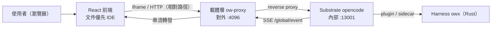
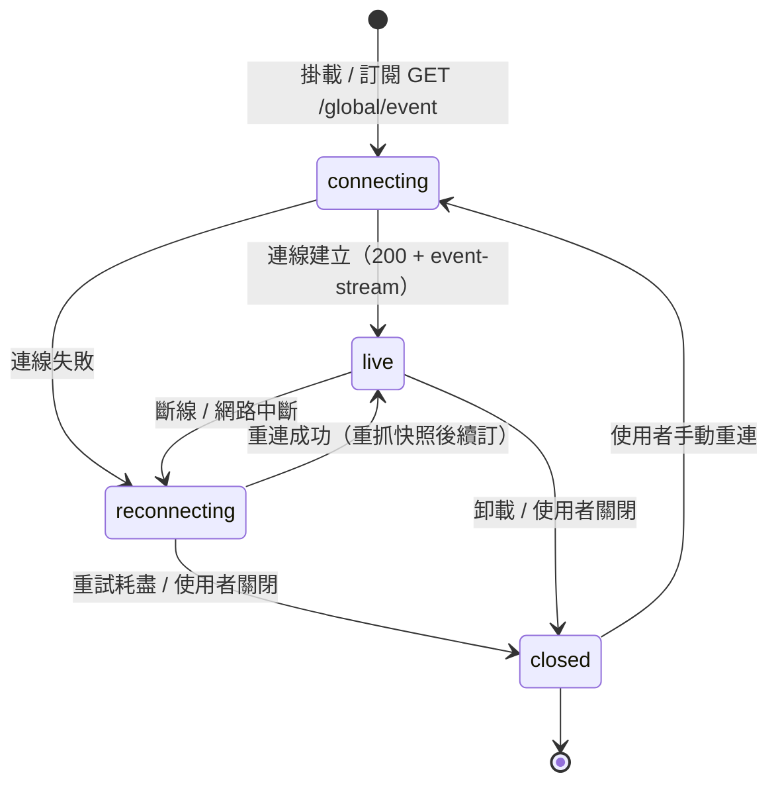

# owx L3 設計：前端（frontend.md）

> 版本：v2.13　|　日期：2026-10-23　|　狀態：Draft
> 來源：整合自 [`base-core-requirements.md`](../spec/base-core-requirements.md)、[`functional-spec.md`](../spec/functional-spec.md)、[`ADR-0003`](../adr/ADR-0003-harness-rust-core-react-frontend.md)、[`ADR-0007`](../adr/ADR-0007-document-first-ide-layout.md)、[`document-standards.md`](../standards/document-standards.md)，以及載體 repo `opencode-web` 之規格（`README.md`、`docs/spec/ow-document-access.md`、`docs/mcp.md`）。

---

## 0. 定位與關聯

### 0.1 定位聲明

- **本檔是**：owx 的 **L3（詳細設計）前端權威**。定義 React 前端的畫面清單、元件樹、狀態管理、SSE 綁定、iframe 嵌入契約、與載體層的介面、載入／錯誤／空／權限狀態，以及無障礙要求。
- **本檔不是**：
  - **不是** 像素稿或視覺 mockup（本檔只描述結構、狀態與契約，不含版面數值）。
  - **不是** HTTP 端點契約（路由、請求／回應、錯誤碼）→ 見 [`interfaces.md`](interfaces.md)。
  - **不是** 模組分解與元件邊界（Rust 核心側）→ 見 [`harness-architecture.md`](harness-architecture.md)。
  - **不是** 資料模型與狀態機權威 → 見 [`data-and-state.md`](data-and-state.md)。
  - **不是** 需求清單 → 見 [`base-core-requirements.md`](../spec/base-core-requirements.md) 與 [`functional-spec.md`](../spec/functional-spec.md)。
  - **不是** 載體層行為規格 → 權威在 carrier repo（連結見 §0.2）。

### 0.2 文件關聯

| 文件 | 角色 | 連結 |
|---|---|---|
| `base-core-requirements.md` | 上游：core 需求（FR-A 至 FR-I、NFR-*） | [`../spec/base-core-requirements.md`](../spec/base-core-requirements.md) |
| `functional-spec.md` | 上游：整合功能規格（FR-CARRIER／SUB／HAR、TC-*） | [`../spec/functional-spec.md`](../spec/functional-spec.md) |
| `harness-architecture.md` | 同層：模組分解與邊界（本檔不重複） | [`harness-architecture.md`](harness-architecture.md) |
| `interfaces.md` | 同層：HTTP 端點契約（本檔不重複） | [`interfaces.md`](interfaces.md) |
| `data-and-state.md` | 同層：資料模型與狀態機（本檔不重複） | [`data-and-state.md`](data-and-state.md) |
| carrier `README.md` | 載體層權威：Web UI、iframe、鎖定模式 | [`../../../opencode-web/README.md`](../../../opencode-web/README.md) |
| carrier `ow-document-access.md` | 載體層權威：文件存取與 doc-status | [`../../../opencode-web/docs/spec/ow-document-access.md`](../../../opencode-web/docs/spec/ow-document-access.md) |

### 0.3 授權狀態

| 元件 | 授權 | 在本檔的角色 | 處置 |
|---|---|---|---|
| **opencode** | **MIT** | Substrate；Web UI 與 server API 來源 | 可重用／改／散布；本檔連結指向，不重抄 |
| **owx 自有程式** | **Proprietary** | React 前端（文件優先 IDE） | 自有；本檔完整定義 |
| **opencode-web（ow）** | **自有（Proprietary）** | 載體層來源；iframe 宿主與 proxy | 可自由改 |
| **omo（oh-my-openagent）** | **SUL-1.0** | **需求來源，非程式碼來源** | 不進交付物；僅黑箱回溯 |

前端候選第三方 UI 函式庫（**全部 MIT，可進交付物**；未列者視為未定案，不得引入）：

| 函式庫 | 授權 | 用途 | 處置 |
|---|---|---|---|
| **React** | **MIT** | UI 執行環境（[`ADR-0003`](../adr/ADR-0003-harness-rust-core-react-frontend.md) 凍結） | 可用 |
| **Vite** | **MIT** | 建置與開發伺服器 | 可用 |
| **Zustand** | **MIT** | client state 容器 | 可用 |
| **TanStack Query** | **MIT** | server state 快取與重試 | 可用 |
| **Radix UI** | **MIT** | 無障礙互動 primitives（dialog／menu／tabs） | 可用 |
| **Tailwind CSS** | **MIT** | 樣式 | 可用 |
| **react-markdown** | **MIT** | Markdown 訊息渲染 | 可用 |
| **Shiki** | **MIT** | 程式碼區塊語法高亮 | 可用 |
| **xterm.js** | **MIT** | 背景任務終端輸出 | 可用 |

> 紅線與 PR 閘門見 [`licensing.md`](../standards/governance/licensing.md) §4、§5。任何新增依賴須於 PR body 標明授權並確認可交付（NFR-1、NFR-10）。

---

## 1. 前端定位與範圍

### 1.1 一句話定位

> owx 前端是一個**文件優先 IDE（document-first IDE）**：以 React 實作，疊在 opencode server 之上，嵌入載體層（opencode-web）並可被 iframe 驅動。版面分**三區**：`[ActivityBar + 側面板] | DocumentPreview | Chat`——側面板由 ActivityBar 切換 **Explorer**（專案檔案樹）與 **Outline**（文件大綱），中央為**文件預覽**，右側為**對話**（session 清單移入 Chat 標頭）。三區各自**可收合／可開啟**，相鄰區之間以可拖曳 **resizer** 調寬（側面板 160–480px、Chat 300–760px，DocumentPreview 彈性填充；預設 280／400px），收合後以常駐控制復原（FR-H-15）。它**不是**內容網站、**不是**文章清單；文件與知識既是 agent 操作的對象，也是使用者直接瀏覽與預覽的對象（[`ADR-0007`](../adr/ADR-0007-document-first-ide-layout.md)）。

### 1.2 IN / OUT

| 面向 | 內容 |
|---|---|
| **IN** | 畫面／區塊（主聊天視窗、session 清單、**專案入口頁 ProjectHome**、新增專案、Explorer、Outline、**文件預覽（多分頁）**、文件選擇器、設定、背景任務、**文件編輯器（僅 md）**、**節點操作 NodeMenu**、**活動列與 Settings 浮動選單**）；三區版面；元件樹；client 與 server 狀態模型；SSE 綁定與連線生命週期；iframe 嵌入契約；與載體層的端點介面與鎖定模式效應；載入／錯誤／空／權限狀態；無障礙（WCAG 2.1 AA） |
| **OUT** | 像素稿與視覺設計；HTTP 端點契約（`interfaces.md`）；Rust 核心模組分解（`harness-architecture.md`）；資料模型與狀態機（`data-and-state.md`）；載體層行為細節（carrier repo）；外掛模組（KAC／CodeGraph／Doc-Edit／Standards）的前端 |

### 1.3 前端在架構中的位置

下圖描述前端如何經載體層抵達 Substrate，並以 SSE 取得即時狀態。前端**不直連** opencode 內部 port，一律經載體層 reverse proxy（FR-SUB-6、FR-CARRIER-9）。



圖說：前端只認載體層對外端點；SSE 事件由 Substrate 產生、載體層轉發（FR-SUB-1），前端不自行產生事件。

---

## 2. 畫面清單（screens）

> 每個畫面標明**目的**與**對應 FR ID**。畫面為邏輯單位，非像素稿；同一畫面可依視窗寬度重排（見 §9 無障礙與響應）。

> **版面區域（三區）可收合／可調寬（FR-H-15）**：左側面板、DocumentPreview、Chat 三區各自**可收合與開啟**；相鄰區之間以可拖曳 **resizer** 調寬（側面板 160–480px、Chat 300–760px，DocumentPreview 彈性填充；預設 280／400px）。收合後以**常駐控制**復原：左側面板經 **ActivityBar** 圖示（點擊作用中圖示切換），DocumentPreview／Chat 經**對側區標頭**的切換鈕；ActivityBar（48px）恆常可見。此為版面層行為，不新增畫面。

### 2.1 主聊天視窗（main chat window）

- **目的**：承載一次對話的完整生命週期。顯示訊息串流（text／tool／reasoning／file part）、輸入框、權限請求提示、abort 控制；**標頭左側**為**連線狀態燈**（綠＝已連線／紅＝連線異常／灰＝未連接）；**右側**為 **session／agent／model 三個 icon 按鈕**（點擊開**下拉浮動選單**）與文件切換鈕（**移除品牌「owx」與「已連線」狀態文字**）；**三區（filetree／文件預覽／chat）標頭統一高度**（`--header-h`，以 filetree header 為基準）；**輸入區（Composer）容器 `padding: 0`、輸入框與容器重合（無邊框／圓角），送出改為內嵌 icon（右下角），最大化輸入空間**；**訊息區不顯示 user／assistant 角色標籤**，**user 泡泡**圓角縮小並帶**左側粗藍線**；**送出採 async**（`POST /session/:id/prompt_async`）＋既有 SSE 串流，避免經 Cloudflare 的同步逾時（524）；**訊息區顯示 assistant 的思考（reasoning，可摺疊）**，並以 `session.status`（busy／idle）顯示**進行中**指示；**model 下拉以 provider 為群組標題（藍色，models 縮排一階、群組間隔一行），且頂部有快速搜尋（逐字收斂，比對 model 名與 provider）**。
- **核心行為**：送出 prompt（`prompt` 或 `prompt_async`）、串流渲染、工具呼叫可視化、權限 allow／deny、abort、context 壓縮提示。
- **指令面板（CommandPalette）**：於 `Composer` 內以 `/` 觸發，列出**合併指令註冊表**（server 指令 + TUI 內建鏡射），支援過濾、鍵盤導覽與執行；不可用指令標示原因（FR-H-11）。
- **對應 FR**：FR-H-1（TUI 與 Web UI 共用同一 server）、FR-D-1（session CRUD／messages／parts／abort）、FR-D-2（SSE 即時推送）、FR-D-10（非同步訊息）、FR-SUB-1（SSE 為即時狀態來源）、FR-SUB-2（權限請求可觀察）、FR-HAR-6（意圖閘門提示）、FR-HAR-7（todo 顯示）、FR-H-11（Web 指令面完整對齊 opencode）、FR-H-15（版面區域可收合／可調寬）。

### 2.2 session 清單／歷史（session list / history）

- **目的**：列出 root session（時間降冪），支援開啟、切換、刪除、子 session 導覽。
- **位置**：**移入 Chat 標頭**，以 `SessionMenu` 下拉呈現（**不再**置於側面板；側面板讓位給 Explorer／Outline，見 §3）。
- **核心行為**：**依當前文件專案**載入清單（`GET /session?directory=<projectRoot>&roots=true`；**不抓全域 session**）、開啟舊 session、刪除（`DELETE /session/:id`）、parent／child 切換。
- **對應 FR**：FR-D-1（session CRUD）、FR-D-11（子 session 與 diff／stats）、FR-A-10（子 session 導覽）、FR-CARRIER-7（回應側改寫 session 頂層 `directory`）。

### 2.3 專案檔案總管（Explorer）

- **目的**：以**專案檔案樹**瀏覽當前專案，供使用者定位與開啟文件。
- **核心行為**：**標頭顯示「專案名稱 `[目錄名]`」**（名稱取 `~/knowledge` 專案中繼資料，副檔名/slug 於方括號）＋ `ProjectMenu`（開啟／新增／關閉／**專案屬性設定**）；**延遲載入**的目錄樹（`GET /file?path=<dir>&directory=<root>`，entries 為 `{name,path,absolute,type,ignored}`）；展開／收合目錄、忽略項（`ignored`）標示；**每個節點顯示目錄／檔案類型圖示（帶顏色）**，**有變更的檔案以文字顏色區隔**（來源 **owx harness** `GET /rpc/git/status`）；**隱藏項目（`.` 開頭）預設不列出**，僅當專案 `params.show_hidden=true` 時顯示（過濾於前端 `lib/hidden.ts`，substrate `GET /file` 未改）；預設／初始專案＝**當前作用中專案**，可設定，初始為 **owx**。
- **對應 FR**：FR-H-12（專案檔案總管）、FR-H-58（顯示隱藏檔案）、FR-CARRIER-7（`/project` 回應側改寫）。

### 2.4 文件大綱（Outline）

- **目的**：呈現**當前預覽文件**的 markdown 標題（H1–H6）大綱，供快速跳轉。
- **核心行為**：於 **client 端**解析當前文件的 markdown 標題；點擊標題捲動文件預覽（§2.5）至對應錨點。
- **對應 FR**：FR-H-13（文件大綱）。

### 2.5 文件預覽（DocumentPreview）

- **目的**：呈現當前文件的渲染結果，供閱讀與對照。
- **核心行為**：**client 端**多格式渲染——**markdown**（`react-markdown`＋**GFM**：表格、任務清單、刪除線、自動連結、腳註；含標題錨點供 §2.4 捲動、**Mermaid 圖表**）與**其他格式之唯讀預覽**（PDF／Word／CSV／Excel／圖片 png・jpg…）；含 **doc-status 徽章**（**重用 FR-CARRIER-10 語意**）。**文件預覽為多分頁**（可同時開啟多檔、切換、單頁 `×` 關閉）；分頁列右側「⋯」浮動選單——**關閉全部文件／文件全部提交／搜尋**（FR-H-25）。**僅 `md` 可編輯**（§2.12 編輯器），其餘唯讀。
- **渲染器**：`MarkdownView`（`components/MarkdownView.tsx`）為**唯一** markdown 渲染入口——`remark-gfm` 擴充語法、標題產生 `slugify` 錨點（供 §2.4）、表格外包 `.md-table` 以橫向捲動、```mermaid 圍籬交由 `MermaidBlock` 以**動態 `import("mermaid")`** 渲染（`securityLevel: "strict"`；未就緒顯示原始碼、失敗顯示錯誤＋原始碼，不中斷預覽）。預覽、§2.12 編輯器並排、§2.7 標準規範皆共用。
- **Mermaid layout 限制（授權）**：`mermaid` 之 `elkjs` 依賴為 **EPL-2.0**，依 [`licensing.md`](../standards/governance/licensing.md) §5.1 以 `packages/elkjs-stub`（MIT）取代——**預設 dagre layout 正常**，`layout: elk` 圖表降級為錯誤訊息；交付物不含 EPL 碼。
- **對應 FR**：FR-H-14（文件預覽）、FR-CARRIER-10（文件狀態聚合）。

### 2.6 檔案／文件選擇器（# 統一選擇器）

- **目的**：以 `#` 觸發**單一**選擇器，範圍限 `.docs/**` 與根 `AGENTS.md`，每檔帶狀態徽章並依 🟠 → 🔵 → 🟡 → 🟢 排序；選取後插入帶狀態的結構化指示區塊（非 inline 全文）。
- **核心行為**：符號後不可有空格、前方需為邊界、無匹配則不彈；狀態徽章來自 doc-status 聚合。
- **對應 FR**：FR-CARRIER-11（統一檔案選擇器）、FR-CARRIER-10（文件狀態聚合）、FR-CARRIER-16（`remote-only` 唯讀引用）。

### 2.7 設定／profile（settings / profile）

- **目的**：以 **設定 modal** 呈現 owx 系統／UI 設定與（未來）profile 隔離狀態；顯示當前 profile 的隔離狀態（五根路徑）、模型選擇、主題（深淺）、權限設定檢視。
- **核心行為**：ActivityBar 底部 Settings 浮動選單之「**系統設置[S]**」開啟**系統設置 modal**（`.settings-modal`：`80vw`×`80vh`、上限 `1792×1120`）；內含三分頁**一般**／**外觀**／**模型**。另 Settings 選單之「**功能維護[F]**」「**賬號維護[A]**」各開**同尺寸佔位 modal**（`.settings-modal`；未實作）。**一般**：系統名稱、知識根目錄；**外觀**：Logo（上傳）、品牌主色、主題（**深／淺／隨系統**）；**模型**：預設 provider／model／agent、**模型下載清單**（FR-H-31）、**Provider 連線**（FR-H-32）。讀寫經 owx harness（`GET/POST /rpc/settings`、`POST/GET /rpc/settings/logo`）。**生效**：`personal.theme`→`:root` 之 `data-theme`（`system` 時移除屬性跟隨系統）；`global.accent`→CSS 變數 `--accent`；`global.systemName`→`document.title` 與品牌；`global.logo`→品牌圖示；預設 provider／model／agent 套用於**新 session**。
- **對應 FR**：FR-H-27（設定 modal 與參數表面）、FR-H-28（設定持久化與生效）、FR-H-29（功能維護佔位）、FR-H-30（賬號維護佔位）、FR-H-8（主題與鍵綁）、FR-E-4（per-agent／per-category 模型）、FR-CARRIER-1（五根隔離可觀察）、FR-CARRIER-4（路徑解析只讀 profile）、FR-CARRIER-13（MCP `get_theme`／`set_theme`）。

### 2.8 背景任務／sub-agent 檢視（background-task / sub-agent view）

- **目的**：呈現背景委派（`run_in_background`）與 sub-agent 的執行狀態，支援取回結果與終端輸出檢視。
- **核心行為**：列出背景任務（`task_id`、狀態、agent、category）、取回結果（`background_output`）、顯示終端輸出（xterm.js）、巢狀深度提示。
- **對應 FR**：FR-HAR-1（委派 sync／background）、FR-HAR-2（category 與 skills）、FR-HAR-4（worker 不可再委派）、FR-A-8（巢狀深度控制）、FR-A-10（子 session 導覽）、FR-H-3（終端可視化）。

### 2.9 專案入口頁（ProjectHome）

- **目的**：在**未開啟專案**時作為入口，列出所有可開啟的文件專案。
- **核心行為**：**本頁即 owx 首頁（預設進入）。全頁**（無側欄、無 chat）以卡片網格列出 **`~/knowledge` 下之文件專案**（由 **owx harness `GET /rpc/knowledge/list`** 提供）；**卡片顯示名稱與標籤（不顯示路徑）**、**等高＋陰影**；**專案若有未提交變更（`dirty`）則卡片左側顯示紅邊**；點卡片開啟；提供「+ 新增專案」入口（→ §2.10）。**文件專案的真實來源是 `~/knowledge`，非 opencode `GET /project`。** 由 Explorer 標頭的**專案控制選單**（`ProjectMenu`：開啟／新增／關閉）之「關閉專案」返回。
- **對應 FR**：FR-H-16（專案入口頁與專案控制）、FR-H-17（新增專案）。

### 2.10 新增專案（NewProjectModal）

- **目的**：建立新的文件專案（於 `~/knowledge`）。
- **核心行為**：modal 輸入**名稱**、**文件英文名**（作為資料夾／識別，`^[a-z0-9][a-z0-9-]*$`）、**標籤**（以「,」分隔）；系統生成**專案編號**與**建立時間**；送出後由 **owx harness** `POST /rpc/project/create` 建立（[`ADR-0008`](../adr/ADR-0008-project-lifecycle-owned-by-owx-harness.md)），**專案根目錄自動生成 `AGENTS.md`（一般性規範）**，成功後開啟該專案並執行 opencode `/init`。
- **對應 FR**：FR-H-17（新增專案）、FR-G-3（command `/init`）。

### 2.11 檔案樹節點操作（NodeMenu）

- **目的**：對 filetree 的**每個節點**（目錄／檔案）直接做檔案與文件生命週期操作，無須離開 IDE。
- **核心行為**：於 filetree 的**每個節點**（目錄／檔案）**hover 後按右鍵（contextmenu）**顯示 `NodeMenu` →【**建立資料夾**／**建立文檔**（預設 `md`，可編輯）／**匯入檔案**（任何格式；非 `md` 唯讀）／**複製路徑（相對）**／**複製絕對路徑**／**匯出**／**轉換格式**／**打包**／**解封裝**／**分享**】。選單**分組**（**組間細線分隔**）：① **建立**（資料夾／文檔）② **匯入／匯出** ③ **打包／解封裝／轉換格式／分享** ④ **複製相對／絕對路徑**。**建立**以輸入框；**複製路徑**為純前端（clipboard，取節點 `path`／`absolute`）；**打包**以格式選擇（`zip` 預設／`tar.gz`／`tar`）；**解封裝**依副檔名偵測；**匯入／匯出／轉換／分享**經 owx harness（`/rpc/import/*`、`/rpc/export/*`、`/rpc/convert`、`/rpc/share`；Notion／filer 未設置時以 `501 not_configured` 呈現）。
- **對應 FR**：FR-H-18（節點操作選單）、FR-H-20（匯入）、FR-H-21（轉換）、FR-H-22（匯出與分享）、FR-H-19（打包／解封裝）。

### 2.12 文件編輯器（僅 `md`）

- **目的**：編輯 markdown 文件（唯一可編輯的格式）。
- **核心行為**：`md` 可進入編輯模式，具 **編輯／並排／預覽** 三種模式（**預設並排**：左 `textarea` 原始碼、右即時渲染，共用 §2.5 之 `MarkdownView`；即時渲染含 GFM 全格式與 Mermaid）；分頁列「編輯」按鈕進入，儲存後回預覽並刷新檔案樹。**非 `md` 檔案唯讀**。儲存經 **owx harness** `POST /rpc/fs/write`（`overwrite`）。
- **對應 FR**：FR-H-23（文件編輯）、FR-H-14（預覽）。

### 2.13 專案屬性設定（ProjectPropertyModal）

- **目的**：檢視／編輯**當前專案**的屬性——基本資料、基礎目錄、文件撰寫規範（含**依循規範**）、參數。
- **入口**：Explorer 標頭的專案選單（`ProjectMenu`）**分割線**下之「**專案屬性設定**」（FR-H-27）。
- **核心行為**：**tabbed modal**（**四個 tab**：基本資料／基礎目錄範例／文件撰寫規範／參數）；尺寸 `min(80vw,1792) × min(80vh,1120)`（**重用 `SettingsModal` 之 `.settings-modal` 樣式與導覽**）。
  - **基本資料**：ID（唯讀）／名稱（中／英）／目錄名（已建立後唯讀）／專案屬性（**單選**；Phase 1）／**專案預設資料夾（唯讀預覽該屬性之清單）**／標籤（「,」分隔）。
  - **基礎目錄範例**：依屬性自 `GET /rpc/project/base-dirs` 取建議清單（勾選）＋「是否據以生成」checkbox＋**「立即建立資料夾」按鈕**＋**「顯示隱藏檔案」checkbox**（`params.show_hidden`，**預設 false＝不顯示**，FR-H-58）；按鈕依目前清單經 `POST /rpc/project/base-dirs/apply` **只補缺**建目錄（不覆寫、不刪除、不改中繼資料），並回報 `created`／`skipped`／`failed`（FR-H-57）；清單為空時停用。
  - **文件撰寫規範**：基礎規範（版本管理／標題／版次／變更履歷／機密等級，預設「一般」）＋提交檢查（一致性／客觀屬實／審計）＋**依循規範**（自 `GET /rpc/standards/list`；**必要項不可取消**）。
  - **參數**：自動保存草稿（預設 10 分）。「顯示隱藏檔」已移至基礎目錄範例（FR-H-58）。
  - 儲存經 **owx harness** `POST /rpc/project/update`（可冪等生成目錄、抄錄規範）；讀取經 `GET /rpc/project/get`。
- **對應 FR**：FR-H-33～58、[`ADR-0011`](../adr/ADR-0011-project-metadata-and-standards-catalog.md)。

### 2.14 標準規範瀏覽（StandardsModal）

- **目的**：瀏覽 `owx-sample/standards/` 之**全部標準**（**自撰**綱要），供依循參考。
- **入口**：ActivityBar 底部 **Settings** 浮動選單之「**標準規範 [D]**」（FR-H-56）。
- **核心行為**：**modal**（`min(80vw,1792) × min(80vh,1120)`，重用 `.settings-modal`）；**左側**（`standards-nav`）為標準清單，**依分類分群**（`GET /rpc/standards/list`）；**右側**（`standards-content`）以 `react-markdown` 呈現所選標準內容（`GET /rpc/standards/get` → `owx-sample/standards/<id>.md`）。
- **對應 FR**：FR-H-56、FR-H-51／52（依循規範／規範目錄）。

---

## 3. 元件樹

下圖為前端元件樹，自 `App` 逐層展開至葉節點。版面為**三區**：`[ActivityBar + 側面板] | DocumentPreview | Chat`（[`ADR-0007`](../adr/ADR-0007-document-first-ide-layout.md)）。畫面（§2）對應樹中的路由層；葉節點為可重用呈現元件。

```mermaid
flowchart TD
    App["App<br/>（Router + Providers）"] --> Providers["Providers<br/>QueryClient · ThemeProvider · SSEProvider"]
    App --> Layout["AppLayout<br/>（三區：側面板 | DocumentPreview | Chat）"]
    App --> ProjectHome["ProjectHome<br/>（§2.9，全頁；未開啟專案）"]
    App --> NewProjectModal["NewProjectModal<br/>（§2.10）"]
    App --> ProjectPropertyModal["ProjectPropertyModal<br/>（§2.13）"]
    App --> StandardsModal["StandardsModal<br/>（§2.14）"]

    Layout --> ActivityBar["ActivityBar<br/>（Explorer／Outline／Knowledge Graph 切換；底部 Settings；48px 恆常可見）"]
    Layout --> SidePanel["SidePanel<br/>（可收合，160–480px）"]
    Layout --> ResizerLeft["Resizer<br/>（側面板 ↔ DocumentPreview）"]
    Layout --> PreviewPane["DocumentPreview<br/>（§2.5，彈性填充）"]
    Layout --> ResizerRight["Resizer<br/>（DocumentPreview ↔ Chat）"]
    Layout --> ChatPane["ChatWindow<br/>（§2.1，可收合，300–760px）"]

    ActivityBar --> ActivityIcon["ActivityIcon<br/>（Explorer／Outline／Knowledge Graph＋底部 Settings；點擊作用中圖示切換側面板）"]
    ActivityBar --> SettingsMenu["SettingsMenu<br/>（浮動選單：系統設置[S]／技能[K]／權限管理[R]／檢查版本[C]／幫助[H]／關於[A]）"]

    SidePanel --> FileExplorer["FileExplorer<br/>（§2.3）"]
    SidePanel --> DocumentOutline["DocumentOutline<br/>（§2.4）"]

    FileExplorer --> ProjectMenu["ProjectMenu<br/>（開啟／新增／關閉專案）"]
    FileExplorer --> FileTree["FileTree<br/>（延遲載入 GET /file）"]
    FileTree --> FileTreeNode["FileTreeNode<br/>（name / type / ignored）"]
    FileTreeNode --> NodeMenu["NodeMenu<br/>（§2.11：建立／複製／打包／解封裝）"]

    DocumentOutline --> OutlineItem["OutlineItem<br/>（H1–H6）"]

    PreviewPane --> MarkdownView["MarkdownView<br/>（react-markdown + 標題錨點）"]
    PreviewPane --> DocStatusBadge["DocStatusBadge<br/>（🟠 🔵 🟡 🟢，FR-CARRIER-10）"]
    PreviewPane --> PreviewHeader["PreviewHeader"]
    PreviewHeader --> ChatToggle["ChatToggle<br/>（收合／開啟 Chat）"]

    ChatPane --> ChatHeader["ChatHeader"]
    ChatPane --> MessageList["MessageList"]
    ChatPane --> Composer["Composer<br/>（輸入框）"]
    ChatPane --> PermissionPrompt["PermissionPrompt"]
    ChatPane --> SettingsPanel["SettingsPanel<br/>（§2.7）"]
    ChatPane --> BackgroundPanel["BackgroundTaskPanel<br/>（§2.8）"]

    ChatHeader --> SessionMenu["SessionMenu<br/>（§2.2，session 下拉）"]
    ChatHeader --> ModelSelect["ModelSelect"]
    ChatHeader --> StatusBadge["StatusBadge<br/>（agent / model / status）"]
    ChatHeader --> PreviewToggle["PreviewToggle<br/>（收合／開啟 DocumentPreview）"]

    MessageList --> MessageItem["MessageItem"]
    MessageItem --> TextPart["TextPart<br/>（react-markdown）"]
    MessageItem --> ToolPart["ToolPart"]
    MessageItem --> ReasoningPart["ReasoningPart"]
    MessageItem --> FilePart["FilePart"]

    ToolPart --> CodeBlock["CodeBlock<br/>（Shiki）"]

    Composer --> DocPicker["DocumentPicker<br/>（§2.6，# 觸發）"]
    Composer --> CommandPalette["CommandPalette<br/>（§2.1，/ 觸發）"]
    Composer --> AbortButton["AbortButton"]

    DocPicker --> DocStatusBadge

    CommandPalette --> CommandRow["CommandRow<br/>（名稱／描述／來源／可用性）"]

    BackgroundPanel --> TaskRow["TaskRow"]
    TaskRow --> TaskOutput["TaskOutput<br/>（xterm.js）"]

    SettingsPanel --> ThemeToggle["ThemeToggle"]
    SettingsPanel --> IsolationView["IsolationView<br/>（五根路徑）"]
```



圖說：`Providers` 注入 server state 快取（TanStack Query）、主題與 SSE 連線；`AppLayout` 為**三區**版面——`ActivityBar` 切換 `SidePanel` 於 `FileExplorer`（§2.3）與 `DocumentOutline`（§2.4）之間，中央為 `DocumentPreview`（§2.5），右側為 `ChatWindow`（§2.1）；session 清單以 `SessionMenu` 置於 `ChatHeader`（§2.2）；`DocumentPicker` 與 `CommandPalette` 皆掛在 `Composer` 內，分別由 `#` 與 `/` 觸發；`BackgroundTaskPanel` 與 `SettingsPanel` 為 Chat 區內可切換的檢視。三區各自可收合／可開啟（FR-H-15）：`ResizerLeft`／`ResizerRight` 為相鄰區之間的可拖曳調寬把手（側面板 160–480px、Chat 300–760px，`DocumentPreview` 彈性填充）；收合後以常駐控制復原——`ActivityIcon`（點擊作用中圖示切換 `SidePanel`）、`ChatHeader` 內的 `PreviewToggle`（開啟 `DocumentPreview`）與 `PreviewHeader` 內的 `ChatToggle`（開啟 `ChatWindow`）；`ActivityBar`（48px）恆常可見。

---

## 4. 狀態管理

### 4.1 client state 模型

前端狀態分兩類，**不混用**：

| 類別 | 內容 | 容器 | 特性 |
|---|---|---|---|
| **client state** | 當前選取的 session、輸入框草稿、選擇器開合、主題、面板切換、連線狀態 | Zustand（記憶體內） | 前端擁有、可即時更新、不需伺服器確認 |
| **server state** | session 清單、message／part、權限請求、背景任務、doc-status、profile 狀態 | TanStack Query（快取）＋ SSE 增量 | 伺服器為權威、以事件流同步、需重試與失效策略 |

原則：**server state 不複製進 client state**；client state 只存「使用者意圖」（選了哪個 session、打了什麼字），不存伺服器資料的副本。

指令註冊表為**衍生資料**，不另存 client state：server 指令屬 server state（TanStack Query 快取 `GET /command`），內建鏡射為 owx 自有常數（模組常數，非 state）；兩者於渲染時合併（FR-H-11）。指令面板的**開合與過濾字串**屬 client state。

### 4.2 server state 經 SSE

server state 的即時面由 SSE 事件流驅動（FR-SUB-1）：事件到達時，以事件內容**增量更新** TanStack Query 快取，而非整批重抓。初次載入以 HTTP 取得快照，之後以 SSE 事件維持一致（見 §5）。

### 4.3 optimistic 與 authoritative

| 操作 | 策略 | 理由 |
|---|---|---|
| 送出 prompt | **optimistic**：立即把使用者訊息插入 `MessageList`，標記為 pending | 輸入延遲不可見；伺服器確認後以權威 message 取代 |
| 刪除 session | **optimistic**：先從清單移除，失敗則回滾並提示 | 清單操作需即時回饋 |
| 權限 allow／deny | **authoritative**：等待伺服器結果，不樂觀 | 權限為阻塞語意（FR-SUB-2），不可假設結果 |
| 模型切換 | **authoritative**：等待寫入確認 | 影響後續所有呼叫，不可樂觀 |
| 背景任務取回 | **authoritative**：等待 `background_output` 回傳 | 結果為一次性且冪等（FR-HAR-1） |

原則：**可逆且低風險者樂觀，不可逆或影響後續語意者權威**。樂觀更新一律附回滾路徑。

### 4.4 重連（reconnect）

SSE 斷線時，前端進入 `reconnecting`（見 §5.3），以指數退避重試訂閱 `GET /global/event`。重連成功後，**重新抓取受影響資源的快照**（session 清單、當前 session 的 message／part），因為斷線期間的事件已遺失；之後再以 SSE 增量維持。事件順序與 upstream 一致，前端不重排、不合併（FR-SUB-1）。

### 4.5 錯誤與重試（error / retry）

| 情境 | 前端行為 |
|---|---|
| HTTP 請求失敗（可重試） | TanStack Query 自動重試（有上限）；顯示重試按鈕 |
| SSE 斷線 | 指數退避重連；顯示連線狀態指示 |
| 403（路徑界外，FR-CARRIER-6） | 不重試；顯示「超出工作區範圍」提示 |
| 403（鎖定模式新增專案，FR-CARRIER-5） | 不重試；新增專案入口本就隱藏 |
| 模型鏈耗盡（FR-HAR-12） | 顯示明確錯誤，不無限重試 |
| session 復原失敗（FR-HAR-11） | 顯示可讀錯誤，不靜默吞錯 |

### 4.6 abort

使用者可中止執行中的 session（FR-D-1）。abort 為**權威操作**：送出後等待伺服器確認，UI 進入 `aborted` 狀態並停止串流渲染；已收到的 part 保留顯示，不回溯刪除。

---

## 5. SSE 綁定

### 5.1 訂閱

前端訂閱 `GET /global/event`（相對路徑，經載體層 base path 轉發）。載體層只轉發，不自行產生事件（FR-SUB-1）。事件流為 server state 的即時來源。

### 5.2 事件對映

下表把 SSE 事件類別對映到 UI 狀態更新。事件類別為介面面（非完整清單），完整 schema 以 opencode 官方文件為準（見 [`data-and-state.md`](data-and-state.md) §2.4）。

| 事件類別 | UI 狀態更新 | 對應 FR |
|---|---|---|
| `session.created` | 插入 session 清單（§2.2） | FR-D-1、FR-D-2 |
| `session.updated` | 更新 session 標題／時間／狀態 | FR-D-1、FR-D-2 |
| `session.deleted` | 從清單移除 | FR-D-1 |
| `message.created` | 插入 `MessageItem`（§2.1） | FR-D-2、FR-SUB-1 |
| `message.updated` | 更新訊息狀態（完成／錯誤） | FR-D-2、FR-C-6 |
| `part.created` | 插入 part（text／tool／reasoning／file） | FR-D-2、FR-SUB-1 |
| `part.updated` | 增量更新 part（串流**文字**與**思考 reasoning**、工具狀態） | FR-D-2、FR-SUB-1 |
| `permission.asked` | 顯示 `PermissionPrompt`（阻塞） | FR-SUB-2 |
| `permission.replied` | 關閉提示，更新工具狀態 | FR-SUB-2 |
| `session.idle` | 結束串流，回到可輸入 | FR-D-1、FR-HAR-9 |
| `session.status`（busy／idle） | 顯示／隱藏**進行中**指示 | FR-D-1、FR-D-2 |

圖說：事件到達時以識別鍵（`session_id`／`message_id`／`part_id`）定位快取節點並增量更新；未知事件類別忽略，不報錯。

### 5.3 連線生命週期

下圖描述 SSE 連線的狀態轉移。`connecting` 為初始訂閱；`live` 為已連線並接收事件；斷線進入 `reconnecting`（指數退避）；重試耗盡或使用者關閉則 `closed`。



圖說：`reconnecting` 期間 UI 顯示連線狀態指示並停用需即時性的操作；重連成功後先重抓快照（§4.4）再續訂，避免斷線期間事件遺失造成狀態漂移。

---

## 6. iframe 嵌入契約

> 前端可被載體層或其他 app 以 iframe 嵌入（FR-H-2、FR-SUB-3）。本節定義嵌入契約；載體層權威見 carrier repo [`README.md`](../../../opencode-web/README.md)。

### 6.1 環境感知 URL

嵌入方以**環境感知 URL** 避免 mixed content（https 頁面不得嵌 http iframe，FR-SUB-3）：

```tsx
const OW_URL =
  import.meta.env.VITE_OPENCODE_WEB_URL ??
  (window.location.protocol === "https:"
    ? "https://<tunnel-domain>"
    : "http://localhost:4096");
```

- https 環境指向 https 端點（如 Cloudflare Tunnel）。
- http 環境指向 localhost。
- 前端自身以**相對路徑**呼叫 API 與 SSE，不寫死 host／port（避免硬編碼，見 [`AGENTS.md`](../../AGENTS.md) §5.3）。

### 6.2 postMessage 契約

嵌入方與前端以 `postMessage` 溝通。訊息一律帶 `type` 與 `source` 標記，前端只回應來自允許 origin 的訊息。

| 方向 | `type` | payload | 用途 |
|---|---|---|---|
| 宿主 → 前端 | `owx:set-scope` | `{ worktree, slug }` | 注入工作區範圍提示（見 §6.4） |
| 宿主 → 前端 | `owx:open-session` | `{ sessionId }` | 要求開啟指定 session |
| 宿主 → 前端 | `owx:set-theme` | `{ theme: "light" \| "dark" }` | 同步主題 |
| 前端 → 宿主 | `owx:ready` | `{ version }` | 前端載入完成 |
| 前端 → 宿主 | `owx:resize` | `{ height }` | 內容高度變更（見 §6.3） |
| 前端 → 宿主 | `owx:error` | `{ code, message }` | 可回報的錯誤 |

原則：**origin 白名單**（對齊 CORS 由 upstream 提供，FR-SUB-4）；未知 `type` 忽略；payload 以結構化物件傳遞，不傳 HTML 字串。

### 6.3 resize

前端在內容高度變更時（訊息新增、面板切換）以 `owx:resize` 通知宿主，宿主據以調整 iframe 高度。前端不主動改宿主 DOM；resize 為**建議值**，最終由宿主決定。

### 6.4 scope 注入提示

宿主可經 `owx:set-scope` 提示當前工作區範圍（`worktree`／`slug`）。此提示僅供 UI 顯示（如側欄 profile 徽章），**不作為安全邊界**：真正的邊界強制在載體層 proxy（FR-CARRIER-6、FR-CARRIER-7），前端不信任自身收到的 scope 值。

---

## 7. 與載體層介面

### 7.1 前端呼叫的端點

前端一律經載體層 reverse proxy（對外 :4096）呼叫，不直連 opencode 內部 port（FR-SUB-6）。端點契約權威見 [`interfaces.md`](interfaces.md)；下表為前端使用面。

| 端點 | 方法 | 用途 | 對應 FR |
|---|---|---|---|
| `/global/event` | GET（SSE） | 訂閱事件流 | FR-SUB-1 |
| `/session` | GET | session 清單（`?directory=<worktree>&roots=true`） | FR-D-1、FR-CARRIER-7 |
| `/session/:id` | GET | 單一 session（頂層 `directory` 由 proxy 改寫） | FR-CARRIER-7 |
| `/session/:id` | DELETE | 刪除 session | FR-D-1 |
| `/session/:id/message` | POST | 送出 prompt | FR-D-1、FR-D-10 |
| `/session/:id/prompt_async` | POST | 送出（**async**；即時回，結果由 SSE 串流；避免 Cloudflare 524） | FR-D-1、FR-D-10 |
| `/session/:id/abort` | POST | 中止執行 | FR-D-1 |
| `/session/:id/share` | POST | 建立分享連結 | FR-D-5 |
| `/session/:id/share` | DELETE | 取消分享 | FR-D-5 |
| `/session/:id` | PATCH | 重新命名 session | FR-D-1 |
| `/session/:id/fork` | POST | 自某訊息 fork 新 session | FR-D-6 |
| `/session/:id/summarize` | POST | 摘要（compact） | FR-D-3 |
| `/session/:id/revert` | POST | 回復到某訊息狀態 | FR-D-7 |
| `/session/:id/unrevert` | POST | 取消回復 | FR-D-7 |
| `/session/:id/diff` | GET | session diff | FR-D-11 |
| `/provider/auth` | GET | provider 認證狀態（`/connect`） | FR-E-1 |
| `/config` | GET | 讀取設定（`/config`） | FR-F-1 |
| `/app` | GET | app 資訊（`/help`、`/status`） | FR-H-1 |
| `/file` | GET | 目錄列舉（`?path=<dir>&directory=<root>`；entries `{name,path,absolute,type,ignored}`） | FR-H-12 |
| `/file/content` | GET | 讀取檔案內容（文件預覽） | FR-H-14 |
| `/project` | GET | 專案清單（`worktree` 由 proxy 改寫） | FR-CARRIER-7、FR-H-12 |
| `/rpc/project/create` | POST（harness） | **建立專案**（`~/knowledge/<slug>`；非 opencode） | FR-H-17 |
| `/rpc/fs/mkdir` | POST（harness） | 建立資料夾（相對 `directory` 之下） | FR-H-18 |
| `/rpc/fs/write` | POST（harness） | 建立／寫入文檔 | FR-H-18 |
| `/rpc/archive/create` | POST（harness） | 打包（`zip`／`tar.gz`／`tar`） | FR-H-19 |
| `/rpc/archive/extract` | POST（harness） | 解封裝（依副檔名偵測） | FR-H-19 |
| `/rpc/import/file` | POST（harness） | 匯入本機檔案（任何格式；非 md 唯讀） | FR-H-20 |
| `/rpc/import/notion` | POST（harness，規劃） | 自 Notion 匯入 | FR-H-20 |
| `/rpc/convert` | POST（harness，規劃） | 格式轉換（`md→pdf`；`pdf→md` 待評估） | FR-H-21 |
| `/rpc/export/filer` | POST（harness，規劃） | 匯出至 filer（回 URL） | FR-H-22 |
| `/rpc/export/notion` | POST（harness，規劃） | 匯出至 Notion | FR-H-22 |
| `/rpc/share` | POST（harness，規劃） | 產生分享連結 | FR-H-22 |
| `/rpc/knowledge/list` | GET（harness） | 列出 `~/knowledge` 文件專案（入口頁來源） | FR-H-16 |
| `/rpc/project/get` | GET（harness） | 讀取專案中繼資料（缺欄補預設） | FR-H-48、FR-H-49 |
| `/rpc/project/update` | POST（harness） | 更新專案屬性（冪等生成目錄／抄錄規範） | FR-H-48、FR-H-50、FR-H-55 |
| `/rpc/project/base-dirs` | GET（harness） | 屬性→建議基礎目錄對照（`owx-sample`） | FR-H-41 |
| `/rpc/project/base-dirs/apply` | POST（harness） | 依清單只補缺建立預設資料夾（不覆寫、不改中繼資料） | FR-H-57 |
| `/rpc/standards/list` | GET（harness） | 規範目錄（`owx-Standard.json`，僅識別資料） | FR-H-51、FR-H-52 |
| `/rpc/standards/get` | GET（harness） | 讀取單一標準文件（`standards/<id>.md`） | FR-H-56 |
| `/rpc/git/status` | GET（harness） | 檔案變更狀態（Explorer 變更色） | FR-H-24 |
| `/rpc/git/commit` | POST（harness） | 提交全部變更（文件全部提交） | FR-H-25 |
| `/rpc/settings` | GET／POST（harness） | 讀取／寫入 owx 設定（`<config_dir>/settings.json`） | FR-H-27、FR-H-28 |
| `/rpc/settings/logo` | GET／POST（harness） | 讀取／上傳品牌 Logo | FR-H-28 |
| `/rpc/models` | GET（harness） | 模型目錄（模型下載清單；讀 opencode 預設 registry） | FR-H-31 |
| `/auth/{id}` | PUT／DELETE | 設定／移除 provider 憑證（＝`/connect`） | FR-H-32 |
| `/global/config` | PATCH | 寫入 opencode 全域設定（provider `baseURL`） | FR-H-32 |
| `/provider` | GET | provider 清單與 `connected`（已連線） | FR-H-32 |
| `/__ow-doc-status` | GET | 文件狀態聚合（僅 `LOCKED` 掛載） | FR-CARRIER-10 |
| `/__ow-inject.js` | GET | 注入腳本（繞 CSP inline 限制） | FR-CARRIER-9 |

> **專案建立走 harness，非 opencode**：opencode 無「建立專案／目錄」API（`POST /project` 不存在——未匹配路由回 SPA catch-all；載體鎖定模式僅攔截）。專案建立由 **owx harness** 之 `POST /rpc/project/create` 負責（契約見 [`interfaces.md`](interfaces.md) §2.5、[`ADR-0008`](../adr/ADR-0008-project-lifecycle-owned-by-owx-harness.md)）。

### 7.2 鎖定模式效應

`OW_LOCK=1` 時，前端行為受載體層影響（FR-CARRIER-5）：

| 效應 | 前端表現 | 對應 FR |
|---|---|---|
| 隱藏「新增專案」UI | 注入腳本隱藏入口；前端不渲染新增專案按鈕 | FR-CARRIER-5 |
| 攔截 `POST /project` | 回 403；前端不重試、不顯示錯誤彈窗 | FR-CARRIER-5 |
| 注入預選 worktree | 前端以注入的 `directory` 為根（權威鍵 `opencode.global.dat:server`） | FR-CARRIER-8 |
| 內部 port 只綁 loopback | 前端只認對外 proxy 端點 | FR-SUB-6 |

原則：**鎖定模式為載體層強制，前端只反映其結果**；前端不自行實作邊界判斷（避免兩套判定漂移，對齊 FR-CARRIER-10 的單一來源原則）。

---

## 8. 載入／錯誤／空／權限狀態

每個畫面須明確定義四類狀態，不得只做 happy path。

| 狀態 | 主聊天視窗 | session 清單 | 專案檔案總管 | 文件大綱 | 文件預覽 | 文件選擇器 | 背景任務 | 指令面板 |
|---|---|---|---|---|---|---|---|---|
| **載入** | 骨架訊息列 | 骨架列 | 目錄樹骨架列 | 大綱骨架列 | 預覽骨架 | 載入中指示 | 骨架列 | 載入中指示（server 指令未回時先顯示內建鏡射） |
| **錯誤** | 可讀錯誤 + 重試 | 可讀錯誤 + 重試 | 可讀錯誤 + 重試 | 可讀錯誤 + 重試 | 可讀錯誤 + 重試 | 靜默不彈（無匹配） | 可讀錯誤 + 重試 | 可讀錯誤 + 重試（server 指令失敗仍顯示內建鏡射） |
| **空** | 引導輸入提示 | 「尚無 session」 | 「無檔案」 | 「無標題」 | 「未選擇文件」 | 無匹配則不彈 | 「無背景任務」 | 無匹配則不彈 |
| **權限** | `PermissionPrompt`（阻塞） | 不適用 | 不適用 | 不適用 | 不適用 | 不適用 | 不適用 | 不適用 |

補充規則：

- **錯誤不靜默**：所有錯誤須可觀察（NFR-4），不得吞錯（對齊 FR-HAR-11）。
- **空狀態可行動**：空狀態提供下一步引導，不顯示空白。
- **權限阻塞**：`PermissionPrompt` 出現時，相關工具不執行（FR-SUB-2）；allow／deny 後才續行。
- **降級**：doc-status 聚合在 filer 不可達時退為 workspace-only（FR-CARRIER-10），前端顯示部分可用而非整體失敗。

---

## 9. 無障礙（a11y）

前端以 **WCAG 2.1 AA** 為門檻。

### 9.1 鍵盤

- 所有互動元素可經鍵盤抵達與操作（Tab／Shift+Tab／Enter／Space）。
- `#` 選擇器支援上下鍵移動、Enter 選取、Esc 關閉。
- 提供跳至主內容的 skip link。
- 快捷鍵不與瀏覽器／輔助技術衝突（FR-H-8 鍵綁）。

### 9.2 焦點

- 焦點順序與視覺順序一致。
- 對話框（dialog／menu）開啟時鎖定焦點於其內，關閉後歸還觸發元素。
- 焦點可見（focus ring），不得以 `outline: none` 移除而不提供替代。

### 9.3 ARIA

- 訊息串流以 `role="log"` 與 `aria-live="polite"` 標記，串流更新可被螢幕閱讀器朗讀。
- 權限提示以 `role="alertdialog"` 標記，需明確回應。
- 連線狀態（§5.3）以 `aria-live` 播報狀態變更。
- 圖示按鈕提供 `aria-label`（如「新增工作階段」）。

### 9.4 對比

- 文字與背景對比達 WCAG 2.1 AA（一般文字 ≥ 4.5:1，大字 ≥ 3:1）。
- 狀態徽章（🟠 🔵 🟡 🟢）**不單靠顏色**傳達狀態，須附文字或圖示標籤（色盲可辨）。
- 深淺主題皆須通過對比檢查（FR-H-8）。

---

## 10. 依據 ID

| 設計面向 | 依據 FR／ADR／NFR |
|---|---|
| 前端技術選型（React） | [`ADR-0003`](../adr/ADR-0003-harness-rust-core-react-frontend.md) |
| 文件優先 IDE 版面（三區） | [`ADR-0007`](../adr/ADR-0007-document-first-ide-layout.md) |
| 主聊天視窗 | FR-H-1、FR-D-1、FR-D-2、FR-D-10、FR-SUB-1、FR-SUB-2、FR-HAR-6、FR-HAR-7 |
| 指令面板（CommandPalette） | FR-H-11、FR-D-5、FR-D-6、FR-D-7、FR-D-11、FR-E-1、FR-F-1 |
| session 清單／歷史 | FR-D-1、FR-D-11、FR-A-10、FR-CARRIER-7 |
| 文件選擇器 | FR-CARRIER-11、FR-CARRIER-10、FR-CARRIER-16 |
| 專案檔案總管（Explorer） | FR-H-12、FR-CARRIER-7 |
| 文件大綱（Outline） | FR-H-13 |
| 文件預覽（DocumentPreview） | FR-H-14、FR-CARRIER-10 |
| 版面區域收合／調寬 | FR-H-15 |
| 專案入口頁與專案控制（ProjectHome／ProjectMenu） | FR-H-16、[`ADR-0008`](../adr/ADR-0008-project-lifecycle-owned-by-owx-harness.md)（來源 `GET /rpc/knowledge/list`） |
| 專案屬性設定（ProjectPropertyModal） | FR-H-33～55、[`ADR-0011`](../adr/ADR-0011-project-metadata-and-standards-catalog.md) |
| 標準規範瀏覽（StandardsModal） | FR-H-56 |
| 新增專案（NewProjectModal，harness 建立） | FR-H-17、FR-G-3、[`ADR-0008`](../adr/ADR-0008-project-lifecycle-owned-by-owx-harness.md) |
| 檔案樹節點操作（NodeMenu） | FR-H-18、[`ADR-0009`](../adr/ADR-0009-filetree-node-operations-via-harness.md) |
| 文件打包／解封裝 | FR-H-19、[`ADR-0009`](../adr/ADR-0009-filetree-node-operations-via-harness.md) |
| 文件匯入／轉換／匯出／分享 | FR-H-20／21／22、[`ADR-0010`](../adr/ADR-0010-document-lifecycle-via-harness.md) |
| 文件編輯（僅 md） | FR-H-23 |
| 檔案樹圖示與變更色 | FR-H-24（`GET /rpc/git/status`） |
| 文件多分頁與分頁選單 | FR-H-25（`POST /rpc/git/commit`） |
| 活動列與 Settings 浮動選單 | FR-H-26 |
| 設定／profile | FR-CARRIER-1、FR-CARRIER-4、FR-E-4、FR-H-8、FR-CARRIER-13 |
| 背景任務／sub-agent | FR-HAR-1、FR-HAR-2、FR-HAR-4、FR-A-8、FR-A-10、FR-H-3 |
| SSE 綁定 | FR-SUB-1、FR-D-2、FR-SUB-2 |
| iframe 嵌入 | FR-H-2、FR-SUB-3、FR-SUB-4 |
| 與載體層介面 | FR-CARRIER-5、FR-CARRIER-6、FR-CARRIER-7、FR-CARRIER-8、FR-CARRIER-9、FR-CARRIER-10、FR-SUB-6 |
| 載入／錯誤／空／權限 | FR-SUB-2、FR-HAR-11、FR-HAR-12、FR-CARRIER-10、NFR-4 |
| 無障礙 | FR-H-8、NFR-4 |
| 授權潔淨 | NFR-1、NFR-10、[`licensing.md`](../standards/governance/licensing.md) |

---

## 11. 缺口與待決

1. **前端尚未有程式碼**：本檔為 clean-room 設計；文件優先 IDE 版面（三區）已由 [`ADR-0007`](../adr/ADR-0007-document-first-ide-layout.md) 定案，實作與測試待迭代螺旋後續輪次產出（承接 [`functional-spec.md`](../spec/functional-spec.md) §8.2）。
2. **postMessage 契約未收斂**：§6.2 的訊息型別為初稿，待與載體層（carrier repo）對齊後回寫。
3. **`ow doc pull` 尚未實作**（FR-CARRIER-16）：`remote-only` 狀態目前只能唯讀引用，選擇器對應行為待實作後驗證。
4. **Team Mode 前端未展開**：共享信箱／共享任務清單／per-member worktree（FR-A-6）待 D4 決策後補入。
5. **opencode v2 差異**：事件類別與 session 結構以 v1 為準；v2 差異待迭代確認後回寫本檔。
6. **響應式斷點未定**：畫面重排的斷點值待視覺設計輪次決定（本檔不含像素稿）。
7. **內建指令目錄須手動同步 opencode 版本**：TUI 內建指令鏡射為 owx 自有常數（版本釘選），opencode 升版時須人工比對並更新；目前無自動偵測機制（FR-H-11）。
8. **檔案樹延遲載入的快取與失效策略未定**：`GET /file` 的 lazy load 快取、展開狀態保存與失效時機待實作輪次細化（FR-H-12）。
9. **大綱解析邊界未定**：重複標題、非標題 `#`（如程式碼區塊內）與錨點去重的處理待實作輪次細化（FR-H-13）。
10. **文件預覽的 doc-status 來源待接**：預覽徽章重用 FR-CARRIER-10 語意，惟 `LOCKED` 以外情境的狀態來源待實作輪次確認（FR-H-14）。
11. **版面區域的收合狀態與寬度持久化未定**：三區的收合狀態與 resizer 寬度是否跨 session 保存，以及與響應式斷點（§11.6）的互動，待實作輪次細化（FR-H-15）。
12. **harness 管理 RPC 的暴露與授權未定**：`/rpc/project/create` 目前經前端（公開網域）可達；上線前須加 bearer／存取控制（見 [`interfaces.md`](interfaces.md) §2.5、`AGENTS.md` §10 go-live）（FR-H-17）。
13. **專案中繼資料格式待收斂**：`.owx-project.json` 目前含 `id`／`name`／`slug`／`tags`／`created`；未來「文件專案規範」（由 `/init` 生成）與其關聯欄位待迭代細化（FR-H-17）。
14. **節點操作的路徑邊界與資源上限待定**：`/rpc/fs/*`、`/rpc/archive/*` 的 `outside_worktree` 檢查、解壓後大小／檔案數上限與逾時待實作輪次細化（FR-H-18／19）。
15. **建立文檔的模板待定**：「建立文檔」預設 markdown；是否帶 frontmatter（name／date）與對齊專案規範（`/init`）待細化（FR-H-18）。
16. **外部整合未落地**：Notion API、filer、`pdf→md` 轉換引擎均**待評估/設置**；未設置時以 `501 not_configured` 呈現，不假造成功（FR-H-20～22、[`ADR-0010`](../adr/ADR-0010-document-lifecycle-via-harness.md)）。
17. **多格式預覽渲染器**：**markdown 已定案**（2026-10-23）——`react-markdown`＋`remark-gfm`＋`mermaid`（動態載入；ELK layout 因 `elkjs` EPL-2.0 以 MIT stub 取代，見 §2.5）；PDF／Word／CSV／Excel／圖片之 client 端渲染器**仍待選型**（授權須先查核）（FR-H-14）。
18. **編輯器選型**：**已定案**（2026-10-23）——不引入 CodeMirror／Monaco／WYSIWYG，採 `textarea`＋**編輯／並排／預覽**三模式（預設並排、即時渲染），渲染與預覽共用 `MarkdownView`；依賴 `remark-gfm`、`mermaid` 皆 MIT（FR-H-23）。
19. **Knowledge Graph 為佔位；Settings 為浮動選單＋modal**：ActivityBar 的「知識圖譜」僅**佔位**（待 GraphRAG）。底部 **Settings 開浮動選單**——**系統設置[S]／功能維護[F]／賬號維護[A]／技能[K]／權限管理[R]／檢查版本[C]／幫助[H]／關於[O]**（快捷鍵字母可觸發）；其中「**系統設置**」開啟**系統設置 modal**（FR-H-27／28；一般／外觀／模型三分頁）、「**功能維護[F]**」「**賬號維護[A]**」各開**同尺寸佔位 modal**（FR-H-29／30）、**檢查版本**接 `GET /app`、**技能**接 `GET /api/skill`，**權限管理／幫助／關於**仍為佔位。

---

## 12. 變更紀錄

| 日期 | 版本 | 變更 |
|---|---|---|
| 2026-10-23 | v2.13 | **Markdown 全格式＋Mermaid**：新增 `MarkdownView`（`remark-gfm`；表格／任務清單／刪除線／自動連結／腳註；`.md-table` 橫向捲動）與 `MermaidBlock`（**動態載入** `mermaid`、`securityLevel: strict`、失敗降級）；§2.5 補渲染器說明、§2.12 編輯器改 **編輯／並排／預覽**（預設並排即時渲染）；依賴 `remark-gfm`／`mermaid` 皆 MIT。 |
| 2026-10-23 | v2.12 | §2.13 基礎目錄範例增**「顯示隱藏檔案」**（`params.show_hidden`，預設不顯示；FR-H-58），參數 tab 移除同項；§2.3 Explorer 補**dot 項目預設隱藏**（前端 `lib/hidden.ts` 過濾，substrate `GET /file` 不變）；§2.13 對應 FR 擴至 FR-H-58。 |
| 2026-10-23 | v2.11 | 依使用者指示：FR-H-57 建立按鈕由 **基本資料** 移到 **基礎目錄範例** tab（勾選清單／「是否據以生成」下方），標籤「**立即建立資料夾**」；基本資料僅保留預設清單唯讀預覽；清單為空時按鈕停用。 |
| 2026-10-23 | v2.10 | §2.13 基本資料補**「生成預設資料夾」**（`POST /rpc/project/base-dirs/apply`；只補缺、不覆寫、不改中繼資料、回報 `created`／`skipped`／`failed`，FR-H-57）；§2.13 對應 FR 擴至 FR-H-57；§7.1 增該端點。 |
| 2026-10-23 | v2.9 | §2.7 設定 modal 重整：**參數設置 → 系統設置**、移除「個人參數」分頁、改為 **一般／外觀／模型** 三分頁（`SettingsTab = general｜appearance｜model`；主題移入「外觀」、模型下載清單與 Provider 連線歸「模型」）；§3 元件樹、§11 缺口項 19 同步。 |
| 2026-10-20 | v2.8 | 新增 §2.14 標準規範瀏覽（`StandardsModal`；Settings 選單「標準規範 [D]」→ modal 左清單／右內容）；§3 元件樹、§7.1 端點（含 `/rpc/standards/get`）、§10 依據同步（FR-H-56）。 |
| 2026-10-20 | v2.7 | §2.7 全域參數補**模型下載清單**（FR-H-31）與 **Provider 連線**（FR-H-32）；§7.1 增 `/rpc/models`、`/auth/{id}`、`/global/config`、`/provider` 端點。 |
| 2026-10-20 | v2.6 | §2.7 改寫為**參數設置 modal**（`80vw`×`80vh`、上限 1792×1120；僅 全域／個人參數兩子域；主題／主色／系統名稱／Logo／預設 provider-model-agent 生效）；Settings 選單新增**功能維護[F]／賬號維護[A]**（各開同尺寸佔位 modal）；§7.1 增 `/rpc/settings`、`/rpc/settings/logo` 端點；§11 缺口項 19 更新（[`ADR-0012`](../adr/ADR-0012-settings-persistence-in-harness-config.md)）。對齊 FR-H-27～30。 |
| 2026-10-19 | v2.5 | model 下拉：provider 群組標題改**藍色**、models **縮排**、群組間隔；**頂部快速搜尋（逐字收斂）**。§2.1 更新。 |
| 2026-10-19 | v0.3 | 改版為**文件優先 IDE**（[`ADR-0007`](../adr/ADR-0007-document-first-ide-layout.md)）：§1.1 定位聲明改寫（移除「不是文件瀏覽器」）、§1.2 IN／OUT 改八畫面、§1.3 圖更新；§2 新增 Explorer（§2.3）／Outline（§2.4）／DocumentPreview（§2.5），session 清單移入 Chat 標頭（§2.2）；§3 元件樹改三區版面（ActivityBar／FileExplorer／DocumentOutline／DocumentPreview／SessionMenu）；§7.1 補 `GET /file`、`GET /file/content` 並更新 `GET /project`；§8 增 Explorer／Outline／DocumentPreview 狀態欄；§10 增依據；§11 增檔案樹／大綱／預覽缺口（FR-H-12／13／14）。 |
| 2026-10-18 | v0.2 | 新增 CommandPalette（§2.1 指令面板、§3 元件樹、§4.1 衍生資料註記）；§7.1 補 share／unshare／rename／fork／summarize／revert／unrevert／diff／provider-auth／config／app 端點；§8 增指令面板狀態欄；§10 增依據；§11 增內建目錄手動同步缺口（FR-H-11）。 |
| 2026-10-17 | v0.1 | 初版：前端定位與關聯、五畫面清單、元件樹、狀態管理、SSE 綁定與連線生命週期、iframe 嵌入契約、與載體層介面、載入／錯誤／空／權限狀態、無障礙、依據 ID。 |
