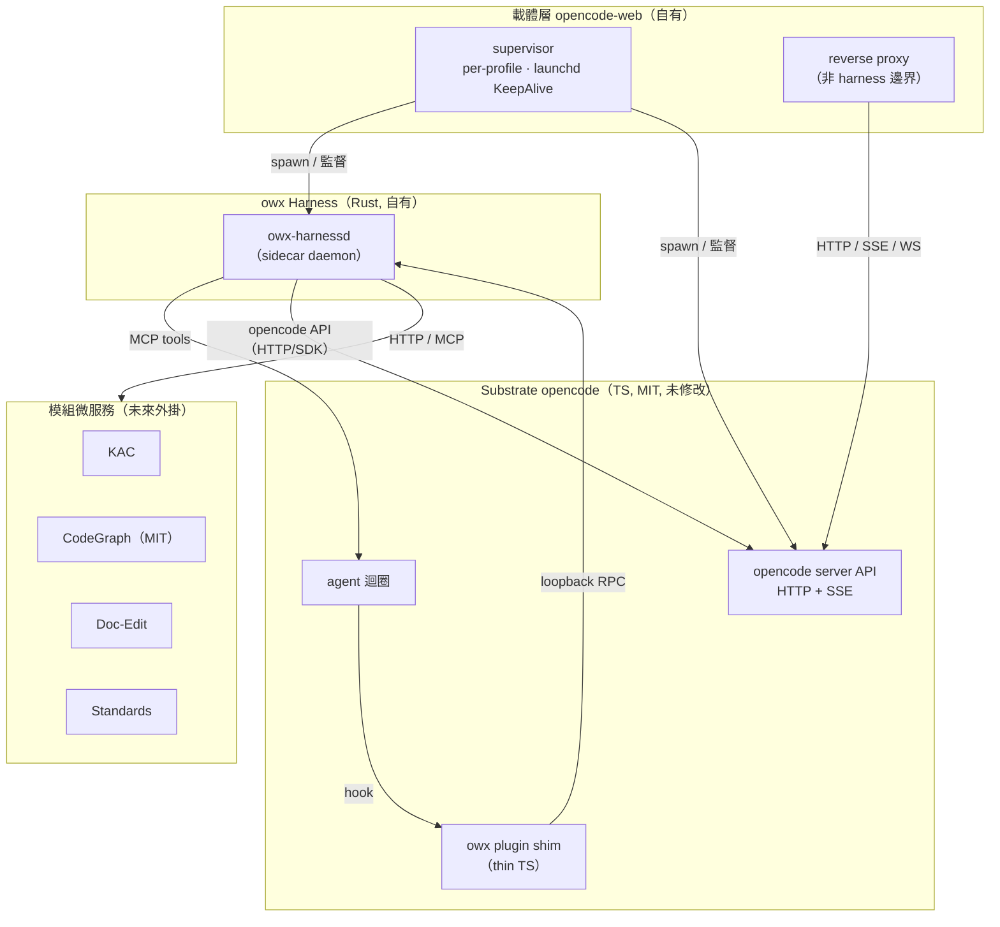
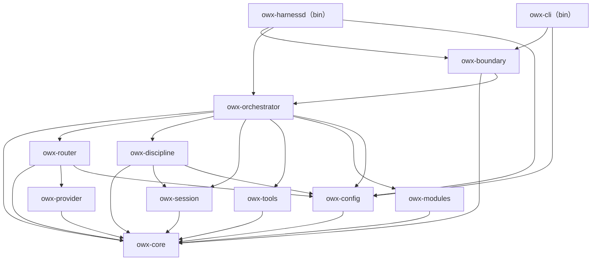
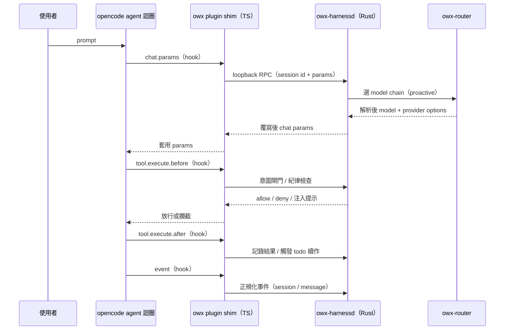
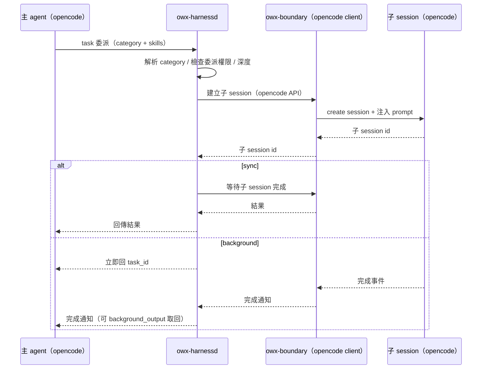

# owx L3 設計：Harness 架構與邊界（harness-architecture.md）

> 版本：v0.1　|　日期：2026-10-17　|　狀態：Draft
> 來源：整合自 [`base-core-requirements.md`](../spec/base-core-requirements.md)、[`functional-spec.md`](../spec/functional-spec.md)、[`ADR-0001`](../adr/ADR-0001-substrate-opencode-cleanroom-omo.md)、[`ADR-0002`](../adr/ADR-0002-iterative-spiral-workflow.md)、[`ADR-0003`](../adr/ADR-0003-harness-rust-core-react-frontend.md)、[`ADR-0004`](../adr/ADR-0004-harness-opencode-boundary.md)、[`document-standards.md`](../standards/document-standards.md)、[`licensing.md`](../standards/governance/licensing.md)。

---

## 0. 定位與關聯

### 0.1 定位聲明

- **本檔是**：owx 的 **L3（詳細設計）Harness 架構與邊界權威**。定義 Harness 的分層拓撲、Rust cargo workspace 的 crate 分解、各職責落點，以及 Harness 與 opencode 之間的整合邊界。
- **本檔不是**：
  - **不是** 需求清單 → 見 [`base-core-requirements.md`](../spec/base-core-requirements.md) 與 [`functional-spec.md`](../spec/functional-spec.md)。
  - **不是** 資料模型與狀態機 → 見 [`data-and-state.md`](data-and-state.md)。
  - **不是** HTTP 端點契約（路由、請求／回應、錯誤碼）→ 見 [`interfaces.md`](interfaces.md)。
  - **不是** 載體層行為規格 → 權威在 carrier repo（連結見 §0.2）。
  - **不是** 實作程式碼：本檔只給可實作的決策與理由，不含 Rust 原始碼。

### 0.2 文件關聯

| 文件 | 角色 | 連結 |
|---|---|---|
| `base-core-requirements.md` | 上游：core 需求（FR-A 至 FR-I、NFR-*） | [`../spec/base-core-requirements.md`](../spec/base-core-requirements.md) |
| `functional-spec.md` | 上游：整合功能規格（FR-CARRIER／SUB／HAR、TC-*） | [`../spec/functional-spec.md`](../spec/functional-spec.md) |
| `ADR-0004` | 上游決策：Harness↔opencode 整合邊界（本檔依其展開） | [`../adr/ADR-0004-harness-opencode-boundary.md`](../adr/ADR-0004-harness-opencode-boundary.md) |
| `ADR-0003` | 上游決策：Rust 核心＋React 前端 | [`../adr/ADR-0003-harness-rust-core-react-frontend.md`](../adr/ADR-0003-harness-rust-core-react-frontend.md) |
| `data-and-state.md` | 同層：資料模型與狀態機（本檔不重複） | [`data-and-state.md`](data-and-state.md) |
| `interfaces.md` | 同層：HTTP 端點契約（本檔不重複） | [`interfaces.md`](interfaces.md) |
| carrier `ow-workspace-layout.md` | 載體層權威：profile 與工作區佈局 | [`../../../opencode-web/docs/spec/ow-workspace-layout.md`](../../../opencode-web/docs/spec/ow-workspace-layout.md) |
| carrier `ow-document-access.md` | 載體層權威：文件存取與 doc-status | [`../../../opencode-web/docs/spec/ow-document-access.md`](../../../opencode-web/docs/spec/ow-document-access.md) |
| carrier `mcp.md` | 載體層權威：MCP 工具契約 | [`../../../opencode-web/docs/mcp.md`](../../../opencode-web/docs/mcp.md) |

### 0.3 授權狀態

| 元件 | 授權 | 在本檔的角色 | 處置 |
|---|---|---|---|
| **opencode** | **MIT** | Substrate；plugin API、server API、session／message 儲存 | 可重用／改／散布；本檔連結指向，不重抄 |
| **owx 自有程式** | **Proprietary** | Harness 全部 crate 與載體層 | 自有；本檔完整定義 |
| **opencode-web（ow）** | **自有（Proprietary）** | 載體層來源；監督 sidecar | 可自由改 |
| **CodeGraph** | **MIT（非自有）** | 未來 code 圖模組（本檔未展開） | 可用；標註非自有 |
| **omo（oh-my-openagent）** | **SUL-1.0** | **需求來源，非程式碼來源** | 不進交付物；僅黑箱回溯 |

> 紅線與 PR 閘門見 [`licensing.md`](../standards/governance/licensing.md) §4、§5。本檔不含任何 omo 之原始碼、prompt、skill 文字、文件或品牌名。

---

## 1. 分層與邊界拓撲

### 1.1 邊界決策（依 ADR-0004）

Harness 與 opencode 的整合邊界**已於 [`ADR-0004`](../adr/ADR-0004-harness-opencode-boundary.md) 拍板**，本檔精確反映，不另立邊界：

- **主幹**：Rust sidecar daemon `owx-harnessd` 承載全部 harness 邏輯；thin TS plugin shim `packages/opencode-plugin-owx/` 以 opencode 的 MIT plugin API 掛載 hook，經 **loopback RPC** 轉呼叫 sidecar。
- **hook 表面**：`chat.params`、`tool.execute.before`、`tool.execute.after`、`event`、`permission.ask`（FR-G-1）。此為**唯一**能攔截 agent 內部迴圈的表面。
- **同一 sidecar 另兼兩職**：(i) 暴露 **MCP server**，供 opencode 模型呼叫 harness 工具；(ii) 作為 **opencode server API 的 HTTP／SDK 客戶端**，驅動 sub-session、注入 prompt、設定 model。
- **載體監督**：載體層（`opencode-web`）**監督** sidecar（per-profile、launchd KeepAlive，FR-CARRIER-14）。
- **reverse proxy 非 harness 邊界**：proxy 只看得到 opencode 的 HTTP API，看不到工具執行與 chat params，無從介入（ADR-0004 Alternatives）。

### 1.2 拓撲圖

下圖描述四層拓撲：載體層監督、Substrate（opencode，未修改）、Harness sidecar、模組微服務。授權邊界即架構邊界，SUL 元件不得越過 Harness 邊界進入交付物。

圖說：載體層同時監督 opencode 與 sidecar；plugin shim 是 opencode 迴圈與 sidecar 之間的唯一 hook 通道；sidecar 以 MCP 供工具、以 opencode API 驅動 sub-session；模組以 HTTP／MCP 越過微服務邊界（NFR-2、NFR-13）。

---

## 2. Crate 分解

### 2.1 分解原則

- **單一職責**：每個 crate 只負責一件事，對外以 `owx-core` 的型別／特徵溝通。
- **依賴單向、無環**：依賴由高層指向低層；`owx-core` 為最底層，無 I/O 依賴。
- **邊界集中**：所有接觸 opencode 表面的程式碼集中於 `owx-boundary`，opencode 版本漂移被隔離於單一模組（ADR-0004 Consequences）。
- **跨語言邊界**：Rust 核心 ↔ TS substrate 只經 plugin／sidecar／MCP 互動，無跨語言直接記憶體耦合（NFR-13）。

### 2.2 Crate 職責與依賴

| Crate | 單一職責 | 依賴 | 依據 ID |
|---|---|---|---|
| `owx-core` | 共用型別與特徵（ports）；**無 I/O** | （無） | NFR-13 |
| `owx-config` | 設定載入與分層 deep-merge、未知鍵拒絕 | `owx-core` | FR-F-1、FR-F-2 |
| `owx-provider`（**待確認**） | provider registry 與憑證解析、統一呼叫介面。ADR-0005 下 harness 可能**僅選鏈、用 opencode providers**，自建 provider client 或不需要 | `owx-core` | FR-E-1、FR-E-4 |
| `owx-session` | harness 側 session 政策與 boulder 狀態（以 session id 為鍵） | `owx-core` | FR-C-5、FR-D-1 |
| `owx-tools` | harness 工具實作與工具政策（白名單／停用） | `owx-core` | FR-B-6、FR-HAR-3 |
| `owx-modules` | 模組微服務的 HTTP／MCP client 邊界 | `owx-core` | NFR-2、FR-G-4 |
| `owx-router` | model chain 選擇與 proactive／reactive fallback | `owx-core`、`owx-provider`、`owx-config` | FR-E-2、FR-E-3、FR-HAR-12、FR-HAR-13 |
| `owx-discipline` | 紀律機制：意圖閘門、todo、plan／verify、續作 | `owx-core`、`owx-session`、`owx-config` | FR-C-1 至 FR-C-4、FR-HAR-6 至 FR-HAR-11 |
| `owx-orchestrator` | 委派編排、category 解析、深度與權限閘門、政策決策 | `owx-core`、`owx-router`、`owx-discipline`、`owx-session`、`owx-tools`、`owx-modules`、`owx-config` | FR-A-1 至 FR-A-9、FR-HAR-1 至 FR-HAR-5 |
| `owx-boundary` | **唯一**接觸 opencode 表面：plugin RPC 協定、MCP server、opencode HTTP／SDK client；漂移隔離點 | `owx-core`、`owx-orchestrator` | FR-G-1、FR-SUB-5、NFR-3 |
| `owx-harnessd`（bin） | sidecar daemon 進入點：啟動 RPC／MCP／client 三面並接線 | `owx-boundary`、`owx-orchestrator`、`owx-config` | ADR-0004 |
| `owx-cli`（bin） | 維運 CLI：健康檢查、設定檢視、手動觸發 | `owx-boundary`、`owx-config` | FR-CARRIER-14 |
| `packages/opencode-plugin-owx/`（TS） | thin plugin shim：掛載 hook、經 loopback RPC 轉呼叫 sidecar | opencode plugin API（MIT） | FR-G-1、ADR-0004 |

### 2.3 依賴圖

下圖箭頭由**依賴者指向被依賴者**（例如 `owx-router --> owx-provider` 表示 router 依賴 provider）。圖中無環。

圖說：`owx-core` 為唯一無依賴的底層；`owx-boundary` 位於 orchestrator 之上、bins 之下，是 ports-and-adapters 的 adapter ring，也是 opencode 版本漂移的唯一隔離點。

---

## 3. 職責配置

下表說明各 harness 職責的落點 crate、觸發面與依據 ID。觸發面指 opencode plugin hook 或 sidecar 內部呼叫。

| 職責 | 落點 crate | 觸發面 | 依據 ID |
|---|---|---|---|
| **紀律：意圖閘門** | `owx-discipline` | `tool.execute.before`（首次工具呼叫前） | FR-C-1、FR-HAR-6 |
| **紀律：todo 強制** | `owx-discipline` | `tool.execute.after`、`event`（閒置續作） | FR-C-2、FR-HAR-7 |
| **紀律：plan／verify** | `owx-discipline` | `chat.params`、`tool.execute.before` | FR-C-3、FR-HAR-8 |
| **紀律：續作（goal／continuation）** | `owx-discipline` + `owx-session` | `event`（session 閒置） | FR-C-4、FR-HAR-9 |
| **紀律：boulder 狀態** | `owx-session` | 內部（以 session id 為鍵） | FR-C-5、FR-HAR-10 |
| **categories** | `owx-config`（定義）+ `owx-orchestrator`（解析） | `chat.params`、委派時 | FR-A-3、FR-HAR-2 |
| **委派（sync／background）** | `owx-orchestrator` | `tool.execute.before`（`task` 工具） | FR-A-1、FR-A-2、FR-HAR-1 |
| **委派權限與深度閘門** | `owx-orchestrator` | 委派時 | FR-A-8、FR-A-9、FR-HAR-4 |
| **model router（proactive 選鏈）** | `owx-router` | `chat.params` | FR-E-2、FR-E-3、FR-HAR-12 |
| **model router（reactive 復原）** | `owx-router` | `event`（執行後失敗） | FR-E-3、FR-HAR-13 |
| **session／memory 政策** | `owx-session` | `event`、內部 | FR-D-1、FR-C-5 |
| **權限政策** | `owx-orchestrator` + `owx-boundary` | `permission.ask` | FR-SUB-2、FR-A-9 |
| **opencode 表面整合** | `owx-boundary` | plugin RPC、MCP server、opencode client | FR-G-1、FR-SUB-5 |

> 所有權原則：**opencode 擁有訊息／session 儲存**；harness 只存**政策與 boulder 狀態**，以 session id 為鍵（ADR-0004 Consequences）。此原則避免雙重編排（見 §5）。

---

## 4. 執行期資料流

### 4.1 prompt 攔截（hook 往返）

下圖描述一次 prompt 如何經 plugin hook 往返 sidecar：`chat.params` 注入 router 選定的 model chain；`tool.execute.before` 執行意圖閘門與紀律檢查；`tool.execute.after` 記錄結果並觸發 todo 續作；`event` 正規化事件。

圖說：hook 為**同步往返**，故 sidecar 逾時策略直接影響 agent 迴圈延遲（見 §5）。安全關鍵 hook（`permission.ask`）採 fail-closed，非關鍵 hook 採 fail-open。

### 4.2 委派至 sub-session

下圖描述 `task` 委派如何由 orchestrator 解析後，經 `owx-boundary` 以 opencode API 建立子 session。sync 阻塞至結果；background 立即回 `task_id`，完成後通知並可 `background_output` 取回。

圖說：子 session 的訊息儲存仍由 opencode 擁有；harness 只保存委派政策與 boulder 狀態（以 session id 為鍵），避免與 opencode 的 session 儲存重複。

---

## 5. 風險與緩解

| 風險 | 說明 | 緩解 | 依據 ID |
|---|---|---|---|
| **hook 覆蓋不足／API 漂移** | opencode plugin hook 可能未覆蓋全部所需攔截點，或版本升級改變 hook 契約 | 以 walking skeleton 先驗證 hook 覆蓋；pin opencode 版本；漂移隔離於 `owx-boundary` 單一模組 | ADR-0004、FR-G-1、NFR-3 |
| **延遲／失敗耦合** | 每次 prompt／工具呼叫跨語言往返 sidecar，增延遲；sidecar 故障可能阻斷迴圈 | 非關鍵 hook **fail-open**（advisory，失敗則放行）；安全關鍵（`permission.ask`）**fail-closed**；設逾時與健康檢查 | ADR-0004、FR-SUB-2、NFR-4 |
| **雙重編排** | harness 與 opencode 同時管理 session／訊息，可能狀態分歧 | opencode 擁有訊息／session 儲存；harness 只存**政策與 boulder 狀態**，以 session id 為鍵 | ADR-0004、FR-C-5、FR-D-1 |
| **router 與 opencode provider-fallback 重疊** | opencode 有同 model ID 的 provider fallback，harness router 另有模型鏈，兩者可能互相干擾 | harness router 擁有**鏈選擇**，以 **agent 設定／session 建立**下傳解析後 model（`chat.params` 無 model 欄位，已 live 驗證）；opencode 只負責同 ID provider 層 fallback（[ADR-0005](../adr/ADR-0005-model-chain-injection-path.md)） | FR-E-2、FR-E-3、FR-HAR-12、FR-HAR-13 |
| **授權侵蝕** | 開發中不慎引入 SUL／非可交付元件，或沿用 omo 品牌 | 交付物僅 MIT／自有；`owx-boundary` 為授權邊界；PR 閘門與元件授權表；本檔不含 omo 內容 | NFR-1、ADR-0001、ADR-0004 |

---

## 6. 依據 ID

### 6.1 架構決策（ADR）

- [`ADR-0001`](../adr/ADR-0001-substrate-opencode-cleanroom-omo.md)：以 opencode 為 substrate、omo 僅作 clean-room 需求來源。
- [`ADR-0002`](../adr/ADR-0002-iterative-spiral-workflow.md)：迭代螺旋工作流。
- [`ADR-0003`](../adr/ADR-0003-harness-rust-core-react-frontend.md)：Harness 核心採 Rust、前端採 React。
- [`ADR-0004`](../adr/ADR-0004-harness-opencode-boundary.md)：Harness↔opencode 整合邊界（Rust sidecar ＋ thin TS plugin shim）。

### 6.2 功能需求（FR）

- **委派編排**：FR-A-1 至 FR-A-9、FR-HAR-1 至 FR-HAR-5。
- **紀律機制**：FR-C-1 至 FR-C-5、FR-HAR-6 至 FR-HAR-11。
- **model router**：FR-E-1 至 FR-E-4、FR-HAR-12、FR-HAR-13。
- **session 與上下文**：FR-D-1。
- **工具**：FR-B-6、FR-HAR-3。
- **設定**：FR-F-1、FR-F-2。
- **擴充機制**：FR-G-1、FR-G-4。
- **Substrate 點名**：FR-SUB-2、FR-SUB-5。
- **載體層**：FR-CARRIER-14。

### 6.3 非功能需求（NFR）

- NFR-1（授權可交付）、NFR-2（可擴充）、NFR-3（不擴充 substrate 行為）、NFR-4（可觀測）、NFR-13（跨語言邊界明確）。

---

## 7. 變更紀錄

| 日期 | 版本 | 變更 |
|---|---|---|
| 2026-10-17 | v0.1 | 初版：依 [`ADR-0004`](../adr/ADR-0004-harness-opencode-boundary.md) 展開 Harness 架構與邊界；定義分層拓撲、crate 分解（依賴無環）、職責配置、執行期資料流（prompt 攔截／委派）、風險與緩解、依據 ID。 |

---

*本文件為 clean-room 設計，不含任何 omo 之原始碼、prompt、skill、文件內容或品牌名。*
