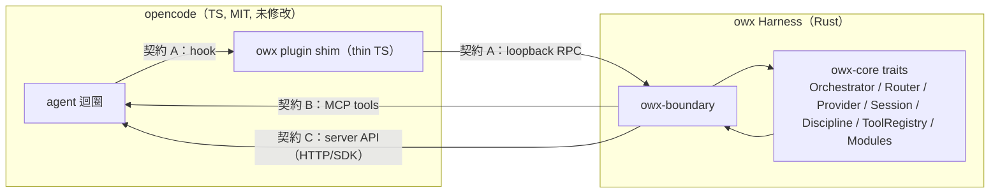
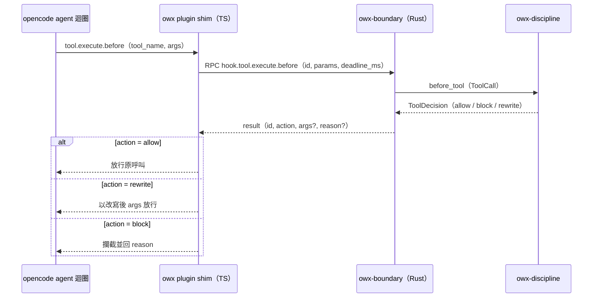
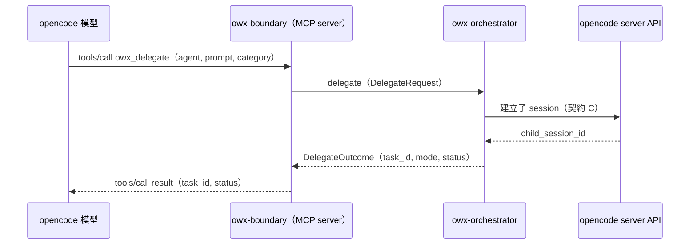

# owx L3 設計：介面契約（interfaces.md）

> 版本：v0.9　|　日期：2026-10-20　|　狀態：Draft
> 來源：整合自 [`base-core-requirements.md`](../spec/base-core-requirements.md)、[`functional-spec.md`](../spec/functional-spec.md)、[`ADR-0001`](../adr/ADR-0001-substrate-opencode-cleanroom-omo.md)、[`ADR-0003`](../adr/ADR-0003-harness-rust-core-react-frontend.md)、[`ADR-0004`](../adr/ADR-0004-harness-opencode-boundary.md)、[`document-standards.md`](../standards/document-standards.md)、[`coding-standards.md`](../standards/coding-standards.md)，以及載體 repo `opencode-web` 之規格（`docs/mcp.md`）。

---

## 1. 定位與關聯

### 1.1 定位聲明

- **本檔是**：owx 的 **L3（詳細設計）介面契約權威**。定義跨邊界契約（hook RPC、harness 管理 RPC、MCP tools、opencode server API 客戶端）與 Harness 內部 Rust trait 的**形狀**（方向、欄位、回應語意、時序、錯誤映射、版本策略）。
- **本檔不是**：
  - **不是** 資料模型與狀態機 → 見 [`data-and-state.md`](data-and-state.md)（本檔不重述任何實體 schema，一律連結）。
  - **不是** 模組分解與元件邊界 → 見 [`harness-architecture.md`](harness-architecture.md)（規劃中；crate 分解見 [`ADR-0004`](../adr/ADR-0004-harness-opencode-boundary.md)）。
  - **不是** 需求清單 → 見 [`base-core-requirements.md`](../spec/base-core-requirements.md) 與 [`functional-spec.md`](../spec/functional-spec.md)。
  - **不是** 實作 → 本檔僅含 trait／type 契約草稿（interface sketch），不含函式體、演算法或 I/O 實作。
  - **不是** opencode server API 的權威文件 → 以連結指向 opencode 官方文件（見 §4.2），不複製。

> **文件關聯（依 [`document-standards.md`](../standards/document-standards.md) §2.5）**：本檔為**同層設計文件**，與 [`data-and-state.md`](data-and-state.md)（資料模型）、[`harness-architecture.md`](harness-architecture.md)（模組分解）分工互補。跨檔以穩定 ID（`FR-*`／`NFR-*`／`ADR-*`／`D*`）追溯，內容不複製。

### 1.2 文件關聯

| 文件 | 角色 | 連結 |
|---|---|---|
| `base-core-requirements.md` | 上游：core 需求（FR-A 至 FR-I、NFR-*） | [`../spec/base-core-requirements.md`](../spec/base-core-requirements.md) |
| `functional-spec.md` | 上游：整合功能規格（FR-CARRIER／SUB／HAR、TC-*） | [`../spec/functional-spec.md`](../spec/functional-spec.md) |
| `ADR-0004` | 上游：Harness↔opencode 整合邊界決策 | [`../adr/ADR-0004-harness-opencode-boundary.md`](../adr/ADR-0004-harness-opencode-boundary.md) |
| `data-and-state.md` | 同層：資料模型與狀態機（本檔不重述） | [`data-and-state.md`](data-and-state.md) |
| `harness-architecture.md` | 同層：模組分解與 crate 邊界（規劃中） | [`harness-architecture.md`](harness-architecture.md) |
| carrier `mcp.md` | 載體層權威：MCP 工具契約（`opencode_*`） | [`../../../opencode-web/docs/mcp.md`](../../../opencode-web/docs/mcp.md) |
| opencode 官方文件 | Substrate 權威：server API 與 plugin hook | [opencode.ai/docs](https://opencode.ai/docs) |

### 1.3 授權狀態

| 元件 | 授權 | 在本檔的角色 | 處置 |
|---|---|---|---|
| **opencode** | **MIT** | Substrate；plugin hook 與 server API 來源 | 可重用／改／散布；本檔連結指向，不重抄 |
| **owx 自有程式** | **Proprietary** | Harness（Rust）與載體層；三條邊界契約與 trait | 自有；本檔完整定義 |
| **opencode-web（ow）** | **自有（Proprietary）** | 載體層來源；`opencode_*` MCP 工具 | 可自由改 |
| **CodeGraph** | **MIT（非自有）** | 未來 code 圖模組（本檔未展開） | 可用；標註非自有 |
| **omo（oh-my-openagent）** | **SUL-1.0** | **需求來源，非程式碼來源** | 不進交付物；僅黑箱回溯 |

> 紅線與 PR 閘門見 [`licensing.md`](../standards/governance/licensing.md) §4、§5。

### 1.4 邊界總覽

下圖為三條跨邊界契約與內部 trait 的相對位置。契約 A（hook RPC）由 shim 發起、sidecar 回應；契約 B（MCP tools）由 opencode 模型發起、sidecar 回應；契約 C（server API）由 sidecar 發起、opencode 回應。三條契約皆收斂於 `owx-boundary`（漂移隔離點，見 §7）。



圖說：契約 A 與 B 為**入向**（opencode 呼叫 harness）；契約 C 為**出向**（harness 驅動 opencode）。`owx-boundary` 是唯一持有 opencode 版本相依映射的模組（[`ADR-0004`](../adr/ADR-0004-harness-opencode-boundary.md)）。

---

## 2. 邊界契約 A：loopback 入向 RPC（shim／前端 → sidecar）

> **來源需求**：FR-G-1（plugin hook 表面）、FR-HAR-6 至 FR-HAR-13（紀律與路由強制）、FR-SUB-2（權限可觀察）、FR-SUB-5（不擴充 substrate）。**決策依據**：[`ADR-0004`](../adr/ADR-0004-harness-opencode-boundary.md)（sidecar ＋ thin TS shim，loopback RPC）。

### 2.1 RPC 信封

shim 與 sidecar 之間以 **loopback RPC**（Unix domain socket 或 `127.0.0.1` TCP，二選一由 `owx-boundary` 決定）通訊。信封為 JSON 物件，欄位如下。

**請求（shim → sidecar）**：

| 欄位 | 型別 | 必填 | 說明 |
|---|---|---|---|
| `schema_version` | string | ✅ | RPC schema 版本（見 §7） |
| `id` | string | ✅ | 關聯識別碼；回應須回填同一 `id` |
| `method` | string | ✅ | 回呼方法名（`hook.chat.params` 等，見 §2.2） |
| `params` | object | ✅ | 方法專屬酬載（見 §2.3） |
| `deadline_ms` | number | ✅ | 逾時上限；逾時由 shim 依該 hook 的 fail 策略處置 |

**回應（sidecar → shim）**：

| 欄位 | 型別 | 必填 | 說明 |
|---|---|---|---|
| `id` | string | ✅ | 回填請求 `id` |
| `result` | object \| null | | 成功酬載（含 `action`，見 §2.3） |
| `error` | object \| null | | 失敗酬載（`{ code, message, data? }`，見 §6） |

> `result` 與 `error` 互斥；兩者皆 null 視為協定錯誤。

### 2.2 回呼訊息總表

| 方法 | 方向 | 觸發時機 | 阻塞 | 失敗策略 | 主要需求 |
|---|---|---|---|---|---|
| `hook.chat.params` | shim → sidecar（請求／回應） | provider 呼叫前 | 是 | fail-open | FR-HAR-12／13、FR-E-2／3 |
| `hook.tool.execute.before` | shim → sidecar（請求／回應） | 工具執行前 | 是 | fail-open（安全關鍵除外） | FR-HAR-6／7／8、FR-C-9 |
| `hook.tool.execute.after` | shim → sidecar（請求／回應） | 工具執行後 | 是 | fail-open | FR-HAR-7／8、FR-C-6 |
| `hook.event` | shim → sidecar（單向通知） | SSE 事件到達時 | 否 | fail-open | FR-SUB-1、FR-HAR-9 |
| `hook.permission.ask` | shim → sidecar（請求／回應） | 權限請求時 | 是 | **fail-closed** | FR-SUB-2、FR-A-9 |

> **fail-open**：sidecar 逾時或不可達時，shim 放行原行為（不阻斷 agent 迴圈）。**fail-closed**：安全關鍵 hook（`permission.ask`）逾時或不可達時，shim 一律拒絕（deny），不靜默放行（[`ADR-0004`](../adr/ADR-0004-harness-opencode-boundary.md) 風險與緩解）。

### 2.3 逐訊息契約

#### A.1 `hook.chat.params`

- **方向**：shim → sidecar（請求）；sidecar → shim（回應）。
- **時機**：provider 呼叫**之前**；**阻塞**（回應到達前不呼叫 provider）。
- **請求 `params` 欄位**：

| 欄位 | 型別 | 必填 | 說明 |
|---|---|---|---|
| `session_id` | string | ✅ | 所屬 session |
| `message_id` | string | ✅ | 觸發訊息 |
| `agent` | string | ✅ | 當前 agent |
| `model_ref` | `model_ref` | ✅ | 目前選定模型（形狀見 [`data-and-state.md`](data-and-state.md) §2.6） |
| `params` | object | ✅ | 目前 chat params（`temperature`／`max_tokens`／`reasoning`／`provider_options`） |
| `chain_hint` | `model_ref[]` | | 呼叫端提示的候選鏈（可選） |

- **回應 `result`**：

| `action` | 附加欄位 | 語意 |
|---|---|---|
| `allow` | 無 | 維持原 params 與 model |
| `rewrite` | `params?`、`model_ref?` | 以 harness 解析後的鏈選擇覆寫 model 與 params（proactive 選鏈，FR-HAR-13） |

- **語意**：harness router 擁有鏈選擇，經此 hook 下傳解析後 model（[`ADR-0004`](../adr/ADR-0004-harness-opencode-boundary.md)）。`rewrite` 只改 model 與 params，不改訊息內容。

#### A.2 `hook.tool.execute.before`

- **方向**：shim → sidecar（請求）；sidecar → shim（回應）。
- **時機**：工具執行**之前**；**阻塞**。
- **請求 `params` 欄位**：

| 欄位 | 型別 | 必填 | 說明 |
|---|---|---|---|
| `session_id` | string | ✅ | 所屬 session |
| `message_id` | string | ✅ | 觸發訊息 |
| `tool_call_id` | string | ✅ | 工具呼叫識別碼 |
| `tool_name` | string | ✅ | 工具名 |
| `args` | object | ✅ | 工具引數 |
| `agent` | string | ✅ | 當前 agent |
| `depth` | number | ✅ | 委派巢狀深度（FR-A-8） |

- **回應 `result`**：

| `action` | 附加欄位 | 語意 |
|---|---|---|
| `allow` | 無 | 放行原呼叫 |
| `block` | `reason` | 攔截（意圖閘門未過、doom_loop、委派權限閘門、深度上限、worker 不可再委派） |
| `rewrite` | `args` | 正規化引數後放行（不改工具名） |

- **語意**：紀律強制點（FR-HAR-6／7／8、FR-C-9）。`block` 須回可觀察 `reason`，不靜默（FR-HAR-4）。

#### A.3 `hook.tool.execute.after`

- **方向**：shim → sidecar（請求）；sidecar → shim（回應）。
- **時機**：工具執行**之後**；**阻塞**（回應到達前不續行）。
- **請求 `params` 欄位**：

| 欄位 | 型別 | 必填 | 說明 |
|---|---|---|---|
| `session_id` | string | ✅ | 所屬 session |
| `message_id` | string | ✅ | 觸發訊息 |
| `tool_call_id` | string | ✅ | 工具呼叫識別碼 |
| `tool_name` | string | ✅ | 工具名 |
| `args` | object | ✅ | 工具引數 |
| `result` | object \| null | | 工具結果（成功時） |
| `error` | object \| null | | 工具錯誤（失敗時） |
| `duration_ms` | number | ✅ | 執行耗時 |

- **回應 `result`**：

| `action` | 附加欄位 | 語意 |
|---|---|---|
| `allow` | 無 | 維持原結果 |
| `rewrite` | `result` | 改寫結果（截斷、去敏、補結構化欄位） |

- **語意**：供 todo 標記、逐步驗證與復原觀察（FR-HAR-7／8、FR-C-6）。`rewrite` 只改結果酬載，不改工具語意。

#### A.4 `hook.event`

- **方向**：shim → sidecar（**單向通知**）。
- **時機**：SSE 事件到達時；**非阻塞**（fire-and-forget）。
- **請求 `params` 欄位**：

| 欄位 | 型別 | 必填 | 說明 |
|---|---|---|---|
| `type` | string | ✅ | 事件類型（`session.*`／`message.*`／`permission.*`） |
| `properties` | object | ✅ | 事件內容 |
| `session_id` | string | | 事件所屬 session（可推導時） |

- **回應**：無（或 `{ action: "allow" }` 作為 ack）。
- **語意**：harness 以事件流觀察 session 生命週期與續作觸發（FR-SUB-1、FR-HAR-9）。載體層只轉發，不新增自製事件（FR-SUB-1）。

#### A.5 `hook.permission.ask`

- **方向**：shim → sidecar（請求）；sidecar → shim（回應）。
- **時機**：權限請求時；**阻塞**（回應到達前工具不執行，FR-SUB-2）。
- **請求 `params` 欄位**：

| 欄位 | 型別 | 必填 | 說明 |
|---|---|---|---|
| `session_id` | string | ✅ | 所屬 session |
| `message_id` | string | ✅ | 觸發訊息 |
| `tool_call_id` | string | ✅ | 工具呼叫識別碼 |
| `tool_name` | string | ✅ | 工具名 |
| `args` | object | ✅ | 工具引數 |
| `permission_kind` | string | ✅ | 權限類別（如 `edit`／`bash`／`task`） |
| `agent` | string | ✅ | 當前 agent |

- **回應 `result`**：

| `action` | 附加欄位 | 語意 |
|---|---|---|
| `allow` | 無 | 允許 |
| `block` | `reason` | 拒絕（工具跳過並回可觀察結果，不靜默） |
| `ask` | 無 | 交由使用者決定（harness 不代決） |

- **語意**：安全關鍵 hook，**fail-closed**（[`ADR-0004`](../adr/ADR-0004-harness-opencode-boundary.md)）。委派權限閘門（FR-A-9）與 plan mode（FR-C-11）皆經此點。

### 2.4 往返時序圖（以 `tool.execute.before` 為例）

下圖為一次 hook 往返：shim 攔截工具呼叫，經 loopback RPC 詢問 sidecar，sidecar 交紀律層判定後回覆，shim 依 `action` 放行、改寫或攔截。



圖說：逾時或 sidecar 不可達時，shim 依 §2.2 的失敗策略處置（此 hook 為 fail-open，`permission.ask` 為 fail-closed）。

### 2.5 harness 管理 RPC（前端 → sidecar）：`POST /rpc/project/create`

> **來源需求**：FR-H-17、FR-H-16。**決策依據**：[`ADR-0008`](../adr/ADR-0008-project-lifecycle-owned-by-owx-harness.md)。

前端（React）經載體／dev proxy 呼叫 sidecar 的 loopback **管理 RPC**。與契約 A 同屬**入向**（client → sidecar）RPC，但為**管理面**（專案生命週期），非 agent 迴圈 hook。

**端點**：`POST /rpc/project/create`

**請求**（`application/json`）：

| 欄位 | 型別 | 必填 | 說明 |
|---|---|---|---|
| `name` | string | ✅ | 專案顯示名稱 |
| `slug` | string | ✅ | 文件英文名；作為資料夾與識別，須符合 `^[a-z0-9][a-z0-9-]*$`（≤64） |
| `tags` | string[] | | 標籤 |

**回應**（200）：

| 欄位 | 型別 | 說明 |
|---|---|---|
| `id` | string | 系統生成專案編號（`OWX-<hex>`） |
| `name`／`slug` | string | 同請求 |
| `tags` | string[] | 同請求 |
| `created` | number | 建立時間（epoch ms） |
| `worktree` | string | 建立之絕對路徑（`<OWX_KNOWLEDGE_DIR>/<slug>`） |

**錯誤**：`400 {error:"invalid_slug"}`、`409 {error:"already_exists"}`、`500 {error:"mkdir_failed"}`。

**副作用**：建立 `<OWX_KNOWLEDGE_DIR>/<slug>`（env `OWX_KNOWLEDGE_DIR`，預設 `~/knowledge`）、寫 `.owx-project.json`、`git init`（best-effort）。

> **安全（go-live）**：`/rpc` 目前經前端（公開網域）可達；上線前須加 **bearer／存取控制**（`AGENTS.md` §10 go-live）。

### 2.6 harness 管理 RPC（前端 → sidecar）：檔案樹節點操作

> **來源需求**：FR-H-18、FR-H-19。**決策依據**：[`ADR-0009`](../adr/ADR-0009-filetree-node-operations-via-harness.md)。

寫入與封裝 RPC，供 Explorer 節點操作使用。**共同安全邊界**：`path` 為**相對** `directory` 的路徑；伺服端正規化後須落在 `directory` 之下，否則回 `400 outside_worktree`。

#### `POST /rpc/fs/mkdir`（建立資料夾）

- **請求**：`{ directory: string, path: string }`
- **回應**（200）：`{ path: string }`（相對路徑）
- **錯誤**：`400 invalid_path`／`400 outside_worktree`／`409 already_exists`

#### `POST /rpc/fs/write`（建立／寫入文檔）

- **請求**：`{ directory: string, path: string, content: string, overwrite?: boolean }`
- **回應**（200）：`{ path: string, bytes: number }`
- **錯誤**：`400 outside_worktree`／`409 already_exists`（`overwrite` 未設時）

#### `POST /rpc/archive/create`（打包）

- **請求**：`{ directory: string, path: string, format?: "zip" | "tar.gz" | "tar" }`（預設 `zip`）
- **回應**（200）：`{ archive: string }`（產物相對路徑，如 `<path>.zip`）
- **錯誤**：`400 outside_worktree`／`404 not_found`／`415 unsupported_format`

#### `POST /rpc/archive/extract`（解封裝）

- **請求**：`{ directory: string, path: string, dest?: string }`（`dest` 預設為去掉副檔名的同名目錄）
- **回應**（200）：`{ dest: string }`
- **錯誤**：`400 outside_worktree`／`404 not_found`／`415 unsupported_format`（依副檔名偵測 `.zip`／`.tar.gz`／`.tgz`／`.tar`）

#### `GET /rpc/knowledge/list`（列出文件專案）

- **請求**：（無 body）
- **回應**（200）：`{ projects: [{ slug, name, id?, tags?, created?, worktree, dirty }] }`——列舉 `OWX_KNOWLEDGE_DIR`（預設 `~/knowledge`）之子目錄；若含 `.owx-project.json` 則附 `id`／`tags`／`created`；`dirty` 為該專案是否有未提交變更（`git status --porcelain` 非空）。
- **語意**：**文件專案的真實來源**（非 opencode `GET /project`）；前端「專案入口頁」以此列表。

#### `GET /rpc/git/status`（檔案變更狀態）

- **請求**：query `directory`
- **回應**（200）：`{ files: [{ path, status }] }`（`status` ∈ `modified`／`added`／`deleted`／`renamed`／`untracked`）
- **語意**：`git -C <directory> status --porcelain`；非 git 目錄回空清單。用於 Explorer 節點的**變更色**。

#### `POST /rpc/git/commit`（提交全部變更）

- **請求**：`{ directory, message }`
- **回應**（200）：`{ committed: boolean, reason? }`（無變更時 `committed:false`，`reason:"nothing_to_commit"`）
- **錯誤**：`400 invalid_directory`／`400 commit_failed`（附 `detail`）
- **語意**：`git add -A` → 若有變更則 `git commit -m <message>`（以 `-c user.name=owx -c user.email=owx@localhost` 覆寫身分）。供「文件全部提交」。

> **安全（go-live）**：寫入面風險高；上線前須加 **bearer／存取控制**，並限制解壓後大小與檔案數（防壓縮炸彈）。

### 2.7 harness 管理 RPC（前端 → sidecar）：文件匯入／轉換／匯出／分享（規劃中）

> **來源需求**：FR-H-20～22。**決策依據**：[`ADR-0010`](../adr/ADR-0010-document-lifecycle-via-harness.md)。

**共同邊界**：`path` 相對 `directory`，限 worktree 之下（`400 outside_worktree`）。外部整合之憑證／端點以 config/env 注入，不寫死。

#### `POST /rpc/import/file`

- **請求**：`{ directory, path, contentBase64, overwrite?: boolean }`
- **回應**（200）：`{ path, bytes }`
- **錯誤**：`400 outside_worktree`／`409 already_exists`

#### `POST /rpc/import/notion`

- **請求**：`{ directory, url, dest?: string }`
- **回應**（200）：`{ path }`
- **錯誤**：`501 not_configured`（Notion API 未設置）

#### `POST /rpc/convert`

- **請求**：`{ directory, path, to: "pdf" | "md" }`
- **回應**（200）：`{ output }`
- **錯誤**：`400 outside_worktree`／`404 not_found`／`415 unsupported_conversion`（如 `pdf → md` 若未支援）

#### `POST /rpc/export/filer`

- **請求**：`{ directory, path }`
- **回應**（200）：`{ url }`
- **錯誤**：`501 not_configured`（filer 未設置）

#### `POST /rpc/export/notion`

- **請求**：`{ directory, path }`
- **回應**（200）：`{ url? }`
- **錯誤**：`501 not_configured`

#### `POST /rpc/share`

- **請求**：`{ directory, paths: string[], permission?: "view" | "edit", regenerate?: boolean }`（`paths`＝**包含的文件清單**；`permission` 預設 `view`＝只能查詢）
- **回應**（200）：`{ url, token }`（連結含**文件 id＋token**）
- **錯誤**：`400 outside_worktree`／`404 not_found`
- **語意**：參考 KAC `doc-server`——token 決定**包含哪些文件**與**權限（查詢／編輯）**；`regenerate: true` 使**舊 token 失效**。

> **資源上限**：本節與 §2.6 之上傳／封裝預設 **50MB**（env `OWX_MAX_UPLOAD_BYTES`，可調）。

> **狀態**：本節為**規劃中**契約；Notion／filer 未設置時以 `501 not_configured` 佔位（**不假造成功**）。

---

### 2.8 harness 管理 RPC（前端 → sidecar）：設定（settings）

> **來源需求**：FR-H-27、FR-H-28。**決策依據**：[`ADR-0012`](../adr/ADR-0012-settings-persistence-in-harness-config.md)。

前端（React）經 sidecar 讀寫 **owx 自有設定**；持久化於 **`<config_dir>/settings.json`**（`config_dir` 解析序：`OWX_CONFIG_DIR` → `$XDG_CONFIG_HOME/owx` → `$HOME/.config/owx`）。設定形狀（camelCase）：

| 欄位 | 型別 | 說明 |
|---|---|---|
| `global.systemName` | string | 系統顯示名稱（預設 `"owx"`） |
| `global.knowledgeRoot` | string \| null | 知識根目錄覆寫（`null`＝沿用 `OWX_KNOWLEDGE_DIR`） |
| `global.logo` | string \| null | Logo 檔名（位於 config dir） |
| `global.accent` | string \| null | 品牌主色（`#rrggbb`） |
| `global.defaultProviderId` | string \| null | 預設 provider（新 session） |
| `global.defaultModelId` | string \| null | 預設 model（新 session） |
| `global.defaultAgent` | string \| null | 預設 agent（新 session） |
| `personal.theme` | `"system"` \| `"light"` \| `"dark"` | 主題 |

#### `GET /rpc/settings`

- **請求**：（無 body）
- **回應**（200）：完整設定物件；檔案不存在或無法解析時回**預設值**（永不 panic）。

#### `POST /rpc/settings`

- **請求**：完整設定物件（前端送完整狀態）。
- **回應**（200）：寫入後之設定。
- **錯誤**：`400 {error:"invalid_settings", detail}`（`accent` 非 `^#[0-9a-fA-F]{6}$`）／`500 {error:"write_failed"}`。
- **語意**：驗證後**覆寫**整份設定檔（pretty JSON）。**未知鍵刻意忽略**（向前相容；與 FR-F-1 之嚴格分層設定刻意不同）。

#### `POST /rpc/settings/logo`

- **請求**：`{ dataBase64: string, ext: "png" | "jpg" | "jpeg" | "svg" | "webp" }`（解碼後 ≤ **2MB**）
- **回應**（200）：`{ logo: string }`（檔名，如 `"logo.png"`）
- **錯誤**：`400 invalid_image`（副檔名不支援或 base64 解碼失敗）／`413 too_large`／`500 write_failed`
- **語意**：寫入 `<config_dir>/logo.<ext>`，並更新 `global.logo`。

#### `GET /rpc/settings/logo`

- **請求**：（無 body）
- **回應**（200）：Logo 原始 bytes；`Content-Type` 依副檔名（png→`image/png`、jpg／jpeg→`image/jpeg`、svg→`image/svg+xml`、webp→`image/webp`）。
- **錯誤**：`404 {error:"not_found"}`（未設定或檔案不存在）

#### `GET /rpc/models`（模型目錄）

- **請求**：（無 body）
- **回應**（200）：`{ source: string, providers: [{ id, name, models: [{ id, name }] }] }`——`source` 為 opencode 預設 registry URL（`OPENCODE_MODELS_URL`，預設 `https://models.opencode.ai`）。
- **錯誤**：`502 {error:"models_unavailable"}`（registry 檔不存在）／`502 {error:"models_invalid"}`（無法解析）
- **語意**：讀取 opencode 就其預設 URL 維護之 registry（解析序 `OPENCODE_MODELS_PATH` → `$XDG_CACHE_HOME/opencode/models.json` → `$HOME/.cache/opencode/models.json`）；供「模型下載清單」（FR-H-31）。

> **Provider 連線（FR-H-32）走 substrate opencode API**（非 harness）：`PUT /auth/{id}`（body `{type:"api",key}`）、`DELETE /auth/{id}`、`GET /provider`、`PATCH /global/config`（`provider.<id>.options.baseURL`）。前端經載體／dev proxy（新增 `/auth` 前綴）直呼 opencode。

> **知識根目錄覆寫**：`global.knowledgeRoot`（非空）覆寫 `OWX_KNOWLEDGE_DIR`（預設 `~/knowledge`），供 `GET /rpc/knowledge/list`（§2.6）與 `POST /rpc/project/create`（§2.5）。

> **安全（go-live）**：`/rpc` 目前經前端（公開網域）可達；上線前須加 **bearer／存取控制**（`AGENTS.md` §10 go-live）。

### 2.9 harness 管理 RPC（前端 → sidecar）：專案屬性設定

> **來源需求**：FR-H-33～55。**決策依據**：[`ADR-0011`](../adr/ADR-0011-project-metadata-and-standards-catalog.md)。規格：[`project-properties-requirements.md`](../spec/project-properties-requirements.md)。

#### `GET /rpc/project/get`

- **請求**：query `directory`（絕對路徑，須落於 `OWX_KNOWLEDGE_DIR` 之下）。
- **回應**（200）：`.owx-project.json` 內容，缺欄以預設補齊；含 `name_en`／`properties[]`／`base_dirs`／`writing_standard`／`params`，並回 `worktree`。
- **錯誤**：`400 invalid_directory`／`400 outside_worktree`。

#### `POST /rpc/project/update`

- **請求**：`{ directory, patch }`（`patch` 為部分物件，deep-merge）；`id`／`slug`／`created` **不可**由 patch 變更。
- **回應**（200）：更新後中繼資料，含 `applied: { base_dirs: string[], compliance_copied: string[] }`。
- **副作用**：`base_dirs.enabled` 為真 → **冪等**建立子目錄；`writing_standard.compliance[]` → 自 `owx-sample/standards/<id>.md` **抄錄**入 `<專案>/standards/<id>.md`（冪等、僅識別資料）。
- **錯誤**：`400 invalid_patch`／`400 invalid_name`／`400 invalid_property`／`400 invalid_confidentiality`／`400 invalid_autosave`／`400 outside_worktree`。

#### `GET /rpc/project/base-dirs`

- **回應**（200）：`{ base_dirs: { <屬性>: { sample_ref, dirs[] } }, properties: string[] }`；`dirs` 來自 `owx-sample/base-dirs/<sample_ref>.json`，缺檔以內建預設。

#### `GET /rpc/standards/list`

- **回應**（200）：規範目錄 `{ categories: [...] }`（`owx-Standard.json`；**僅識別資料**）。缺檔／格式錯誤 → `{ categories: [] }`（降級）。

#### `GET /rpc/standards/get`

- **請求**：query `id`（標準 id，如 `ISO-27001`；不得含路徑分隔或 `..`）。
- **回應**（200）：`{ id, content }`（`owx-sample/standards/<id>.md` 之內容；**自撰**文件，非標準原文）。
- **錯誤**：`400 invalid_id`／`404 not_found`。

> **安全（go-live）**：同 §2.5，`/rpc` 上線前須加 bearer／存取控制。

---

## 3. 邊界契約 B：MCP tools（sidecar → opencode model）

> **來源需求**：FR-G-4（MCP）、FR-HAR-1 至 FR-HAR-13（harness 能力）、NFR-2（模組可擴充）。**決策依據**：[`ADR-0004`](../adr/ADR-0004-harness-opencode-boundary.md)（sidecar 另暴露 MCP server，供 opencode 模型呼叫 harness 工具）。

### 3.1 工具總表

sidecar 以 MCP server 形式暴露 harness 工具，供 opencode 模型選用。工具前綴 `owx_*`，與載體層的 `opencode_*` 工具（見 carrier [`mcp.md`](../../../opencode-web/docs/mcp.md) §3.1）區隔。

| 工具 | 語意 | 主要需求 |
|---|---|---|
| `owx_delegate` | 委派 sub-agent（sync／background） | FR-HAR-1、FR-HAR-2 |
| `owx_background_output` | 取回背景委派結果（冪等） | FR-HAR-1 |
| `owx_intent_gate` | 意圖閘門（分類與是否需工具） | FR-HAR-6 |
| `owx_todo_write` | 建立／更新 todo | FR-HAR-7 |
| `owx_plan` | 產出計畫（供審查） | FR-HAR-8 |
| `owx_verify` | 逐步驗證（附證據） | FR-HAR-8 |
| `owx_goal` | 持久目標（續作機制） | FR-HAR-9 |
| `owx_route_model` | 查詢模型鏈與選定模型 | FR-HAR-12、FR-HAR-13 |
| `owx_module_call` | 呼叫模組微服務（HTTP／MCP） | NFR-2 |

> 委派與 fallback 的**資料形狀**（`task-delegation`、`model-fallback-decision`）見 [`data-and-state.md`](data-and-state.md) §2.5、§2.6；本節只定義工具介面，不重述實體 schema。

### 3.2 逐工具契約

#### B.1 `owx_delegate`

- **輸入**：

| 欄位 | 型別 | 必填 | 說明 |
|---|---|---|---|
| `agent` | string | ✅ | 目標 sub-agent |
| `prompt` | string | ✅ | 委派任務描述 |
| `category` | string | | 領域預設（決定 model chain 與 tool policy） |
| `skills` | string[] | | 注入的知識／工具 |
| `run_in_background` | boolean | | 背景執行（預設 false） |
| `depth` | number | | 巢狀深度（由 harness 覆核上限） |

- **輸出**：`{ task_id, mode, status, result? }`（`mode` 為 `sync`／`background`；背景時 `result` 省略，`status` 為 `running_background`）。
- **語意**：sync 阻塞至結果；background 立即回 `task_id`。閘門拒絕（權限／深度／worker 不可再委派）回 `status=rejected` 與 `error`（FR-A-8／9、FR-HAR-4）。

#### B.2 `owx_background_output`

- **輸入**：`{ task_id }`。
- **輸出**：`{ task_id, status, result?, error? }`。
- **語意**：**冪等**（同 `task_id` 回同結果）；取回前結果保留（FR-HAR-1）。

#### B.3 `owx_intent_gate`

- **輸入**：`{ session_id, prompt }`。
- **輸出**：`{ intent, category, requires_tools, proceed }`。
- **語意**：純問答（`requires_tools=false`）不強制後續紀律；`proceed=false` 時 agent 須先澄清意圖（FR-HAR-6）。

#### B.4 `owx_todo_write`

- **輸入**：`{ todos: [{ content, status, priority }] }`（`status` 為 `pending`／`in_progress`／`completed`／`cancelled`）。
- **輸出**：`{ ok, count }`。
- **語意**：多步任務強制建立 todo 並逐步標記（FR-HAR-7）。

#### B.5 `owx_plan`

- **輸入**：`{ session_id, goal }`。
- **輸出**：`{ plan_id, steps: [{ step_id, description, verify_hint }] }`。
- **語意**：產出計畫供審查；審查未通過不得進入執行（FR-HAR-8）。

#### B.6 `owx_verify`

- **輸入**：`{ plan_id, step_id, evidence }`。
- **輸出**：`{ verified, next }`。
- **語意**：逐步驗證；`verified=false` 時 `next` 指示回退或補證（FR-HAR-8）。

#### B.7 `owx_goal`

- **輸入**：`{ action: "set" | "show" | "pause" | "resume" | "clear", goal? }`。
- **輸出**：`{ goal, state }`。
- **語意**：設定持久目標；session 閒置時重新注入續作提示，直到完成審計通過（FR-HAR-9）。

#### B.8 `owx_route_model`

- **輸入**：`{ agent, category?, task_hint? }`。
- **輸出**：`{ chain: model_ref[], selected }`（`model_ref` 形狀見 [`data-and-state.md`](data-and-state.md) §2.6）。
- **語意**：唯讀查詢；實際下傳經 `hook.chat.params`（§2.3 A.1）（FR-HAR-12／13）。

#### B.9 `owx_module_call`

- **輸入**：`{ module, operation, payload }`。
- **輸出**：`{ ok, result?, error? }`。
- **語意**：以 HTTP／MCP 越過微服務邊界呼叫模組（KAC／CodeGraph／Doc-Edit／Standards）；核心與模組解耦（NFR-2）。模組內部契約不在本檔展開（見 D2 至 D4）。

### 3.3 工具呼叫時序圖（以 `owx_delegate` 為例）

下圖為一次 MCP 工具呼叫：opencode 模型選用 `owx_delegate`，sidecar 經 orchestrator 建立子 session（契約 C）並回傳結果。



圖說：MCP 層只做**包裝與轉譯**，能力邊界與 harness 一致；子 session 的建立與驅動走契約 C（§4）。

---

## 4. 邊界契約 C：sidecar → opencode server API

> **來源需求**：FR-D-1（session CRUD）、FR-D-2（SSE）、FR-D-10（非同步訊息）、FR-E-4（per-agent model）、FR-SUB-1（事件流）。**決策依據**：[`ADR-0004`](../adr/ADR-0004-harness-opencode-boundary.md)（sidecar 作為 opencode server API 的客戶端）。

### 4.1 呼叫清單

harness 以 opencode server API 客戶端身分驅動 sub-session、注入 prompt、設定 model、訂閱事件。下表為**語意層呼叫**（非 wire 契約）；wire 契約以 opencode 官方文件為準（§4.2）。

| 語意呼叫 | 用途 | 需求 |
|---|---|---|
| 建立 session | 為委派建立子 session | FR-D-1、FR-HAR-1 |
| 送出訊息／prompt | 注入委派 prompt 或續作提示 | FR-D-1、FR-HAR-9 |
| 非同步送出訊息 | 背景委派（先回應後非阻塞執行） | FR-D-10、FR-HAR-1 |
| 設定 model | 套用 router 解析後的 model 與 params | FR-E-4、FR-HAR-12 |
| 訂閱事件 | 觀察 session／message／permission 事件 | FR-D-2、FR-SUB-1 |
| 中止 session | 中止執行中的 session | FR-D-1 |
| 讀取訊息 | 取回子 session 結果 | FR-D-1、FR-HAR-1 |

### 4.2 連結（不複製）

- **opencode server API 權威文件**：[opencode.ai/docs](https://opencode.ai/docs)（v1；v2 差異待迭代確認，見 [`data-and-state.md`](data-and-state.md) §5）。
- **載體層 MCP 對應**：carrier [`mcp.md`](../../../opencode-web/docs/mcp.md) §6 說明「每個 MCP tool 內部對應 opencode server HTTP API」，本檔不重抄其對應表。
- **事件類別**：owx 依賴的 `session.*`／`message.*`／`permission.*` 見 [`data-and-state.md`](data-and-state.md) §2.4。

> 本節**不複製** opencode 的端點路徑、請求／回應 schema 或錯誤碼；所有 wire 細節以 opencode 官方文件為單一來源。`owx-boundary` 負責將語意呼叫映射為實際 wire 呼叫（§7 漂移隔離）。

---

## 5. 內部 Rust 介面

> **來源需求**：FR-HAR-1 至 FR-HAR-13、NFR-2、NFR-13。**決策依據**：[`ADR-0003`](../adr/ADR-0003-harness-rust-core-react-frontend.md)（Rust 核心）、[`ADR-0004`](../adr/ADR-0004-harness-opencode-boundary.md)（crate 分解）。**規範依據**：[`coding-standards.md`](../standards/coding-standards.md) §5（`Result` ＋ `thiserror`、禁 `unwrap`／`expect`、窮舉 match）。

> 本節為 **trait／type 契約草稿**（interface sketch），非實作。所有 trait 置於 `owx-core`（型別／特徵，無 I/O）；實作置於下游 crate（`owx-provider`／`owx-session`／`owx-tools`／`owx-modules`／`owx-router`／`owx-discipline`／`owx-orchestrator`／`owx-boundary`）。

### 5.1 錯誤型別（`owx-core`）

```rust
// owx-core：定型錯誤（thiserror）；邊界轉為 HTTP／MCP／SSE 形狀（見 §6）
#[derive(Debug, thiserror::Error)]
pub enum HarnessError {
    #[error("boundary transport error: {0}")]
    Boundary(#[from] BoundaryError),
    #[error("provider error: {0}")]
    Provider(#[from] ProviderError),
    #[error("session error: {0}")]
    Session(#[from] SessionError),
    #[error("discipline violation: {0}")]
    Discipline(#[from] DisciplineError),
    #[error("tool error: {0}")]
    Tool(#[from] ToolError),
    #[error("module error: {0}")]
    Module(#[from] ModuleError),
    #[error("config error: {0}")]
    Config(#[from] ConfigError),
}
```

### 5.2 trait 契約

#### `Orchestrator`（`owx-orchestrator`）

- **職責**：委派編排、prompt 生命週期、背景任務管理、事件分派。
- **錯誤型別**：`HarnessError`。

```rust
pub trait Orchestrator: Send + Sync {
    async fn handle_prompt(&self, req: PromptRequest) -> Result<PromptOutcome, HarnessError>;
    async fn delegate(&self, req: DelegateRequest) -> Result<DelegateOutcome, HarnessError>;
    async fn background_output(&self, task_id: TaskId) -> Result<DelegateOutcome, HarnessError>;
    async fn on_event(&self, ev: SubstrateEvent) -> Result<(), HarnessError>;
}
```

#### `Router`（`owx-router`）

- **職責**：模型鏈解析（proactive）與失敗復原（reactive）。
- **錯誤型別**：`RouterError`。

```rust
pub trait Router: Send + Sync {
    fn resolve_chain(&self, req: RouteRequest) -> Result<ModelChain, RouterError>;
    async fn on_failure(&self, ctx: FallbackContext) -> Result<ModelRef, RouterError>;
}
```

#### `Provider`（`owx-provider`）

- **職責**：統一 provider 介面；憑證解析與逾時。
- **錯誤型別**：`ProviderError`。

```rust
pub trait Provider: Send + Sync {
    async fn complete(&self, req: CompletionRequest) -> Result<CompletionResponse, ProviderError>;
    fn capabilities(&self) -> ProviderCapabilities;
}
```

#### `Session`（`owx-session`）

- **職責**：session 建立／prompt／中止／事件訂閱（契約 C 的型別化包裝）。
- **錯誤型別**：`SessionError`。

```rust
pub trait Session: Send + Sync {
    async fn create(&self, req: CreateSession) -> Result<SessionId, SessionError>;
    async fn prompt(&self, id: SessionId, msg: PromptMessage) -> Result<MessageId, SessionError>;
    async fn prompt_async(&self, id: SessionId, msg: PromptMessage) -> Result<MessageId, SessionError>;
    async fn abort(&self, id: SessionId) -> Result<(), SessionError>;
    fn subscribe(&self) -> EventStream;
}
```

#### `Discipline`（`owx-discipline`）

- **職責**：意圖閘門、工具前後判定、todo、完成審計（契約 A 的判定核心）。
- **錯誤型別**：`DisciplineError`。

```rust
pub trait Discipline: Send + Sync {
    async fn intent_gate(&self, ctx: IntentContext) -> Result<IntentDecision, DisciplineError>;
    async fn before_tool(&self, call: ToolCall) -> Result<ToolDecision, DisciplineError>;
    async fn after_tool(&self, outcome: ToolOutcome) -> Result<(), DisciplineError>;
    async fn todo(&self, op: TodoOp) -> Result<TodoState, DisciplineError>;
    async fn audit(&self, ctx: AuditContext) -> Result<AuditVerdict, DisciplineError>;
}
```

#### `ToolRegistry`（`owx-tools`）

- **職責**：harness 工具註冊與查詢（供契約 B 的 MCP server 列舉）。
- **錯誤型別**：`ToolError`。

```rust
pub trait ToolRegistry: Send + Sync {
    fn register(&self, tool: Box<dyn HarnessTool>) -> Result<(), ToolError>;
    fn get(&self, name: &str) -> Option<std::sync::Arc<dyn HarnessTool>>;
    fn list(&self) -> Vec<ToolDescriptor>;
}
```

#### `ModuleClient`（`owx-modules`）

- **職責**：模組微服務呼叫（HTTP／MCP 邊界）。
- **錯誤型別**：`ModuleError`。

```rust
pub trait ModuleClient: Send + Sync {
    async fn call(&self, req: ModuleCall) -> Result<ModuleResult, ModuleError>;
    fn describe(&self) -> ModuleDescriptor;
}
```

### 5.3 trait 對映

| trait | crate | 錯誤型別 | 對應契約 | 主要需求 |
|---|---|---|---|---|
| `Orchestrator` | `owx-orchestrator` | `HarnessError` | A、B、C | FR-HAR-1、FR-HAR-9 |
| `Router` | `owx-router` | `RouterError` | A（`chat.params`） | FR-HAR-12、FR-HAR-13 |
| `Provider` | `owx-provider` | `ProviderError` | C（出向呼叫） | FR-E-1 至 FR-E-4 |
| `Session` | `owx-session` | `SessionError` | C | FR-D-1、FR-D-2、FR-D-10 |
| `Discipline` | `owx-discipline` | `DisciplineError` | A（判定核心） | FR-HAR-6 至 FR-HAR-8 |
| `ToolRegistry` | `owx-tools` | `ToolError` | B（工具列舉） | FR-HAR-1、FR-B-8 |
| `ModuleClient` | `owx-modules` | `ModuleError` | B（`owx_module_call`） | NFR-2 |

---

## 6. 錯誤模型

> **規範依據**：[`coding-standards.md`](../standards/coding-standards.md) §8（邊界錯誤統一形狀；外部依賴失敗包裝成定型領域錯誤，保留 `cause`；不對外洩漏堆疊）。

### 6.1 錯誤分類

| 錯誤型別 | 語意 | 可重試 | 失敗策略 |
|---|---|---|---|
| `BoundaryError` | loopback RPC 傳輸／協定錯誤 | 是 | 依 hook 策略（fail-open／fail-closed） |
| `ProviderError` | provider 呼叫失敗（逾時、限流、認證） | 是（換候選） | reactive fallback |
| `SessionError` | session 操作失敗（不存在、衝突） | 否 | 回報 |
| `DisciplineError` | 紀律違規（閘門未過、doom_loop） | 否 | 攔截並回 `reason` |
| `ToolError` | 工具引數／執行錯誤 | 否 | 回報 |
| `ModuleError` | 模組微服務呼叫失敗 | 是 | 降級或回報 |
| `ConfigError` | 設定解析／驗證失敗 | 否 | 啟動即 fail fast |

### 6.2 映射表（Rust → HTTP／MCP／SSE）

| `HarnessError` | HTTP（RFC 7807 problem+json） | MCP error code | SSE 事件 |
|---|---|---|---|
| `Boundary` | `502 Bad Gateway` | `-32603`（internal） | `error` |
| `Provider` | `502`／`504 Gateway Timeout` | `-32000`（server） | `error` |
| `Session` | `404 Not Found`／`409 Conflict` | `-32001`（server） | `error` |
| `Discipline` | `403 Forbidden` | `-32002`（server） | `permission` |
| `Tool` | `400 Bad Request`／`422 Unprocessable` | `-32602`（invalid params） | `error` |
| `Module` | `502 Bad Gateway` | `-32003`（server） | `error` |
| `Config` | `500 Internal Server Error` | `-32603`（internal） | `error` |

> MCP error code 採 JSON-RPC 標準碼（`-32700` 至 `-32603`）與 server 自訂碼（`-32000` 至 `-32099`）。HTTP 錯誤形狀為 RFC 7807 `application/problem+json`（[`coding-standards.md`](../standards/coding-standards.md) §8）。SSE 錯誤事件沿用 `error`／`permission` 類別（[`data-and-state.md`](data-and-state.md) §2.4）。

### 6.3 錯誤酬載形狀

```rust
// owx-boundary：對外錯誤酬載（不洩漏堆疊與內部細節）
pub struct ErrorPayload {
    pub code: ErrorCode,      // 定型碼（見 §6.2）
    pub message: String,      // 可讀訊息（不含堆疊）
    pub data: Option<serde_json::Value>, // 結構化補充（如 reason、retryable）
}
```

---

## 7. 版本與相容

> **來源需求**：NFR-3（不擴充 substrate）、NFR-13（跨語言邊界明確）。**決策依據**：[`ADR-0004`](../adr/ADR-0004-harness-opencode-boundary.md)（pin 版本；漂移隔離於 `owx-boundary`）。

### 7.1 opencode 版本 pin

- **pin 位置**：`owx-boundary` 持有 `OPENCODE_PINNED_VERSION` 常數（單一來源，禁散落各處）。
- **啟動檢查**：sidecar 啟動時比對實際 opencode 版本與 pin 值；不符則記錄並依策略（warn／fail）處置。
- **升級流程**：升級 opencode 版本須同步更新 pin 值與 `owx-boundary` 的映射，並跑契約測試（[`coding-standards.md`](../standards/coding-standards.md) §4.2 contract 層）。

### 7.2 schema 版本策略

| 契約 | 版本欄位 | 相容策略 |
|---|---|---|
| hook RPC | 信封 `schema_version` | 加法相容（新增欄位不破壞舊 shim）；破壞性變更升版並雙軌 |
| MCP tools | 工具 `inputSchema`／`outputSchema` | 加法相容；破壞性變更以新工具名（`owx_*_v2`）並存 |
| SSE 事件映射 | `owx-boundary` 內部映射表 | 隨 opencode 版本更新；對外事件類別穩定 |

### 7.3 漂移隔離

- **唯一漂移點**：所有 opencode 版本相依的映射（hook 名、server API wire 形狀、事件類別）集中於 `owx-boundary`。
- **核心無關 substrate**：`owx-core` 的 trait 與型別不引用任何 opencode 專屬符號；opencode 改動只影響 `owx-boundary`（[`ADR-0004`](../adr/ADR-0004-harness-opencode-boundary.md)）。
- **契約測試**：以 contract 層測試鎖定三條邊界的形狀（[`coding-standards.md`](../standards/coding-standards.md) §4.2）。

### 7.4 已驗證：opencode plugin hook 表面（1.18.x）

> 驗證方式：對照 `@opencode-ai/plugin`（1.18.x）之 `Hooks` 型別定義與既有真實外掛；shim 對 `Hooks` 做**編譯期驗證**（`tsc` 通過）；並以**真實 opencode 執行**做 live 驗證（詳見本節末）。

與本專案相關的 hook：

| hook | input → output | owx 用途 |
|---|---|---|
| `tool.execute.before` | `{tool, sessionID, callID}` → `{args}` | 意圖閘門、工具攔截；**可改寫 `args`**；**阻擋須 throw**（output 無 block 欄位）|
| `tool.execute.after` | `{tool, sessionID, callID, args}` → `{title, output, metadata}` | 結果觀察／後處理 |
| `permission.ask` | `Permission` → `{status}` | 權限政策 |
| `chat.message` | `{sessionID, agent, model?, …}` → `{message, parts}` | 訊息觀察 |
| `chat.params` | `{sessionID, agent, model, provider, message}` → `{temperature, topP, topK, maxOutputTokens, options}` | LLM 參數；**output 無 model** |
| `event` | `{event}` | 事件觀察（續作／idle）|
| `experimental.chat.system.transform` | `{sessionID?, model}` → `{system}` | system prompt 注入（紀律）|
| `experimental.session.compacting` | `{sessionID}` → `{context, prompt?}` | 壓縮自訂 |
| `tool.definition` | `{toolID}` → `{description, parameters}` | 工具定義調整 |

**結論**：
1. shim 假設正確：hook 為 `{ "<name>": async (input, output) => {} }`；plugin 進入點為 `async (PluginInput) => Hooks`。
2. `tool.execute.before` 可改寫 `args`、但無 block 欄位 → 阻擋以 **throw** 實作。
3. ⚠️ **模型鏈／fallback（FR-HAR-12/13）不經 `chat.params`**（output 無 model 欄位）→ 注入路徑須改由 agent 設定／SDK 設定 session model／provider hook 達成（**待決**）。

**Live 驗證（真實 opencode `run`，載入 shim → sidecar `owx-harnessd`）**：

- 外掛載入成功；hook 觸發並到達 sidecar：`event`（高頻）、`chat.message`、`chat.params`、**`tool.execute.before`**（工具執行時）。
- 發現：**`event` hook 觸發極頻繁**（單次執行數十至上百次）→ harness 不得在 `event` 同步做重工；須節流／非同步，日誌以 debug 級記錄（已於 `owx-boundary` 調整）。
- `tool.execute.before` 本次回 `allow`（未觸發 throw 路徑）；throw 在 agent 端的行為仍待專項驗證。

**待決（新增）**：FR-HAR-12/13 模型注入路徑；`tool.execute.before` throw 在 agent 端的行為。

---

## 8. 依據 ID

| 類別 | ID | 說明 |
|---|---|---|
| ADR | [`ADR-0001`](../adr/ADR-0001-substrate-opencode-cleanroom-omo.md) | opencode 為 substrate、omo 僅 clean-room 需求來源 |
| ADR | [`ADR-0003`](../adr/ADR-0003-harness-rust-core-react-frontend.md) | Harness 核心 Rust、前端 React |
| ADR | [`ADR-0004`](../adr/ADR-0004-harness-opencode-boundary.md) | Rust sidecar ＋ thin TS shim；三條邊界契約 |
| FR | FR-G-1 | plugin hook 表面（契約 A 來源） |
| FR | FR-G-4 | MCP（契約 B 來源） |
| FR | FR-HAR-1、FR-HAR-2 | 委派（sync／background）、category 與 skills |
| FR | FR-HAR-4 | category worker 不可再委派 |
| FR | FR-HAR-6 至 FR-HAR-8 | 意圖閘門、todo、規劃與驗證 |
| FR | FR-HAR-9、FR-HAR-10 | 續作機制、工作計畫狀態 |
| FR | FR-HAR-12、FR-HAR-13 | 模型鏈、兩套 fallback |
| FR | FR-A-8、FR-A-9 | 巢狀深度控制、委派權限閘門 |
| FR | FR-C-6、FR-C-9、FR-C-11 | session 復原、doom_loop 防護、plan mode |
| FR | FR-D-1、FR-D-2、FR-D-10 | session CRUD、SSE、非同步訊息 |
| FR | FR-E-1 至 FR-E-4 | provider 統一介面、模型鏈、fallback、per-agent model |
| FR | FR-SUB-1、FR-SUB-2、FR-SUB-5 | SSE 事件流、權限可觀察、plugin／sidecar 掛載點 |
| NFR | NFR-2、NFR-3、NFR-13 | 可擴充、不擴充 substrate、跨語言邊界明確 |
| 規範 | [`document-standards.md`](../standards/document-standards.md) §2.5、§4.4、§6 | 文件關聯、設計標準、Mermaid |
| 規範 | [`coding-standards.md`](../standards/coding-standards.md) §5、§8 | Rust 標準、錯誤處理 |

---

## 9. 變更紀錄

| 日期 | 版本 | 變更 |
|---|---|---|
| 2026-10-20 | v0.9 | §2.8 增 `GET /rpc/models`（模型目錄；讀 opencode 預設 registry）與 **Provider 連線走 substrate opencode API** 註記（`PUT/DELETE /auth/{id}`、`GET /provider`、`PATCH /global/config`）。對齊 FR-H-31／FR-H-32。 |
| 2026-10-20 | v0.8 | 新增 **§2.8 harness 管理 RPC：設定（settings）**（`GET/POST /rpc/settings`、`POST/GET /rpc/settings/logo`；設定物件、錯誤、`knowledgeRoot` 覆寫；未知鍵向前相容）。依 [`ADR-0012`](../adr/ADR-0012-settings-persistence-in-harness-config.md)。 |
| 2026-10-19 | v0.7 | §2.6 增 `POST /rpc/git/commit`（提交全部變更；供「文件全部提交」）。 |
| 2026-10-19 | v0.4 | 新增 **§2.7 harness 管理 RPC：文件匯入／轉換／匯出／分享（規劃中）**（`/rpc/import/file`、`/rpc/import/notion`、`/rpc/convert`、`/rpc/export/filer`、`/rpc/export/notion`、`/rpc/share`；含 `501 not_configured` 佔位）。依 [`ADR-0010`](../adr/ADR-0010-document-lifecycle-via-harness.md)。 |
| 2026-10-19 | v0.3 | 新增 **§2.6 harness 管理 RPC：檔案樹節點操作**（`/rpc/fs/mkdir`、`/rpc/fs/write`、`/rpc/archive/create`、`/rpc/archive/extract` 契約、共同安全邊界、錯誤、go-live 註記）。依 [`ADR-0009`](../adr/ADR-0009-filetree-node-operations-via-harness.md)。 |
| 2026-10-19 | v0.2 | §2 擴為「loopback 入向 RPC（shim／前端 → sidecar）」並新增 **§2.5 harness 管理 RPC**（`POST /rpc/project/create` 契約、錯誤、副作用、安全註記）；§1.1 契約清單補「harness 管理 RPC」。依 [`ADR-0008`](../adr/ADR-0008-project-lifecycle-owned-by-owx-harness.md)。 |
| 2026-10-17 | v0.1 | 初版：三條邊界契約（hook RPC／MCP tools／server API 客戶端）、內部 Rust trait 契約、錯誤模型與映射、版本與相容策略。依 [`ADR-0004`](../adr/ADR-0004-harness-opencode-boundary.md) 邊界決策；資料形狀連結 [`data-and-state.md`](data-and-state.md)，不重述。 |
