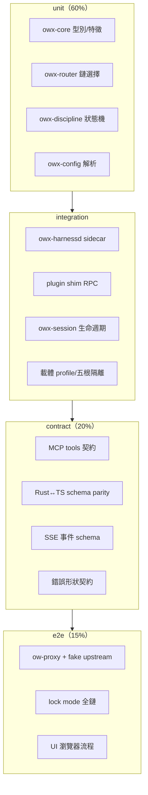
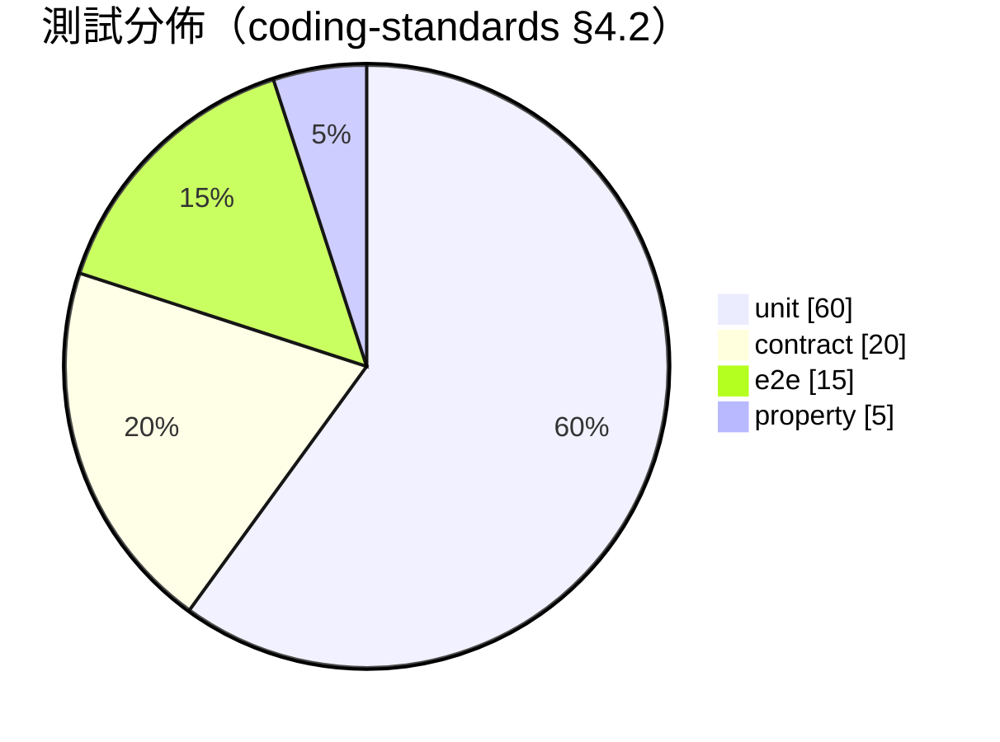
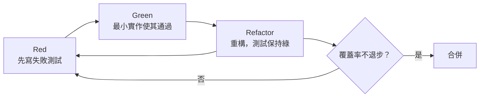
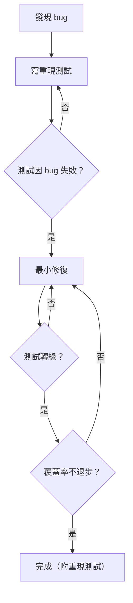
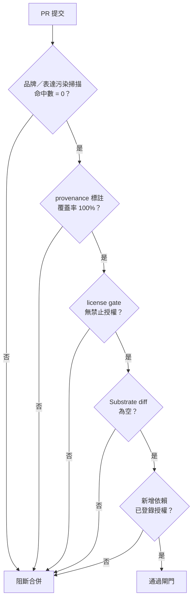

# owx 測試設計（testing.md）

> 版本：v1.1　|　日期：2026-10-19　|　狀態：Draft
> 來源：整合自 [`AGENTS.md`](../../AGENTS.md) §5、[`coding-standards.md`](../standards/coding-standards.md) §4、[`licensing.md`](../standards/governance/licensing.md)、[`base-core-requirements.md`](../spec/base-core-requirements.md)、[`functional-spec.md`](../spec/functional-spec.md)、[`ADR-0002`](../adr/ADR-0002-iterative-spiral-workflow.md)、[`ADR-0004`](../adr/ADR-0004-harness-opencode-boundary.md)，以及載體 repo `opencode-web` 既有測試（`cli/ow.test.mjs`、`proxy/ow-proxy.test.mjs`、`mcp-server/src/tools.test.ts`）之可觀察風格與隔離手法。

---

## 0. 定位與關聯

### 0.1 定位聲明（依 [`document-standards.md`](../standards/document-standards.md) §2.5）

本檔是 owx 的**測試設計**：定義測試分層、工具鏈、`FR-*`／`NFR-*` 到 `TC-*` 的對映、覆蓋率門檻、TDD 工作流、clean-room 與授權邊界測試、介面契約測試、UI 測試與 CI 佈線。

本檔**不是**：

- **不是需求規格**：需求條文屬 [`base-core-requirements.md`](../spec/base-core-requirements.md) 與 [`functional-spec.md`](../spec/functional-spec.md)，本檔以連結引用，不重抄。
- **不是實作程式碼**：本檔所有 `TC-*` 皆為**設計佔位（design placeholder）**，描述「該測什麼、在哪一層、預期什麼」，**不含任何可執行測試碼**。
- **不是已完成的測試**：owx 目前**尚無程式碼**（[`AGENTS.md`](../../AGENTS.md) §0），故本檔所有 `TC-*` **皆未實作**；實體測試案例待迭代螺旋（[`ADR-0002`](../adr/ADR-0002-iterative-spiral-workflow.md)）後續輪次補齊。

> **重要事實**：本檔的 `TC-*` 是**設計層 ID**，不是「已通過的測試」。任何把本檔的 `TC-*` 讀成「已實作」者，即違反 [`licensing.md`](../standards/governance/licensing.md) §4「不得把未來該做寫成已做」之紅線。

### 0.2 上下游連結

| 關係 | 文件 | 說明 |
|---|---|---|
| 上游（需求） | [`base-core-requirements.md`](../spec/base-core-requirements.md) | FR-A 至 FR-I、NFR-1 至 NFR-7 |
| 上游（整合規格） | [`functional-spec.md`](../spec/functional-spec.md) | FR-CARRIER／FR-SUB／FR-HAR、NFR-8 至 NFR-13、既有 `TC-*` 佔位 |
| 上游（規範） | [`coding-standards.md`](../standards/coding-standards.md) §4 | 測試紀律、測試金字塔、覆蓋率門檻、bug fix 紀律 |
| 上游（治理） | [`licensing.md`](../standards/governance/licensing.md) | 授權分級、clean-room 流程、PR 閘門 |
| 上游（決策） | [`ADR-0002`](../adr/ADR-0002-iterative-spiral-workflow.md)、[`ADR-0004`](../adr/ADR-0004-harness-opencode-boundary.md) | 迭代螺旋、Harness↔opencode 邊界 |
| 同級（設計） | [`data-and-state.md`](data-and-state.md) | 資料模型與狀態機（測試狀態轉換之依據） |

### 0.3 追溯原則

- 跨檔一律以**穩定 ID**（`FR-*`／`NFR-*`／`TC-*`／`ADR-*`）互指，內容不複製。
- 每條 `FR-*`／`NFR-*` **至少**對映一個 `TC-*`；無 `TC-*` 的需求視為**未完成**（對齊 NFR-8）。
- `TC-*` 一旦發佈**不改號**；廢除則標 `Deprecated` 並註明取代者（[`document-standards.md`](../standards/document-standards.md) §3）。

---

## 1. 測試策略

### 1.1 四層 + 一橫切

owx 採四層測試（unit／integration／contract／e2e），並以 **property-based** 為橫切（cross-cutting）手法。分層定義、範圍、工具、執行時機如下。

| 層級 | 定義 | 範圍 | 工具（候選） | 何時跑 |
|---|---|---|---|---|
| **unit** | 純邏輯，無 I/O、無網路、無真實檔案系統 | orchestrator 決策、狀態轉換、parser、router 鏈選擇、config 解析 | Rust `cargo test`；TS `node:test` | 每次存檔／每個 commit |
| **integration** | 跨模組、真實 I/O（暫存檔、子行程、loopback），但不跨服務邊界 | sidecar↔shim RPC、session 生命週期、五根隔離、workspace ensure | Rust `cargo test`（`#[tokio::test]`）；TS `node:test` + `tsx` | 每個 PR |
| **contract** | 邊界契約：API／MCP／schema／事件形狀 | MCP tools 契約、Rust↔TS schema parity、SSE 事件 schema、錯誤形狀 | `node:test` + `tsx`；Rust schema 測試 | 每個 PR |
| **e2e** | 真實啟動服務，端到端穿越多層 | 載體 proxy + fake upstream、UI 瀏覽器流程、lock mode 全鏈 | `node:test`（proxy）；Playwright（UI） | 合併前／夜間 |
| **property**（橫切） | 變形測試：對不變式做隨機輸入 | 路徑邊界守衛、slug 驗證、改寫器冪等、schema round-trip | Rust `proptest`；TS `fast-check` | 每個 PR（抽樣）／夜間（加長） |

### 1.2 分層對應元件（flowchart）

下圖描述四層測試各自覆蓋的元件。unit 覆蓋純邏輯 crate；integration 覆蓋跨模組與真實 I/O；contract 覆蓋跨語言與服務邊界；e2e 覆蓋端到端鏈路。

圖說：測試由內而外堆疊；內層失敗時外層不必跑（fail fast）。property-based 橫切於各層，對不變式做隨機輸入。

### 1.3 測試分佈（pie chart）

分佈依 [`coding-standards.md`](../standards/coding-standards.md) §4.2 測試金字塔：unit 60%、contract 20%、e2e 15%、property 5%。

### 1.4 載體測試先例（風格與隔離）

owx 的測試風格與隔離手法，**沿用載體 repo `opencode-web` 既有測試的可觀察先例**（不複製其內容，僅取風格）：

| 先例 | 手法 | owx 沿用 |
|---|---|---|
| `cli/ow.test.mjs` | `node:test` 零新增依賴；`mkdtempSync` 沙盒；`OW_PROFILE_FILE` 指向暫存檔，不碰真實 `~/.config` | 隔離以 env 重導向；測試不碰真實使用者目錄 |
| `proxy/ow-proxy.test.mjs` | 真實啟動 proxy + **fake upstream**（`createServer`）；`OW_WORKTREE` 指向 mktemp 沙盒；斷言「擋掉壞值」與「不誤殺好值」兩面 | e2e 以 fake upstream 取代真實 opencode；正反案例成對 |
| `mcp-server/src/tools.test.ts` | `node:test` + `tsx`；以「實際註冊」為唯一事實來源，比對 docs 與 endpoint | contract 測試以實作為單一事實來源，防文件漂移 |

**隔離三原則**（強制）：

1. **沙盒**：所有檔案 I/O 限 `mkdtemp` 沙盒，測試結束 `rmSync` 清除。
2. **env 重導向**：以環境變數（如 `OW_PROFILE_FILE`、`OW_WORKTREE`、`XDG_*`）把路徑導向沙盒，**不碰真實使用者目錄**。
3. **fake upstream**：e2e 以可控的 fake upstream 取代真實外部服務，使「守衛失效」可被明確斷言（marker 不出現）。

### 1.5 斷言紀律

- 測試依 **Given／When／Then**：一個 When 對一個測試（[`coding-standards.md`](../standards/coding-standards.md) §4.2）。
- **禁止對 prompt／自然語言文字做快照或字串斷言**；只斷言機器消費的結構（工具名、路由決策、結構化欄位）。
- 正反案例成對：每個「擋掉壞值」的測試，須有對應「不誤殺好值」的測試。

---

## 2. 測試工具鏈

### 2.1 工具候選表

> 授權欄為**候選標註**，**待 PR 覆核**（依 [`licensing.md`](../standards/governance/licensing.md) §5）。任何新增依賴（npm／cargo）須在 PR body 標明授權並更新 [`licensing.md`](../standards/governance/licensing.md) §2 元件清單。

| 層級 | 工具候選 | 用途 | 授權（待 PR 覆核） |
|---|---|---|---|
| unit（Rust） | `cargo test`（內建） | 純邏輯單元測試 | MIT / Apache-2.0（Rust 工具鏈，雙授權） |
| unit（TS） | `node:test`（內建） | 零新增依賴單元測試 | MIT（Node.js） |
| integration（Rust） | `cargo test` + `tokio::test` | 非同步整合測試 | MIT / Apache-2.0 |
| integration（TS） | `node:test` + `tsx` | TS 直跑整合測試 | MIT |
| contract | `node:test` + `tsx` | MCP／schema 契約測試 | MIT |
| e2e（proxy） | `node:test` + `node:http` | 真實 proxy + fake upstream | MIT |
| e2e（UI） | Playwright | 瀏覽器端到端 | Apache-2.0 |
| UI component | React Testing Library | 元件測試 | MIT |
| property（Rust） | `proptest` | 變形測試 | MIT / Apache-2.0 |
| property（TS） | `fast-check` | 變形測試 | MIT |
| coverage（Rust） | `cargo-llvm-cov` | 覆蓋率量測 | MIT / Apache-2.0 |
| coverage（TS） | `c8`（V8 coverage） | 覆蓋率量測 | ISC |
| a11y | `axe-core` | WCAG 2.1 AA 檢查 | MPL-2.0（⚠️ 須查核，見 §2.2） |

### 2.2 授權注意

- **可交付**（✅）：MIT、Apache-2.0、BSD、ISC、自有（[`licensing.md`](../standards/governance/licensing.md) §1）。
- **須查核**（⚠️）：`axe-core` 為 MPL-2.0（弱 copyleft，檔案級）。MPL-2.0 **不在**明確可交付清單，須逐一確認可商用可散布並記錄於 PR；若不可交付，改用自有 a11y 檢查或替代方案。
- **禁止進交付物**（❌）：SUL／SSPL／BUSL／GPL／AGPL。
- 所有新增依賴須在 PR body 標明授權，並更新 [`licensing.md`](../standards/governance/licensing.md) §2 元件清單，PR 方可合併。

---

## 3. FR→TC 對映

> **本節為本檔核心。** 為**每一條** `FR-*` 與 `NFR-*` 指派一個 `TC-*` ID 與一行測試描述。
>
> **ID 慣例**：
> - base-core FR-A 至 FR-I 用 `TC-A-1` 至 `TC-I-12`（依群序）。
> - 沿用 [`functional-spec.md`](../spec/functional-spec.md) 既有 `TC-CARRIER-1..16`、`TC-SUB-1..6`、`TC-HAR-1..15`、`TC-NFR-1..13`。
> - FR-H-11 跨三層（unit／component／contract），以 `TC-H-11a`／`TC-H-11b`／`TC-H-11c` 表示。
> - FR-H-12／13／14 同樣跨層，以子 ID 表示：FR-H-12 用 `TC-H-12a`（unit）／`TC-H-12b`（component）／`TC-H-12c`（contract）；FR-H-13 用 `TC-H-13a`（unit）／`TC-H-13b`（component）；FR-H-14 用 `TC-H-14a`（component）／`TC-H-14b`（contract）。
> - FR-H-15 跨層，以子 ID 表示：`TC-H-15a`（unit，寬度 clamp／約束）／`TC-H-15b`（component，收合／開啟切換與 resizer 拖曳）。
> - FR-H-16／17（專案生命週期）以子 ID 表示：FR-H-16 用 `TC-H-16a`（component，入口頁／專案控制）／`TC-H-16b`（contract，`GET /project`）；FR-H-17 用 `TC-H-17a`（unit，slug 驗證與建立 handler）／`TC-H-17b`（component，NewProjectModal）／`TC-H-17c`（contract，`POST /rpc/project/create`）。
> - FR-H-18／19（檔案樹節點操作）以子 ID 表示：FR-H-18 用 `TC-H-18a`（unit，路徑邊界與 mkdir／write handler）／`TC-H-18b`（component，NodeMenu）／`TC-H-18c`（contract，`/rpc/fs/*`）；FR-H-19 用 `TC-H-19a`（unit，格式偵測與打包／解封裝 handler）／`TC-H-19b`（component，NodeMenu 打包／解封裝）／`TC-H-19c`（contract，`/rpc/archive/*`）。
> - FR-H-20～22（文件生命週期，規劃）以子 ID 表示：FR-H-20 用 `TC-H-20a`（unit，匯入 handler／非 md 唯讀）／`TC-H-20b`（component，NodeMenu 匯入）／`TC-H-20c`（contract，`/rpc/import/*`，含 `501`）；FR-H-21 用 `TC-H-21a`（unit，轉換 handler）／`TC-H-21b`（component，NodeMenu 轉換）／`TC-H-21c`（contract，`/rpc/convert`）；FR-H-22 用 `TC-H-22a`（component，NodeMenu 匯出／分享）／`TC-H-22b`（contract，`/rpc/export/*`、`/rpc/share`，含 `501`）。
> - FR-H-14 增 `TC-H-14c`（component，多格式預覽＋Mermaid）；FR-H-23 用 `TC-H-23a`（component，僅 md 可編輯／非 md 唯讀）／`TC-H-23b`（contract，儲存經 `/rpc/fs/write`）。
> - FR-H-24（圖示／變更色）用 `TC-H-24a`（component，型別圖示＋顏色、變更色）／`TC-H-24b`（contract，`GET /rpc/git/status`）。
> - FR-H-25（多分頁）用 `TC-H-25a`（component，多分頁開啟／切換／關閉＋分頁選單）／`TC-H-25b`（contract，`POST /rpc/git/commit`）。
> - FR-H-26（活動列／Settings 選單）用 `TC-H-26a`（component，ActivityBar 切換＋Settings 浮動選單與快捷鍵）／`TC-H-26b`（contract，技能 `GET /api/skill`＋檢查版本 `GET /app`）。
>
> **層級欄**：unit／integration／contract／e2e／property。
>
> **所有 `TC-*` 皆為設計佔位，尚未實作**（見 §0.1）。

### 3.1 群組摘要

| 群 | FR 數 | TC 範圍 | 數量 |
|---|---|---|---|
| FR-A（Agent 執行與編排） | 13 | `TC-A-1` 至 `TC-A-13` | 13 |
| FR-B（工具） | 12 | `TC-B-1` 至 `TC-B-12` | 12 |
| FR-C（紀律機制） | 11 | `TC-C-1` 至 `TC-C-11` | 11 |
| FR-D（Session 與上下文） | 11 | `TC-D-1` 至 `TC-D-11` | 11 |
| FR-E（模型與 Provider） | 13 | `TC-E-1` 至 `TC-E-13` | 13 |
| FR-F（設定與隔離） | 14 | `TC-F-1` 至 `TC-F-14` | 14 |
| FR-G（擴充機制） | 11 | `TC-G-1` 至 `TC-G-11` | 11 |
| FR-H（UI） | 26 | `TC-H-1` 至 `TC-H-26`（FR-H-11 a／b／c；FR-H-12 a／b／c；FR-H-13 a／b；FR-H-14 a／b／c；FR-H-15 a／b；FR-H-16 a／b；FR-H-17 a／b／c；FR-H-18 a／b／c；FR-H-19 a／b／c；FR-H-20 a／b／c；FR-H-21 a／b／c；FR-H-22 a／b；FR-H-23 a／b；FR-H-24 a／b；FR-H-25 a／b；FR-H-26 a／b） | 50 |
| FR-I（部署與多租戶） | 12 | `TC-I-1` 至 `TC-I-12` | 12 |
| FR-CARRIER（載體層） | 16 | `TC-CARRIER-1` 至 `TC-CARRIER-16` | 16 |
| FR-SUB（Substrate 點名） | 6 | `TC-SUB-1` 至 `TC-SUB-6` | 6 |
| FR-HAR（Harness 自建） | 15 | `TC-HAR-1` 至 `TC-HAR-15` | 15 |
| NFR（非功能） | 13 | `TC-NFR-1` 至 `TC-NFR-13` | 13 |
| **合計** | **173** | | **197** |

### 3.2 FR-A｜Agent 執行與編排

| FR ID | TC ID | 層級 | 一行測試描述 |
|---|---|---|---|
| FR-A-1 | TC-A-1 | integration | 主 agent 於 session 內以 `task` 委派 sub-agent，斷言委派事件與結果回傳 |
| FR-A-2 | TC-A-2 | integration | 同步委派阻塞至結果；背景委派立即回 `task_id` 並於完成後通知 |
| FR-A-3 | TC-A-3 | unit | 委派指定 category 與 skills，斷言套用對應 model chain 與注入 |
| FR-A-4 | TC-A-4 | unit | 唯讀研究型 sub-agent 的寫入與委派工具不可用（白名單） |
| FR-A-5 | TC-A-5 | unit | category worker 嘗試再委派被拒，防無限迴圈 |
| FR-A-6 | TC-A-6 | integration | Team Mode 1 lead + N 成員共享信箱與任務清單，per-member worktree 可選 |
| FR-A-7 | TC-A-7 | unit | 兩 agent 的 prompt／model chain／tool policy／permission 互不影響 |
| FR-A-8 | TC-A-8 | unit | `subagent_depth` 0／1／2 分別停用／單層／允許巢狀，超深被拒 |
| FR-A-9 | TC-A-9 | unit | `permission.task` glob 控制可啟動的 sub-agent，界外被拒 |
| FR-A-10 | TC-A-10 | integration | parent／child session 導覽 first／cycle／parent 切換正確 |
| FR-A-11 | TC-A-11 | unit | 隱藏系統 agent（compaction／title／summary）不由使用者選取 |
| FR-A-12 | TC-A-12 | unit | sub-agent 未指定模型時繼承呼叫者，個別覆寫生效 |
| FR-A-13 | TC-A-13 | integration | 外部研究 agent 將外部 repo／文件抓入受管快取 |

### 3.3 FR-B｜工具

| FR ID | TC ID | 層級 | 一行測試描述 |
|---|---|---|---|
| FR-B-1 | TC-B-1 | integration | 檔案工具 read／write／edit／multiedit／glob／grep／list 各自行為 |
| FR-B-2 | TC-B-2 | integration | bash 工具經權限閘門，未允許不執行 |
| FR-B-3 | TC-B-3 | integration | LSP 診斷／定義／參考／符號／rename 與 AST-grep 查詢 |
| FR-B-4 | TC-B-4 | integration | webfetch／websearch 網路工具回傳結構化結果 |
| FR-B-5 | TC-B-5 | unit | `todowrite` 建立／更新 todo；`question` 向使用者提問 |
| FR-B-6 | TC-B-6 | unit | `tools:{name:false}` 停用後該工具不可呼叫 |
| FR-B-7 | TC-B-7 | unit | `apply_patch` 套用補丁，失敗回定型錯誤 |
| FR-B-8 | TC-B-8 | integration | 自訂工具（TS `tool()` 或腳本）註冊後可被呼叫 |
| FR-B-9 | TC-B-9 | unit | 自訂／外掛工具覆蓋內建同名工具（優先序） |
| FR-B-10 | TC-B-10 | integration | `.ignore` 覆寫 `.gitignore`，grep／glob 依此過濾 |
| FR-B-11 | TC-B-11 | integration | LSP experimental 工具（hover／實作／呼叫階層）回傳正確 |
| FR-B-12 | TC-B-12 | unit | websearch 後端可選 Exa／Parallel，切換生效 |

### 3.4 FR-C｜紀律機制

| FR ID | TC ID | 層級 | 一行測試描述 |
|---|---|---|---|
| FR-C-1 | TC-C-1 | unit | 每個 prompt 動用工具前先出現意圖確認步驟 |
| FR-C-2 | TC-C-2 | unit | 多步任務建立 todo 並逐步標記完成，閒置觸發續作 |
| FR-C-3 | TC-C-3 | unit | 先規劃、逐步驗證、計畫審查通過才執行 |
| FR-C-4 | TC-C-4 | integration | 持久目標未完成時閒置重新注入續作提示 |
| FR-C-5 | TC-C-5 | integration | 跨 session 保存已驗證進度，未驗證不寫入 |
| FR-C-6 | TC-C-6 | integration | 缺工具結果／thinking 不匹配／空訊息／context 超限／JSON 錯誤透明復原 |
| FR-C-7 | TC-C-7 | unit | `steps`／`maxSteps` 達上限強制摘要 |
| FR-C-8 | TC-C-8 | unit | compaction auto／prune／reserved 與壓縮 hook 注入／替換 |
| FR-C-9 | TC-C-9 | unit | 相同工具呼叫重複 N 次觸發 doom_loop 攔截（預設 ask） |
| FR-C-10 | TC-C-10 | integration | 快照式 undo／redo 以 git snapshot 回溯，可停用 |
| FR-C-11 | TC-C-11 | unit | plan mode 為權限設定，預設 edit／bash 為 ask |

### 3.5 FR-D｜Session 與上下文

| FR ID | TC ID | 層級 | 一行測試描述 |
|---|---|---|---|
| FR-D-1 | TC-D-1 | integration | session CRUD／messages／parts／子 session／share／summarize／abort |
| FR-D-2 | TC-D-2 | contract | SSE 事件流即時推送 session／訊息／權限狀態 |
| FR-D-3 | TC-D-3 | unit | context 壓縮與工具輸出截斷 |
| FR-D-4 | TC-D-4 | integration | prompt 歷史與 undo／snapshot |
| FR-D-5 | TC-D-5 | integration | session 分享連結 manual／auto／disabled 三模式 |
| FR-D-6 | TC-D-6 | integration | session fork 自某訊息分支出新 session |
| FR-D-7 | TC-D-7 | integration | revert／unrevert 回復到某訊息狀態 |
| FR-D-8 | TC-D-8 | integration | git-backed 快照可停用 |
| FR-D-9 | TC-D-9 | integration | export／import 含 `--sanitize` 去敏 |
| FR-D-10 | TC-D-10 | integration | `prompt_async` 先回應後非阻塞執行 |
| FR-D-11 | TC-D-11 | integration | 子 session 與 session diff／stats |

### 3.6 FR-E｜模型與 Provider

| FR ID | TC ID | 層級 | 一行測試描述 |
|---|---|---|---|
| FR-E-1 | TC-E-1 | unit | 多 provider 統一介面，registry + 憑證解析 |
| FR-E-2 | TC-E-2 | unit | 模型鏈 primary + 有序 fallback |
| FR-E-3 | TC-E-3 | unit | proactive 選鏈與 reactive 失敗復原兩套 fallback |
| FR-E-4 | TC-E-4 | unit | per-agent／per-category 指定 model／reasoning／temperature／max tokens／provider options |
| FR-E-5 | TC-E-5 | unit | unstable agent 強制背景監控 |
| FR-E-6 | TC-E-6 | unit | `small_model` 用於標題／摘要 |
| FR-E-7 | TC-E-7 | unit | model variants 推理強度預設可循環切換 |
| FR-E-8 | TC-E-8 | unit | model 載入優先序 flag > config > 上次使用 > 內建 |
| FR-E-9 | TC-E-9 | integration | provider timeout／headerTimeout／chunkTimeout |
| FR-E-10 | TC-E-10 | unit | `disabled_providers`／`enabled_providers` 白黑名單 |
| FR-E-11 | TC-E-11 | unit | policies（`provider.use`）獨立於 permissions |
| FR-E-12 | TC-E-12 | contract | structured output 以 JSON schema 驗證 |
| FR-E-13 | TC-E-13 | integration | 本地／離線模型 Ollama／LM Studio／llama.cpp／OpenAI-compatible |

### 3.7 FR-F｜設定與隔離

| FR ID | TC ID | 層級 | 一行測試描述 |
|---|---|---|---|
| FR-F-1 | TC-F-1 | unit | 設定檔分層 deep-merge（project > user），未知鍵 hard-fail |
| FR-F-2 | TC-F-2 | unit | agent／category inline 或檔案定義，prompt 指向 `file://` 與 `prompt_append` |
| FR-F-3 | TC-F-3 | integration | 五根隔離 data／config／state／tmp（+cache）以 env 切換 |
| FR-F-4 | TC-F-4 | integration | 多帳號 profile 各自 port／worktree／dataDir／configDir／stateDir／tmpDir／pid |
| FR-F-5 | TC-F-5 | integration | slug 與 token 職責分離，真 token 只存 `auth.json` |
| FR-F-6 | TC-F-6 | unit | env escape hatch 跳過專案設定／注入 inline config／跳過外掛 |
| FR-F-7 | TC-F-7 | unit | 設定優先序鏈 remote→global→`OPENCODE_CONFIG`→project→`.opencode`→inline→managed→MDM |
| FR-F-8 | TC-F-8 | integration | 遠端設定 `<org>/.well-known/opencode` |
| FR-F-9 | TC-F-9 | integration | 受管設定／MDM admin 強制，使用者不可覆寫 |
| FR-F-10 | TC-F-10 | unit | `OPENCODE_CONFIG_DIR` 自訂設定目錄 |
| FR-F-11 | TC-F-11 | unit | 變數插值 `{env:VAR}`／`{file:path}` |
| FR-F-12 | TC-F-12 | integration | 規則檔 `AGENTS.md` 與 Claude Code 相容（`CLAUDE.md`／`.claude/skills/`） |
| FR-F-13 | TC-F-13 | integration | references 以 `@alias` 引用並 materialize 至快取 |
| FR-F-14 | TC-F-14 | unit | 權限 env 入口 `OPENCODE_PERMISSION` 與 inline config content |

### 3.8 FR-G｜擴充機制

| FR ID | TC ID | 層級 | 一行測試描述 |
|---|---|---|---|
| FR-G-1 | TC-G-1 | contract | Plugin API hook 表面（event／config／chat.*／tool.execute.*／permission.ask） |
| FR-G-2 | TC-G-2 | integration | Skills `SKILL.md` frontmatter（name／description／mcp）可嵌 MCP |
| FR-G-3 | TC-G-3 | unit | Commands slash 指令 markdown 模板 + `$ARGUMENTS` |
| FR-G-4 | TC-G-4 | integration | MCP local（stdio）／remote（http）支援 `{env:VAR}`／`{file:}` 插值 |
| FR-G-5 | TC-G-5 | unit | skill／command／plugin 載入優先序 project > user > opencode > builtin |
| FR-G-6 | TC-G-6 | contract | Plugin 事件／hook 全表（command／file／installation／lsp／message／permission／server／session／shell／tool／tui） |
| FR-G-7 | TC-G-7 | integration | Plugin 載入序與套件自動安裝（Bun，快取） |
| FR-G-8 | TC-G-8 | integration | Skill 探索路徑與 frontmatter metadata |
| FR-G-9 | TC-G-9 | unit | Command 進階 subtask／shell 注入／`@file`／位置參數 |
| FR-G-10 | TC-G-10 | integration | MCP 進階 OAuth／DCR／per-agent enable／tool glob／remote defaults |
| FR-G-11 | TC-G-11 | contract | ACP 作為擴充／客戶端介面 |

### 3.9 FR-H｜UI

| FR ID | TC ID | 層級 | 一行測試描述 |
|---|---|---|---|
| FR-H-1 | TC-H-1 | integration | TUI 與 Web UI 共用同一 server |
| FR-H-2 | TC-H-2 | e2e | Web UI iframe 可嵌入 |
| FR-H-3 | TC-H-3 | integration | 終端可視化顯示背景 agent |
| FR-H-4 | TC-H-4 | e2e | ACP client 支援 Zed／JetBrains／Neovim |
| FR-H-5 | TC-H-5 | e2e | 桌面 app macOS／Windows／Linux |
| FR-H-6 | TC-H-6 | e2e | IDE 擴充 VS Code／Cursor／Windsurf／VSCodium |
| FR-H-7 | TC-H-7 | integration | mDNS 探索 |
| FR-H-8 | TC-H-8 | unit | 主題與鍵綁 |
| FR-H-9 | TC-H-9 | integration | TUI attention 桌面通知／音效 |
| FR-H-10 | TC-H-10 | contract | `/tui` 控制 API |
| FR-H-11 | TC-H-11a | unit | 指令註冊表合併 server 指令與內建鏡射，並依可用性／來源過濾正確 |
| FR-H-11 | TC-H-11b | component | CommandPalette 渲染、鍵盤導覽、選取後觸發對應動作 |
| FR-H-11 | TC-H-11c | contract | 每個 server-backed 內建指令對應正確 opencode 端點（方法／路徑） |
| FR-H-12 | TC-H-12a | unit | 檔案樹 helper：延遲載入目錄、entries 映射 `{name,path,absolute,type,ignored}` |
| FR-H-12 | TC-H-12b | component | FileExplorer 渲染專案切換器與延遲載入目錄樹，載入／錯誤／空狀態正確 |
| FR-H-12 | TC-H-12c | contract | `GET /project` 與 `GET /file?path=&directory=` 契約（entries 形狀） |
| FR-H-13 | TC-H-13a | unit | markdown 大綱 parser：抽取 H1–H6 標題與層級 |
| FR-H-13 | TC-H-13b | component | DocumentOutline 渲染標題，點擊捲動預覽至對應錨點 |
| FR-H-14 | TC-H-14a | component | DocumentPreview 渲染 markdown、標題錨點與 doc-status 徽章 |
| FR-H-14 | TC-H-14b | contract | `GET /file/content` 契約（文件內容讀取） |
| FR-H-15 | TC-H-15a | unit | 區域寬度 clamp：側面板 160–480px、Chat 300–760px，越界夾至邊界；DocumentPreview 彈性填充 |
| FR-H-15 | TC-H-15b | component | 三區收合／開啟切換（ActivityBar 圖示、對側區標頭切換鈕）與 resizer 拖曳調寬 |
| FR-H-16 | TC-H-16a | component | ProjectHome 渲染專案卡片並可開啟；ProjectMenu 開啟／新增／關閉切換全頁入口 |
| FR-H-16 | TC-H-16b | contract | `GET /project` 契約（清單形狀：worktree／vcs） |
| FR-H-17 | TC-H-17a | unit | slug 驗證（`^[a-z0-9][a-z0-9-]*$`）與建立 handler（建目錄＋`.owx-project.json`；重複 409／非法 400） |
| FR-H-17 | TC-H-17b | component | NewProjectModal 表單（名稱／英文名／標籤）；建立後開啟專案並執行 `/init` |
| FR-H-17 | TC-H-17c | contract | `POST /rpc/project/create` 契約（請求／回應／400 invalid_slug／409 already_exists） |
| FR-H-18 | TC-H-18a | unit | 路徑邊界（`outside_worktree`／`invalid_path`）與 mkdir／write handler（建資料夾／寫檔；重複 409） |
| FR-H-18 | TC-H-18b | component | NodeMenu：建立資料夾／文檔、複製相對／絕對路徑 |
| FR-H-18 | TC-H-18c | contract | `POST /rpc/fs/mkdir`／`/rpc/fs/write` 契約 |
| FR-H-19 | TC-H-19a | unit | 壓縮格式偵測與打包／解封裝 handler（`zip`／`tar.gz`／`tar`） |
| FR-H-19 | TC-H-19b | component | NodeMenu：打包（格式選擇）／解封裝（僅壓縮檔） |
| FR-H-19 | TC-H-19c | contract | `POST /rpc/archive/create`／`/rpc/archive/extract` 契約 |
| FR-H-20 | TC-H-20a | unit | 匯入 handler（base64→檔；非 md 唯讀）與路徑邊界 |
| FR-H-20 | TC-H-20b | component | NodeMenu：匯入檔案；非 md 顯示唯讀 |
| FR-H-20 | TC-H-20c | contract | `/rpc/import/file`、`/rpc/import/notion`（`501 not_configured`） |
| FR-H-21 | TC-H-21a | unit | 轉換 handler（`md→pdf`；`pdf→md` 回 `415`） |
| FR-H-21 | TC-H-21b | component | NodeMenu：轉換格式 |
| FR-H-21 | TC-H-21c | contract | `POST /rpc/convert` 契約 |
| FR-H-22 | TC-H-22a | component | NodeMenu：匯出／分享 |
| FR-H-22 | TC-H-22b | contract | `/rpc/export/filer`、`/rpc/export/notion`、`/rpc/share`（含 `501`） |
| FR-H-14 | TC-H-14c | component | 多格式預覽（PDF／Word／CSV／Excel／圖片）＋ markdown 之 Mermaid 渲染 |
| FR-H-23 | TC-H-23a | component | 僅 `md` 可編輯；非 `md` 唯讀 |
| FR-H-23 | TC-H-23b | contract | 儲存經 `POST /rpc/fs/write`（`overwrite`） |
| FR-H-24 | TC-H-24a | component | Explorer 節點顯示型別圖示＋顏色；變更檔以文字顏色區隔 |
| FR-H-24 | TC-H-24b | contract | `GET /rpc/git/status` 契約（`{ path, status }`） |
| FR-H-25 | TC-H-25a | component | 文件多分頁（開啟／切換／單頁關閉）＋分頁選單（關閉全部／搜尋） |
| FR-H-25 | TC-H-25b | contract | `POST /rpc/git/commit` 契約（`committed`／`nothing_to_commit`） |
| FR-H-26 | TC-H-26a | component | ActivityBar 切換（Explorer／Outline／Knowledge Graph）＋ Settings 浮動選單與快捷鍵 |
| FR-H-26 | TC-H-26b | contract | 技能 `GET /api/skill`、檢查版本 `GET /app`（其餘佔位） |
| FR-H-33～35 | TC-H-33 | component | `ProjectPropertyModal` 四 tab（shell）＋載入；`ProjectMenu` 入口與分割線 |
| FR-H-36～40 | TC-H-36 | component/unit | 基本資料（ID 唯讀／屬性單選／`parseTags` 去重）；`GET /rpc/project/get` 補預設 |
| FR-H-41～43 | TC-H-41 | component/contract | 基礎目錄對照（`/rpc/project/base-dirs`）與生成 checkbox |
| FR-H-44～46 | TC-H-44 | unit | `.owx-project.json` 原子寫入與 round-trip（Rust） |
| FR-H-47～48 | TC-H-47 | contract | `GET /rpc/standards/list`（缺檔降級為空） |
| FR-H-49～51 | TC-H-49 | unit | `POST /rpc/project/update` 冪等生成目錄／抄錄規範（Rust） |
| FR-H-52～55 | TC-H-52 | unit/contract | patch 驗證（`invalid_property`／`invalid_autosave`）＋ api 函式契約 |
| FR-H-56 | TC-H-56 | contract/component | `GET /rpc/standards/get`（含 `invalid_id`／`not_found`）＋ `StandardsModal` shell |

### 3.10 FR-I｜部署與多租戶

| FR ID | TC ID | 層級 | 一行測試描述 |
|---|---|---|---|
| FR-I-1 | TC-I-1 | e2e | 內外網分離，內部 port 綁 `127.0.0.1`，對外由 reverse proxy |
| FR-I-2 | TC-I-2 | e2e | 鎖定模式隱藏新增專案、攔截 `POST /project`、注入預選 worktree |
| FR-I-3 | TC-I-3 | integration | CORS 白名單與 HTTP Basic 密碼 |
| FR-I-4 | TC-I-4 | e2e | 開機自啟 launchd 與 crash 重啟 |
| FR-I-5 | TC-I-5 | e2e | 容器化 Docker image |
| FR-I-6 | TC-I-6 | e2e | CI/CD 整合 GitHub Actions／GitLab CI |
| FR-I-7 | TC-I-7 | e2e | 企業交付集中設定／SSO／內部 AI gateway／自架 share |
| FR-I-8 | TC-I-8 | integration | 網路 proxy 環境變數與自訂 CA |
| FR-I-9 | TC-I-9 | integration | 受管／MDM 設定企業強制 |
| FR-I-10 | TC-I-10 | integration | 私有 npm registry |
| FR-I-11 | TC-I-11 | integration | 自動更新 auto／notify／off |
| FR-I-12 | TC-I-12 | e2e | Windows／WSL 支援 |

### 3.11 FR-CARRIER｜載體層（沿用既有 TC）

| FR ID | TC ID | 層級 | 一行測試描述 |
|---|---|---|---|
| FR-CARRIER-1 | TC-CARRIER-1 | integration | 五根隔離，`ow status` 印出五個實際絕對路徑 |
| FR-CARRIER-2 | TC-CARRIER-2 | unit | profile 註冊與輸入驗證（worktree 存在、漏值、slug 格式） |
| FR-CARRIER-3 | TC-CARRIER-3 | integration | slug 與 token 職責分離，token 不出現在路徑／git／listing |
| FR-CARRIER-4 | TC-CARRIER-4 | integration | 路徑解析只讀 profile 記錄，app 掛掉仍可定位 |
| FR-CARRIER-5 | TC-CARRIER-5 | e2e | 鎖定注入與 `POST /project` 攔截回 403 |
| FR-CARRIER-6 | TC-CARRIER-6 | e2e | 請求側路徑邊界守衛（參數驅動、全 method） |
| FR-CARRIER-7 | TC-CARRIER-7 | e2e | 回應側守衛與改寫（directories／project／session） |
| FR-CARRIER-8 | TC-CARRIER-8 | contract | 注入鍵名權威契約（`opencode.global.dat:server`） |
| FR-CARRIER-9 | TC-CARRIER-9 | e2e | 代理端點與 upgrade（inject.js／doc-status／masters） |
| FR-CARRIER-10 | TC-CARRIER-10 | integration | 文件狀態聚合端點（BFS／md5／四態） |
| FR-CARRIER-11 | TC-CARRIER-11 | e2e | 統一檔案選擇器（`#` 觸發、範圍、排序） |
| FR-CARRIER-12 | TC-CARRIER-12 | integration | workspace ensure 冪等代建與七條護欄 |
| FR-CARRIER-13 | TC-CARRIER-13 | contract | MCP 工具契約（8 個 `opencode_*` tools） |
| FR-CARRIER-14 | TC-CARRIER-14 | e2e | launchd 開機自啟與 crash 重啟 |
| FR-CARRIER-15 | TC-CARRIER-15 | integration | commit-doc 實作在 KAC repo（載體 repo 不應找到） |
| FR-CARRIER-16 | TC-CARRIER-16 | integration | `ow doc pull` 規劃中、尚未實作 |

### 3.12 FR-SUB｜Substrate 點名條目（沿用既有 TC）

| FR ID | TC ID | 層級 | 一行測試描述 |
|---|---|---|---|
| FR-SUB-1 | TC-SUB-1 | contract | SSE 事件流為即時狀態來源，載體層只轉發 |
| FR-SUB-2 | TC-SUB-2 | integration | 權限請求可觀察（allow／deny，阻塞語意） |
| FR-SUB-3 | TC-SUB-3 | e2e | Web UI 可 iframe 嵌入，環境感知 URL |
| FR-SUB-4 | TC-SUB-4 | contract | CORS 由 upstream 提供，載體層不產生 |
| FR-SUB-5 | TC-SUB-5 | integration | plugin／sidecar 為 Harness 掛載點，Substrate 未修改 |
| FR-SUB-6 | TC-SUB-6 | e2e | 內部 port 綁 loopback |

### 3.13 FR-HAR｜Harness 自建（沿用既有 TC）

| FR ID | TC ID | 層級 | 一行測試描述 |
|---|---|---|---|
| FR-HAR-1 | TC-HAR-1 | integration | 委派 sync／background，背景冪等取回 |
| FR-HAR-2 | TC-HAR-2 | unit | category 與 skills 注入 |
| FR-HAR-3 | TC-HAR-3 | unit | 唯讀研究型 sub-agent 白名單 |
| FR-HAR-4 | TC-HAR-4 | unit | category worker 不可再委派 |
| FR-HAR-5 | TC-HAR-5 | unit | per-agent 設定互不影響 |
| FR-HAR-6 | TC-HAR-6 | unit | 意圖閘門 |
| FR-HAR-7 | TC-HAR-7 | unit | todo 強制 |
| FR-HAR-8 | TC-HAR-8 | unit | 規劃與驗證節奏 |
| FR-HAR-9 | TC-HAR-9 | integration | 續作機制 |
| FR-HAR-10 | TC-HAR-10 | integration | 工作計畫狀態（boulder） |
| FR-HAR-11 | TC-HAR-11 | integration | session 復原 |
| FR-HAR-12 | TC-HAR-12 | unit | 模型鏈 |
| FR-HAR-13 | TC-HAR-13 | unit | 兩套 fallback |
| FR-HAR-14 | TC-HAR-14 | unit | 紀律語境重寫為文件優先 |
| FR-HAR-15 | TC-HAR-15 | integration | traceability 產出 |

### 3.14 NFR｜非功能需求（沿用既有 TC）

| NFR ID | TC ID | 層級 | 一行測試描述 |
|---|---|---|---|
| NFR-1 | TC-NFR-1 | contract | 交付物掃描無 SUL／SSPL／BUSL／GPL 授權 |
| NFR-2 | TC-NFR-2 | integration | 新增模組不需改核心，以 HTTP／MCP 接入 |
| NFR-3 | TC-NFR-3 | integration | Substrate 原始碼 diff 為空 |
| NFR-4 | TC-NFR-4 | integration | session／事件／權限／fallback 四類事件可觀察 |
| NFR-5 | TC-NFR-5 | integration | 注入常見失敗情境，長任務仍完成 |
| NFR-6 | TC-NFR-6 | integration | 兩 profile 同時跑，各自 `/project` 回不同 worktree |
| NFR-7 | TC-NFR-7 | integration | 存在 doc-native 工具與知識圖介面擴充點 |
| NFR-8 | TC-NFR-8 | contract | 每條 FR 附驗收與 `TC-*` 佔位 |
| NFR-9 | TC-NFR-9 | contract | 文件無 ASCII art，所有圖為 Mermaid |
| NFR-10 | TC-NFR-10 | integration | 以 `cargo metadata`／`pnpm licenses list` 產出元件授權表 |
| NFR-11 | TC-NFR-11 | e2e | 經 proxy 與直連 upstream 延遲差在門檻內 |
| NFR-12 | TC-NFR-12 | integration | `ow status` 印出五根路徑 |
| NFR-13 | TC-NFR-13 | contract | Rust↔TS 邊界有明確契約，無跨語言直接記憶體耦合 |

---

## 4. 覆蓋率門檻

依 [`AGENTS.md`](../../AGENTS.md) §5.5 與 [`coding-standards.md`](../standards/coding-standards.md) §4.3。

| 範圍 | 最小門檻 | 說明 |
|---|---|---|
| Rust core（整體） | **≥80%** | harness 核心、MCP server、工具層 |
| 關鍵領域 | **100%** | 見下方清單 |
| UI component | **60%** | React 元件 |
| TS（substrate 整合、腳本） | ≥80% | 逐步達標 |

**必須 100% 的關鍵領域**：

1. **授權邊界檢查**（[`licensing.md`](../standards/governance/licensing.md) §4 紅線）。
2. **orchestrator 編排決策**（委派、深度控制、權限閘門）。
3. **model fallback 決策**（proactive 選鏈、reactive 復原、鏈耗盡）。
4. **clean-room 元件的來源標註**（provenance annotation）。

**鐵則**：

- **不刪測試求綠**：不得為通過門檻而刪除或停用測試。
- **不得回退**：覆蓋率不得低於前一版；PR 若使覆蓋率下降，須說明理由並經人工 review。
- 覆蓋率量測：Rust 用 `cargo-llvm-cov`；TS 用 `c8`。

---

## 5. TDD 工作流

### 5.1 Red → Green → Refactor

依 [`coding-standards.md`](../standards/coding-standards.md) §4.1，任何 PR 須含「失敗測試（紅）→ 實作（綠）→ 重構」。例外僅限純文件、純設定。

### 5.2 Bug fix 紀律

依 [`coding-standards.md`](../standards/coding-standards.md) §4.4：**先寫失敗測試重現 → 確認真的因 bug 失敗 → 修 → 確認綠 → 覆蓋率不退步**。禁止「修 bug 不附測試」。

---

## 6. Clean-room 與授權邊界測試

> 本節為 owx 特有且最高優先（[`licensing.md`](../standards/governance/licensing.md) 僅次於 [`AGENTS.md`](../../AGENTS.md) §2）。違反即阻斷合併。

### 6.1 品牌／表達污染掃描

- **目的**：確保 repo 內**不出現** omo（SUL-1.0）之原始碼、prompt、skill 文字或其品牌名（清單見 [`licensing.md`](../standards/governance/licensing.md) §3.2）。
- **手法**：掃描器讀取一份**機器可讀的 denylist 檔**（如 `tools/denylist.txt`，**待建**），逐檔比對；denylist 內容**不內嵌於本文件**，避免本文件自身即含禁用字串。
- **範圍**：所有交付物檔案（程式碼、文件、設定、prompt、skill）。
- **斷言**：命中數為 0；命中即 PR 阻斷。

### 6.2 Provenance annotation（來源標註）

- **目的**：clean-room 產出（自建 harness）須標明來源為「功能需求回溯」，不得暗示衍生自 omo 之表達。
- **手法**：harness 原始檔（`crates/owx-*`）須帶 provenance 標頭（如 `// provenance: clean-room, refs FR-HAR-*`）。
- **斷言**：harness 來源檔的 provenance 標註覆蓋率 **100%**（對齊 §4 關鍵領域）。

### 6.3 License gate（依賴白名單）

- **目的**：交付物僅含 MIT／Apache-2.0／BSD／ISC／自有。
- **手法**：以 `cargo metadata`／`pnpm licenses list` 產出元件授權表，比對白名單；SUL／SSPL／BUSL／GPL／AGPL 一律拒絕。
- **斷言**：無禁止授權；新增依賴須已在 [`licensing.md`](../standards/governance/licensing.md) §2 元件清單登錄。

### 6.4 Substrate-unmodified diff check

- **目的**：驗證 NFR-3（不擴充 substrate 行為）。
- **手法**：對 opencode 原始碼做 diff 檢查，整合只經 plugin／sidecar／proxy。
- **斷言**：Substrate 原始碼 diff 為空（對應 `TC-NFR-3`、`TC-SUB-5`）。

### 6.5 PR 閘門（flowchart）

下圖描述 PR 合併前的授權與 clean-room 閘門。任一關卡失敗即阻斷合併。

---

## 7. MCP／介面契約測試

> 契約測試以**實作為唯一事實來源**，防文件與程式漂移（沿用 `mcp-server/src/tools.test.ts` 先例）。

### 7.1 MCP tools 契約

- **範圍**：ow MCP server 對外 tools（v1 共 8 個 `opencode_*` tools，見 [`functional-spec.md`](../spec/functional-spec.md) FR-CARRIER-13）。
- **斷言**：實際註冊的 tools 名稱與數量，須與 `docs/mcp.md` §3.1 及 HTTP transport info endpoint 三者一致；工具名無重複。
- **對應**：`TC-CARRIER-13`。

### 7.2 Rust↔TS 邊界 schema parity

- **範圍**：Rust sidecar（`owx-harnessd`）與 thin TS plugin shim 之間的 loopback RPC 訊息（[`ADR-0004`](../adr/ADR-0004-harness-opencode-boundary.md)）。
- **斷言**：兩端 schema 定義一致（欄位名、型別、必填性）；以共用 schema 檔為單一來源，兩端各自生成／驗證。
- **對應**：`TC-NFR-13`。

### 7.3 SSE 事件 schema

- **範圍**：Substrate 推送的 session／訊息／權限事件（FR-SUB-1）。
- **斷言**：事件形狀符合 schema；載體層只轉發，不新增自製事件；斷線重連續訂，事件順序與 upstream 一致。
- **對應**：`TC-SUB-1`、`TC-D-2`。

### 7.4 錯誤形狀契約

- **範圍**：邊界錯誤統一形狀（Rust 定型錯誤 → HTTP／MCP 錯誤；TS RFC 7807 problem+json，見 [`coding-standards.md`](../standards/coding-standards.md) §8）。
- **斷言**：外部依賴失敗包裝成定型領域錯誤並保留 `cause`；不對外洩漏堆疊與內部細節；無空 `catch {}`。
- **對應**：`TC-NFR-13`、`TC-B-7`。

---

## 8. UI 測試

### 8.1 元件測試（component）

- **工具**：React Testing Library（候選，MIT）。
- **範圍**：聊天視窗元件、訊息列表、權限對話框、檔案選擇器、指令面板（CommandPalette）、專案檔案總管（FileExplorer）、文件大綱（DocumentOutline）、文件預覽（DocumentPreview，含多格式＋Mermaid）、版面區域收合／調寬（Resizer 與區切換控制）、專案入口頁（ProjectHome）／專案控制（ProjectMenu）／新增專案（NewProjectModal）、檔案樹節點操作（NodeMenu）、文件編輯器（僅 md）。
- **門檻**：UI component 覆蓋率 **60%**（[`coding-standards.md`](../standards/coding-standards.md) §4.3）。
- **斷言**：元件單一職責；業務邏輯抽 hook／service；渲染使用者內容一律 sanitize。

### 8.2 端到端測試（e2e）

- **工具**：Playwright（候選，Apache-2.0）。
- **範圍**：真實啟動服務，穿越載體 proxy 與 fake upstream，驗證完整使用者流程。
- **對應**：`TC-H-2`、`TC-CARRIER-5`、`TC-CARRIER-11`。

### 8.3 iframe 嵌入

- **範圍**：Web UI 可被 iframe 嵌入（FR-H-2、FR-SUB-3）。
- **斷言**：https 環境指向 https 端點，http 環境指向 localhost；避免 mixed content。

### 8.4 無障礙（a11y）

- **標準**：WCAG 2.1 AA（[`coding-standards.md`](../standards/coding-standards.md) §7）。
- **工具**：`axe-core`（候選，MPL-2.0，⚠️ 須查核，見 §2.2）。
- **斷言**：關鍵流程無 a11y 違規；鍵盤可操作；對比度符合 AA。

---

## 9. CI 佈線

> **CI 待建**（[`coding-standards.md`](../standards/coding-standards.md) §3 合入門檻註記「CI 待建」）。本節定義目標佈線。

### 9.1 管線（flowchart）

下圖描述 PR 觸發的 CI 管線。任一 stage 失敗即阻斷合併。

### 9.2 Stage 表

| Stage | 指令（目標） | 失敗處置 |
|---|---|---|
| fmt / clippy / test | `cargo fmt --check` + `cargo clippy --all-targets -- -D warnings` + `cargo test` | 阻斷 |
| coverage | `cargo-llvm-cov` + `c8`，比對門檻（§4） | 阻斷（低於門檻） |
| typecheck | `pnpm typecheck`（`tsc --noEmit`） | 阻斷 |
| license gate | `cargo metadata` + `pnpm licenses list` 比對白名單 | 阻斷 |
| clean-room scan | denylist 掃描 + provenance 檢查（§6） | 阻斷 |
| contract | MCP／schema／SSE／錯誤形狀（§7） | 阻斷 |
| e2e | proxy e2e + Playwright（§8） | 阻斷 |

---

## 10. 缺口與待決

1. **所有 `TC-*` 尚未實作**：本檔為設計佔位；實體測試案例待迭代螺旋後續輪次補齊（[`ADR-0002`](../adr/ADR-0002-iterative-spiral-workflow.md)）。
2. **CI 待建**：§9 為目標佈線，尚無實際 CI 設定。
3. **denylist 檔待建**：§6.1 的機器可讀 denylist（如 `tools/denylist.txt`）尚未建立。
4. **工具授權待覆核**：§2.1 工具候選（尤以 `axe-core` MPL-2.0）須逐一查核並登錄 [`licensing.md`](../standards/governance/licensing.md) §2。
5. **NFR-11 延遲門檻未定**：`TC-NFR-11` 的門檻值待實測後回填（承接 [`functional-spec.md`](../spec/functional-spec.md) §8.2）。
6. **property-based 覆蓋範圍待定**：§1.1 的 property 測試標的（路徑守衛、slug、改寫器冪等）須於實作輪次細化。
7. **跨平台 e2e 待定**：`TC-I-12`（Windows／WSL）、`TC-H-5`（桌面 app）之 CI 執行環境待決。
8. **契約 schema 單一來源待定**：§7.2 Rust↔TS schema parity 的共用 schema 檔格式與生成流程待決。

---

## 11. 變更紀錄

| 日期 | 版本 | 變更 |
|---|---|---|
| 2026-10-20 | v1.3 | 新增 FR-H-56（標準規範瀏覽）之 `TC-H-56`；web 84 綠、Rust 綠。 |
| 2026-10-20 | v1.2 | 新增專案屬性設定（FR-H-33～55）之 TC 對映（`TC-H-31/34/39/42/45/47/50`）；Rust 19 綠、web 75 綠。對齊 [`ADR-0011`](../adr/ADR-0011-project-metadata-and-standards-catalog.md)。 |
| 2026-10-19 | v1.1 | 新增 FR-H-26 之 TC 對映（`TC-H-26a/b`）；§3 增子 ID 慣例說明；§3.1 群組摘要 FR-H 更新為 26 FR／50 TC、合計 173 FR／197 TC。 |
| 2026-10-19 | v0.3 | 新增 FR-H-12／13／14 之 TC 對映（`TC-H-12a/b/c`、`TC-H-13a/b`、`TC-H-14a/b`）；§3 增子 ID 慣例說明；§3.1 群組摘要 FR-H 更新為 14 FR／20 TC、合計 161 FR／167 TC；§8.1 元件測試範圍補 FileExplorer／DocumentOutline／DocumentPreview。 |
| 2026-10-18 | v0.2 | 新增 FR-H-11 之 TC 對映（`TC-H-11a` unit／`TC-H-11b` component／`TC-H-11c` contract）；§3.1 群組摘要 FR-H 更新為 11 FR／13 TC、合計 158 FR／160 TC；§8.1 元件測試範圍補指令面板。 |
| 2026-10-17 | v0.1 | 初版：定義測試定位與關聯（§0）、四層 + property 橫切策略（§1）、工具鏈與授權標註（§2）、`FR-*`／`NFR-*` 至 `TC-*` 完整對映（§3，157 條）、覆蓋率門檻（§4）、TDD 工作流（§5）、clean-room 與授權邊界測試（§6）、MCP／介面契約測試（§7）、UI 測試（§8）、CI 佈線（§9）、缺口與待決（§10）。所有 `TC-*` 為設計佔位，尚未實作。 |

---

*本文件為測試設計，不含任何實作程式碼；所有 `TC-*` 皆為設計佔位，尚未實作。不含任何 omo 之原始碼、prompt、skill、文件內容或品牌名。*
