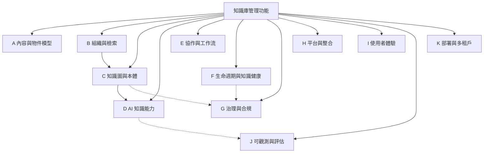

# 知識庫管理功能調查（knowledge-management-feature-survey.md）

> 版本：v0.1　|　日期：2026-10-21　|　狀態：Draft
> 來源：外部網路研究（clean-room：僅讀公開文件／產品頁，非任何 SUL 元件之原始碼、prompt、skill 文字或品牌名）。
> 方法：五個獨立角度並行調查，再交叉去重、合併為單一分類樹——① 企業級 KM 平台、② 個人知識管理（PKM）、③ AI/RAG 知識庫平台、④ GraphRAG／知識圖＋本體、⑤ AI agent 記憶系統。
> 目的：回答「一個知識庫管理系統**應該具備哪些功能**」，作為 owx（文件優先 agent 執行環境）下一輪迭代（[`base-core-requirements.md`](../spec/base-core-requirements.md) §7 缺口、[`product-positioning.md`](product-positioning.md) 支柱 5）的功能盤點與範圍決策輸入。

---

## 0. 摘要（Executive Summary）

跨 5 個角度、逾 60 個系統的調查顯示，成熟知識庫管理的功能可歸納為 **11 個功能領域（A–K）**，並呈現三個收斂趨勢：

1. **物件模型從「文件」走向「可定址節點」**：頁面／區塊／物件／實體被統一為可連結、可引用的節點（Roam／Logseq DB／Tana／Anytype／Notion）。
2. **檢索從「關鍵字」走向「混合＋圖＋時序」**：full-text + vector + graph + metadata 融合，再疊 rerank／查詢改寫（Azure AI Search／Vectara／Graphiti）。
3. **治理與可證追溯成為企業分水嶺**：權限感知檢索、稽核、provenance、本體約束、生命週期驗證——這正是 owx 的差異化楔子。

**對 owx 的關鍵結論**：owx 已具備「文件工作面 + 專案生命週期 + 配套 chat」骨架（見 §12）。真正缺口集中在 **C（知識圖／本體）、D（AI 知識能力）、F（知識健康）、G（治理／可證追溯）、J（評估）**——這正是 [`ADR-0006`](../adr/ADR-0006-module-interface-mcp-https.md) 規劃為外掛（KAC／CodeGraph／Standards）的部分。

---

## 1. 方法與範圍

### 1.1 五個調查角度與代表系統

| # | 角度 | 代表系統 |
|---|---|---|
| 1 | 企業級 KM／文件協作平台 | Confluence, Notion, SharePoint／Viva Topics, Slab, Guru, Document360, Helpjuice, Bloomfire, Stack Overflow for Teams |
| 2 | 個人知識管理（PKM）／網絡化思考 | Obsidian, Logseq, Roam, Tana, RemNote, Dendron, Foam, Anytype, Heptabase, Anki |
| 3 | AI／RAG 知識庫平台 | Dify, RAGFlow, LlamaIndex/LlamaParse, Vectara, Pinecone, Amazon Kendra/Bedrock KB, Vertex AI Search, Cohere, Glean, Dust, Sana, NotebookLM, Microsoft Copilot Studio |
| 4 | GraphRAG／知識圖＋本體 | Microsoft GraphRAG, Neo4j GraphRAG/GDS, Ontotext GraphDB, Stardog, TopBraid EDG, Protégé/OWL, SPARQL/RDF/SKOS/SHACL/JSON-LD/PROV-O, Cognee, Graphiti/Zep, LightRAG, KAG |
| 5 | AI agent 記憶／上下文管理 | mem0, Letta/MemGPT, Zep/Graphiti, Cognee, LangMem/LangGraph, OpenAI/Claude memory, CrewAI, Redis Agent Memory, txtai, MemoryOS, A-MEM |

> **重要提醒**：Microsoft **Viva Topics 已於 2025-02-22 退役**，官方指引改為「在 SharePoint 發佈、以 Microsoft Search 探索、以 Copilot 取用」。此處僅作「AI 主題圖」功能的歷史參照，非現役競品。

### 1.2 範圍（IN／OUT）

- **IN**：知識庫「功能面」的分類與清單（含檢索、圖、AI、治理、生命週期、平台）。
- **OUT**：定價、行銷文案、各平台實作細節、owx 的具體電路設計（另見 ADR）。
- **方法論紅線**：僅讀公開文件／產品頁；**不**引用任何 omo（SUL-1.0）原始碼、prompt、skill 文字或品牌名。

### 1.3 統一功能分類樹

---

## 2. A｜內容與物件模型（Content & Object Model）

### A.1 編輯與撰寫

| 功能 | 說明 | 來源示例 |
|---|---|---|
| Block-based editor | 每個元素是可拖曳區塊（段落／標題／清單／toggle／callout／code／math／TOC／embed） | Notion |
| Slash commands | 輸入 `/` 插入區塊／巨集／動態內容 | Notion, Confluence, Obsidian |
| Rich-text WYSIWYG | 格式、表格、清單、拖拉圖片、自訂 HTML | Helpjuice, Document360, Bloomfire |
| Markdown 原生編輯 | 以 Markdown 或原始碼撰寫；與 WYSIWYG 並存 | Document360, Slab, Obsidian, Foam, Dendron |
| 即時協同編輯 | 多人同時編輯同一文件、游標／在場指示 | Confluence, Notion, Slab, SharePoint |
| 行內留言／註解 | 錨定文字的留言，可解決（resolvable） | Confluence, Notion, Guru, Document360 |
| 建議編輯（suggested edits） | 提出修訂，由擁有者接受／拒絕 | Notion, Stack Overflow |
| 模板／blueprints | 可重用預先格式化結構，可綁巨集與自動索引 | 全部 |
| Synced blocks | 一處編輯、處處同步的區塊 | Notion |
| 可重用片段與變數 | 跨文章重用區塊與變數替換 | Document360, Helpjuice |
| 條件式內容區塊 | 依國家／裝置／讀者群／日期顯示或隱藏 | Document360 |
| 媒體嵌入／Smart link 預覽 | 圖片、影音、附件、第三方（Figma/GitHub/Jira）預覽 | 全部 |
| 巨集（macros） | 嵌入動態內容（Jira issues、TOC、頁面清單） | Confluence |
| Web clipper | 一鍵把網頁存入工作區 | Notion, Obsidian, Heptabase |
| 匯入（Word/PDF/Notion 等） | 外部文件轉為原生文章 | Document360, Notion, Helpjuice |

### A.2 物件模型（OWX 楔子核心）

| 功能 | 說明 | 來源示例 |
|---|---|---|
| 頁面／區塊統一為節點 | 頁面與區塊皆為可定址節點，以同一語法引用 | Logseq DB, Roam, Tana |
| Block reference `(( ))` | 對個別區塊／bullet 定址與連結 | Roam, Logseq, RemNote |
| Block embed／transclusion | 區塊／頁面的即時可編輯內嵌副本 | Roam, Logseq, Foam, RemNote Portals |
| Object／Type 模型 | 萬物皆為具型別的物件（page/task/person/image），以關係串接 | Anytype |
| Supertags／Fields | 節點套用型別模板，所有實例形成可查詢集合 | Tana |
| 區塊層級留言／反應 | 針對區塊的討論串、emoji 反應 | Roam, Logseq |
| 頁面／區塊 ID 與穩定定址 | 時間碼或編號 ID、permalink | Zettelkasten, Obsidian |

---

## 3. B｜組織與檢索（Organization & Retrieval）

### B.1 資訊架構（IA）

| 功能 | 說明 | 來源示例 |
|---|---|---|
| Spaces／Teamspaces | 頂層容器（團隊／專案／文件／個人） | Confluence, Notion |
| 階層式頁面樹 | 父子頁形成分類／子分類 | Confluence, Slab, Notion, SharePoint |
| Topics／Subtopics | 階層式主題樹；一篇可屬多主題 | Slab |
| Collections／Folders | 兩層（Collection → 資料夾，最多 3 層） | Guru |
| Wikimedia／Databases | 具型別屬性的結構化資料庫與多視圖 | Notion |
| Categories／Workspaces | 內容階層／多文件 hub | Document360, Helpjuice |
| Managed metadata／Term store | 集中治理的分類詞彙（global/local, open/closed） | SharePoint |
| 標籤（Tags）／標籤分類 | 使用者自訂標籤，可驅動通知／訂閱 | Stack Overflow, Guru, Document360 |
| 我的最愛／星號／釘選 | 釘選空間或內容 | Confluence, Slab, Guru |
| MOC／索引筆記 | 主題叢集的 hub 筆記（Zettelkasten 實踐） | PKM 實踐 |
| Namespaced pages | `parent/child` 頁面命名空間 | Logseq |
| 系列（Series）／Content Map | 有序文章序列／全站結構檢視 | Bloomfire, Slab |

### B.2 搜尋

| 功能 | 說明 | 來源示例 |
|---|---|---|
| 全文搜尋 | 跨全部內容的關鍵字搜尋 | 全部 |
| 進階搜尋／篩選 | 依空間、作者、型別、時間、標籤、標題限定 | Confluence |
| 查詢語言 | CQL／Datalog／DQL、布林、regex、屬性比較 | Confluence, Roam, Logseq, Obsidian |
| 搜尋運算子 | `tag:`、`path:`、`content:`、`task:`、`-exclude`、通配 | Stack Overflow, Obsidian |
| Faceted search | 依 facet 逐步精煉 | Slab, Document360, GraphDB connectors |
| Semantic search | 意圖／語意檢索（超越關鍵字） | Stack Overflow, Guru, mem0 |
| Hybrid search | 關鍵字 + 向量融合檢索 | Guru, Pinecone, Azure AI Search, Graphiti |
| AI 生成式答案 | 檢索結果上合成附來源的答案 | Confluence Rovo, Glean, Document360 Eddy |
| 對話式搜尋 | 保留上下文的追問 | Document360, Guru Knowledge Agent |
| 跨應用企業搜尋 | 聯邦式搜尋多個連接工具 | Notion, Guru, Glean |
| 自動完成／即時結果 | 輸入即出現結果 | Slab, Kendra |
| 權限感知搜尋 | 依使用者權限即時過濾結果 | Guru, Glean, Notion, Kendra |
| 已存查詢／嵌入查詢 | 保存或內嵌即時查詢結果 | Obsidian, Roam, Logseq |

### B.3 檢索（RAG retrieval）

| 功能 | 說明 | 來源示例 |
|---|---|---|
| Chunking 策略 | general／parent-child／Q&A；sentence／semantic／fixed | Dify, RAGFlow, Vectara |
| 文件解析／OCR／版面 | DeepDoc／MinerU／agentic OCR；表格、公式、圖表抽取 | RAGFlow, LlamaParse, Bedrock KB |
| 混合檢索 + RRF | 並行 full-text + vector，以 Reciprocal Rank Fusion 合併 | Azure AI Search, Pinecone |
| Reranking | cross-encoder／reranker 重新排序候選 | Cohere Rerank, Vectara Slingshot, Bedrock |
| Metadata filtering | `$eq/$in/$and/$or`、SQL-like 篩選 | Pinecone, Vectara, Dify |
| 查詢改寫／擴展 | intelligent rewriting、同義詞、query decomposition | Vectara, Azure AI Search, Kendra |
| 詞彙檢索（BM25） | 關鍵字／稀疏檢索 | Pinecone, Vectara, Azure |
| 代理式檢索（agentic） | 多跳推理、子查詢分解、充分性評估 | Bedrock KB, Azure AI Search |
| Cross-language search | 跨語言檢索 | RAGFlow |
| PageIndex／LLM 索引 | 模擬人類翻書的頁面索引 | RAGFlow |

---

## 4. C｜知識圖與本體（Knowledge Graph & Ontology）

### C.1 圖建構（Graph Construction）

| 功能 | 說明 | 來源示例 |
|---|---|---|
| 實體抽取 | LLM 抽取具型別實體（title/type/description） | GraphRAG, Neo4j KG Builder |
| 關係抽取 | LLM 描述共現實體間的關係 | GraphRAG, Graphiti |
| Lexical graph | 建 Document/Chunk 節點與 `NEXT_CHUNK`／`FROM_DOCUMENT` 邊 | Neo4j |
| 實體解析／去重 | 合併同一實體的節點（exact/spaCy/fuzzy） | Neo4j, RAGFlow, OpenAlex |
| 社群偵測 | Leiden／Louvain 階層式社群聚類 | GraphRAG, Neo4j GDS |
| 社群摘要 | LLM 對每個社群產生摘要（自底向上） | GraphRAG, RAGFlow |
| 增量索引 | 只更新變更輸入、保留一致實體 ID | GraphRAG, Graphiti, LightRAG |
| 時序抽取＆邊失效 | 新事實以 `invalid_at` 使衝突舊邊失效（保留歷史） | Graphiti/Zep |
| 選擇性刪除／重建 | 刪除文件時僅重建受影響子圖 | LightRAG |
| 互索引（圖↔chunk） | 圖結構與原始文本雙向索引 | KAG |
| 資料點／任務／管線 | 結構化圖節點組合為可重現抽取管線 | Cognee |

### C.2 本體與 Schema（Ontology）

| 功能 | 說明 | 來源示例 |
|---|---|---|
| OWL 2 本體編輯 | 類別／屬性／個體管理、推理器整合 | Protégé |
| SHACL 形狀約束 | node/property shapes、複雜屬性路徑、驗證報告 | TopBraid, Stardog, GraphDB |
| OWL↔SHACL 轉換 | 由 RDFS/OWL 產生 SHACL，或反向匯出 | TopBraid |
| SKOS 概念體系 | 詞表／分類法，`broader/narrower`、`exactMatch` 映射 | W3C SKOS |
| 受控詞彙／業務詞彙表 | 集中定義術語，連結技術 metadata | TopBraid glossaries |
| 跨詞彙對映（Crosswalks） | 連結不同詞彙中的對應詞彙 | TopBraid reference data |
| 預設 vs 學習本體 | 預先以 schema 定義型別，或讓結構自資料浮現 | Graphiti |
| 自訂實體型別 | 領域專屬型別定義 | Graphiti, Cognee |
| 本體接地（grounding） | 抽取實體對應到 OWL 類別，標記 `ontology_valid` | Cognee |
| 本體版本化／遷移 | 版本化變更、停用（非刪除）shape、受控發佈 | TopBraid |
| JSON-LD `@context`／framing | JSON key 對應 RDF IRI；重塑圖為指定 JSON | W3C JSON-LD 1.1 |
| 語意對齊 | 以同義／上位／包含關係對齊碎片化知識 | KAG |

### C.3 查詢與推論（Query & Reasoning）

| 功能 | 說明 | 來源示例 |
|---|---|---|
| SPARQL 1.1 | 圖樣式、OPTIONAL、FILTER、property paths、聚合、聯邦查詢 | W3C SPARQL |
| Cypher | 屬性圖宣告式查詢語言 | Neo4j |
| Text2Cypher／Text2SPARQL | 自然語言轉圖查詢後執行 | Neo4j, GraphDB Talk to Your Graph |
| 前向鏈推論（materialization） | 反覆套用 entailment 規則至閉包 | GraphDB |
| 標準規則集 | RDFS／OWL-Horst／OWL2-RL／OWL2-QL profile | GraphDB |
| 查詢時（lazy）推論 | 以 schema 重寫查詢而非預先具現化 | Stardog |
| 規則引擎／SWRL | 自訂 entailment 規則 | Protégé, GraphDB, Stardog |
| GraphRAG Global/Local/DRIFT/Basic | 社群報告 map-reduce／實體錨定／動態遍歷／基線向量 | Microsoft GraphRAG |
| 動態社群選擇 | LLM 由上而下評社群相關性，剪枝（省 ~77% token） | Microsoft Research |
| 路徑搜尋／圖演算法 | 最短路徑、Dijkstra、PageRank、社群偵測等 60+ | GraphDB, Neo4j GDS |
| 邏輯形式引導混合推理 | 將問題分解為可執行邏輯形式（Retrieval/Sort/Math/Deduce） | KAG |
| 虛擬圖（OBDA） | 將關聯／NoSQL 對映為 RDF，就地以 SPARQL 查詢 | Stardog |

### C.4 視覺化與探索（Visualization）

| 功能 | 說明 | 來源示例 |
|---|---|---|
| Global／Local graph view | 全圖與單頁鄰域圖（深度可調） | Obsidian, Roam |
| 圖篩選／分群著色 | 依搜尋詞／標籤／orphan 篩選、查詢分群著色 | Obsidian, Anytype |
| 圖探索器 | 由資源或查詢結果展開連結 | GraphDB Workbench, Neo4j Bloom, Stardog Explorer |
| 類別階層／類別關係檢視 | 以實例數探索 RDF 類別階層與關係 | GraphDB |
| Canvas／Whiteboard | 無限 2D 畫布編排筆記與媒體與連結線 | Obsidian Canvas, Logseq, Heptabase |
| Mind map | 由卡片／分支生成心智圖 | Heptabase |
| 影響分析／blast radius | 由節點遍歷相依與呼叫者評估變更影響 | graph-rag MCP |
| 圖資料匯出 | 匯出 CSV/Excel/Markdown，可含向量 | LightRAG, GraphDB |

---

## 5. D｜AI 知識能力（AI Knowledge Capabilities）

### D.1 生成與問答

| 功能 | 說明 | 來源示例 |
|---|---|---|
| Grounded generation + citations | 答案錨定檢索資料並附來源 | Vectara, Cohere, Bedrock |
| 細粒度行內引用 | 每個 span 標 start/end/text/sources | Cohere, NotebookLM |
| 引用強制（citation enforcement） | 平台層級強制每次回答附來源 | Guru |
| 幻覺防護／事實一致性 | HHEM 分數、contextual grounding、自動推理檢查 | Vectara, Bedrock Guardrails, Vertex |
| 拒答 fallback | 來源無資訊時誠實拒答 | NotebookLM |
| 多文件綜整／Deep Research | 跨內外部來源產生帶引用報告 | Glean, Guru |
| 答案模式／persona | system instruction、對話風格（Custom/Guide/Analyst） | Vertex, NotebookLM |
| 輸出產物 | 音訊摘要、學習指南、簡報、心智圖、時間軸 | NotebookLM, Glean, Sana |

### D.2 AI 寫作與知識整理

| 功能 | 說明 | 來源示例 |
|---|---|---|
| AI 起草／潤稿／翻譯 | 由提示生成草稿、調整語氣、多語翻譯 | Confluence Rovo, Notion AI, Document360 Eddy |
| 自動摘要／關鍵要點 | 摘要長文、抽取 3–5–7 要點 | Confluence, Guru, Bloomfire |
| 自動標籤／SEO 助手 | 產生標籤、標題、描述、詞彙表 | Document360, Bloomfire |
| 去重／衝突偵測 | 偵測冗餘與矛盾內容 | Guru, Bloomfire |
| 缺口偵測＋自動生成知識 | 找出缺失知識並草擬文件 | Guru |
| 會議記錄／逐字稿 | 轉錄並摘要會議 | Notion, Tana |
| 自動驗證 | 依使用／年齡／政策自動標記 verified | Guru |

### D.3 Agent／AI 治理（AI Governance）

| 功能 | 說明 | 來源示例 |
|---|---|---|
| Agent 治理／權限範圍 | 監控每個 agent、限定其可見／可做 | Notion |
| 權限感知檢索 | AI 只看得到使用者有權看的內容 | Guru, Glean, Dust, Kendra |
| Agent 稽核日誌／訓練中心 | 記錄所有 agent 動作、可修正並追蹤準確度 | Notion, Guru |
| Guardrails／DLP masking | 防濫用、PII/PHI 於入庫時遮蔽 | Guru, Bedrock Guardrails |
| AI 用量分析／ROI | 追蹤 AI 採用、credits | Notion, Confluence Rovo Insights |
| Model 白名單／路由 | 限定可用模型；model tier（Basic/Standard/Premium） | Notion, Dust |
| 提案式 AI 編輯 | AI 變更以可審提案呈現後才套用 | Tana |

---

## 6. E｜協作與工作流（Collaboration & Workflow）

| 功能 | 說明 | 來源示例 |
|---|---|---|
| 草稿／已發佈狀態 | 內容生命週期狀態（draft/published/unpublished） | 全部, Document360 |
| 審核／核准工作流 | 發佈前需審查；多步核准、可重指派 | Document360, Bloomfire, Guru |
| 工作流建置器／設計器 | 拖拉式 pipeline、角色與階段對映 | Document360 |
| 工作流分析 | 追蹤內容於階段間流動、平均審查時間、瓶頸 | Document360 |
| 工作流自動化 | 自動核准、提醒、升級 | Document360 |
| 排程發佈 | 未來時間自動發佈 | Document360, Helpjuice |
| 審查提醒 | 週期性內容稽核提醒 | Document360, Guru |
| 留言／反應／投票 | 討論串、emoji、讚／倒讚、接受答案 | 全部, Stack Overflow |
| Q&A | 提問／回答、多個答案 | Stack Overflow, Bloomfire |
| 通知／訂閱／追蹤 | email/Slack/Teams 通知、watch/subscribe | 全部 |
| 收件匣／通知中心 | 站內通知中心 | Confluence, Notion |
| 公告（含已讀追蹤） | 廣播並追蹤誰已讀 | Guru |
| 任務／待辦區塊 | 行內任務追蹤、排程／截止日 | Notion, Confluence, Roam, Logseq |
| 自動化規則 | 觸發／動作（通知、標籤、歸檔、連工具） | Confluence Premium, Notion |
| 內容擁有者（owner） | 指派單／多擁有者、變更擁有者 | Confluence, Notion, Slab, Guru |
| 主題專家（SME） | 自動偵測＋手動維護專家；專家審查路由 | Stack Overflow, Guru |
| 引導式對話 | agent 引導使用者完成結構化結果 | Guru |

---

## 7. F｜生命週期與知識健康（Lifecycle & Knowledge Health）

### F.1 版本與歷史

| 功能 | 說明 | 來源示例 |
|---|---|---|
| 版本歷史／差異比對 | 追蹤每次變更、可視化 diff | 全部, Confluence, Slab, SharePoint |
| 回復舊版 | 回滾至任一先前版本 | 全部 |
| 次要／主要版本 | draft/minor 與 published/major 版本 | SharePoint |
| 簽出／簽入 | 獨佔編輯鎖與簽入註解 | SharePoint |
| 讀者可見版本歷史 | 版本號、日期、發佈者、摘要 | Document360 |
| 版本保留上限 | 可設定的版本保留數 | SharePoint, Slab |
| 頁面分析／閱讀回條 | 檢視數、唯一檢視、編輯者；已讀確認＋時間戳 | Confluence, Notion, Bloomfire |

### F.2 驗證與維護（Knowledge Health）

| 功能 | 說明 | 來源示例 |
|---|---|---|
| 內容擁有者 ＋ 通知 | 指派問責擁有者；到期通知 | Confluence, Notion, Slab, Guru |
| 驗證工作流／徽章 | SME 驗證、verified/unverified 狀態＋時間戳 | Guru, Notion, Slab |
| 驗證排程 | 週／月／季／年或指定日期的複核節奏 | Guru, Slab |
| 主要＋次要驗證者 | 多驗證者，一位為主要問責 | Slab |
| 驗證到期 | 驗證失效、通知擁有者重新驗證 | Notion, Slab |
| 信任分數 | 聚合驗證健康度指標 | Guru |
| Content Health 檢查 | 自動旗標可能過期／不準確內容 | Stack Overflow |
| 審查佇列 | 依年齡＋熱度排序的優先審查佇列 | Stack Overflow |
| 標記過時（obsolete） | 鎖定並在搜尋中降權，保留歷史 | Stack Overflow |
| 陳舊／衰減偵測 | 找出 stale 內容 | Slab, Confluence, Bloomfire |
| 重複偵測 | 找出重疊／冗餘內容 | Bloomfire, Guru |
| 衝突偵測 | 旗標矛盾內容 | Bloomfire, Guru |
| 缺口偵測／未答問題 | 找出缺失知識、未答問題 | Guru, Bloomfire, Slab |
| 知識健康報告 | 自動檢查、結構分數、健康等級、盲點偵測 | Bloomfire |
| 專家地圖／概念叢集 | 誰懂什麼、作者權威；知識被文件化程度 | Bloomfire |
| 內容管理器／批次操作 | 大量篩選／歸檔／刪除／換擁有者／換狀態 | Confluence, Guru, Document360 |
| 失效擁有者過濾 | 找出離職者持有的內容 | Confluence |

### F.3 歸檔與生命週期

| 功能 | 說明 | 來源示例 |
|---|---|---|
| 歸檔／取消歸檔 | 歸檔過時頁面但保留存取 | Confluence |
| 批次歸檔 | 一次歸檔多項（含繼承權限） | Confluence |
| 自動歸檔／清理 | 自動歸檔陳舊低信任內容（人在迴路） | Guru, Bloomfire |
| 到期日／排程下架 | 內容到期或排程自動下架 | Helpjuice, Bloomfire |
| 回收桶／保留期 | 可還原已刪內容（30 天等） | Notion, Bloomfire |
| 備份／還原 | 每日自動備份＋手動還原 | Document360, Helpjuice |

---

## 8. G｜治理與合規（Governance & Compliance）

### G.1 權限與存取控制

| 功能 | 說明 | 來源示例 |
|---|---|---|
| 站台／空間／頁面權限 | 全域、每空間、每頁（含子頁繼承） | Confluence, Guru, Document360 |
| 細粒度頁面／資料庫權限 | 精確控制每頁／每列的可見與編輯 | Notion |
| RBAC／自訂角色 | 角色（Admin/Creator/Owner/Viewer）＋自訂權限集 | Guru, Document360, Bloomfire |
| Reader groups／security groups | 依受眾分群派權 | Document360 |
| 訪客存取／公開連結 | 外部使用者受限、view-only 公開連結 | Confluence, Slab, Notion |
| 私有分享連結（expiring） | 給外部審閱的私有可撤銷連結 | Document360 |
| IP 限制／網域限制 | 依 IP 或 email 網域限定登入 | Document360, Notion |
| 權限繼承與檢視 | 子內容繼承權限；一處檢視某使用者全部權限 | Confluence, Guru |
| 圖上安全 | 具名圖讀寫隔離、未授權圖自查詢靜默移除 | Stardog |

### G.2 稽核、追溯與 Provenance

| 功能 | 說明 | 來源示例 |
|---|---|---|
| 稽核日誌（可篩選／匯出／保留） | 時間戳記錄安全與管理事件 | Confluence, Notion, Guru, Vectara |
| SIEM 整合 | 即時串流稽核事件 | Notion |
| 溯源／血緣（lineage） | 每次回答／編輯／驗證附 lineage | Guru, TopBraid, GraphDB |
| PROV-O／PROV-DM | W3C 溯源本體：Entity/Activity/Agent、`wasDerivedFrom` | W3C PROV |
| Episodic provenance | 每個實體／關係回溯到產生它的 episode | Graphiti/Zep |
| 推論證明（proof）／解釋 | 找出某陳述如何被推導；最小斷言集 | GraphDB, Stardog |
| 需求↔設計↔碼追溯 | OSLC／ReqIF 標準；Satisfies/Derives/Implemented By | OSLC, ReqIF |
| 連結有效性／組態管理 | 版本化連結、歷史追溯記錄 | OSLC |
| 變更追蹤 | 以交易 ID 追蹤變更 | GraphDB |

### G.3 合規與資料保護

| 功能 | 說明 | 來源示例 |
|---|---|---|
| DLP／敏感資訊過濾 | 防止敏感資料外洩、遮罩 PII | Microsoft Purview, Bedrock Guardrails |
| 敏感度標籤／自動標籤 | 分類、加密、浮水印、隨檔移動 | Microsoft Purview |
| 保留政策／標籤 | 依合規時程保留／刪除，處置審查 | Microsoft Purview |
| eDiscovery／法律保留 | 搜尋、保留、收集、審閱、匯出 | Microsoft Purview |
| 資料落地（data residency） | 選擇資料託管區域＋自助遷移 | Confluence, Notion, Document360 |
| 合規認證 | SOC 2 Type II、ISO 27001、GDPR、HIPAA、CCPA | 全部企業級 |
| 加密（at rest/in transit/CMK） | AES-256、TLS、客戶自管金鑰 | Notion, Vectara |
| 不使用客戶資料訓練 | 合約禁止以客戶資料訓練 | Notion, Vectara, Document360 |
| 資料主體權利 | 刪除權／可攜權（GDPR） | Notion, mem0 |
| 存取審查／職責分離／MFA | 定期權限複核、角色分離、強制 MFA | Document360, Slab |

---

## 9. H｜平台與整合（Platform & Integration）

| 功能 | 說明 | 來源示例 |
|---|---|---|
| REST／GraphQL API | 程式化讀寫 | 全部, Slab |
| Webhooks | 變更即時通知 | Slab, Bloomfire, mem0 |
| OAuth 2.0／scoped API keys | 統一授權、權限範圍金鑰 | Bloomfire, Document360 |
| MCP server | 以 Model Context Protocol 對外曝露知識 | Guru, Notion, Graphiti, Neo4j |
| 應用市集／外掛生態 | 第三方 app 生態 | Confluence Marketplace, Obsidian |
| 連接器（connectors） | 連接 Drive/Notion/Confluence/Slack/Git/Jira/… | Glean, Guru, Dust, Kendra |
| 增量同步／排程同步 | 定期或即時同步來源 | Dust, Glean, Kendra |
| Slack／Teams 整合 | 於對話中搜尋／提問／發佈 | 全部 |
| 匯入／匯出 | 批次匯入匯出（含 PDF/e-book） | 全部 |
| 可嵌入 widget | 將 KB 嵌入網站／app | Document360, Helpjuice |
| Ticket deflector | 建議 KB 文章以減少工單 | Document360 |
| CI/CD／CLI 同步 | 由程式碼同步文件 | Document360, Stack Overflow |
| 外掛／擴充 API | 開發者 API、腳本、SDK | Obsidian, Logseq, Anytype |
| Zapier／自動化連接 | 無程式碼自動化 | Helpjuice |
| 私有 npm registry／內部 gateway | 企業內部套件與 AI gateway | FR-I-10, Confluence |

---

## 10. I｜使用者體驗（Reader / End-user Experience）

| 功能 | 說明 | 來源示例 |
|---|---|---|
| 公開／私有／混合 KB 站台 | 讀者面存取模型 | Document360 |
| 自訂品牌／主題／自訂網域 | 品牌化 KB 站台與 URL | Slab, Document360 |
| 站台自訂 | 主題、色系、字體、導覽、首頁 | Document360 |
| 朗讀（read aloud）／無障礙 | 文字轉語音、鍵盤快捷 | Document360 |
| 下載為 PDF | 批次下載文章／分類 | Document360 |
| 讀者回饋 | 讚／倒讚＋留言 | 全部 |
| 個人化推薦／策展 feed | 依角色／部門推薦內容 | Helpjuice, Bloomfire |
| 首頁建置器 | 拖拉 widget 自訂首頁 | Bloomfire |
| 行動 app | 行動擷取與存取 | Notion |
| 個人檔案／專業 | 使用者檔案與專長 | Slab, Stack Overflow |
| 多語 KB／AI 翻譯 | 50–300+ 語系、即時翻譯、語言切換器 | Document360, Helpjuice |
| 翻譯狀態／同步 | 已翻譯狀態、與來源同步 | Helpjuice |

---

## 11. J｜可觀測與評估（Observability & Evaluation）

### J.1 分析與洞察

| 功能 | 說明 | 來源示例 |
|---|---|---|
| 內容分析 | 檢視、閱讀、讚倒讚、停留時間 | 全部 |
| 站台／空間／頁面三層分析 | 多層級分析 | Confluence Premium |
| 搜尋分析 | 熱門關鍵字、零結果、跳出、成功度 | 全部 |
| 讀者／團隊帳號分析 | 回訪、登入、貢獻 | Document360 |
| 票券分流分析 | KB 解決查詢的效果 | Document360 |
| 找不到頁面／壞連結分析 | 偵測破損／過時連結 | Document360 |
| AI 搜尋／答案分析 | 最常引用文章、已答／未答、trending | Document360, Guru |
| 知識健康儀表板 | 驗證分數隨時間變化 | Guru |
| 自訂報表／排程報表 | 組合表格＋篩選、自動投遞 | Bloomfire, Guru |
| 分析匯出 | 匯出至 Tableau/Looker/Power BI | Guru, Bloomfire |
| 頂尖貢獻者 | 依回應／檢視找出 SME | Bloomfire, Slab |

### J.2 評估（RAG / Memory Evals）

| 功能 | 說明 | 來源示例 |
|---|---|---|
| Faithfulness | 回答主張是否被檢索上下文支持 | RAGAS, LlamaIndex |
| Answer Relevancy／Correctness | 答案與問題的相關性／正確性 | RAGAS, LlamaIndex |
| Context Precision／Recall | 檢索到的 chunk 排序與覆蓋 | RAGAS, LlamaIndex |
| 檢索評估指標 | hit-rate、MRR、precision/recall、NDCG | LlamaIndex |
| 問題生成（合成測資） | 產生 (question, context) 測資 | LlamaIndex |
| 平台原生評估 | Open RAG Eval、quality runs、citation F1 | Vectara, Guru |
| 長期記憶基準 | LoCoMo、LongMemEval、LongMemEval-V2 | 學術, mem0 |
| 五項記憶能力 | 抽取、多 session 推理、時序推理、知識更新、拒答 | LongMemEval |
| 追蹤／觀測 | 分層 trace、成本／延遲儀表板、online eval | Langfuse, LangSmith, Phoenix |
| 使用量與成本 | token 用量、P50–P99 延遲、成本會計 | Langfuse, LangSmith |

---

## 12. K｜部署與多租戶（Deployment & Multi-tenancy）

| 功能 | 說明 | 來源示例 |
|---|---|---|
| 內外網分離 | 內部 port 綁 loopback，對外由 proxy 曝露 | owx FR-I-1 |
| 鎖定模式 | 隱藏新增專案、攔截建立、注入預選 worktree | owx FR-I-2 |
| 多帳號／profile 隔離 | 每 profile 獨立 port／worktree／dataDir | owx FR-F-4 |
| SSO／SAML／OIDC | 單一登入 | 全部企業級 |
| SCIM 佈建 | 自動建立／更新／停用使用者 | Notion, Guru, Slab |
| HRIS／身分同步 | 同步組織結構與權限 | Guru |
| 容器化／CI-CD | Docker、GitHub Actions／GitLab CI | FR-I-5, FR-I-6 |
| 受管／MDM 設定 | 管理者強制、使用者不可覆寫 | FR-I-9 |
| 命名空間／corpus 多租戶 | 分區資料、租戶隔離 | Pinecone, Vectara |
| 自架／BYOC／自託管 | 在自有 VPC 部署、自託管 relay | Zep, Anytype |

---

## 13. 跨面向合併：去重與合併說明

五個角度高度重疊，以下為主要**合併決策**（避免同一功能重複列舉）：

| 出現於多角度 | 合併落點 | 說明 |
|---|---|---|
| Backlinks／雙向連結（企業 KM ∩ PKM ∩ 圖） | **A.2 物件模型** | 企業平台視為「關聯」，PKM 視為「雙向連結」，圖角度視為「邊」——同一本質。 |
| 混合檢索（RAG ∩ 圖 ∩ 企業搜尋） | **B.3 檢索** | 三者皆為 full-text+vector+（graph）融合；差異僅在權重與 reranker。 |
| Provenance／lineage（圖 ∩ 治理 ∩ agent 記憶） | **G.2 稽核追溯** | GraphRAG 的 provenance、企業的 audit trail、記憶的 episodic provenance 同源。 |
| 權限感知檢索（RAG ∩ 企業 ∩ 圖安全） | **G.1 權限 ＋ D.3 AI 治理** | 檢索時套用 ACL，屬治理；AI 只看可見內容屬 AI 治理。 |
| 驗證／staleness（企業 ∩ PKM 無 ∩ RAG 部分） | **F.2 知識健康** | 企業平台的 verification 與 Stack Overflow Content Health 合流。 |
| Ontology（圖本體 ∩ AI 平台 schema ∩ agent 記憶） | **C.2 本體與 Schema** | RAGFlow entity/relation config、Graphiti 本體、OWL 皆為 schema 治理。 |
| Chunking／解析（RAG ∩ 圖建構） | **B.3 檢索 ＋ C.1 圖建構** | 解析是共同前處理；chunking 屬檢索，實體抽取屬圖。 |
| 記憶型別（agent 記憶 ∩ 圖本體） | **D.3 ＋ C.2** | 語意／情節／程序記憶對映到圖的實體／episode／schema。 |

**跨角度收斂結論**：
1. **物件模型**：三條路線（文件塊／網絡節點／實體三元組）正在合流為「可定址節點＋關係」。
2. **檢索**：業界共識為 **hybrid + rerank + metadata filter +（可選）graph/temporal**。
3. **治理**：**權限感知 + provenance + 生命週期驗證 + 本體約束** 是企業可交付的門檻。

---

## 14. 對照 owx 現況（現況 / 規劃中 / 缺口）

> 對照 [`base-core-requirements.md`](../spec/base-core-requirements.md) FR-H／FR-HAR、[`product-positioning.md`](product-positioning.md) §4 核心支柱、[`AGENTS.md`](../../AGENTS.md) §3 架構。

| 領域 | owx 現況 | 狀態 |
|---|---|---|
| A 內容與物件模型 | 文件（md）編輯／預覽／大綱／多分頁；非 md 唯讀（FR-H-14／23／25） | 🟡 部分（僅文件層，無區塊／節點模型） |
| A.2 物件模型 | **無**統一節點模型（文件為檔案，非可定址節點） | 🔴 缺口 |
| B 組織與檢索 | 檔案樹 Explorer、專案（`~/knowledge`）；搜尋僅前端檔名搜尋 | 🟡 部分 |
| B.3 檢索（RAG） | **無**（Knowledge Graph 為佔位，FR-H-26） | 🔴 缺口 |
| C 知識圖與本體 | **規劃中**（KAC／CodeGraph 模組，ADR-0006） | 🔵 規劃 |
| C 可證追溯 | **規劃中**（FR-HAR-15 traceability 產出） | 🔵 規劃 |
| D AI 知識能力 | 配套 chat（opencode 指令面對齊）；無 grounding／citation 知識能力 | 🟡 部分 |
| E 協作與工作流 | **無**（單人為主；無審核／工作流） | 🔴 缺口 |
| F 生命週期與知識健康 | doc-status 四態（draft/published/modified/remote-only，FR-CARRIER-10）；git 提交 | 🟡 部分 |
| F.2 驗證／健康 | **無** | 🔴 缺口 |
| G 治理與合規 | profile 隔離、slug／token 分離、lock mode、邊界守衛；無稽核／eDiscovery | 🟡 部分 |
| G.2 provenance | **無**（僅 git 歷史） | 🔴 缺口 |
| H 平台與整合 | MCP（載體層 8 tools）、fs/archive/convert/export RPC；plugin/skill/command | 🟡 部分 |
| I 使用者體驗 | 品牌、主題、logo、多格式預覽 | 🟡 部分 |
| J 可觀測與評估 | session 事件流、權限可觀察（FR-SUB-1/2） | 🟡 部分 |
| J.2 評估 | **無** | 🔴 缺口 |
| K 部署與多租戶 | 內外網分離、lock mode、launchd、profile 隔離 | 🟢 已具備 |

**判讀**：owx 的骨架（K 部署、部分 A／G／H）已具備；**差異化楔子（C 知識圖／本體／可證追溯）與其支撐（B.3 檢索、D 知識能力、F.2 知識健康、J.2 評估）仍是缺口**——與 [`product-positioning.md`](product-positioning.md) §4「支柱 5（🔵 規劃中）」一致。

---

## 15. 差異化缺口（Differentiation Space）

跨 5 角度調查發現以下**業界普遍薄弱或未解**的點，正是 owx 的差異化空間：

1. **本體／schema 治理為一等公民**：僅 RAGFlow 曝露 entity/relation 設定；**無**平台提供「規格↔測試↔碼」的受治理本體與可證追溯。
2. **知識庫版本化**：re-index 普遍存在，但真正的 KB 版本／diff／rollback 罕見。
3. **測試集成為受管理資產**：eval 測資仍停留在程式層（RAGAS／LlamaIndex），非管理主控台物件。
4. **跨平台 ACL 聯邦**：權限鏡射多為單連接器；跨來源統一的 ACL 語意不一致。
5. **時序知識圖的企業化**：Graphiti／Zep 的 bi-temporal 是強差異點，但尚未被企業 KM 平台普遍採用。
6. **「開發」文件 vs「檢索」文件**：既有 RAG 平台檢索**既有**文件；owx 的定位是**開發與演化**文件——功能清單需含協作／治理／生命週期，而非只有問答。
7. **文件優先的物件模型**：業界合流至「可定址節點」，但尚無以**文件／知識為原生對象**、並把 code 視為特例的系統。

---

## 16. 來源（Selected Sources）

> 僅列主要官方文件來源；完整清單見各角度原始研究。授權狀態：均為公開文件／產品頁。

**企業 KM**：Atlassian Confluence（support.atlassian.com）・Notion（notion.com/help）・Microsoft SharePoint／Purview（learn.microsoft.com）・Slab（slab.com, help.slab.com）・Guru（getguru.com, help.getguru.com）・Document360・Helpjuice・Bloomfire・Stack Overflow for Teams。

**PKM**：Obsidian（obsidian.md/help）・Logseq（docs.logseq.com）・Roam（roamdocs.fyi）・Tana（outliner.tana.inc）・RemNote（help.remnote.com）・Dendron（wiki.dendron.so）・Foam（foam.md）・Anytype（doc.anytype.io）・Heptabase（wiki.heptabase.com）・Anki（docs.ankiweb.net）・zettelkasten.de。

**AI／RAG**：Dify（docs.dify.ai）・RAGFlow（ragflow.io/docs）・LlamaIndex（developers.llamaindex.ai）・Vectara（docs.vectara.com）・Pinecone（docs.pinecone.io）・Amazon Kendra／Bedrock（docs.aws.amazon.com）・Vertex AI Search（cloud.google.com）・Cohere（docs.cohere.com）・Glean（docs.glean.com）・Dust（docs.dust.tt）・Sana（support.sana.ai）・NotebookLM（support.google.com）・Copilot Studio（learn.microsoft.com）・RAGAS（docs.ragas.io）。

**GraphRAG／本體**：Microsoft GraphRAG（microsoft.github.io/graphrag）・Neo4j（neo4j.com/docs）・Ontotext GraphDB（graphdb.ontotext.com）・Stardog（docs.stardog.com）・TopBraid（topquadrant.com）・Protégé（protege.stanford.edu）・W3C（SPARQL／RDF／SKOS／SHACL／PROV-O／JSON-LD）・Cognee（docs.cognee.ai）・Graphiti／Zep（help.getzep.com）・LightRAG（github.com/HKUDS/LightRAG）・KAG（openspg.github.io）・OSLC／ReqIF。

**Agent 記憶**：mem0（docs.mem0.ai）・Letta（docs.letta.com）・Zep（help.getzep.com）・LangMem／LangGraph（langchain-ai.github.io/langmem, docs.langchain.com）・OpenAI（help.openai.com）・Claude（platform.claude.com, code.claude.com）・CrewAI（docs.crewai.com）・Redis Agent Memory（redis.io）・txtai（neuml.github.io/txtai）・Langfuse／LangSmith／Phoenix ・學術 survey（arXiv 2505.00675／2512.13564／2602.06052、LoCoMo、LongMemEval）。

---

## 17. 變更紀錄

| 日期 | 版本 | 變更 |
|---|---|---|
| 2026-10-21 | v0.1 | 初版：五角度（企業 KM／PKM／AI-RAG／GraphRAG-本體／agent 記憶）並行調查，合併為 11 領域（A–K）統一功能分類樹；含跨面向去重說明、owx 現況對照、差異化缺口與來源。 |

