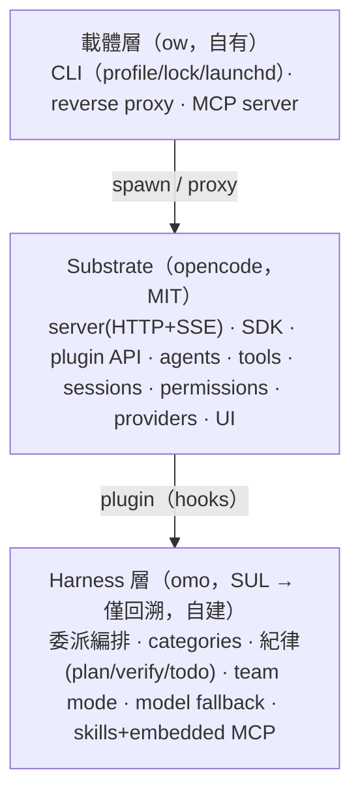

# 基礎核心需求規格（clean-room 回溯）

> 版本：v0.3　|　日期：2026-10-17　|　狀態：Draft
> 來源：clean-room 回溯自 `opencode`（MIT）公開文件與可觀察行為、`omo`（SUL-1.0）可觀察行為；載體為自有 `opencode-web`。
>
> 目的：把「基礎核心 = opencode + omo，以 opencode-web 為載體」的**功能需求**回溯成規格，
> 作為下一步「**調整功能**」與最終「**開發**」的輸入。
>
> 方法：**clean-room**：只讀公開文件與可觀察行為，抽取**功能需求**；
> **不**複製任何 omo 的原始碼、prompt、skill 文字、文件，也**不**沿用其品牌名。
>
> 授權狀態：`opencode` = **MIT**（可直接重用/改）；`omo` = **SUL-1.0**（**只回溯需求，不可複製**）；
> `opencode-web` = 自有（Proprietary）。

---

## 0. 範圍

| 面向 | 內容 |
|---|---|
| **IN** | 一個「agent 執行環境」的核心能力：agent 編排、工具、紀律機制、session/context、模型路由、設定隔離、擴充機制、UI、部署 |
| **OUT**（本版） | 具體的「文件優先」功能調整（下一階段做）、KAC/CodeGraph 等外掛模組、商業模式 |
| **不變量** | 授權可交付企業（僅 MIT/自有）；架構可被模組微服務擴充；以 opencode 為 substrate |

---

## 1. 系統定位（一句話）

> 一個**多 agent、有紀律的執行環境**：主 agent 透過委派（`task`）驅動專業 sub-agent，
> 以工具操作真實檔案系統，以 session 承載上下文，以設定隔離支援多帳號/多 app。

---

## 2. 架構視圖（三層）

---

## 3. 功能需求（FR）

### FR-A｜Agent 執行與編排
- **FR-A-1** 主 agent 在 session 內執行，透過 `task` 工具**委派**給 sub-agent。
- **FR-A-2** sub-agent 可為**同步**（等待結果）或**背景**（`run_in_background`，完成後通知、可 `background_output` 取回）。
- **FR-A-3** 委派時可指定 **category**（領域預設）與 **skills**（注入知識/工具）。
- **FR-A-4** 提供**唯讀**研究型 sub-agent（探索、文件檢索、計畫諮詢、計畫審查），其工具受白名單限制（不可寫/不可再委派）。
- **FR-A-5** category worker **不可再委派**（防無限迴圈）。
- **FR-A-6**（進階）**Team Mode**：1 lead + 最多 N 成員、共享信箱、共享任務清單、可選 per-member git worktree、可選終端可視化。
- **FR-A-7** 每個 agent 有獨立 **prompt / model chain / tool policy / permission**。
- **FR-A-8** **巢狀深度控制**：`subagent_depth`（預設 1；0 停用；2 允許巢狀）限制委派深度，防無限遞迴。
- **FR-A-9** **委派權限閘門**：`permission.task` 以 glob 控制某 agent 可啟動哪些 sub-agent。
- **FR-A-10** **子 session 導覽**：parent / child session 可切換（first / cycle / parent）。
- **FR-A-11** **隱藏系統 agent**：compaction / title / summary 等自動執行、不由使用者選取。
- **FR-A-12** **sub-agent 模型繼承**：未指定時繼承呼叫者模型，可個別覆寫。
- **FR-A-13**（進階）**外部研究 agent**（scout 型）：將外部 repo/文件抓入受管快取，供跨來源研究。

### FR-B｜工具
- **FR-B-1** 檔案：讀、寫、編輯、多編輯、glob、grep、list。
- **FR-B-2** 執行：bash（含權限閘門）。
- **FR-B-3** 程式理解：LSP（診斷/定義/參考/符號/rename）、AST-grep。
- **FR-B-4** 網路：webfetch、websearch。
- **FR-B-5** 流程：todowrite、question（向使用者提問）。
- **FR-B-6** 工具可被設定**停用**（`tools: { name: false }`）。
- **FR-B-7** 補丁套用工具（`apply_patch`）。
- **FR-B-8** **自訂工具**：任意語言實作（TS/JS `tool()` 或腳本）可註冊為工具。
- **FR-B-9** **工具同名覆蓋優先序**：自訂/外掛工具覆蓋內建同名工具。
- **FR-B-10** **忽略規則**：`.ignore` 可覆寫 `.gitignore`（供 grep / glob）。
- **FR-B-11** LSP 工具（experimental）：定義、參考、hover、文件/工作區符號、實作、呼叫階層。
- **FR-B-12** websearch 後端可選（Exa / Parallel）。

### FR-C｜紀律機制（harness 核心價值）
- **FR-C-1** **意圖閘門**：每個 prompt 在動用工具前，先強制確認意圖/分類。
- **FR-C-2** **todo 強制**：多步任務建立 todo、逐步標記完成、閒置時再觸發續作。
- **FR-C-3** **規劃／驗證**節奏：先規劃、逐步驗證、計畫審查後才執行。
- **FR-C-4** **續作機制**（goal/continuation）：設定持久目標，session 閒置時重新注入續作提示，直到完成審計通過。
- **FR-C-5** **工作計畫狀態**（boulder）：跨 session 保存已驗證的進度記錄。
- **FR-C-6** **session 復原**：缺工具結果、thinking block 不匹配、空訊息、context 超限、JSON 解析錯誤→透明復原。
- **FR-C-7** **迭代上限**：`steps`/maxSteps 上限，達上限強制摘要。
- **FR-C-8** **上下文壓縮設定**：compaction（auto / prune / reserved）＋壓縮 hook（可注入或替換壓縮 prompt）。
- **FR-C-9** **doom_loop 防護**：相同工具呼叫重複 N 次即攔截（預設 ask）。
- **FR-C-10** **快照式 undo/redo**：以內建 git snapshot 支援回溯（可停用）。
- **FR-C-11** **plan mode 為權限設定**（非獨立引擎）：預設把 edit/bash 設為 `ask`。

### FR-D｜Session 與上下文
- **FR-D-1** session CRUD、messages、parts、子 session、share、summarize、abort。
- **FR-D-2** 事件流（SSE）即時推送 session/訊息/權限請求等狀態。
- **FR-D-3** context 壓縮（compaction）與工具輸出截斷。
- **FR-D-4** prompt 歷史、undo/snapshot。
- **FR-D-5** **session 分享連結**（`/share`、`/unshare`）：模式 manual / auto / disabled。
- **FR-D-6** **session fork**：自某訊息分支出新 session。
- **FR-D-7** **revert / unrevert**：回復到某訊息狀態。
- **FR-D-8** **git-backed 快照**（snapshot，可停用）。
- **FR-D-9** **export / import**（含 `--sanitize` 去敏）。
- **FR-D-10** **非同步訊息**（`prompt_async`，先回應後非阻塞執行）。
- **FR-D-11** 子 session 與 session diff / stats。

### FR-E｜模型與 Provider
- **FR-E-1** 多 provider、統一介面；provider 由 registry + 憑證解析。
- **FR-E-2** **模型鏈**：primary + 有序 fallback。
- **FR-E-3** **兩套 fallback**：proactive（chat params 選鏈）+ reactive（執行後失敗復原）。
- **FR-E-4** per-agent / per-category 指定 model、reasoning level、temperature、max tokens、provider options。
- **FR-E-5** 可標記 agent 為 unstable → 強制背景監控。
- **FR-E-6** **small_model**：輕量任務（標題 / 摘要）使用較便宜模型。
- **FR-E-7** **model variants**：推理強度預設，可循環切換。
- **FR-E-8** **model 載入優先序**：flag > config > 上次使用 > 內建優先序。
- **FR-E-9** **provider 逾時**：timeout / headerTimeout / chunkTimeout。
- **FR-E-10** **allowed / denied providers**：`disabled_providers` / `enabled_providers`。
- **FR-E-11** **policies**（resource-level，如 `provider.use`），獨立於 permissions。
- **FR-E-12** **structured output**：以 JSON schema 驗證模型輸出。
- **FR-E-13** **本地 / 離線模型**：Ollama / LM Studio / llama.cpp / OpenAI-compatible 自訂 provider。

> 註：opencode **無原生 model fallback**（僅同 model ID 的 provider fallback）；FR-E-2/3「模型鏈 + 兩套 fallback」**源自 omo，由 harness 自建**。

### FR-F｜設定與隔離
- **FR-F-1** 設定檔分層 deep-merge（project > user），未知鍵拒絕（hard-fail）。
- **FR-F-2** agent/category 可 inline 或檔案定義；prompt 可指向外部檔（`file://`）與 `prompt_append`。
- **FR-F-3** **五根隔離**：data / config / state / tmp（+ cache 可選），以 env 切換。
- **FR-F-4** **多帳號 profile**：每 profile 獨立 port / worktree / dataDir / configDir / stateDir / tmpDir / pid。
- **FR-F-5** **slug 與 token 職責分離**：真 token 只存 profile 的 `auth.json`，不進路徑/git/listing。
- **FR-F-6** env escape hatch（跳過專案設定、注入 inline config、跳過外掛等）。
- **FR-F-7** **設定優先序鏈**：remote（`.well-known/opencode`）→ global → `OPENCODE_CONFIG` → project → `.opencode/` dirs → inline → managed → macOS MDM。
- **FR-F-8** **遠端設定**：`<org>/.well-known/opencode` 提供組織預設。
- **FR-F-9** **受管設定 / MDM**：admin 強制、使用者不可覆寫（含 macOS `.mobileconfig`）。
- **FR-F-10** `OPENCODE_CONFIG_DIR` 自訂設定目錄。
- **FR-F-11** **變數插值**：`{env:VAR}` / `{file:path}`。
- **FR-F-12** **規則檔**：專案 `AGENTS.md`、全域 `~/.config/opencode/AGENTS.md`；相容 Claude Code（`CLAUDE.md`、`.claude/skills/`）。
- **FR-F-13** **references**：外部目錄與 git repo 以 `@alias` 引用並 materialize 至快取。
- **FR-F-14** **權限的 env 入口**：`OPENCODE_PERMISSION` 與 inline config content。

### FR-G｜擴充機制
- **FR-G-1** **Plugin API（TS）**：hook 表面（event/config/chat.*/tool.execute.*/permission.ask/…）。
- **FR-G-2** **Skills**：`SKILL.md`（frontmatter: name/description/mcp/…），可嵌 MCP。
- **FR-G-3** **Commands**：slash 指令，markdown 模板 + `$ARGUMENTS`。
- **FR-G-4** **MCP**：local（stdio）與 remote（http）；支援 `{env:VAR}`/`{file:}` 插值。
- **FR-G-5** skill/command/plugin 皆有載入優先序（project > user > opencode > builtin）。
- **FR-G-6** **Plugin 事件/hook 全表**：command / file / installation / lsp / message / permission / server / session / shell / tool / tui。
- **FR-G-7** **Plugin 載入序與套件自動安裝**（Bun；快取 `~/.cache/opencode/node_modules`）。
- **FR-G-8** **Skill 探索路徑**（含 `.claude/skills/`、`.agents/skills/`）與 frontmatter metadata（`opencode/slash`、`opencode/autoinvoke`、license、compatibility）。
- **FR-G-9** **Command 進階**：`subtask` 強制子任務、shell 注入（`` !`cmd` ``）、`@file` 引用、位置參數 `$1…`。
- **FR-G-10** **MCP 進階**：OAuth（自動偵測 401、DCR RFC 7591、預註冊）、per-agent enable、tool glob、remote defaults。
- **FR-G-11** **ACP**（Agent Client Protocol）作為擴充 / 客戶端介面。

### FR-H｜UI
- **FR-H-1** TUI（終端）與 Web UI 共用同一 server。
- **FR-H-2** Web UI 為 iframe 可嵌入（供其他 app 使用）。
- **FR-H-3** 終端可視化（tmux/cmux panes）顯示背景 agent。
- **FR-H-4** **ACP client 支援**（Zed / JetBrains / Neovim）。
- **FR-H-5** **桌面 app**（macOS / Windows / Linux）。
- **FR-H-6** **IDE 擴充**（VS Code / Cursor / Windsurf / VSCodium）。
- **FR-H-7** **mDNS 探索**。
- **FR-H-8** **主題與鍵綁**（themes / keybinds）。
- **FR-H-9** **TUI attention**（桌面通知 / 音效）。
- **FR-H-10** `/tui` 控制 API。

### FR-I｜部署與多租戶
- **FR-I-1** 內外網分離：內部 port 綁 `127.0.0.1`，對外由 reverse proxy 暴露。
- **FR-I-2** 鎖定模式：隱藏「新增專案」、攔截 `POST /project`、注入預選 worktree。
- **FR-I-3** CORS 白名單、HTTP Basic 密碼。
- **FR-I-4** 開機自啟（launchd）與 crash 重啟。
- **FR-I-5** **容器化**（Docker image）。
- **FR-I-6** **CI/CD 整合**（GitHub Actions / GitLab CI）。
- **FR-I-7** **企業交付**：集中設定、SSO、內部 AI gateway、自架 share 服務。
- **FR-I-8** **網路**：proxy 環境變數、自訂 CA（`NODE_EXTRA_CA_CERTS`）。
- **FR-I-9** **受管 / MDM 設定**（企業強制）。
- **FR-I-10** **私有 npm registry**。
- **FR-I-11** **自動更新**（auto / notify / off）。
- **FR-I-12** **Windows / WSL** 支援。

---

## 4. 非功能需求（NFR）

| 編號 | 需求 |
|---|---|
| NFR-1 | **授權可交付**：交付物僅含 MIT / 自有程式碼；SUL 元件不得進交付物 |
| NFR-2 | **可擴充**：核心以微服務/模組邊界開放外掛（KAC、CodeGraph、…） |
| NFR-3 | **不擴充 substrate 行為**：opencode 以包裝/外掛方式使用，不改其原始碼 |
| NFR-4 | **可觀測**：session/事件/權限/fallback 皆可觀察 |
| NFR-5 | **可復原**：常見失敗自動復原，不中斷長任務 |
| NFR-6 | **隔離**：帳號/app/設定/資料互不洩漏 |
| NFR-7 | **文件優先可達**：架構須能承載「以文件/知識為原生對象」（下一階段調整） |

---

## 5. 邊界

- **本核心做**：編排、工具、紀律、session、模型路由、擴充、隔離、UI。
- **本核心不做**（外掛微服務）：知識本體/GraphRAG（KAC）、code graph（CodeGraph）、文件格式引擎（Doc-Edit）、標準本體（Standards）等。

---

## 6. 來源對映與授權

| 能力群 | 主要來源 | 授權 | 處置 |
|---|---|---|---|
| FR-A-8~13（巢狀/委派權限/子 session/隱藏 agent/模型繼承/scout）、FR-B 工具、FR-D session、FR-E provider、FR-F 設定、FR-G 擴充、FR-H UI、FR-I 部署 | **opencode** | MIT | **可重用/改/散布** |
| FR-A-1~7 委派編排、FR-C 紀律、FR-A-6 team mode、FR-E-2/3 fallback、skills+embedded MCP | **omo** | SUL-1.0 | **僅回溯需求，自建（Rust）** |
| 載體：CLI/proxy/MCP server、profile、lock mode、workspace、commit-doc | **opencode-web** | 自有 | 可自由改 |

> opencode 官方來源：v1 `opencode.ai/docs`、v2 `opencode.ai/v2/docs`（repo `anomalyco/opencode`；MIT）。v2 差異（無 session 分享、embedded SDK、background subagents）待評估。

---

## 7. 相對「文件優先」目標的缺口（供步驟②調整）

1. **原生對象仍是程式碼**：工具（LSP/AST/bash）偏 code；缺 doc-native 工具（md 結構編輯、版本/審核、格式無損）。
2. **紀律綁在 code 語境**：plan/verify/todo 的 prompt 需重寫為「規格/文件」語境。
3. **無統一知識圖**：缺 doc+code + 標準本體的 GraphRAG 介面（FR 需新增）。
4. **無 traceability 產出**：紀律需擴充為「需求↔文件↔測試↔實作」可證追溯。
5. **skills/commands 需重養**：現有 skills 多為 code 導向，須重建為文件/規格導向。
6. **opencode 覆蓋率（v0.3 已補）**：已對照 opencode 官方文件，將各 FR 群遺漏項補入（見 §10）；v2 差異與尚未文件化之行為待迭代確認。

---

## 8. 待決（迭代中就地決策並記 ADR）

1. ~~自建 harness 的語言/邊界~~ → **✅ 已定案：Rust 核心 + React 前端**（[ADR-0003](../adr/ADR-0003-harness-rust-core-react-frontend.md)）。
2. ~~文件格式~~ → **✅ 初期只 md**（參照 opencode-web）；Doc-Edit 外掛先不實作。
3. ~~標準本體範圍~~ → **✅ 屬外掛、第一階段先不實作**。
4. ~~優先外掛與介面~~ → **✅ 介面＝MCP / HTTPS；先不實作外掛**（[ADR-0006](../adr/ADR-0006-module-interface-mcp-https.md)）。
5. ~~可交付清單~~ → **✅ 以 `scripts/sbom.mjs` 產出元件授權表**。
6. 模型注入路徑 → **✅**（[ADR-0005](../adr/ADR-0005-model-chain-injection-path.md)，Accepted）。

---

## 9. 定位與關聯

- 本檔定位為 **core 需求清單**（逐條、原子、可 ID 引用）；**不**重複載體層與交互細節。
- **整合功能規格**（三層 + Mermaid 架構/交互圖 + FR 驗收條件 + 授權對映）見 [`functional-spec.md`](functional-spec.md)。
- 載體層（`opencode-web`／ow）之權威規格在其 repo 內：`docs/spec/ow-workspace-layout.md`、`docs/spec/ow-document-access.md`、`docs/mcp.md`（連結引用，不複製）。

---

## 10. 變更紀錄

| 日期 | 版本 | 變更 |
|---|---|---|
| 2026-10-17 | v0.3 | 對照 opencode 官方文件（v1/v2）補齊覆蓋率：FR-A 補 8~13、FR-B 補 7~12、FR-C 補 7~11、FR-D 補 5~11、FR-E 補 6~13（含 fallback 來源註記）、FR-F 補 7~14、FR-G 補 6~11、FR-H 補 4~10、FR-I 補 5~12；§6 來源對映細化並註明 opencode v1/v2 與 repo 名；§7 增覆蓋率註記。 |
| 2026-10-17 | v0.2 | 補 §2.2 必備表頭（版本/日期/狀態/來源）；§2 ASCII 架構視圖遷為 Mermaid（依文件標準 §6）；§8 D1 標為已定案並連 ADR-0003；新增 §9 定位與關聯、§10 變更紀錄。 |
| 2026-10-17 | v0.1 | 初版：clean-room 回溯 FR A-I、NFR、邊界、來源對映、缺口、待決。 |

---

*本文件為 clean-room 需求追溯，不含任何 omo 之原始碼、prompt、skill、文件內容或品牌名。*
