# owx 整合功能規格（functional-spec.md）

> 版本：v0.3　|　日期：2026-10-17　|　狀態：Draft
> 來源：整合自 [`AGENTS.md`](../../AGENTS.md)、[`base-core-requirements.md`](base-core-requirements.md)、[`ADR-0001`](../adr/ADR-0001-substrate-opencode-cleanroom-omo.md)、[`ADR-0002`](../adr/ADR-0002-iterative-spiral-workflow.md)、[`ADR-0003`](../adr/ADR-0003-harness-rust-core-react-frontend.md)、[`document-standards.md`](../standards/document-standards.md)、[`licensing.md`](../standards/governance/licensing.md)，以及載體 repo `opencode-web` 之規格（`docs/spec/ow-workspace-layout.md`、`docs/spec/ow-document-access.md`、`docs/mcp.md`、`README.md`、`AGENTS.md`）。

---

## 0. 目的、方法、範圍與授權狀態

### 0.1 目的

本規格是 owx 的**整合功能規格**：把三層（載體層 owx、Substrate opencode、Harness owx 自建）的架構、流程、互動、逐條驗收條件與授權對映，收斂成單一可追溯文件。

它承接 [`base-core-requirements.md`](base-core-requirements.md) 的 core 需求清單（FR-A 至 FR-I），補上該檔刻意不重複的**載體層細節**與**交互流程**，作為迭代螺旋（[`ADR-0002`](../adr/ADR-0002-iterative-spiral-workflow.md)）中「立框架、實作、需求回流」的輸入。

### 0.2 方法（clean-room）

- **只讀公開文件與可觀察行為**，抽取功能需求；**不**複製任何 omo（SUL-1.0）的原始碼、prompt、skill 文字、文件，也**不**沿用其品牌名。流程見 [`licensing.md`](../standards/governance/licensing.md) §3。
- Harness 層（§4）的每一條 FR，皆由 [`base-core-requirements.md`](base-core-requirements.md) §3 的 FR-A、FR-C、FR-E-2/3 **自寫轉化**而來，非逐條重抄。
- 載體層（§2）以**連結引用**載體 repo 的權威規格，不複製其內容。

### 0.3 範圍與邊界（IN / OUT）

| 面向 | 內容 |
|---|---|
| **IN** | 三層架構與端到端互動；載體層 FR（profile／lock／workspace ensure／reverse proxy／MCP／部署）；Substrate 層的點名條目；Harness 層 clean-room FR；交互流程（委派／SSE／權限／fallback／邊界守衛）；NFR；來源對映與授權；缺口與待決 |
| **OUT** | 具體「文件優先」功能調整的實作細節（下一輪迭代）；KAC／CodeGraph／Doc-Edit／Standards 等外掛模組的內部設計；商業模式；omo 任何內部實作 |
| **不變量** | 交付物僅含 MIT／自有程式碼；架構可被模組微服務擴充；opencode 以包裝／外掛使用，不改其原始碼 |

**本規格做**：定義三層的功能需求、驗收條件、交互流程與授權對映，作為迭代螺旋的輸入。

**本規格不做**：不定義外掛模組（KAC／CodeGraph／Doc-Edit／Standards）的內部設計；不重抄 Substrate 的 FR-B／D／E／G／H／I（以連結指向）；不複製載體 repo 規格內容（以連結引用）；不實作任何程式碼。

> **文件關聯（依 [`document-standards.md`](../standards/document-standards.md) §2.5）**：本檔定位為**整合規格**（架構／交互／逐條驗收），**不是**需求清單（見 [`base-core-requirements.md`](base-core-requirements.md)），也**不是**載體層權威規格（見 carrier repo 內 `docs/spec/ow-workspace-layout.md`、`docs/spec/ow-document-access.md`、`docs/mcp.md`）。上下游以相對連結互指，跨檔以穩定 ID（`FR-*`／`NFR-*`／`ADR-*`／`D*`／`TC-*`）追溯，內容不複製。

### 0.4 授權狀態

| 元件 | 授權 | 在 owx 的角色 | 處置 |
|---|---|---|---|
| **opencode** | **MIT** | Substrate | 可重用／改／散布 |
| **owx 自有程式** | **Proprietary** | 載體層 + Harness 核心 | 自有 |
| **opencode-web（ow）** | **自有（Proprietary）** | 載體層來源 | 可自由改 |
| **CodeGraph** | **MIT（非自有）** | 未來 code 圖模組 | 可用；標註非自有 |
| **omo（oh-my-openagent）** | **SUL-1.0** | **需求來源，非程式碼來源** | 不進交付物；僅黑箱回溯 |

> 紅線與 PR 閘門見 [`licensing.md`](../standards/governance/licensing.md) §4、§5。

### 0.5 變更紀錄

| 日期 | 版本 | 變更 |
|---|---|---|
| 2026-10-17 | v0.3 | 完成 L2（功能層）細節：**每一條 FR 的「驗收」由單行升級為可測的具體條件**（輸入／預期輸出／邊界／錯誤案例，採「給定…則…」）；為關鍵流程補**行為層細節**（狀態轉移、順序、失敗／回滾、併發／非同步語意）；§5 新增三張 `stateDiagram-v2`（session 生命週期、委派 sync／background、model fallback proactive／reactive）；§0.3 補「文件關聯」定位聲明（依文件標準 §2.5）。 |
| 2026-10-17 | v0.2 | §3 增「覆蓋率」註記：Substrate 群已對照 opencode 官方文件補齊（連結 base-core v0.3）；§8.2 增 Substrate 覆蓋率待收斂項。 |
| 2026-10-17 | v0.1 | 初版：整合三層架構、載體／Substrate／Harness FR、交互流程、NFR、來源對映與授權、缺口與待決。 |

---

## 1. 系統總覽

### 1.1 三層架構

owx 由三層構成：載體層（owx 自有）、Substrate（opencode，MIT）、Harness（owx 自建，clean-room）。模組微服務為未來外掛，各自獨立部署。

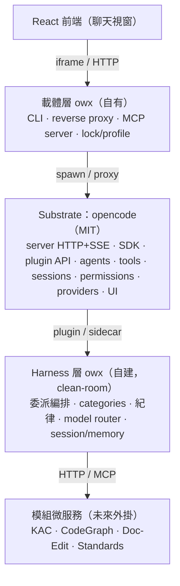

圖說：載體層包裝並代理 Substrate；Harness 以 plugin／sidecar 掛在 Substrate 邊界；模組以 HTTP／MCP 越過微服務邊界。授權邊界即架構邊界，SUL 元件不得越過 Harness 邊界進入交付物。

### 1.2 端到端互動

下圖描述一次使用者請求如何穿越四層：UI 到載體層、載體層到 Substrate、Substrate 到 Harness，再逐層回傳。

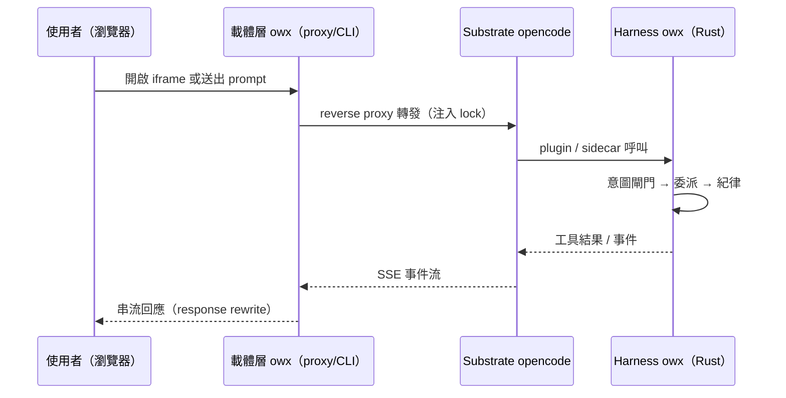

---

## 2. 載體層 owx（`FR-CARRIER-*`）

> **連結慣例**：載體層權威規格位於**另一個 repo**（`opencode-web`）。本節以可解析的相對路徑連結（`../../../opencode-web/...`），並註明「carrier repo 內路徑」；內容不複製，衝突時以載體 repo 規格為準。
>
> 載體層的職責是**隔離、profile 管理、文件流程與邊界強制**，不寫 AI 邏輯。
>
> **驗收格式**：每條 FR 的「驗收」以「給定（前置／輸入）…則（預期輸出）」表述，並補「邊界」與「錯誤」兩類案例；`TC-*` 為對應測試案例 ID 佔位。

### 2.1 profile 與多帳號隔離

**FR-CARRIER-1｜五根隔離**
每個 profile 以 env 切換 opencode 的五個路徑根：data（`XDG_DATA_HOME`）、config（`XDG_CONFIG_HOME`）、state（`XDG_STATE_HOME`）、tmp（`TMPDIR`）、cache（刻意共用）。目錄不存在時 opencode 會安靜退回全域，故啟動前必須建立。
- **驗收**：
  - 給定 `ow status <profile>`，則 stdout 列出 data／config／state／tmp／cache 五個**實際絕對路徑**，且四根（data／config／state／tmp）與該 slug 對應。
  - 邊界：cache 路徑刻意與其他 profile 共用（`~/.cache/opencode/`），其餘四根互異。
  - 錯誤：給定任一 profile 目錄不存在，則啟動流程先建立再啟動；不得讓 opencode 安靜退回全域根。
- **行為**：目錄建立必須在 spawn opencode **之前**完成（順序保證）；建立失敗則啟動中止並回非零碼，不啟動半套環境（避免部分根指向全域）。
- **來源**：carrier repo 內路徑 `docs/spec/ow-workspace-layout.md` §5.2、`README.md`「設定隔離」。

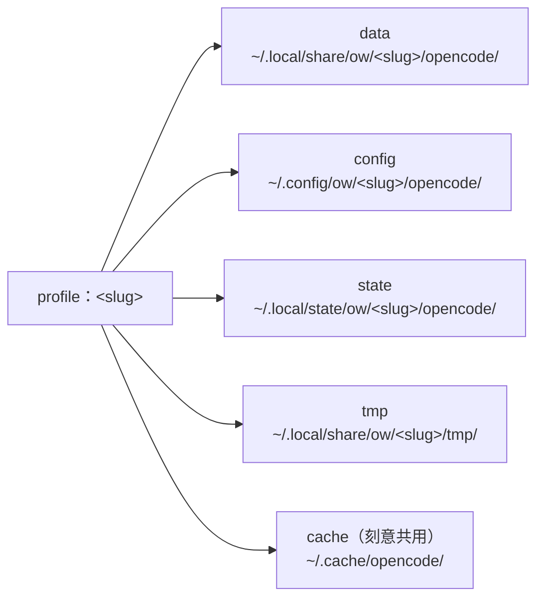

**FR-CARRIER-2｜profile 註冊與輸入驗證**
`ow profile add <slug> --worktree <path> --port <n>` 註冊 profile；必須驗證 worktree 目錄存在、`--worktree` 漏值不得吞掉下一個 flag、slug 須符合 `^[a-z0-9][a-z0-9_-]*$`。
- **驗收**：
  - 給定合法 `ow profile add <slug> --worktree <path> --port <n>`，則寫入 `profiles.json` 並回成功。
  - 邊界：slug 須符合 `^[a-z0-9][a-z0-9_-]*$`；`--worktree` 後直接接 `--port` 時，須判定 `--worktree` 漏值。
  - 錯誤：不存在的 worktree 路徑 → 拒絕並回可讀錯誤；`../../etc` 這類 slug → 拒絕；`--worktree` 漏值 → 拒絕，不得把 `--port` 當路徑寫入。
- **行為**：驗證失敗時**不得寫入任何 profile 記錄**（原子性：全成功或全不寫），避免留下半套 profile。
- **來源**：carrier repo 內路徑 `docs/spec/ow-workspace-layout.md` §3、§6；`AGENTS.md` §2.3。

**FR-CARRIER-3｜slug 與 token 職責分離**
目錄名／分支名／profile 名／SeaweedFS 子路徑四者同名且等於 slug；真 token 只存 profile 的 `auth.json`，不得出現在任何路徑、git 記錄或 listing。
- **驗收**：
  - 給定任一 profile，則 `ps`、`ls`、`git worktree list`、SeaweedFS listing 皆不含真 token。
  - 邊界：token 僅見於 `~/.local/share/ow/<slug>/opencode/auth.json`。
  - 錯誤：給定 token 出現在路徑／git 記錄／listing 任一處，則視為違規（測試須斷言不存在）。
- **來源**：carrier repo 內路徑 `docs/spec/ow-workspace-layout.md` §4。

**FR-CARRIER-4｜路徑解析只讀 profile 記錄**
ow 解析工作區一律走 profile 記錄（`profiles.json`），不反查 app；app 掛掉時既有工作區仍可定位。
- **驗收**：
  - 給定 app 服務不可用，則 `ow status <profile>` 仍能解析並印出 worktree 路徑。
  - 邊界：解析來源為 `profiles.json`，不呼叫 app API。
  - 錯誤：`profiles.json` 缺該 slug → 回可讀錯誤，不猜測路徑。
- **來源**：carrier repo 內路徑 `docs/spec/ow-workspace-layout.md` §4.2。

### 2.2 lock mode（鎖定模式）

**FR-CARRIER-5｜鎖定注入與新增專案攔截**
`OW_LOCK=1` 時：隱藏「新增專案」UI、攔截 `POST /project` 回 403、注入預選 worktree、內部 port 只綁 `127.0.0.1`。
- **驗收**：
  - 給定 `OW_LOCK=1`，則 `POST /project` 回 403。
  - 邊界（反向驗證）：移除注入後，同一請求回 200。
  - 錯誤：鎖定模式下 opencode 內部 port 僅 loopback 可連；外部直連須失敗。
- **行為**：注入腳本於 HTML 回應時插入（隱藏「新增專案」UI）；攔截在 proxy 層，**先於** upstream 執行，故 upstream 不會收到該請求。
- **來源**：carrier repo 內路徑 `README.md`「鎖定模式」、`AGENTS.md` §0.4。

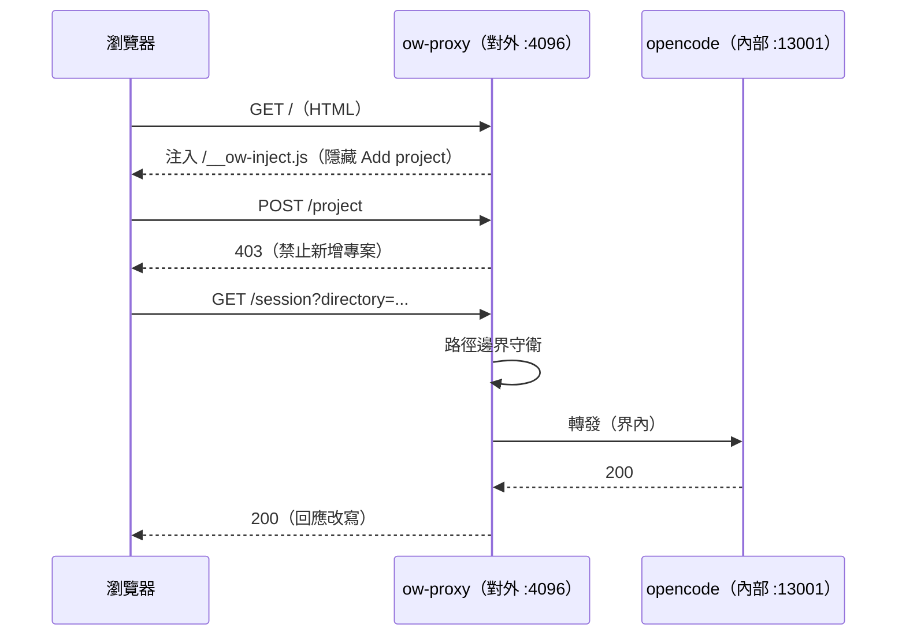

### 2.3 請求與回應邊界守衛

**FR-CARRIER-6｜請求側路徑邊界守衛（參數驅動、全 method）**
守衛條件為 `LOCKED && hasPathParams(url) && pathParamsOutsideWorktree(url) → 403`。不列舉路由、不限 method；逐一驗四個參數面：`directory`、`workspace`、`path`（相對 `directory` resolve）、`location`（JSON 物件或 bracket notation）。須處理 URL decode、`..` 穿越與 symlink（realpath 後再判一次）。
- **驗收**：
  - 給定任一帶界外路徑參數的請求（含 `POST`、含 bracket notation、含 symlink 祖先逃逸），則回 403。
  - 邊界：逐一驗 `directory`、`workspace`、`path`（相對 `directory` resolve）、`location`（JSON 物件或 bracket notation）四參數面。
  - 錯誤：URL decode 後仍須判；`..` 穿越與 symlink 須 realpath 後再判一次；界內或無路徑參數的請求仍回 200（不誤殺 UI 檔案樹）。
- **行為**：守衛為**參數驅動**（不列舉路由），故新增路由不需改守衛；判定順序為 decode → resolve → realpath → 邊界比對，任一階段失敗即 403。
- **來源**：carrier repo 內路徑 `docs/spec/ow-document-access.md` §8.1.0 至 §8.1.2、§9.4。

**FR-CARRIER-7｜回應側守衛與改寫**
請求側攔不到的回應內容洩漏，須在回應層處理：`GET /project/{id}/directories` 過濾 JSON 陣列只留界內；`GET /project` 保留全部條目、只改寫 `worktree` 欄位並清空 `sandboxes`；`GET /session/<id>` 只改寫 session 物件頂層 `directory`，不遞迴改寫 message／tool 引數。改寫一律 fail-open，且重寫 body 時須移除互斥的 `transfer-encoding`。
- **驗收**：
  - 給定 `GET /project/{id}/directories` 上游回含界外目錄，則回應只含界內項目。
  - 邊界：`GET /project` 上游含界外 `worktree`，則條目數／順序／`id` 不變而 `worktree` 被改寫、`sandboxes` 清空。
  - 錯誤：gzip 上游改寫後須可被瀏覽器解析（無 `ERR_CONTENT_DECODING_FAILED`）；重寫 body 時移除互斥的 `transfer-encoding`。
- **行為**：改寫一律 **fail-open**（改寫失敗則放行原回應，不阻斷請求）；`GET /session/<id>` 只改頂層 `directory`，不遞迴改寫 message／tool 引數（避免破壞歷史）。
- **來源**：carrier repo 內路徑 `docs/spec/ow-document-access.md` §8.1.3 至 §8.1.6。

**FR-CARRIER-8｜注入鍵名權威契約**
注入腳本寫入的 localStorage 鍵名屬外部契約：權威鍵為 `opencode.global.dat:server`（保留 `server.v3` 供舊版相容），並改寫 `opencode.window.browser.dat:tabs` 與 `…:tabs.info` 各自攜帶的 `directory`。
- **驗收**：
  - 給定注入後載入 UI，則 `projects.local[0].worktree` 維持界內、不被 app 改回界外。
  - 邊界：權威鍵 `opencode.global.dat:server`（保留 `server.v3` 相容）；另改寫 `opencode.window.browser.dat:tabs` 與 `…:tabs.info` 的 `directory`。
  - 錯誤：鍵名契約有迴歸測試鎖定；鍵名變更須同步更新測試，否則視為破壞契約。
- **來源**：carrier repo 內路徑 `docs/spec/ow-document-access.md` §8.1.5。

### 2.4 reverse proxy

**FR-CARRIER-9｜代理端點與 upgrade**
ow-proxy 對外提供：`/__ow-inject.js`（注入腳本，繞 CSP inline 限制）、`/__ow-doc-status`（文件狀態聚合）、`/__ow-masters`（master 清單），並轉發 HTTP／SSE／WebSocket upgrade。CORS 由 upstream opencode 提供，proxy 不自行產生 CORS 標頭。
- **驗收**：
  - 給定請求 `/__ow-inject.js`，則回 200 且內容為注入腳本。
  - 邊界：`/__ow-doc-status`、`/__ow-masters` 各自回對應聚合／清單。
  - 錯誤：SSE 或 WS upgrade 須正確轉發；跨源請求 CORS 標頭來自 upstream，proxy 不自行產生。
- **來源**：carrier repo 內路徑 `docs/spec/ow-document-access.md` §9.3、`README.md`「鎖定模式」。

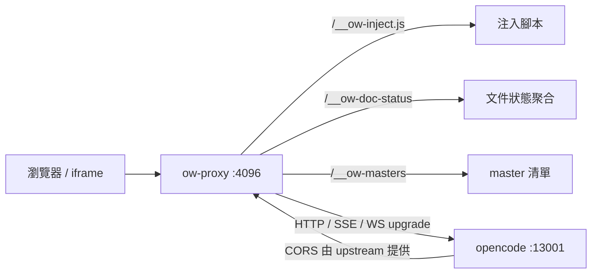

**FR-CARRIER-10｜文件狀態聚合端點**
`GET /__ow-doc-status` 在 proxy 端完成 BFS 列檔與 md5 計算，回傳 `[{path, state, md5, fileSize}]`。狀態四態為 draft／published／modified／remote-only。每個 listing 請求須帶 `Accept: application/json`；目錄判斷用 `Mode & 0x80000000`；md5 取 base64（與 filer 的 `Md5` 對齊）；BFS 深度上限 8；僅納入 `.md`；回應加 `Cache-Control: no-store`；端點僅在 `LOCKED` 時掛載；與邊界守衛共用同一個 `isInsideWorktree()`。
- **驗收**：
  - 給定 filer 不可達，則 `filerReachable=false` 且 `entries` 退為 workspace-only，端點不整體失敗。
  - 邊界：工作區與 filer 兩份副本 md5 相同 → 該檔標 `published`；md5 不同 → 標 `modified`。
  - 錯誤：listing 請求未帶 `Accept: application/json` → 拒絕；目錄判斷用 `Mode & 0x80000000`；BFS 深度上限 8；僅納入 `.md`；回應加 `Cache-Control: no-store`；端點僅在 `LOCKED` 時掛載。
- **行為**：與邊界守衛**共用同一個** `isInsideWorktree()`（單一來源，避免兩套判定漂移）；filer 不可達時**降級**而非整體失敗（部分可用優於全不可用）。
- **來源**：carrier repo 內路徑 `docs/spec/ow-document-access.md` §3.2、§9.4。

**FR-CARRIER-11｜統一檔案選擇器**
`#` 觸發單一選擇器，範圍限 `.docs/**` 與根 `AGENTS.md`，每個檔案帶狀態徽章並依 🟠 → 🔵 → 🟡 → 🟢 排序；選取後插入帶狀態的結構化指示區塊（非 inline 全文）。碰撞避免：符號後不可有空格、前方需為邊界、無匹配則不彈。
- **驗收**：
  - 給定輸入 `#PLAN`，則彈出選擇器並列出 `.docs/PLAN.md` 與其狀態。
  - 邊界：範圍限 `.docs/**` 與根 `AGENTS.md`；排序 🟠 → 🔵 → 🟡 → 🟢。
  - 錯誤：輸入 `# 標題`（符號後有空格）→ 不觸發；無匹配 → 不彈。
- **行為**：選取後插入**帶狀態的結構化指示區塊**（非 inline 全文），避免把整份文件塞進 prompt。
- **來源**：carrier repo 內路徑 `docs/spec/ow-document-access.md` §3、§4、§5。

### 2.5 workspace ensure（代建）

**FR-CARRIER-12｜工作區代建（層 A）**
`ow workspace ensure <app> <slug> --repo <path>` 在**已授權 app root** 下冪等代建 `<slug>/`。七條護欄：冪等（絕不 `rm -rf`）、不覆蓋非空目錄、app／slug 白名單、併發鎖、分支出處一律 `-b <slug>`、不代簽 token、app root 白名單。只代建層 A（工作區存在性），層 B（實例啟動與路由）屬 app 側。
- **驗收**：
  - 給定 profile 已存在且 worktree 相符，則回 `{created:false, reason:"exists"}`。
  - 邊界：目標目錄非空 → 拒絕；app／slug 白名單外 → 拒絕。
  - 錯誤：同一 slug 併發觸發 → 只建一份（併發鎖）；分支出處一律 `-b <slug>`；不代簽 token。
- **行為**：冪等且**絕不 `rm -rf`**；併發以鎖序列化，後到者觀察到已存在即回 `exists`；只代建層 A，層 B（實例啟動與路由）屬 app 側。
- **來源**：carrier repo 內路徑 `docs/spec/ow-workspace-layout.md` §6.2。

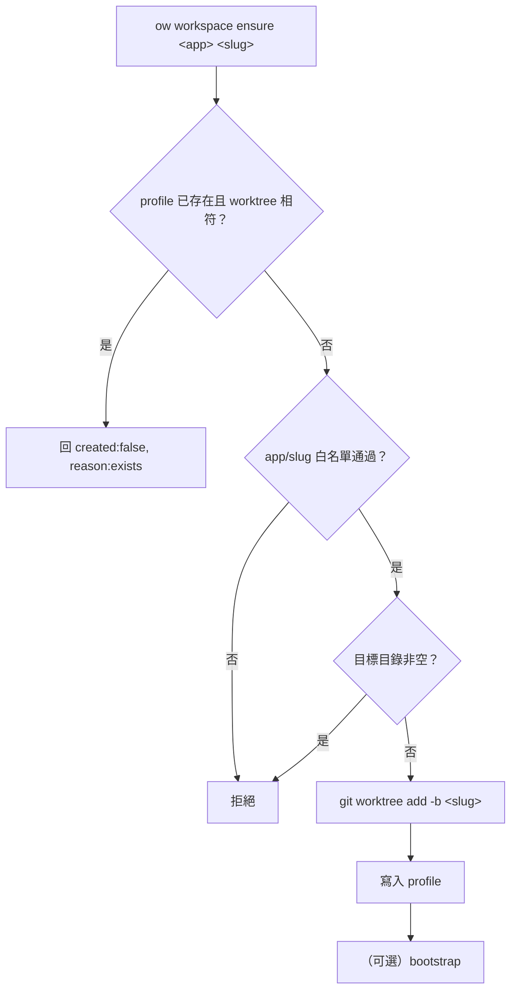

### 2.6 MCP server

**FR-CARRIER-13｜MCP 工具契約**
ow 對外提供 MCP server（stdio 與 HTTP `:13010/mcp`），v1 共 8 個 `opencode_*` tools：`list_projects`、`create_session`、`list_sessions`、`send_message`、`read_file`、`list_files`、`get_theme`、`set_theme`。所有需專案的操作要求 `project` 參數，且只能操作已 Import 的專案。MCP 層只做包裝與專案限定，不新增 opencode 沒有的能力。
- **驗收**：
  - 給定 MCP client 連線，則可列出 8 個 tools 且名稱與 `docs/mcp.md` §3.1 一致。
  - 邊界：所有需專案的操作要求 `project` 參數。
  - 錯誤：未 Import 的專案 id → 操作被拒。
- **行為**：MCP 層只做**包裝與專案限定**，不新增 opencode 沒有的能力（能力邊界與 Substrate 一致）。
- **來源**：carrier repo 內路徑 `docs/mcp.md` §3.1、§5。

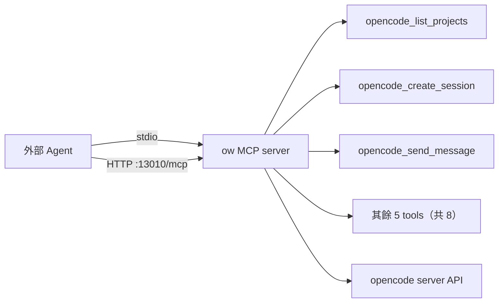

### 2.7 部署（launchd）

**FR-CARRIER-14｜開機自啟與 crash 重啟**
`ow service <profile>` 生成 LaunchAgent plist，含 `KeepAlive=true`（crash 重啟）、`RunAtLoad=true`（開機自啟）、完整 PATH 與 `XDG_*` env。launchd 管理的實例，`ow restart` 改用 `launchctl kickstart -k`，`ow stop` 拒絕執行並提示改用 `launchctl unload`。
- **驗收**：
  - 給定 `kill -9` opencode 行程，則 launchd 於數秒內自動重啟。
  - 邊界：plist 含 `KeepAlive=true`、`RunAtLoad=true`、完整 PATH 與 `XDG_*` env。
  - 錯誤：launchd 管理實例，`ow stop` 拒絕執行並提示改用 `launchctl unload`，不謊報已停止；`ow restart` 改用 `launchctl kickstart -k`。
- **來源**：carrier repo 內路徑 `README.md`「開機自啟」、`AGENTS.md` §5.1。

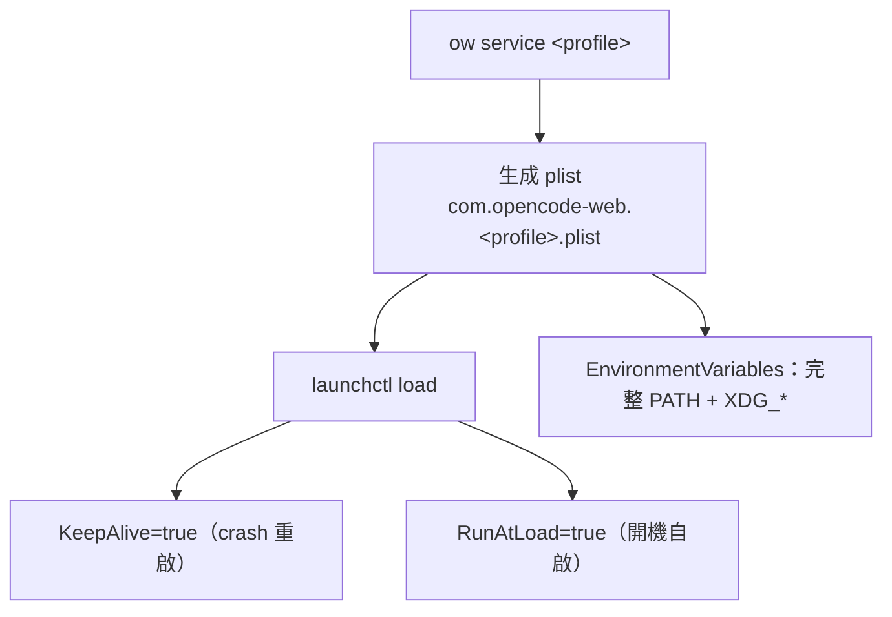

### 2.8 文件流程邊界（兩個必須標明的事實）

**FR-CARRIER-15｜commit-doc 實作在 KAC repo（外部）**
`/commit-doc` 的實作（`.opencode/command/commit-doc.md` 與 `scripts/commit-doc.sh`）位於 **KAC repo**（`~/github/kac`），**不在載體 repo**。載體 repo 只有 `scripts/start.sh`。commit-doc 只做 git commit（分支 `<slug>`，不 push GitHub）與 filer 上傳（`/kac-docs/<slug>/`），編輯期不寫回中央儲存。
- **驗收**：
  - 給定在載體 repo 搜尋 commit-doc 實作，則**不應**找到（實作在 KAC repo）。
  - 邊界：載體 repo 只有 `scripts/start.sh`。
  - 錯誤：執行 commit-doc 落點為 `/kac-docs/<slug>/` 且不 push GitHub；編輯期不寫回中央儲存。
- **來源**：carrier repo 內路徑 `docs/spec/ow-workspace-layout.md` §7、`AGENTS.md` §0.5。

**FR-CARRIER-16｜`ow doc pull`（規格規劃中、尚未實作）**
`ow doc pull <profile> <path>` 為補齊文件生命週期的反向拉取指令，**目前僅在規格規劃中，尚未實作**。現況 `commit-doc` 只有上傳、沒有讀回，故 `remote-only` 狀態只能唯讀引用。
- **驗收**：
  - 給定現行載體 repo，則 `ow doc pull` **不存在**（不得宣稱已實作）。
  - 邊界：實作後，給定 `remote-only` 檔案，則 pull 後工作區出現副本且狀態轉為 `published`。
  - 錯誤：現況 commit-doc 只有上傳、沒有讀回，故 `remote-only` 只能唯讀引用。
- **來源**：carrier repo 內路徑 `docs/spec/ow-document-access.md` §3.5、§9.3。

### 2.9 載體 FR 追溯表

| FR ID | 能力 | carrier ID | 來源檔案（carrier repo 內路徑） |
|---|---|---|---|
| FR-CARRIER-1 | 五根隔離 | I1, I3 | `docs/spec/ow-workspace-layout.md` §5.2 |
| FR-CARRIER-2 | profile 註冊與驗證 | I2, I3 | `docs/spec/ow-workspace-layout.md` §3, §6 |
| FR-CARRIER-3 | slug／token 分離 | I4 | `docs/spec/ow-workspace-layout.md` §4 |
| FR-CARRIER-4 | 路徑解析只讀 profile | I7 | `docs/spec/ow-workspace-layout.md` §4.2 |
| FR-CARRIER-5 | lock 注入與攔截 | （無，見 README 鎖定模式） | `README.md`、`AGENTS.md` §0.4 |
| FR-CARRIER-6 | 請求側邊界守衛 | R4, R5 | `docs/spec/ow-document-access.md` §8.1 |
| FR-CARRIER-7 | 回應側守衛與改寫 | R4 | `docs/spec/ow-document-access.md` §8.1.3 至 §8.1.6 |
| FR-CARRIER-8 | 注入鍵名權威 | （無，見 §8.1.5） | `docs/spec/ow-document-access.md` §8.1.5 |
| FR-CARRIER-9 | 代理端點與 upgrade | C7, C12 | `docs/spec/ow-document-access.md` §9.3 |
| FR-CARRIER-10 | 文件狀態聚合 | C1 至 C5, C9, C10, D1 至 D7 | `docs/spec/ow-document-access.md` §3.2, §9.4 |
| FR-CARRIER-11 | 統一檔案選擇器 | Q1, Q2, Q3 | `docs/spec/ow-document-access.md` §3 至 §5 |
| FR-CARRIER-12 | workspace ensure | I9 | `docs/spec/ow-workspace-layout.md` §6.2 |
| FR-CARRIER-13 | MCP 工具契約 | （無，見 `docs/mcp.md`） | `docs/mcp.md` §3.1 |
| FR-CARRIER-14 | launchd 部署 | （無，見 README launchd） | `README.md`、`AGENTS.md` §5.1 |
| FR-CARRIER-15 | commit-doc 邊界 | I5, I6 | `docs/spec/ow-workspace-layout.md` §7 |
| FR-CARRIER-16 | `ow doc pull`（規劃中） | C6, Q2 | `docs/spec/ow-document-access.md` §3.5, §9.3 |

> 標「（無）」者為載體規格未給對應 ID 的條目，來源以檔案章節註明。

---

## 3. Substrate 層 opencode（`FR-SUB-*`）

> Substrate 為 opencode（**MIT**），以包裝／外掛使用，**不改其原始碼**。本節**不逐條重抄** [`base-core-requirements.md`](base-core-requirements.md) §3 的 FR-B／FR-D／FR-E／FR-G／FR-H／FR-I，僅以連結指向，並補「本規格需要點名」的條目。

| 群 | 內容 | 連結 |
|---|---|---|
| FR-B | 工具（檔案／執行／程式理解／網路／流程） | [`base-core-requirements.md`](base-core-requirements.md) §3 FR-B |
| FR-D | Session 與上下文（CRUD／SSE／compaction／undo） | [`base-core-requirements.md`](base-core-requirements.md) §3 FR-D |
| FR-E | 模型與 Provider（多 provider／模型鏈／fallback） | [`base-core-requirements.md`](base-core-requirements.md) §3 FR-E |
| FR-G | 擴充機制（plugin／skill／command／MCP） | [`base-core-requirements.md`](base-core-requirements.md) §3 FR-G |
| FR-H | UI（TUI／Web UI／iframe 可嵌入） | [`base-core-requirements.md`](base-core-requirements.md) §3 FR-H |
| FR-I | 部署與多租戶（內外網分離／鎖定／CORS／launchd） | [`base-core-requirements.md`](base-core-requirements.md) §3 FR-I |

> **覆蓋率**：base-core §3 已對照 opencode 官方文件（v1 `opencode.ai/docs`、v2 `opencode.ai/v2/docs`）補齊各群遺漏項（base-core v0.3，repo `anomalyco/opencode`）；本節以連結繼承，不重複。

**FR-SUB-1｜SSE 事件流為即時狀態來源**
Substrate 以 SSE（`/global/event`）推送 session／訊息／權限請求等狀態；載體層只轉發，不自行產生事件。
- **驗收**：
  - 給定 UI 訂閱 `/global/event`，則 session／訊息／權限事件即時到達。
  - 邊界：載體層只轉發，不自行產生事件。
  - 錯誤：載體層新增 opencode 沒有的自製事件 → 違規。
- **行為**：斷線後重連須續訂；事件順序與 upstream 一致（proxy 不重排、不合併）。
- **來源**：base-core FR-D-2；carrier repo 內路徑 `README.md`「已知問題」。

**FR-SUB-2｜權限請求可觀察**
Substrate 的 permission 機制在工具執行前發出請求，結果可觀察（allow／deny）。
- **驗收**：
  - 給定需權限的工具呼叫，則發出 permission 事件並等待結果。
  - 邊界：結果（allow／deny）記錄於日誌可查。
  - 錯誤：未回應前工具不得執行（阻塞語意）。
- **行為**：權限請求為**阻塞式**（工具在結果到達前不執行）；deny 後工具跳過並回可觀察結果，不靜默。
- **來源**：base-core FR-B-2、FR-D-2。

**FR-SUB-3｜Web UI 可 iframe 嵌入**
Substrate 的 Web UI 可被 iframe 嵌入，供其他 app 使用；載體層以環境感知 URL 避免 mixed content。
- **驗收**：
  - 給定 https 環境，則 iframe 指向 https 端點。
  - 邊界：http 環境則指向 localhost。
  - 錯誤：mixed content 須避免（https 頁面不得嵌 http iframe）。
- **來源**：base-core FR-H-2；carrier repo 內路徑 `README.md`「其他專案整合」。

**FR-SUB-4｜CORS 由 upstream 提供**
CORS 白名單由 upstream opencode 提供（`OPENCODE_WEB_CORS`），載體層不自行產生 CORS 標頭。
- **驗收**：
  - 給定跨源請求，則 `access-control-*` 標頭來自 upstream。
  - 邊界：載體層不注入自製 CORS 標頭。
  - 錯誤：proxy 產生 CORS 標頭 → 違規。
- **來源**：base-core FR-I-3；carrier repo 內路徑 `docs/spec/ow-document-access.md` §5.2。

**FR-SUB-5｜plugin／sidecar 為 Harness 掛載點**
Substrate 的 plugin API 與 sidecar 邊界是 Harness 的掛載點；Harness 不擴充 Substrate 行為。
- **驗收**：
  - 給定 Harness 掛載，則經 plugin／sidecar 邊界互動。
  - 邊界：Substrate 原始碼未被修改（diff 為空）。
  - 錯誤：直接改 Substrate 原始碼 → 違規。
- **來源**：base-core FR-G-1；[`ADR-0003`](../adr/ADR-0003-harness-rust-core-react-frontend.md)。

**FR-SUB-6｜內部 port 綁 loopback**
鎖定模式下 Substrate 內部 port 只綁 `127.0.0.1`，對外由 reverse proxy 暴露。
- **驗收**：
  - 給定鎖定模式，則內部 port 僅 loopback 可連。
  - 邊界：對外由 reverse proxy 暴露。
  - 錯誤：外部直連內部 port → 失敗。
- **來源**：base-core FR-I-1；carrier repo 內路徑 `AGENTS.md` §0.3。

---

## 4. Harness 層 owx 自建（`FR-HAR-*`）

> Harness 為 owx **clean-room 自建**（Rust 核心，[`ADR-0003`](../adr/ADR-0003-harness-rust-core-react-frontend.md)），由 [`base-core-requirements.md`](base-core-requirements.md) 的 FR-A、FR-C、FR-E-2/3 **自寫轉化**。內容不含任何 omo（SUL-1.0）原始碼、prompt、skill 文字或品牌名。

### 4.1 委派編排與 categories

**FR-HAR-1｜委派（sync／background）**
主 agent 透過 `task` 工具委派給 sub-agent；sub-agent 可為同步（等待結果）或背景（`run_in_background`，完成後通知、可 `background_output` 取回）。
- **驗收**：
  - 給定同步委派，則主 agent 等待並取得結果。
  - 邊界：背景委派立即取得 `task_id`。
  - 錯誤：背景完成後收到通知並可 `background_output` 取回結果；取回前結果保留。
- **行為**：背景任務完成通知為**一次性**；重複取回須**冪等**（同 `task_id` 回同結果）；同步委派阻塞呼叫者直到結果或錯誤。
- **來源**：base-core FR-A-1、FR-A-2。

**FR-HAR-2｜category 與 skills 注入**
委派時可指定 category（領域預設）與 skills（注入知識／工具）。
- **驗收**：
  - 給定指定 category，則套用該 category 的 model chain 與 tool policy。
  - 邊界：指定 skills 則對應知識／工具被注入。
  - 錯誤：未知 category → 拒絕或回退預設（須明確定義，不得靜默）。
- **來源**：base-core FR-A-3。

**FR-HAR-3｜唯讀研究型 sub-agent**
提供唯讀研究型 sub-agent（探索、文件檢索、計畫諮詢、計畫審查），工具受白名單限制（不可寫、不可再委派）。
- **驗收**：
  - 給定研究型 sub-agent，則寫入工具與委派工具不可用。
  - 邊界：探索、文件檢索、計畫諮詢、計畫審查四型皆受白名單限制。
  - 錯誤：嘗試呼叫寫入／委派工具 → 被拒。
- **來源**：base-core FR-A-4。

**FR-HAR-4｜category worker 不可再委派**
category worker 不可再委派，防無限迴圈。
- **驗收**：
  - 給定 category worker 嘗試委派，則被拒。
  - 邊界：防無限迴圈。
  - 錯誤：委派呼叫回錯誤，不靜默忽略。
- **來源**：base-core FR-A-5。

**FR-HAR-5｜per-agent 設定**
每個 agent 有獨立 prompt／model chain／tool policy／permission。
- **驗收**：
  - 給定兩個 agent，則各自的 prompt、model chain、tool policy、permission 互不影響。
  - 邊界：改一個 agent 的設定不影響另一個。
  - 錯誤：設定衝突時以 per-agent 為準（覆蓋順序明確）。
- **來源**：base-core FR-A-7。

### 4.2 紀律機制

**FR-HAR-6｜意圖閘門**
每個 prompt 在動用工具前，先強制確認意圖／分類。
- **驗收**：
  - 給定新 prompt，則在首次工具呼叫前出現意圖確認步驟。
  - 邊界：純問答（無工具）不強制。
  - 錯誤：跳過意圖閘門直接呼叫工具 → 違規。
- **來源**：base-core FR-C-1。

**FR-HAR-7｜todo 強制**
多步任務建立 todo、逐步標記完成、閒置時再觸發續作。
- **驗收**：
  - 給定多步任務，則建立 todo 並逐步標記。
  - 邊界：單步任務不強制。
  - 錯誤：閒置時觸發續作；未標記完成即宣稱完成 → 違規。
- **來源**：base-core FR-C-2。

**FR-HAR-8｜規劃與驗證節奏**
先規劃、逐步驗證、計畫審查後才執行。
- **驗收**：
  - 給定任務，則先產出計畫並經審查，才進入執行。
  - 邊界：審查未通過不得執行。
  - 錯誤：跳過審查直接執行 → 違規。
- **來源**：base-core FR-C-3。

**FR-HAR-9｜續作機制**
設定持久目標，session 閒置時重新注入續作提示，直到完成審計通過。
- **驗收**：
  - 給定持久目標未完成，則閒置後重新注入續作提示。
  - 邊界：完成審計通過則停止續作。
  - 錯誤：審計未通過不得停止。
- **來源**：base-core FR-C-4。

**FR-HAR-10｜工作計畫狀態**
跨 session 保存已驗證的進度記錄。
- **驗收**：
  - 給定跨 session 續作，則已驗證進度可被讀回。
  - 邊界：僅保存「已驗證」進度，未驗證不寫入。
  - 錯誤：進度檔損毀 → 回退至上一已驗證狀態，不中斷。
- **來源**：base-core FR-C-5。

**FR-HAR-11｜session 復原**
缺工具結果、thinking block 不匹配、空訊息、context 超限、JSON 解析錯誤，皆透明復原。
- **驗收**：
  - 給定缺工具結果、thinking block 不匹配、空訊息、context 超限、JSON 解析錯誤任一情境，則 session 透明復原且長任務不中斷。
  - 邊界：復原對使用者透明（不要求重下 prompt）。
  - 錯誤：復原失敗 → 記錄並回報，不靜默吞錯。
- **來源**：base-core FR-C-6。

### 4.3 model router

**FR-HAR-12｜模型鏈**
primary + 有序 fallback。
- **驗收**：
  - 給定 primary 可用，則使用 primary。
  - 邊界：primary 不可用則依序嘗試 fallback。
  - 錯誤：全鏈失敗 → 回報明確錯誤，不無限重試。
- **來源**：base-core FR-E-2。

**FR-HAR-13｜兩套 fallback**
proactive（chat params 選鏈）與 reactive（執行後失敗復原）。
- **驗收**：
  - 給定 proactive 選鏈，則在呼叫前決定鏈。
  - 邊界：執行後失敗則 reactive 復原。
  - 錯誤：reactive 復原須保留原請求語意（不重複副作用）。
- **來源**：base-core FR-E-3。

### 4.4 文件優先轉化（承接缺口）

**FR-HAR-14｜紀律語境重寫為文件優先**
plan／verify／todo 的 prompt 須重寫為「規格／文件」語境，而非 code 語境。
- **驗收**：
  - 給定文件編輯任務，則紀律提示以規格／文件為對象。
  - 邊界：不得沿用 code 導向措辭。
  - 錯誤：出現 code 導向措辭 → 違規。
- **來源**：base-core §7 缺口 2。

**FR-HAR-15｜traceability 產出**
紀律擴充為「需求 ↔ 文件 ↔ 測試 ↔ 實作」可證追溯。
- **驗收**：
  - 給定一條需求，則可追溯其對應文件、測試與實作。
  - 邊界：追溯以穩定 ID（`FR-*`／`TC-*`）互指。
  - 錯誤：斷鏈（需求無對應測試）→ 視為未完成。
- **來源**：base-core §7 缺口 4。

### 4.5 Harness 互動圖

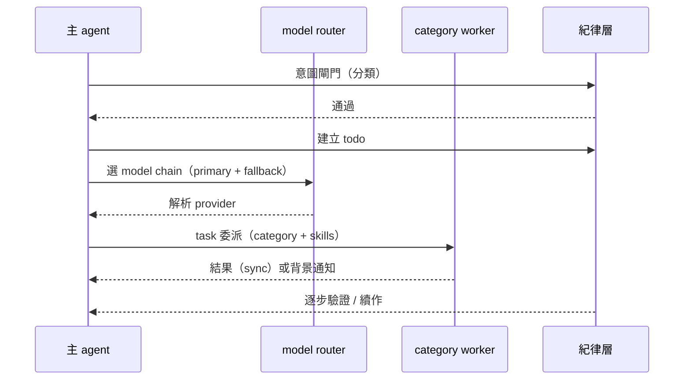

---

## 5. 交互與流程

### 5.1 委派（sync／background）

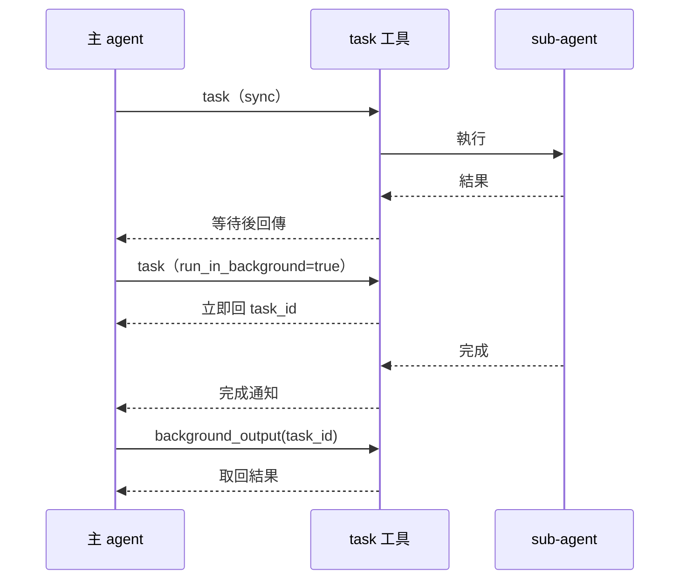

### 5.2 SSE 事件流

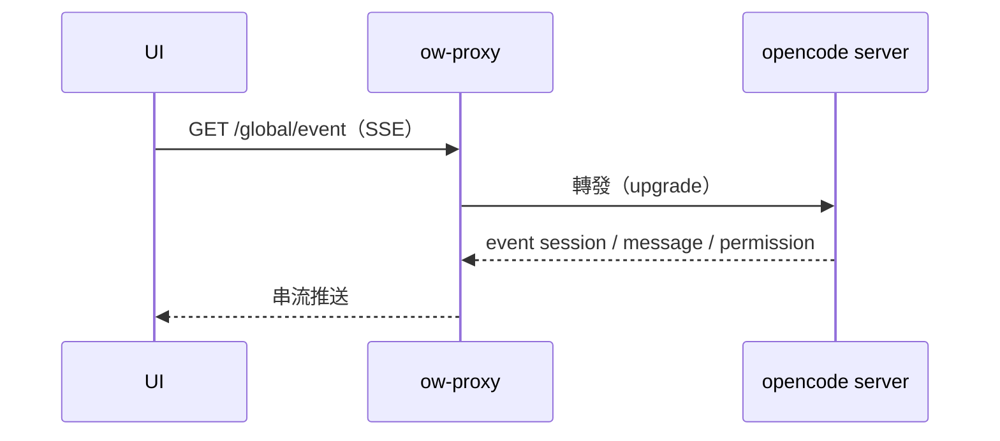

### 5.3 權限請求

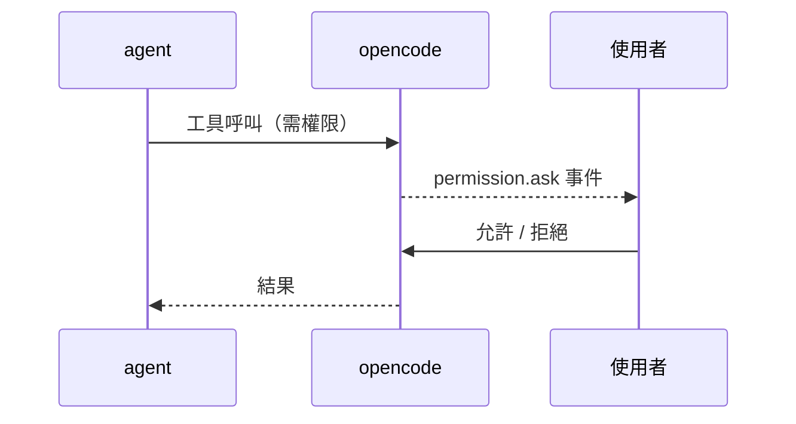

### 5.4 model fallback

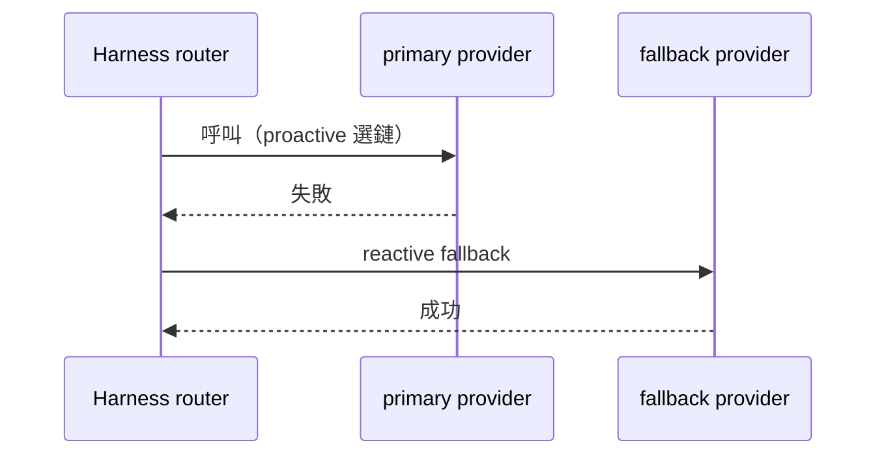

### 5.5 lock-mode 請求邊界守衛

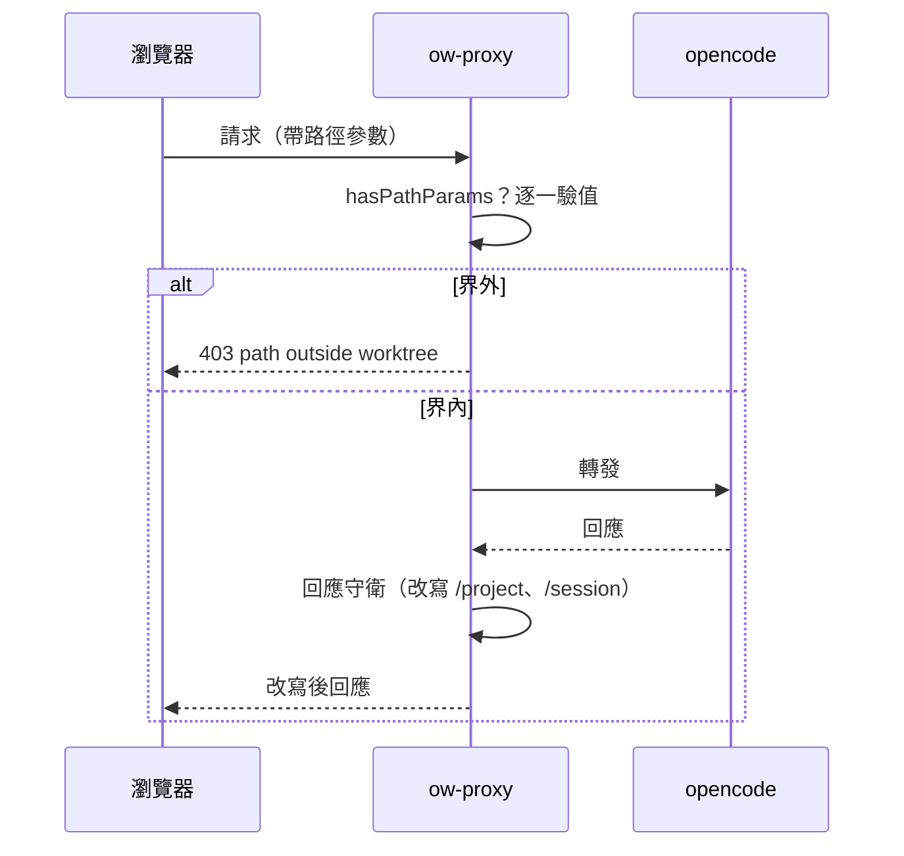

### 5.6 session 生命週期（狀態圖）

下圖描述 session 的狀態轉移。`Running` 為執行中；工具需權限時進入 `AwaitingPermission`（阻塞，直到 allow／deny）；context 超限時進入 `Compacting`（壓縮後回 `Running`）；失敗情境進入 `Recovering`（透明復原後回 `Running`，復原失敗則 `Error`）。`Completed`／`Aborted`／`Error` 皆可回到 `Idle` 以接受續作。

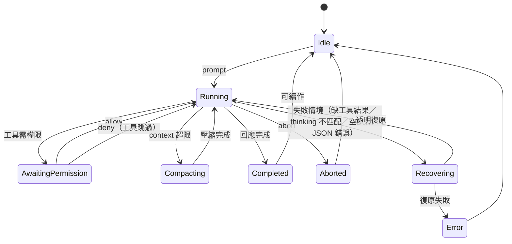

### 5.7 委派 sync 與 background（狀態圖）

下圖描述委派的兩種模式。`sync` 由 `SyncRunning` 阻塞至 `ResultReturned`；`run_in_background` 立即發 `task_id` 後於背景執行，完成時 `Notified`，再由 `background_output` 取回（`Retrieved`）。背景失敗亦走 `Notified`（攜帶錯誤），不靜默消失。

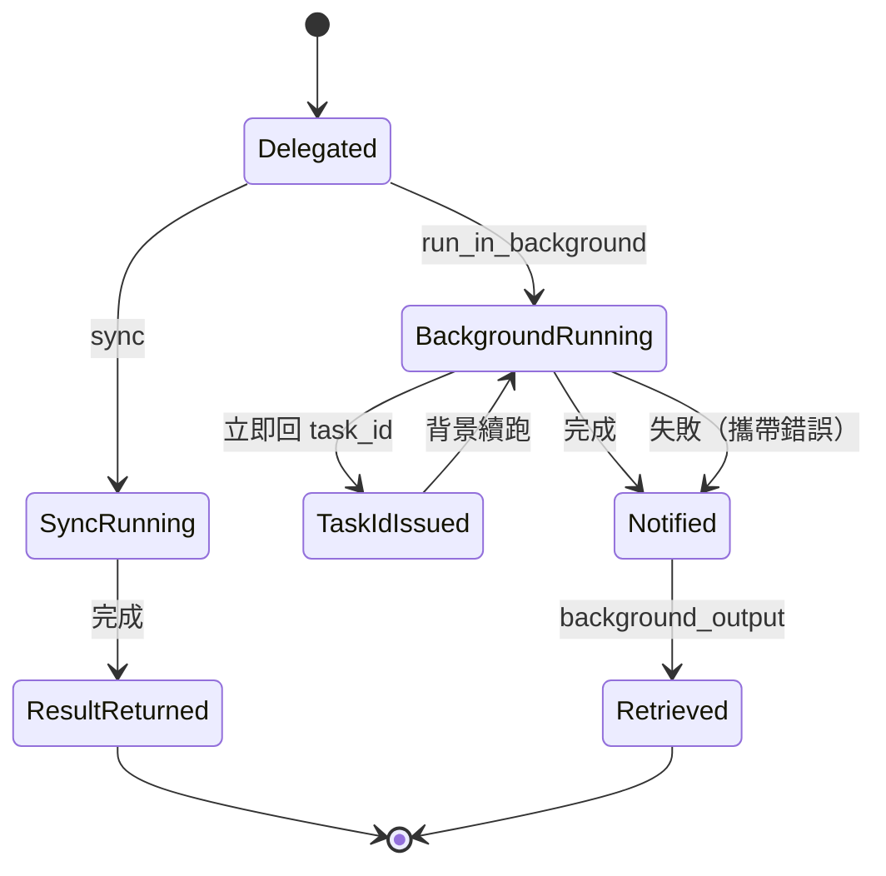

### 5.8 model fallback proactive 與 reactive（狀態圖）

下圖描述兩套 fallback。`proactive` 在呼叫前選定鏈（`ChainSelected`）；`reactive` 於執行後失敗時依序換下一 fallback（`ReactiveFallback`）。鏈耗盡則 `ChainExhausted`，回報明確錯誤，不無限重試。

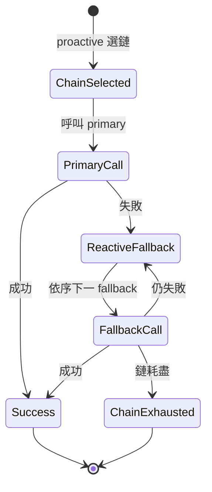

---

## 6. 非功能需求（NFR）

> NFR-1 至 NFR-7 沿用 [`base-core-requirements.md`](base-core-requirements.md) §4，並補可驗證判準；NFR-8 起為本規格增補。

| 編號 | 需求 | 可驗證判準 |
|---|---|---|
| NFR-1 | **授權可交付**：交付物僅含 MIT／自有程式碼；SUL 元件不得進交付物 | 交付物掃描無 SUL／SSPL／BUSL／GPL 授權；元件授權表齊備（`TC-NFR-1`） |
| NFR-2 | **可擴充**：核心以微服務／模組邊界開放外掛 | 新增模組不需改核心；以 HTTP／MCP 邊界接入（`TC-NFR-2`） |
| NFR-3 | **不擴充 substrate 行為**：opencode 以包裝／外掛使用，不改其原始碼 | Substrate 原始碼 diff 為空；整合只經 plugin／sidecar／proxy（`TC-NFR-3`） |
| NFR-4 | **可觀測**：session／事件／權限／fallback 皆可觀察 | 上述四類事件皆可於日誌或事件流觀察（`TC-NFR-4`） |
| NFR-5 | **可復原**：常見失敗自動復原，不中斷長任務 | 注入常見失敗情境，長任務仍完成（`TC-NFR-5`） |
| NFR-6 | **隔離**：帳號／app／設定／資料互不洩漏 | 兩 profile 同時跑，各自 `/project` 回不同 worktree；五根路徑互異（`TC-NFR-6`） |
| NFR-7 | **文件優先可達**：架構須能承載「以文件／知識為原生對象」 | 存在 doc-native 工具與知識圖介面的擴充點（`TC-NFR-7`） |
| NFR-8 | **可測試性**：每條 FR 皆有可觀察／可測的驗收判準 | 每條 FR 附「驗收」與 `TC-*` 佔位；無驗收的 FR 視為未完成（`TC-NFR-8`） |
| NFR-9 | **文件即知識資產**：架構／流程／互動圖一律 Mermaid，可 diff、可被 RAG 解析 | 文件中無 ASCII art／圖檔；所有圖為 Mermaid 原始碼（`TC-NFR-9`） |
| NFR-10 | **授權閘門可自動化**：可產出授權元件表（形如 SBOM） | 以 `cargo metadata`／`pnpm licenses list` 可產出元件授權表（`TC-NFR-10`） |
| NFR-11 | **代理延遲可控**：reverse proxy 不顯著增加請求延遲 | 經 proxy 與直連 upstream 的延遲差在既定門檻內（門檻待定，見 §8）（`TC-NFR-11`） |
| NFR-12 | **隔離可觀察**：`ow status <profile>` 印出五根路徑 | 執行 `ow status <profile>` 可見 data／config／state／tmp／cache 五行（`TC-NFR-12`） |
| NFR-13 | **跨語言邊界明確**：Rust 核心 ↔ TS substrate 以 plugin／sidecar／MCP 互動 | 邊界互動有明確契約；無跨語言直接記憶體耦合（`TC-NFR-13`） |

---

## 7. 來源對映與授權

| FR 群 | 主要來源 | 授權 | 處置 |
|---|---|---|---|
| FR-CARRIER-1 至 FR-CARRIER-16（載體層） | **opencode-web（ow）** | **自有（Proprietary）** | 可自由改 |
| FR-SUB-1 至 FR-SUB-6（Substrate 點名條目） | **opencode** | **MIT** | 可重用／改／散布 |
| FR-HAR-1 至 FR-HAR-5（委派編排） | **omo**（回溯） | **SUL-1.0** | 僅回溯需求，自建（Rust） |
| FR-HAR-6 至 FR-HAR-11（紀律機制） | **omo**（回溯） | **SUL-1.0** | 僅回溯需求，自建（Rust） |
| FR-HAR-12 至 FR-HAR-13（model router） | **omo**（回溯） | **SUL-1.0** | 僅回溯需求，自建（Rust） |
| FR-HAR-14 至 FR-HAR-15（文件優先轉化） | **owx 自寫**（承接 base-core §7 缺口） | **Proprietary** | 自有 |
| 未來 code 圖模組（未在本規格展開） | **CodeGraph** | **MIT（非自有）** | 可用；標註非自有 |
| 未來知識／標準模組（未在本規格展開） | **KAC／owx 自寫** | **Proprietary** | 自有 |

> 任何新增外部元件（npm／cargo／工具／服務）須更新 [`licensing.md`](../standards/governance/licensing.md) §2 元件清單並於 PR body 標明授權。

---

## 8. 缺口 / 待決

### 8.1 承接 D2 至 D5（[`AGENTS.md`](../../AGENTS.md) §9）

| # | 決策 | 影響 | 狀態 |
|---|---|---|---|
| D2 | **文件格式**：初期只 md（參照 opencode-web） | Doc-Edit 模組 | ✅ 定案 |
| D3 | **標準本體**：屬外掛、先不實作 | Standards 模組 | ✅ 定案 |
| D4 | **外掛介面＝MCP / HTTPS**；先不實作外掛（[ADR-0006](../adr/ADR-0006-module-interface-mcp-https.md)）| 微服務邊界 | ✅ 定案 |
| D5 | **可交付清單**：以 `scripts/sbom.mjs` 產出（licensing §6）| §7 落地 | ✅ 定案 |

### 8.2 本規格未完備處

1. **載體層 FR 未涵蓋全部載體能力**：本規格聚焦 profile／lock／proxy／MCP／部署與文件流程；載體 repo 的 `ow scan`、`ow upgrade`、`ow version` 等指令未逐條展開。
2. **`ow doc pull` 尚未實作**（FR-CARRIER-16）：文件生命週期閉環缺一環，`remote-only` 目前只能唯讀引用。
3. **commit-doc 實作在 KAC repo**（FR-CARRIER-15）：載體 repo 無此實作，跨 repo 改動需獨立授權。
4. **NFR-11 延遲門檻未定**：reverse proxy 的延遲門檻值待實測後回填。
5. **Harness 尚未有程式碼**：FR-HAR-* 為 clean-room 需求，實作與測試待迭代螺旋後續輪次產出。
6. **模組微服務未展開**：KAC／CodeGraph／Doc-Edit／Standards 的介面與契約未在本規格定義（見 D2 至 D4）。
7. **待確認**：載體層部分能力（如 `/__ow-masters` 的完整契約、session 刪除注入的邊界）僅見於載體 repo 變更紀錄，未收斂為穩定規格，須回 carrier repo 確認後補入。
8. **Substrate 覆蓋率**：base-core §3 已對照 opencode 官方文件補齊（v0.3）；但 opencode v2 差異與尚未文件化之行為未收斂，須迭代確認。
9. **驗收條件尚未對應實體測試**：本版已把每條 FR 的「驗收」升級為可測條件並附 `TC-*` 佔位，但 `TC-*` 目前僅為 ID 佔位，實體測試案例待實作輪次補齊。

### 8.3 迭代回寫義務

依 [`ADR-0002`](../adr/ADR-0002-iterative-spiral-workflow.md)，每輪迭代結束**必須回寫本規格**；規格落後於實作，視為該輪未完成。規格與現實衝突時，以實作驗證為準，回頭更新本規格。
