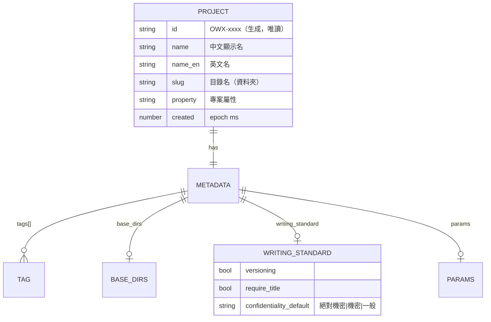
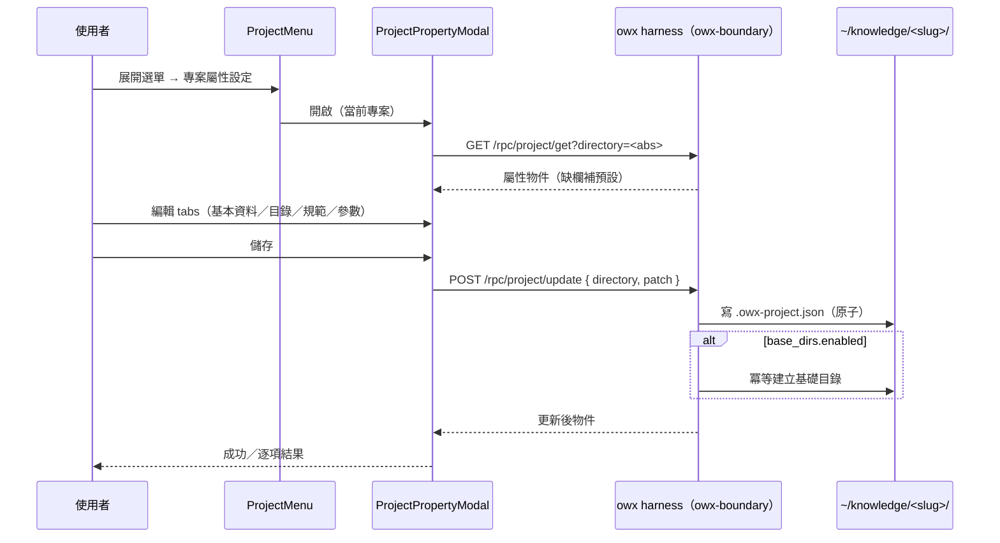

# owx 功能規格：專案屬性設定（project-properties-requirements.md）

> 版本：v0.1　|　日期：2026-10-20　|　狀態：Draft（**待使用者確認**）
> 來源：使用者需求（2026-10-20 條列口述，含「AI 幫忙建議」授權）；對齊 [`ADR-0008`](../adr/ADR-0008-project-lifecycle-owned-by-owx-harness.md)、[`frontend.md`](../design/frontend.md) §2.9／§2.10／§2.3、[`interfaces.md`](../design/interfaces.md) §2.5、`crates/owx-boundary/src/lib.rs`。

---

## 0. 目的、方法、範圍與授權狀態

### 0.1 目的

為 owx 的「文件專案」新增**專案屬性設定（project property settings）**能力：使用者可自 Explorer 的專案選單開啟一個 **modal**，以分頁（tabs）檢視與編輯**當前專案的屬性**（識別、目錄建議、文件撰寫規範、參數），並（可選）依設定**生成基礎目錄**與**規範文件模板**。

本規格把使用者的口述需求收斂為**逐條、原子、可驗證**的功能需求（FR），並明列資料模型、與現有 `POST /rpc/project/create`／`.owx-project.json` 的關係、邊界與**待決問題**，作為迭代螺旋（[`ADR-0002`](../adr/ADR-0002-iterative-spiral-workflow.md)）「需求回流 → 實作」的輸入。

### 0.2 方法

- 使用者需求為**唯一需求來源**；本規格**不新增**未被要求的行為，僅補齊「為使其可實作／可驗證」所必需的最小細節。
- 「AI 建議」類內容（基礎目錄建議、其他參數建議）由本規格**提出具體預設清單**（§1.4、§1.6），使用者可於確認階段增刪；實作時以**設定／常數**承載，非散落硬編碼（對齊 [`AGENTS.md`](../../AGENTS.md) §5.3）。
- 凡涉外部元件一律標授權（§5）。

### 0.3 範圍與邊界（IN / OUT）

| 面向 | 內容 |
|---|---|
| **IN** | ProjectMenu 入口（分割線＋「專案屬性設定」）；屬性設定 modal 殼（尺寸／開合／關閉）；五個 tab（基本資料／基礎目錄範例／文件撰寫規範／參數／其他參數）；專案屬性列舉；基礎目錄建議對照；文件撰寫規範模型；參數模型；`.owx-project.json` 擴充；讀取／更新 RPC；依設定生成目錄／規範的副作用 |
| **OUT** | 專案**建立**流程本身（屬 [`ADR-0008`](../adr/ADR-0008-project-lifecycle-owned-by-owx-harness.md)、FR-H-17，本規格僅**擴充**其欄位）；AI 稽核／一致性檢查的**實際演算法**（本規格只定義**開關與契約**，演算法另案）；外掛模組（Standards／KAC）內部設計；權限／多人治理（Team Mode）；像素級視覺稿 |

**本規格做**：定義「專案屬性設定」的 FR、資料模型、驗收條件、邊界與待決。
**本規格不做**：不定義 AI 稽核引擎的實作；不重抄 [`frontend.md`](../design/frontend.md)／[`interfaces.md`](../design/interfaces.md) 既有內容（以連結引用）；不實作任何程式碼。

> **文件關聯（依 [`document-standards.md`](../standards/document-standards.md) §2.5）**：本檔是**功能規格**（feature spec），**不是**專案生命週期的整合規格（見 [`functional-spec.md`](functional-spec.md)）；FR 群沿用 `FR-H-*` 序號，自 **FR-H-27** 起接續（現行最高為 FR-H-26）；NFR 自 **NFR-14** 起接續。資料模型與狀態機之權威另見 [`data-and-state.md`](../design/data-and-state.md)，本檔僅定義本功能所需欄位並標註。

### 0.4 定位聲明

- **本檔是**：專案屬性設定功能的**需求清單**（逐條 FR／NFR／邊界／待決）。
- **本檔不是**：實作；不是像素稿；不是端點契約的權威（契約權威在 [`interfaces.md`](../design/interfaces.md)，本檔提議**新增**契約並標「待定案」）。

### 0.5 授權狀態

| 元件 | 授權 | 在本檔的角色 | 處置 |
|---|---|---|---|
| **owx 自有程式** | **Proprietary** | 前端 modal、harness RPC、中繼資料 | 自有；本檔完整定義 |
| **opencode** | **MIT** | Substrate（未被擴充） | 可重用；本功能**不**擴充 substrate |
| **React**（既有） | **MIT** | modal／tabs 所在執行環境 | 已可交付 |
| **omo** | **SUL-1.0** | 無涉 | 不進交付物 |

> 本功能**不引入**新外部依賴；若實作需新增（如 tabs／dialog primitive），須依 [`licensing.md`](../standards/governance/licensing.md) §2 於 PR body 標授權並確認可交付（NFR-1、NFR-10）。現行前端未引入 Radix／Tailwind 等（[`frontend.md`](../design/frontend.md) §0.3 為**候選**），本規格預設以現有原生元件實作。

---

## 1. 名詞與資料模型

### 1.1 名詞定義

| 名詞 | 定義 |
|---|---|
| **專案屬性（project property）** | 專案的**分類**（如「系統開發文件」「公司手冊」）；單一專案**預設為單選**（多選列為待決 D-PPS-2）；用以推導基礎目錄建議。 |
| **目錄名（directory name / slug）** | 專案於 `OWX_KNOWLEDGE_DIR`（預設 `~/knowledge`）下的**資料夾名**；即現行 `slug`（`^[a-z0-9][a-z0-9-]*$`，≤64）。 |
| **名稱（zh／en）** | 專案的**顯示名**；`name`（中文，主顯示）與 `name_en`（英文，輔助）。 |
| **基礎目錄（base directories）** | 依專案屬性建議的專案內**子目錄骨架**（每個皆含 `skills/`）。 |
| **文件撰寫規範（writing standard）** | 專案層級的文件規範開關（版本管理、標題、版次、變更履歷、機密等級）與提交檢查開關（一致性、客觀屬實、審計流程）。 |
| **參數（parameters）** | 專案層級或使用者層級的執行偏好（顯示隱藏檔、自動保存草稿…）。 |

### 1.2 專案屬性中繼資料（`.owx-project.json` 擴充）

現行檔案（`create_project()`，`crates/owx-boundary/src/lib.rs`）為 `{ id, name, slug, tags, created }`。本規格**加法擴充**（additive，向後相容，NFR-19）：

```jsonc
{
  "id": "OWX-1A2B",           // 既有：系統生成編號
  "name": "台股研究",          // 既有：顯示名（本規格定義為中文主名）
  "name_en": "stock-research", // 新增：英文名（可選）
  "slug": "stock-research",    // 既有：目錄名（資料夾）
  "tags": ["finance"],         // 既有：標籤
  "created": 1760000000000,    // 既有：epoch ms
  "property": "研究專案",       // 新增：專案屬性（§1.3）
  "base_dirs": {                // 新增：基礎目錄建議與生成開關（§1.4）
    "enabled": false,           //   是否據以生成（checkbox）
    "dirs": ["research", "literature", "notes", "data", "findings", "skills"]
  },
  "writing_standard": {         // 新增：文件撰寫規範（§1.5）
    "versioning": true,
    "require_title": true,
    "require_revision": true,
    "require_change_log": true,
    "confidentiality_default": "一般",
    "submit_checks": { "consistency": false, "objectivity": false, "audit": false }
  },
  "params": {                   // 新增：參數（§1.6）
    "show_hidden": false,
    "autosave_minutes": 10
  }
}
```



> 圖說：中繼資料為**單一 JSON 檔**（`.owx-project.json`），本規格新增 `name_en`／`property`／`base_dirs`／`writing_standard`／`params` 五個欄位；既有欄位語意不變。**未知欄位須被忽略而非報錯**（前向相容）。

### 1.3 專案屬性列舉（`property`）

| # | 值 | 說明 |
|---|---|---|
| 1 | `系統開發文件` | 系統／軟體開發相關文件 |
| 2 | `公司手冊` | 公司治理、政策、手冊 |
| 3 | `產品文件` | 產品規格、說明、手冊 |
| 4 | `專利文件` | 專利申請、檢索、揭露 |
| 5 | `流程規劃` | 流程、SOP、規劃 |
| 6 | `研究專案` | 研究、調查、實驗 |
| 7 | `一般報告` | 一般性報告 |

- 上表為**使用者列舉原值**（第 1–7 項）；使用者原文第 7 項後有尾逗號，暗示**可能增列** → 見待決 D-PPS-2。
- 實作為**具名常數／設定**（避免硬編碼散落；[`AGENTS.md`](../../AGENTS.md) §5.3）。
- **選項值即顯示值**（繁中字串）；未來如需 i18n 再引入 key（待決）。

### 1.4 基礎目錄建議對照（AI 建議，可調整）

依 `property` 建議下列子目錄；**每個皆含 `skills/`**（使用者明示）。此為**建議值**，使用者可於確認階段增刪。

| 專案屬性 | 建議基礎目錄（皆含 `skills/`） |
|---|---|
| 系統開發文件 | `docs/`、`specs/`、`design/`、`api/`、`adr/`、`tests/`、`skills/` |
| 公司手冊 | `handbook/`、`policies/`、`onboarding/`、`processes/`、`faq/`、`skills/` |
| 產品文件 | `product/`、`features/`、`guides/`、`release-notes/`、`faq/`、`skills/` |
| 專利文件 | `patents/`、`drafts/`、`prior-art/`、`figures/`、`disclosures/`、`skills/` |
| 流程規劃 | `processes/`、`workflows/`、`templates/`、`roles/`、`kpi/`、`skills/` |
| 研究專案 | `research/`、`literature/`、`notes/`、`data/`、`findings/`、`skills/` |
| 一般報告 | `reports/`、`drafts/`、`attachments/`、`archive/`、`skills/` |

> **建議來源**：由本規格提出（非外部程式碼）。實作以「屬性 → 目錄清單」之**靜態對照表**承載（見待決 D-PPS-4：是否改為執行期 AI 生成）。

### 1.5 文件撰寫規範模型

| 欄位 | 型別 | 預設 | 說明 |
|---|---|---|---|
| `versioning` | bool | `true` | 文件必須版本管理（git） |
| `require_title` | bool | `true` | 文件須有**標題** |
| `require_revision` | bool | `true` | 須有**版次** |
| `require_change_log` | bool | `true` | 須有**變更履歷** |
| `confidentiality_default` | enum | `一般` | **機密等級**：`絕對機密`／`機密`／`一般`（預設） |
| `submit_checks.consistency` | bool | `false` | 提交時檢查**一致性** |
| `submit_checks.objectivity` | bool | `false` | 提交時檢查**客觀屬實** |
| `submit_checks.audit` | bool | `false` | 啟用**審計流程** |

> 前三項（版本管理／標題／版次／變更履歷）為使用者明示之「**基礎規範**」；`confidentiality_default` 預設 `一般`（使用者明示）。提交檢查三項預設**關閉**（使用者未指定預設，列待決 D-PPS-6）。

### 1.6 參數模型（含 AI 建議之其他參數）

**使用者明示**
| 欄位 | 型別 | 預設 | 說明 |
|---|---|---|---|
| `show_hidden` | bool | `false` | 是否顯示隱藏檔（預設「否」） |
| `autosave_minutes` | int | `10` | 多少分鐘自動保存草稿（預設 10） |

**AI 建議（其他參數；使用者可增刪）——待決 D-PPS-7**
| 欄位（建議） | 型別 | 建議預設 | 說明 |
|---|---|---|---|
| `default_revision` | string | `v0.1` | 新文件預設版次起始 |
| `filename_rule` | enum | `kebab-case` | 新檔命名規則（`kebab-case`／`none`） |
| `doc_template` | bool | `true` | 新文件自動帶規範 frontmatter（標題／版次／變更履歷／機密等級） |
| `editor_mode` | enum | `raw` | md 編輯器模式（`raw`／`wysiwyg`） |
| `commit_on_save` | bool | `false` | 保存時自動提交（與 git 整合） |
| `export_format` | enum | `pdf` | 預設匯出格式（對接 `/rpc/convert`） |
| `locale` | string | `zh-TW` | 顯示語言 |
| `leave_warn_unsaved` | bool | `true` | 未儲存離開時警告 |
| `ai_can_edit` | bool | `false` | 允許 agent 主動編輯文件（權限；與 [`interfaces.md`](../design/interfaces.md) §2.3 A.5 權限閘門關聯） |

> **注意**：「顯示隱藏檔」影響 Explorer／預覽之呈現；「自動保存草稿」影響 [`DocEditor`](../../apps/web/src/components/DocEditor.tsx) 行為。「其他參數」在使用者原文為**第 5 節（內容空白）**，疑與第 4 節重複 → 見待決 D-PPS-1、D-PPS-7。

---

## 2. 功能需求（FR）

> **驗收格式**：每條 FR 以「給定（前置／輸入）…則（預期輸出）」表述，並補「邊界」與「錯誤」。`TC-*` 為對應測試案例 ID 佔位。

### 2.1 入口與 modal 殼

**FR-H-27｜ProjectMenu 入口：分割線＋「專案屬性設定」**
Explorer 標頭的專案選單（`ProjectMenu`，[`frontend.md`](../design/frontend.md) §2.3）在既有「開啟專案／新增專案／關閉專案」之下，先加一條**分割細線**，再加一項**「專案屬性設定」**；點擊開啟屬性設定 modal。
- **驗收**：給定展開專案選單，則項目順序為「開啟專案／新增專案／關閉專案／（分割線）／專案屬性設定」；點「專案屬性設定」則開啟 modal 並關閉選單。
- **邊界**：分割線為**不可點擊**的視覺分隔（`role="separator"`）；不改變既有三項行為。
- **錯誤**：無當前專案（`root === ""`）時，「專案屬性設定」須為**停用**或**不渲染**（不得開啟空 modal）。
- **行為**：開啟選單後選任一項即關閉選單（沿用現行 `run()` 語意）。
- **來源**：使用者需求 1；現行 [`ProjectMenu.tsx`](../../apps/web/src/components/ProjectMenu.tsx)。

**FR-H-28｜屬性設定 modal 殼（尺寸、自適應、開合）**
Modal 寬高約**全螢幕 80%**，**自適應**，最大不超過 **1792 × 1120**（像素）。
- **驗收**：給定視窗尺寸 `W × H`，則 modal 寬為 `min(0.8 × W, 1792)`、高為 `min(0.8 × H, 1120)`；視窗縮放時 modal 隨之改變。
- **邊界**：寬或高不足時按比例縮小；小視窗下不得溢出視口（須可捲動）。
- **錯誤**：任一維度算得 0 或負值時，套用最小尺寸（待決 D-PPS-8 之最小尺寸值）。
- **行為**：沿用既有 modal 慣例（`modal-backdrop` ＋ `modal`，`role="dialog"`／`aria-modal="true"`，點背景或 `Esc` 關閉）；關閉時若有未儲存變更須提示（見 FR-H-44）。
- **來源**：使用者需求 1；現行 [`NewProjectModal.tsx`](../../apps/web/src/components/NewProjectModal.tsx)。

**FR-H-29｜Tab 導覽**
Modal 內容以 **tabs** 呈現：① **基本資料** ② **基礎目錄範例** ③ **文件撰寫規範** ④ **參數** ⑤ **其他參數**。
- **驗收**：給定開啟 modal，則可見上列 tabs（順序同此）；切換 tab 顯示對應面板。
- **邊界**：tabs 以 `role="tablist"`／`role="tab"`／`role="tabpanel"` 標記（a11y，NFR-14）。
- **錯誤**：未知 tab 不應存在；不得空 panel（「其他參數」若確定保留，須有內容或明確說明）。
- **來源**：使用者需求 1（tabs 標題）。

### 2.2 Tab ① 基本資料

**FR-H-30｜ID（唯讀，生成）**
顯示專案 `id`（系統生成，如 `OWX-1A2B`）；**不可編輯**。
- **驗收**：給定已開啟專案，則 ID 欄位顯示其 `id` 且為唯讀（`disabled`／`readonly`）。
- **邊界**：ID 由系統生成（[`ADR-0008`](../adr/ADR-0008-project-lifecycle-owned-by-owx-harness.md)）；本規格不變更生成規則。
- **錯誤**：若 `.owx-project.json` 缺 `id`，顯示「未編號」並允許（後續）補生成——待決 D-PPS-9。

**FR-H-31｜名稱（中文／英文）**
可編輯**中文名**（`name`）與**英文名**（`name_en`）；名稱可含中英文。
- **驗收**：給定輸入中文名，則存為 `name`；輸入英文名，則存為 `name_en`。
- **邊界**：`name` 為必填、非空；`name_en` 可空。長度上限待決 D-PPS-10。
- **錯誤**：`name` 空 → 阻止儲存並提示。

**FR-H-32｜目錄名（slug）**
顯示／可編輯專案**目錄名**（資料夾＝`slug`），規則 `^[a-z0-9][a-z0-9-]*$`（≤64）。
- **驗收**：給定合法目錄名，則可存；給定不合規者（大寫／空白／`..`），則拒絕並提示。
- **邊界**：**更改目錄名是否重新命名實體資料夾**為高風險操作 → 待決 D-PPS-3；**預設本規格採「已建立專案之目錄名唯讀」**（建立時可編輯）。
- **錯誤**：目標資料夾已存在 → 拒絕（沿用 `already_exists` 語意）。

**FR-H-33｜專案屬性（單選）**
自 §1.3 七個選項中**單選**一個 `property`。
- **驗收**：給定選擇「研究專案」，則存 `property: "研究專案"`，並驅動 Tab ② 的基礎目錄建議。
- **邊界**：預設為空或「一般報告」（待決 D-PPS-2）；多選需求見 D-PPS-2。
- **錯誤**：值不在列舉內 → 拒絕（不靜默接受任意字串）。

**FR-H-34｜標籤（多標籤，以「,」分隔）**
輸入多個**標籤**，可用 `,`（半角）分割；儲存前 trim 並去除空值／重複。
- **驗收**：給定輸入 `finance, research,` 則存 `tags: ["finance","research"]`（去空白、去空、去重）。
- **邊界**：半角 `,`；是否同時接受全角 `，` 待決 D-PPS-11。
- **錯誤**：單一標籤過長／過多時提示（上限待決 D-PPS-10）。

### 2.3 Tab ② 基礎目錄範例

**FR-H-35｜依屬性建議基礎目錄（AI 建議，可編輯）**
依 Tab ① 選定的 `property`，顯示 §1.4 對應的**基礎目錄建議清單**；使用者可勾選／增刪。
- **驗收**：給定 `property = 研究專案`，則清單顯示 `research、literature、notes、data、findings、skills`。
- **邊界**：清單為**建議**；使用者可移除或新增自訂目錄。切換 `property` 時，若使用者未手動改過則**重算建議**（已手改則保留）。
- **錯誤**：屬性為空 → 顯示提示「請先於基本資料選擇專案屬性」，清單為空。
- **來源**：使用者需求 2（「基本上每個都加一個 skills 目錄」）。

**FR-H-36｜是否依此生成專案文件夾（checkbox）**
以 checkbox 控制是否**依上述清單生成實體資料夾**（`base_dirs.enabled`）。
- **驗收**：給定勾選並儲存，則於專案根建立對應子目錄；未勾選則不建立。
- **邊界**：**冪等**——已存在的目錄不報錯、內容不覆蓋（對齊 `safe_join`／`/rpc/fs/mkdir` 邊界，[`interfaces.md`](../design/interfaces.md) §2.6）。
- **錯誤**：路徑逃逸／非法目錄名 → 拒絕（`outside_worktree`／`invalid_path`）。
- **行為**：生成為**儲存後副作用**（見 FR-H-44）；生成失敗須回報，且不使屬性儲存失敗（分離成敗）。

### 2.4 Tab ③ 文件撰寫規範

**FR-H-37｜基礎規範（版本管理／標題／版次／變更履歷／機密等級）**
提供 §1.5 基礎規範的開關；機密等級三選（`絕對機密`／`機密`／`一般`），**預設 `一般`**。
- **驗收**：給定 modal 載入，則機密等級預設選中「一般」；變更後存 `writing_standard.confidentiality_default`。
- **邊界**：機密等級下拉必含三值；開關預設見 §1.5。
- **錯誤**：未知機密等級 → 拒絕。
- **行為**：規範為**宣告式設定**；實際「生成規範文件模板」見 FR-H-44（待決 D-PPS-5）。

**FR-H-38｜文件提交（一致性／客觀屬實／審計流程）**
提供提交檢查開關：**檢查一致性**、**是否客觀屬實**、**設置審計流程**（`submit_checks.*`）。
- **驗收**：給定各開關狀態，則存對應布林值。
- **邊界**：本規格只定義**開關與契約**；檢查／稽核之**實際演算法**為 OUT（另案／外掛模組）。
- **錯誤**：開關啟用但後端未實作時，須以「尚未設置」呈現（`501 not_configured` 語意，[`interfaces.md`](../design/interfaces.md) §2.7），**不假造通過**。

### 2.5 Tab ④ 參數 ／ ⑤ 其他參數

**FR-H-39｜顯示隱藏檔（預設「否」）**
開關 `params.show_hidden`，**預設 `false`**；啟用時 Explorer／預覽顯示隱藏檔（`.` 開頭）。
- **驗收**：預設為「否」；開啟後，Explorer 顯示 `.` 開頭項目。
- **邊界**：此參數作用範圍（專案層 vs 使用者層）待決 D-PPS-12。

**FR-H-40｜自動保存草稿（預設 10 分鐘）**
數值 `params.autosave_minutes`，**預設 `10`**；> 0 生效，`0` 表示停用（待決 D-PPS-13）。
- **驗收**：預設值 10；於編輯器（[`DocEditor`](../../apps/web/src/components/DocEditor.tsx)）每 N 分鐘自動保存草稿。
- **邊界**：最小／最大範圍待決 D-PPS-13；間隔期間無變更則不寫入。

**FR-H-41｜其他參數（AI 建議，可增刪）**
提供 §1.6「AI 建議」之其他參數（使用者原文第 5 節，內容空白）。
- **驗收**：顯示 §1.6 建議參數並可存；使用者可刪除不需要者。
- **邊界**：**預設僅收斂使用者明示之兩項**（FR-H-39／40）；其餘建議為**選配**，未採納者不在本輪實作。
- **錯誤**：參數值非法 → 拒絕。
- **來源**：使用者需求 5（空白）＋「其他 AI 幫忙建議一下」。

### 2.6 持久化與套用

**FR-H-42｜中繼資料持久化（`.owx-project.json` 擴充）**
屬性設定存回專案之 `.owx-project.json`（§1.2），採**加法擴充**、未知欄位忽略。
- **驗收**：儲存後重讀，新增欄位（`name_en`／`property`／`base_dirs`／`writing_standard`／`params`）往返一致（round-trip）。
- **邊界**：**不破壞**既有欄位與既有讀取端（`GET /rpc/knowledge/list`、`create_project`）；舊檔缺新欄位時，讀取以 §1.5／§1.6 **預設值**補齊（NFR-19）。
- **錯誤**：寫入失敗 → 回報，不靜默；不使既有欄位遺失（原子寫入，先寫暫存再置換，待決 D-PPS-14）。

**FR-H-43｜讀取／更新 RPC（harness）**
新增／擴充 harness 管理 RPC：**讀取**單一專案屬性與**更新**屬性。
- **建議契約**（**待定案**，契約權威將落於 [`interfaces.md`](../design/interfaces.md)）：
  - `GET /rpc/project/get?directory=<abs>` → `{ id, name, name_en, slug, tags, property, base_dirs, writing_standard, params, created, worktree }`。
  - `POST /rpc/project/update`（body `{ directory, patch }`）→ 更新後之完整物件；錯誤 `400 invalid_slug`／`400 invalid_property`／`404 not_found`／`409 already_exists`（改名情境）。
- **驗收**：給定讀取，則回完整物件（缺欄補預設）；給定更新，則檔案更新且回應一致。
- **邊界**：`directory` 須落在 `OWX_KNOWLEDGE_DIR` 之下（沿用路徑邊界）。
- **錯誤**：見上列錯誤碼；`/rpc` 之**存取控制**沿 [`AGENTS.md`](../../AGENTS.md) §10 go-live（上線前加 bearer）。

**FR-H-44｜套用變更與生成副作用**
「儲存」後：(a) 寫回中繼資料；(b) 若 `base_dirs.enabled` **且**對應目錄尚不存在 → **冪等**建立；(c)（待決 D-PPS-5）可選生成**規範文件模板**（帶標題／版次／變更履歷／機密等級之 frontmatter）。
- **驗收**：給定儲存，則 (a) 成立；勾選生成時 (b) 目標目錄存在；重複儲存不報錯、不覆蓋。
- **邊界**：三項**成敗分離**——(b)／(c) 失敗不使 (a) 回滾，須逐項回報。
- **錯誤**：部分成功時以可讀訊息列明哪些步驟失敗（不靜默，NFR-4）。
- **行為**：套用走 harness（前端無檔案系統寫入權，[`ADR-0008`](../adr/ADR-0008-project-lifecycle-owned-by-owx-harness.md)）。

---

## 3. 非功能需求（NFR）

| 編號 | 需求 | 可驗證判準 |
|---|---|---|
| NFR-14 | **modal 無障礙（WCAG 2.1 AA）** | 開啟時焦點鎖於 modal、`Esc` 關閉、關閉後焦點歸還觸發鈕；tabs 具 `role`／方向鍵可切換（`TC-H-27a`） |
| NFR-15 | **自適應尺寸** | 依 FR-H-28 計算之寬高於多種視窗尺寸下皆 ≤ 1792×1120 且不溢出（`TC-H-27b`） |
| NFR-16 | **無硬編碼** | 屬性列舉、基礎目錄對照、預設值以**常數／設定**承載，非散落字面值（[`AGENTS.md`](../../AGENTS.md) §5.3）（`TC-NFR-16`） |
| NFR-17 | **授權潔淨** | 本功能**不新增**外部依賴；若新增須標授權且可交付（[`licensing.md`](../standards/governance/licensing.md) §2）（`TC-NFR-17`） |
| NFR-18 | **可測試性** | 每條 FR 附「驗收」與 `TC-*` 佔位；無驗收者視為未完成（`TC-NFR-18`） |
| NFR-19 | **向後相容** | `.owx-project.json` 加法擴充；舊檔缺新欄位時以預設補齊；未知欄位忽略（`TC-NFR-19`） |
| NFR-20 | **邊界安全** | 所有寫入路徑正規化後須落在專案 `directory` 之下（`outside_worktree`），拒絕穿越與 symlink 逃逸（`TC-NFR-20`） |
| NFR-21 | **不擴充 substrate** | 本功能全部落於 owx 自有邊界（前端＋harness）；opencode 原始碼 diff 為空（[`ADR-0008`](../adr/ADR-0008-project-lifecycle-owned-by-owx-harness.md)、NFR-3）（`TC-NFR-21`） |

---

## 4. 邊界（做什麼 / 不做什麼）

**做**
- 於 ProjectMenu 增入口與分割線（FR-H-27）。
- 以 tabs modal 檢視／編輯當前專案屬性（FR-H-28～41）。
- 加法擴充 `.owx-project.json`，並冪等生成基礎目錄（FR-H-42、FR-H-44）。

**不做（本輪）**
- 不改 opencode／substrate（NFR-21）。
- 不定義 AI 稽核／一致性檢查之演算法（FR-H-38 僅開關）。
- 不做目錄名變更後之**實體資料夾重新命名**（預設唯讀，D-PPS-3）。
- 不做多人／Team Mode 治理（權限、審計流程之後端實作）。
- 不做像素級視覺稿（僅結構與尺寸約束）。
- 不引入新第三方依賴（除經授權確認）。

---

## 5. 來源對映與授權

| FR 群 | 主要來源 | 授權 | 處置 |
|---|---|---|---|
| FR-H-27～41（UI 與設定模型） | **owx 自寫**（使用者需求） | **Proprietary** | 自有 |
| FR-H-42～44（中繼資料與 RPC） | **owx 自寫**（延伸 [`ADR-0008`](../adr/ADR-0008-project-lifecycle-owned-by-owx-harness.md)） | **Proprietary** | 自有 |
| 基礎目錄建議（§1.4）與其他參數（§1.6） | **owx 自寫**（AI 建議，可調整） | **Proprietary** | 自有 |
| 執行環境（React／Vite） | **React／Vite** | **MIT** | 已可交付 |

> 任何新增外部元件（npm／cargo）須更新 [`licensing.md`](../standards/governance/licensing.md) §2 並於 PR body 標明授權。

---

## 6. 缺口 / 待決

> 以下為**需使用者確認後**才定案之決策；未確認前，本規格以「預設」欄落地。

| # | 待決問題 | 本規格預設 | 影響 |
|---|---|---|---|
| **D-PPS-1** | 使用者原文第 4 節「參數」與第 5 節「其他參數」是否為**兩節**（前者明示兩項、後者放 AI 建議），抑或重複／誤植？ | 視為**同一概念**：④ 承載使用者明示兩項、⑤ 承載 AI 建議之其他參數 | Tab 數量與歸屬 |
| **D-PPS-2** | 專案屬性是**單選**還是**多選**？（原文尾逗號暗示選項可能擴充） | **單選**；選項表可擴充 | 資料模型（`property` vs `properties[]`）與目錄建議 |
| **D-PPS-3** | 已建立專案的**目錄名是否可改**？改後是否重命名實體資料夾？ | **已建立專案目錄名唯讀**（建立時可設） | 高風險檔案操作 |
| **D-PPS-4** | 基礎目錄建議為**靜態對照表**，或每次由 **AI（opencode）即時生成**？ | **靜態對照表**（§1.4），可編輯 | 相依 AI 呼叫、可重現性 |
| **D-PPS-5** | 「文件撰寫規範」是否要**生成規範文件／frontmatter 模板**到專案？ | **僅存設定**；生成模板列**選配**（預設關） | 副作用範圍 |
| **D-PPS-6** | 提交檢查三項（一致性／客觀屬實／審計）**預設值**？ | 全部**預設關閉** | 預設行為 |
| **D-PPS-7** | 「其他參數」採納哪些 AI 建議項（§1.6）？ | 本輪**只做** `show_hidden`／`autosave_minutes`；其餘選配 | 實作範圍 |
| **D-PPS-8** | Modal **最小尺寸**（小視窗）與是否可**捲動**？ | 可捲動；最小尺寸另訂 | 響應式 |
| **D-PPS-9** | 舊專案**缺 `id`** 時如何處理？ | 顯示「未編號」，可（後續）補生成 | 相容 |
| **D-PPS-10** | 名稱／標籤之**長度與數量上限**？ | 名稱 ≤128 字；標籤單筆 ≤32、總數 ≤20 | 驗證 |
| **D-PPS-11** | 標籤分隔符是否同時接受**全角「，」**？ | 只接受半角 `,` | 輸入解析 |
| **D-PPS-12** | `show_hidden`／`autosave_minutes` 屬**專案層**或**使用者層**設定？ | 存於**專案中繼資料**（`.owx-project.json`） | 儲存位置 |
| **D-PPS-13** | `autosave_minutes` 之**範圍**與 `0` 是否代表停用？ | `0`＝停用；範圍 1–120（待確認） | 驗證 |
| **D-PPS-14** | 中繼資料寫入是否**原子**（暫存＋置換）？ | **是**（避免半寫入損毀） | 可靠性 |
| **D-PPS-15** | 是否需為本功能（中繼資料擴充＋新 RPC）**立 ADR**？ | **建議立**（`ADR-0011`：專案屬性與中繼資料 schema） | 治理 |

**其他缺口**
1. **`GET /rpc/project/get`／`POST /rpc/project/update` 之契約尚未定案**（FR-H-43）：正式落地後須回寫 [`interfaces.md`](../design/interfaces.md)。
2. **前端 modal 之 tabs 元件**：現行前端無 tabs primitive；實作方式（原生／既有元件）待實作輪次決定（NFR-17 授權）。
3. **與 `/init` 的關係**：現行「新增專案」會執行 opencode `/init`（[`frontend.md`](../design/frontend.md) §2.10）；本功能的目錄／規範生成與 `/init` 的**職責分界**待釐清（D-PPS-5 相關）。
4. **`OWX_KNOWLEDGE_DIR` 外之專案**：屬性設定僅對 `~/knowledge` 下專案生效（沿用 [`ADR-0008`](../adr/ADR-0008-project-lifecycle-owned-by-owx-harness.md)）。
5. **變更生效時機**：屬性是「即時生效」或「儲存後生效」→ 本規格採**儲存後生效**；未儲存關閉之提示見 FR-H-28。

---

## 7. 交互流程（Mermaid）

下圖描述一次屬性設定：由 Explorer 專案選單開啟 modal，於 tabs 編輯，儲存時經 harness 更新中繼資料並冪等生成目錄。



下圖描述 modal 與儲存的生命週期。開啟後可於 tab 間切換；有未儲存變更時關閉需確認；儲存成功／失敗各有路徑。


---

## 8. 變更紀錄

| 日期 | 版本 | 變更 |
|---|---|---|
| 2026-10-20 | v0.1 | 初版：由使用者口述需求（2026-10-20）收斂為功能規格——ProjectMenu 入口（分割線＋專案屬性設定）、tabbed modal（尺寸 80%／≤1792×1120）、五 tab（基本資料／基礎目錄範例／文件撰寫規範／參數／其他參數）、`.owx-project.json` 加法擴充、讀取／更新 RPC、生成副作用；FR-H-27～44（18 條）、NFR-14～21（8 條）；列 15 項待決（D-PPS-1～15）。 |
