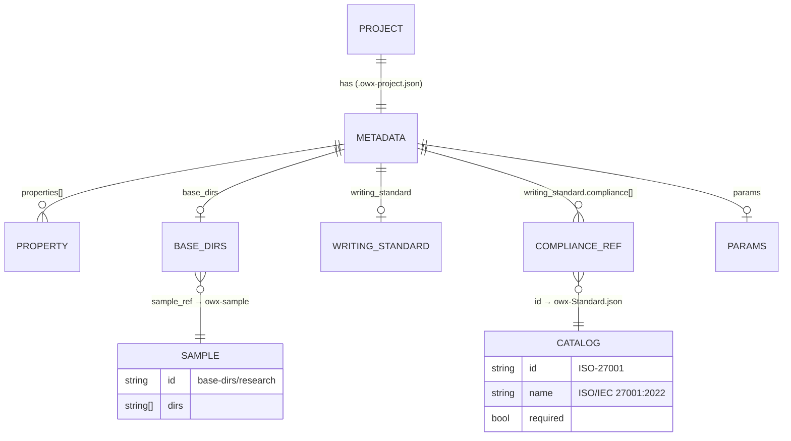
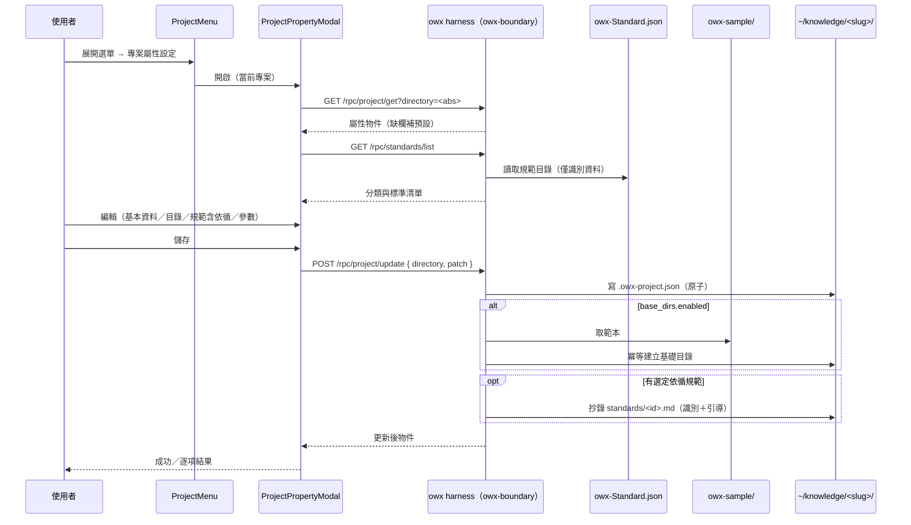
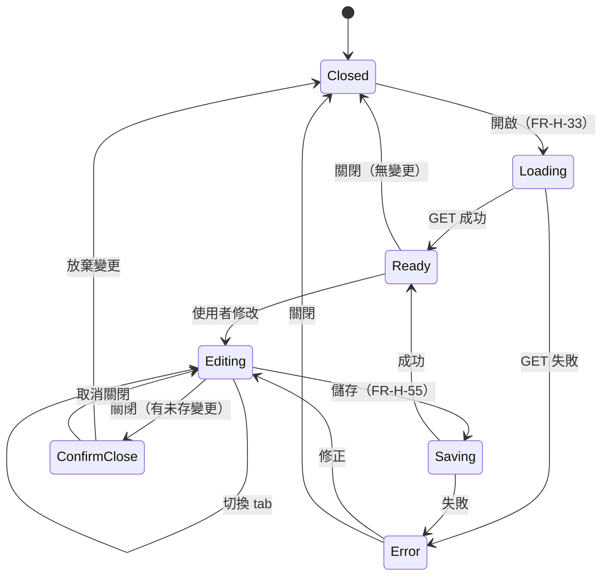

# owx 功能規格：專案屬性設定（project-properties-requirements.md）

> 版本：v1.4　|　日期：2026-10-23　|　狀態：Stable（**已實作**）
> 來源：使用者需求（2026-10-20 條列口述，含「AI 幫忙建議」授權）＋ 確認回覆（2026-10-20：分組多選／目錄名唯讀／靜態對照／合併參數節／專案層／立 ADR；新增 `owx-sample` 範本庫、`owx-Standard.json` 依循規範、抄錄）；對齊 [`ADR-0008`](../adr/ADR-0008-project-lifecycle-owned-by-owx-harness.md)、[`ADR-0011`](../adr/ADR-0011-project-metadata-and-standards-catalog.md)、[`frontend.md`](../design/frontend.md) §2.9／§2.10／§2.3、[`interfaces.md`](../design/interfaces.md) §2.5、`crates/owx-boundary/src/lib.rs`。

---

## 0. 目的、方法、範圍與授權狀態

### 0.1 目的

為 owx 的「文件專案」新增**專案屬性設定（project property settings）**能力：使用者可自 Explorer 的專案選單開啟一個 **modal**，以分頁（tabs）檢視與編輯**當前專案的屬性**——識別資料、基礎目錄、**文件撰寫規範（含依循規範）**、參數——並（可選）依設定**生成基礎目錄**與**抄錄規範**。

本規格把使用者需求收斂為**逐條、原子、可驗證**的功能需求（FR），並明列**三類持久化位置**（專案中繼資料／`owx-sample` 範本庫／`owx-Standard.json` 規範目錄）、與現有 `POST /rpc/project/create` 的關係、邊界與**待決問題**。

### 0.2 方法

- 使用者需求與確認回覆為**唯一需求來源**；本規格**不新增**未被要求的行為，僅補齊「為使其可實作／可驗證」所必需的最小細節。
- 「AI 建議」內容（基礎目錄建議 §1.4、其他參數 §1.6、**規範目錄 §1.7／附錄 A**）由本規格提出**具體清單**，使用者可於確認階段增刪；實作時以**設定／資料檔**承載，非散落硬編碼（[`AGENTS.md`](../../AGENTS.md) §5.3）。
- 凡涉外部元件一律標授權（§5）；**標準本身受著作權保護**——本功能僅收錄**標準的識別資料（名稱／編號／發行機構）**，**不複製標準內容**（NFR-22）。

### 0.3 範圍與邊界（IN / OUT）

| 面向 | 內容 |
|---|---|
| **IN** | ProjectMenu 入口（分割線＋「專案屬性設定」）；modal 殼（尺寸／開合）；**四個 tab**（基本資料／基礎目錄範例／文件撰寫規範／參數）；專案屬性（**分組多選**，Phase 1 單選）；基礎目錄範例（**來源＝`owx-sample` 範本庫**）；文件撰寫規範（含**依循規範**，來源＝**`owx-Standard.json` 規範目錄**）；參數；**三類持久化**；讀取／更新 RPC；依設定生成目錄與**抄錄規範** |
| **OUT** | 專案**建立**流程本身（屬 [`ADR-0008`](../adr/ADR-0008-project-lifecycle-owned-by-owx-harness.md)、FR-H-17，本規格僅**擴充**欄位）；AI 稽核／一致性檢查的**實際演算法**；**標準內容本身**（本功能僅索引，不複製）；外掛模組（Standards／KAC）內部設計；多人治理（Team Mode）；像素級視覺稿 |

**本規格做**：定義「專案屬性設定」的 FR、資料模型、三類持久化、驗收條件、邊界與待決。
**本規格不做**：不定義 AI 稽核引擎實作；不複製任何標準文件之內容；不重抄 [`frontend.md`](../design/frontend.md)／[`interfaces.md`](../design/interfaces.md) 既有內容；不實作任何程式碼。

> **文件關聯（依 [`document-standards.md`](../standards/document-standards.md) §2.5）**：本檔是**功能規格**，**不是**整合規格（見 [`functional-spec.md`](functional-spec.md)）；FR 群沿用 `FR-H-*`，自 **FR-H-33** 起（`FR-H-27～32` 已由設定 modal 使用）；NFR 自 **NFR-14** 起。資料模型權威另見 [`data-and-state.md`](../design/data-and-state.md)；決策見 [`ADR-0011`](../adr/ADR-0011-project-metadata-and-standards-catalog.md)。

### 0.4 定位聲明

- **本檔是**：專案屬性設定功能的**需求清單**（FR／NFR／邊界／待決＋附錄 A 規範目錄草案）。
- **本檔不是**：實作；不是像素稿；不是端點契約權威（契約權威在 [`interfaces.md`](../design/interfaces.md)，本檔提議**新增**契約並標「待定案」）。

### 0.5 授權狀態

| 元件 | 授權 | 在本檔的角色 | 處置 |
|---|---|---|---|
| **owx 自有程式** | **Proprietary** | 前端 modal、harness RPC、中繼資料、範本庫、規範目錄 | 自有；本檔完整定義 |
| **opencode** | **MIT** | Substrate（未被擴充） | 可重用；本功能**不**擴充 substrate |
| **React／Vite**（既有） | **MIT** | modal／tabs 執行環境 | 已可交付 |
| **外部標準（ISO／IEC／IEEE／NIST／ISSB…）** | **各發行機構著作權（非軟體授權）** | **僅索引**其識別資料 | **不得複製內容**；僅存名稱／編號／發行機構（NFR-22） |
| **omo** | **SUL-1.0** | 無涉 | 不進交付物 |

> 本功能**不引入**新外部依賴；若實作需新增（如 tabs／dialog primitive），須依 [`licensing.md`](../standards/governance/licensing.md) §2 於 PR body 標授權並確認可交付（NFR-1、NFR-10）。

---

## 1. 名詞與資料模型

### 1.1 名詞定義

| 名詞 | 定義 |
|---|---|
| **專案屬性（project property）** | 專案的**分類**（如「系統開發文件」）。支援**分組多選**（僅允許相容群組內的組合）；**Phase 1 先單選**（使用者確認）。 |
| **目錄名（slug）** | 專案於 `OWX_KNOWLEDGE_DIR`（預設 `~/knowledge`）下的**資料夾名**；規則 `^[a-z0-9][a-z0-9-]*$`（≤64）。**已建立後唯讀**（使用者確認）。 |
| **名稱（zh／en）** | 顯示名：`name`（中文主顯示）、`name_en`（英文輔助）。 |
| **基礎目錄範例** | 依專案屬性建議的專案內**子目錄骨架**（每個含 `skills/`）；**範本來源存於 `owx-sample`**（§1.8）。 |
| **依循規範（compliance standards）** | 專案宣告遵循的**外部標準**（資安／SRS／ESG／公司治理…）；目錄存於 **`owx-Standard.json`**（§1.7）；選定後**抄錄**入專案（§1.8、FR-H-53）。 |
| **抄錄（copy-in）** | 將 `owx-sample` 的範本或 `owx-Standard.json` 選定規範之**識別資料與引導範本**複製入專案。 |
| **範本庫（`owx-sample`）** | 存放**基礎目錄與文件範本**的外部目錄（不隨專案存放）。 |
| **規範目錄（`owx-Standard.json`）** | 存放**標準清單（僅識別資料）**的資料檔。 |

### 1.2 三類持久化位置（使用者確認）

| # | 位置 | 內容 | 說明 |
|---|---|---|---|
| 1 | **`<專案>/.owx-project.json`** | 專案的**設定與選擇**（識別、屬性、選定的範本／規範**引用**） | 隨專案版本控制；加法擴充、向後相容 |
| 2 | **`owx-sample/`**（`OWX_SAMPLE_DIR`） | **範本庫**：基礎目錄骨架範本、文件 frontmatter 範本 | 使用者確認：「範本保存到 owx-sample」 |
| 3 | **`owx-Standard.json`**（`OWX_STANDARD_FILE`） | **規範目錄**：標準清單（僅識別資料） | 使用者確認：「放在 owx-Standard.json」；AI 收集（附錄 A） |

**原則**：專案**只存選擇與引用**，**不複製範本／標準全文**入中繼資料；需要時由**抄錄**（FR-H-53）落地為專案內可見檔案。

#### 專案中繼資料（`.owx-project.json` 擴充）

現行（`create_project()`，`crates/owx-boundary/src/lib.rs`）為 `{ id, name, slug, tags, created }`。本規格**加法擴充**：

```jsonc
{
  "id": "OWX-1A2B",             // 既有：系統生成編號（唯讀）
  "name": "台股研究",            // 既有：中文顯示名
  "name_en": "stock-research",   // 新增：英文名（可選）
  "slug": "stock-research",      // 既有：目錄名（已建立後唯讀）
  "tags": ["finance"],           // 既有：標籤
  "created": 1760000000000,      // 既有：epoch ms
  "properties": ["研究專案"],     // 新增：專案屬性（陣列；Phase 1 僅一項；§1.3）
  "base_dirs": {                 // 新增：基礎目錄（來源＝owx-sample；§1.4）
    "sample_ref": "base-dirs/research",  //   owx-sample 內之範本 id
    "enabled": false,            //   是否據以生成（checkbox）
    "dirs": ["research", "literature", "notes", "data", "findings", "skills"]
  },
  "writing_standard": {          // 新增：文件撰寫規範（§1.5）
    "versioning": true,
    "require_title": true,
    "require_revision": true,
    "require_change_log": true,
    "confidentiality_default": "一般",
    "compliance": ["ISO-27001", "ISO-IEC-IEEE-29148"], // 依循規範（標準 id；§1.7）
    "submit_checks": { "consistency": false, "objectivity": false, "audit": false }
  },
  "params": {                    // 新增：參數（專案層；§1.6）
    "show_hidden": false,
    "autosave_minutes": 10
  }
}
```



> 圖說：專案中繼資料**只引用** `owx-sample`（範本）與 `owx-Standard.json`（規範）之 **id**；未知欄位須被忽略而非報錯（前向相容，NFR-19）。

### 1.3 專案屬性（`properties`）與相容群組

使用者確認：**支援分組多選**（僅允許相容組合），**Phase 1 先以單選**。

**選項（§1.3.1）**

| # | 值 | 建議群組 |
|---|---|---|
| 1 | `系統開發文件` | A（軟體／產品開發） |
| 2 | `產品文件` | A |
| 3 | `公司手冊` | B（組織治理） |
| 4 | `流程規劃` | B |
| 5 | `專利文件` | C（智財／研發） |
| 6 | `研究專案` | C |
| 7 | `一般報告` | 獨立（不與他項組合） |

**相容群組（§1.3.2；使用者範例）**
- **群組 A**：`系統開發文件` ↔ `產品文件`（可組合）。
- **群組 B**：`公司手冊` ↔ `流程規劃`（可組合）。
- **群組 C**：`專利文件` ↔ `研究專案`（同屬智財／研發；**待確認** D-PPS-18）。
- `一般報告`：**獨立**，不與他項組合（待確認）。

> **實作**：資料模型用**陣列** `properties[]`（前向相容）；多選的合法性由**相容矩陣**驗證；**Phase 1** UI 以**單選**呈現（`properties` 長度 ≤ 1）。

### 1.4 基礎目錄範例（來源＝`owx-sample`）

使用者確認：**靜態對照**，且**範本存於 `owx-sample`**。建議範本（初稿；存於 `owx-sample/base-dirs/<id>.json`）：

| 專案屬性 | 範本 id | 建議基礎目錄（皆含 `skills/`） |
|---|---|---|
| 系統開發文件 | `base-dirs/system-docs` | `docs/`、`specs/`、`design/`、`api/`、`adr/`、`tests/`、`skills/` |
| 公司手冊 | `base-dirs/handbook` | `handbook/`、`policies/`、`onboarding/`、`processes/`、`faq/`、`skills/` |
| 產品文件 | `base-dirs/product` | `product/`、`features/`、`guides/`、`release-notes/`、`faq/`、`skills/` |
| 專利文件 | `base-dirs/patent` | `patents/`、`drafts/`、`prior-art/`、`figures/`、`disclosures/`、`skills/` |
| 流程規劃 | `base-dirs/process` | `processes/`、`workflows/`、`templates/`、`roles/`、`kpi/`、`skills/` |
| 研究專案 | `base-dirs/research` | `research/`、`literature/`、`notes/`、`data/`、`findings/`、`skills/` |
| 一般報告 | `base-dirs/report` | `reports/`、`drafts/`、`attachments/`、`archive/`、`skills/` |

> 範本可由使用者於 `owx-sample` 增刪；屬性→範本之對照為**可設定**（非硬編碼）。

### 1.5 文件撰寫規範模型（含依循規範）

| 欄位 | 型別 | 預設 | 說明 |
|---|---|---|---|
| `versioning` | bool | `true` | 文件必須版本管理（git） |
| `require_title` | bool | `true` | 文件須有**標題** |
| `require_revision` | bool | `true` | 須有**版次** |
| `require_change_log` | bool | `true` | 須有**變更履歷** |
| `confidentiality_default` | enum | `一般` | 機密等級：`絕對機密`／`機密`／`一般`（預設） |
| `compliance[]` | string[] | 見 §1.7 | **依循規範**（標準 id 清單；含**必要**項） |
| `submit_checks.consistency` | bool | `false` | 提交時檢查**一致性** |
| `submit_checks.objectivity` | bool | `false` | 提交時檢查**客觀屬實** |
| `submit_checks.audit` | bool | `false` | 啟用**審計流程** |

### 1.6 參數模型（項目合併：使用者確認「同意先合併」）

原「參數」（§4）與「其他參數」（§5）**合併為一個 tab**。

**使用者明示**
| 欄位 | 型別 | 預設 | 說明 |
|---|---|---|---|
| `show_hidden` | bool | `false` | 是否顯示隱藏檔（預設「否」） |
| `autosave_minutes` | int | `10` | 多少分鐘自動保存草稿（預設 10） |

**AI 建議（其他參數；可增刪）**
| 欄位（建議） | 型別 | 建議預設 | 說明 |
|---|---|---|---|
| `default_revision` | string | `v0.1` | 新文件預設版次起始 |
| `filename_rule` | enum | `kebab-case` | 新檔命名規則 |
| `doc_template` | bool | `true` | 新文件自動帶規範 frontmatter |
| `editor_mode` | enum | `raw` | md 編輯器模式（`raw`／`wysiwyg`） |
| `commit_on_save` | bool | `false` | 保存時自動提交 |
| `export_format` | enum | `pdf` | 預設匯出格式 |
| `locale` | string | `zh-TW` | 顯示語言 |
| `leave_warn_unsaved` | bool | `true` | 未儲存離開時警告 |
| `ai_can_edit` | bool | `false` | 允許 agent 主動編輯文件（權限） |

> **儲存位置**：**專案層**（使用者確認）；存於 `.owx-project.json` 之 `params`。

### 1.7 依循規範與規範目錄（`owx-Standard.json`）

**使用者需求**：文件撰寫規範增加一項「**依循規範**」；其中**國際安全規範為「必要」**；並提供「SRS 參考規範、ESG（ISO 14067）、公司治理、…」。標準清單由 AI 收集，存於 **`owx-Standard.json`**；**從專案裡選擇後抄錄**。

**資料流**：
```
owx-Standard.json（規範目錄，僅識別資料）
        │  讀取
        ▼
屬性設定 Modal › 文件撰寫規範 › 依循規範（勾選；含必要項）
        │  選擇
        ▼
.owx-project.json › writing_standard.compliance[]（記 id）
        │  抄錄（FR-H-53）
        ▼
<專案>/standards/<id>.md（引導範本＋識別資料；不含標準原文）
```

- **必要項**：`資訊安全`（國際安全規範）之核心標準標 `required: true`，**不可取消**（如 `ISO-27001`）。
- 目錄**分類**：資訊安全（必要）、隱私／個資、系統／軟體工程（SRS 參考）、ESG／永續、公司治理／法遵、風險／營運持續、AI 治理、產業專用（安全／資安）。
- **檔案位置**：目錄**獨立為** [`owx-sample/owx-Standard.json`](../../owx-sample/owx-Standard.json)（repo 種子）；每項標準**各有一份單獨文件**（索引見 [`owx-sample/standards/README.md`](../../owx-sample/standards/README.md)）。
- **收錄形式狀態（欄位）**：每項具 `acquisition`（`full`＝全文／`summary`＝摘要／`byo`＝自備）、`license`、`full_text_allowed`、`source_url`、`summary`。現全為 `summary` 佔位。
  - `public-domain`／`open` → `full_text_allowed: true`（**可**收錄全文；取得後增補）。
  - `restricted`／`proprietary` → `full_text_allowed: false`（**僅摘要**；付費者購買後再增補）。
- **產生**：各標準文件由 [`scripts/gen-standards.mjs`](../../scripts/gen-standards.mjs) 自目錄**產生**（資料驅動；請勿手改產物）。
- **授權**：目錄**僅存識別資料**（名稱／編號／發行機構／發布年＋**自撰摘要**），**嚴禁收錄標準原文**（NFR-22）。

### 1.8 範本庫（`owx-sample`）

- **repo 種子**：本 repo 之 `owx-sample/`（版本控制）＝部署至 `OWX_SAMPLE_DIR` 之來源。
- 內容（初稿）：
  - `base-dirs/<id>.json`：基礎目錄骨架（§1.4）。
  - `doc-templates/*.md`：文件 frontmatter 範本（標題／版次／變更履歷／機密等級）。
  - [`owx-Standard.json`](../../owx-sample/owx-Standard.json)：規範目錄（§1.7）。
  - `standards/<id>.md`：每項標準**各一份**單獨文件（由 [`scripts/gen-standards.mjs`](../../scripts/gen-standards.mjs) 產生；供**抄錄**用）。
- 路徑以 **`OWX_SAMPLE_DIR`** 設定（預設待決，D-PPS-16）。
- 屬 owx 自有資料；可進交付物（若含第三方文字須逐一查核授權）。

### 1.9 內容策略（自評估導向；使用者確認 2026-10-20）

> **目標**：**自評估／撰寫文件**導向——蒐集**網路上公開的檢核點與綱要**，撰寫**自撰**之自評文件；未來若要**正式認證**，再**付費下載**官方標準。

| 桶 | 取得方式 | 文件內容 |
|---|---|---|
| **A**（可下載：`public-domain`／`open`） | **下載**官方全文（PDF／HTML） | 摘要 ＋ **自撰檢核綱要** ＋（可）**官方全文** ＋ 官方連結 ＋ 授權 |
| **B/C**（不可下載：`restricted`／`proprietary`） | 僅蒐集**公開檢核點／綱要**並**自撰** | 摘要 ＋ **自撰檢核清單／綱要**（標註公開來源） ＋ 官方連結 ＋「認證時付費下載」 |

**紅線**：B/C **不得**複製標準原文；僅能**自撰**並標註公開來源（NFR-22）。A 桶全文須附**授權與出處**。

**文件性質標記**：每份文件標明「**自撰**（非標準原文）」；A 桶若嵌入官方全文，另設「**全文（官方；授權）**」段落。

---

## 2. 功能需求（FR）

> **驗收格式**：每條 FR 以「給定（前置／輸入）…則（預期輸出）」表述，並補「邊界」與「錯誤」。`TC-*` 為對應測試案例 ID 佔位。

### 2.1 入口與 modal 殼

**FR-H-33｜ProjectMenu 入口：分割線＋「專案屬性設定」**
Explorer 標頭的專案選單（`ProjectMenu`，[`frontend.md`](../design/frontend.md) §2.3）在既有「開啟／新增／關閉專案」之下，先加**分割細線**，再加「**專案屬性設定**」；點擊開啟屬性設定 modal。
- **驗收**：給定展開選單，則順序為「開啟專案／新增專案／關閉專案／（分割線）／專案屬性設定」；點後開啟 modal 並關閉選單。
- **邊界**：分割線不可點擊（`role="separator"`）；不改變既有三項行為。
- **錯誤**：無當前專案（`root === ""`）時，該項**停用或不渲染**（不開空 modal）。
- **來源**：使用者需求 1；[`ProjectMenu.tsx`](../../apps/web/src/components/ProjectMenu.tsx)。

**FR-H-34｜屬性設定 modal 殼（尺寸、自適應、開合）**
Modal 寬高約**全螢幕 80%**，**自適應**，最大不超過 **1792 × 1120**（像素）。
- **驗收**：給定視窗 `W × H`，則寬 `min(0.8W, 1792)`、高 `min(0.8H, 1120)`；縮放時隨之改變。
- **邊界**：不足時等比縮小；小視窗**可捲動**、不溢出視口。
- **錯誤**：維度算得 ≤0 時套用最小尺寸（D-PPS-8）。
- **行為**：沿用既有 modal 慣例（`role="dialog"`／`aria-modal`；點背景或 `Esc` 關閉）；有未儲存變更時關閉須提示。
- **來源**：使用者需求 1；[`NewProjectModal.tsx`](../../apps/web/src/components/NewProjectModal.tsx)。

**FR-H-35｜Tab 導覽（四 tabs，合併後）**
Modal 以 **tabs** 呈現：① **基本資料** ② **基礎目錄範例** ③ **文件撰寫規範**（含依循規範） ④ **參數**（含其他參數）。
- **驗收**：可見上列四個 tabs（順序同此）；切換顯示對應面板。
- **邊界**：`role="tablist"`／`tab`／`tabpanel`（a11y，NFR-14）。
- **錯誤**：不得空 panel。
- **來源**：使用者需求 1 ＋ 確認回覆 4（合併）。

### 2.2 Tab ① 基本資料

**FR-H-36｜ID（唯讀，生成）**
顯示專案 `id`（系統生成，如 `OWX-1A2B`），**不可編輯**。
- **驗收**：顯示 `id` 且唯讀。
- **邊界**：生成規則不變（[`ADR-0008`](../adr/ADR-0008-project-lifecycle-owned-by-owx-harness.md)）。
- **錯誤**：缺 `id` → 顯示「未編號」（D-PPS-9）。

**FR-H-37｜名稱（中文／英文）**
可編輯 `name`（中文）與 `name_en`（英文）。
- **驗收**：中文存 `name`、英文存 `name_en`。
- **邊界**：`name` 必填；`name_en` 可空；長度上限 D-PPS-10。
- **錯誤**：`name` 空 → 阻止儲存並提示。

**FR-H-38｜目錄名（slug，已建立後唯讀）**
顯示目錄名（資料夾＝`slug`）；**已建立後唯讀**（使用者確認）；建立時可設。
- **驗收**：既有專案中為唯讀；規則顯示 `^[a-z0-9][a-z0-9-]*$`。
- **邊界**：**不提供**已建立專案之改名／重命名資料夾（高風險，見 §4）。
- **錯誤**：—（唯讀）。

**FR-H-39｜專案屬性（分組多選；Phase 1 單選）**
自 §1.3 選項選擇屬性；**支援相容群組多選**，**Phase 1 單選**。
- **驗收**：Phase 1 僅能選一項，存 `properties: [值]`。
- **邊界**：多選啟用後，僅允許**同群組**組合（A／B／C）；跨群組或含獨立項之組合 → 拒絕。
- **錯誤**：值不在列舉 → 拒絕（不靜默接受任意字串）。
- **來源**：使用者需求 1＋確認回覆 1。

**FR-H-40｜標籤（多標籤，以「,」分隔）**
輸入多標籤，以半角 `,` 分割；儲存前 trim、去空、去重。
- **驗收**：`finance, research,` → `["finance","research"]`。
- **邊界**：半角 `,`；全角接受性 D-PPS-11。
- **錯誤**：過長／過多 → 提示（D-PPS-10）。

### 2.3 Tab ② 基礎目錄範例

**FR-H-41｜依屬性建議基礎目錄（來源＝`owx-sample`）**
依選定 `properties` 自 `owx-sample` 之範本顯示建議清單；可勾選／增刪。
- **驗收**：`properties=["研究專案"]` → 顯示 `research、literature、notes、data、findings、skills`（來源 `base-dirs/research`）。
- **邊界**：清單為**建議**；切換屬性時若未手改則**重算**（已手改則保留）。
- **錯誤**：無屬性 → 提示「請先於基本資料選擇專案屬性」。
- **來源**：使用者需求 2＋確認回覆（範本存 `owx-sample`）。

**FR-H-42｜是否依此生成專案文件夾（checkbox）**
以 checkbox 控制是否**依清單生成實體資料夾**（`base_dirs.enabled`）。
- **驗收**：勾選並儲存 → 於專案根建立對應子目錄；未勾選 → 不建立。
- **邊界**：**冪等**——已存在不報錯、不覆蓋（`/rpc/fs/mkdir` 邊界，[`interfaces.md`](../design/interfaces.md) §2.6）。
- **錯誤**：路徑逃逸／非法 → 拒絕（`outside_worktree`／`invalid_path`）。
- **行為**：生成為**儲存後副作用**（FR-H-55）；失敗須回報且不使屬性儲存失敗。

### 2.4 Tab ③ 文件撰寫規範（含依循規範）

**FR-H-43｜基礎規範（版本管理／標題／版次／變更履歷／機密等級）**
提供 §1.5 基礎規範開關；機密等級三選，**預設「一般」**。
- **驗收**：載入時機密等級預設「一般」；變更存 `writing_standard.confidentiality_default`。
- **邊界**：下拉必含三值；開關預設見 §1.5。
- **錯誤**：未知機密等級 → 拒絕。

**FR-H-44｜文件提交（一致性／客觀屬實／審計流程）**
提供提交檢查開關（`submit_checks.*`）。
- **驗收**：存對應布林值。
- **邊界**：本規格只定義**開關與契約**；演算法為 OUT。
- **錯誤**：開關啟用但後端未實作 → 以「尚未設置」呈現（`501 not_configured`，[`interfaces.md`](../design/interfaces.md) §2.7），**不假造通過**。

**FR-H-51｜依循規範選擇（來源＝`owx-Standard.json`）**
自 `owx-Standard.json`（附錄 A）讀取規範目錄，以**分類**呈現供勾選；**國際安全規範為必要（`required: true`，不可取消）**。
- **驗收**：給定開啟，則列出來自 `owx-Standard.json` 之分類與標準；必要項已勾選且**停用取消**；勾選結果存 `writing_standard.compliance[]`（記 id）。
- **邊界**：目錄為**外部資料檔**；新增標準只需改檔案，前端與後端**不需改碼**（NFR-16）。
- **錯誤**：目錄檔不存在／格式錯誤 → 可讀錯誤，且**必要項仍以內建預設**呈現（降級，不整體失敗）。
- **來源**：使用者確認（新增依循規範；國際安全規範必要；目錄放 `owx-Standard.json`）。

**FR-H-52｜規範目錄檔讀取（`GET /rpc/standards/list`）**
harness 提供讀取介面，回傳 `owx-Standard.json` 內容（或其子集）。
- **驗收**：給定呼叫，則回分類與標準清單（僅識別資料）。
- **邊界**：**唯讀**；僅回識別資料，**不含**標準原文（NFR-22）。
- **錯誤**：檔案缺失 → `500`／`404`（待定案）；前端降級（FR-H-51 錯誤）。
- **備註**：契約待定案，正式將落於 [`interfaces.md`](../design/interfaces.md)（見 §6）。

**FR-H-56｜標準規範瀏覽（StandardsModal）**
Settings 浮動選單新增「**標準規範 [D]**」；開啟 **modal**（80%／≤1792×1120），**左側**為全部標準清單（**依分類分群**，來源 `GET /rpc/standards/list`），**右側**為所選標準之**內容**（`GET /rpc/standards/get`，即 `owx-sample/standards/<id>.md`）。
- **驗收**：給定開啟，則左側列出來自規範目錄之標準（依分類）；點選則右側顯示該標準文件內容。
- **邊界**：內容為**自撰**文件（僅識別資料／綱要；**非標準原文**，NFR-22）。
- **錯誤**：目錄未設置 → 左側提示、右側空狀態；文件不存在 → 右側顯示錯誤（不靜默）。
- **來源**：使用者需求（2026-10-20）。

### 2.5 Tab ④ 參數（含其他參數）

**FR-H-45｜顯示隱藏檔（預設「否」）**
開關 `params.show_hidden`，**預設 `false`**；啟用時 Explorer／預覽顯示隱藏檔。
- **驗收**：預設「否」；開啟後 Explorer 顯示 `.` 開頭項目。
- **邊界**：屬**專案層**（確認回覆 5）。

**FR-H-46｜自動保存草稿（預設 10 分鐘）**
數值 `params.autosave_minutes`，**預設 `10`**；`0`＝停用（D-PPS-13）。
- **驗收**：預設 10；於編輯器（[`DocEditor`](../../apps/web/src/components/DocEditor.tsx)）每 N 分鐘自動保存草稿。
- **邊界**：範圍待決 D-PPS-13；無變更則不寫入。

**FR-H-47｜其他參數（AI 建議，可增刪）**
提供 §1.6 之其他建議參數（可增刪）。
- **驗收**：顯示 §1.6 建議參數並可存。
- **邊界**：本輪**至少**實作 `show_hidden`／`autosave_minutes`；其餘為選配。
- **來源**：使用者需求 5＋「其他 AI 幫忙建議一下」＋確認回覆 4（合併）。

### 2.6 持久化與套用

**FR-H-48｜專案中繼資料持久化（`.owx-project.json` 擴充）**
屬性設定存回專案之 `.owx-project.json`，**加法擴充**、未知欄位忽略。
- **驗收**：儲存後重讀，新增欄位往返一致（round-trip）。
- **邊界**：**不破壞**既有欄位與既有讀取端；舊檔缺新欄位 → 以預設補齊（NFR-19）。
- **錯誤**：寫入失敗 → 回報，不靜默、不使既有欄位遺失（**原子寫入**，D-PPS-14）。

**FR-H-53｜抄錄（範本／規範入專案）**
依設定將 `owx-sample` 選定範本與 `owx-Standard.json` 選定規範**抄錄**入專案。
- **驗收**：給定選定 `ISO-27001`，則於 `<專案>/standards/ISO-27001.md` 產生**引導範本＋識別資料**（**不含標準原文**）；中繼資料記 id。
- **邊界**：**冪等**（已存在不覆蓋，除非明確覆寫）；落點與形式見 D-PPS-17。
- **錯誤**：路徑逃逸 → 拒絕（`outside_worktree`）；目錄不存在 → 建立。
- **行為**：為**儲存後副作用**（FR-H-55）；走 harness（前端無檔案系統寫入權）。

**FR-H-54｜規範／範本之 id 引用一致性**
中繼資料中的 `sample_ref`／`compliance[]` 之 id 須能於 `owx-sample`／`owx-Standard.json` 解析。
- **驗收**：id 可解析 → 顯示名稱；不可解析（目錄改動）→ 標示「已失效」並保留原 id（**不靜默刪除**）。
- **邊界**：目錄演化不得破壞既有專案（前向／後向相容）。

**FR-H-55｜套用變更與生成副作用**
「儲存」後：(a) 寫回中繼資料；(b) `base_dirs.enabled` 且目錄不存在 → **冪等**建立；(c) 依 `compliance[]` **抄錄**規範（FR-H-53）。
- **驗收**：儲存則 (a) 成立；勾選生成時 (b) 目標目錄存在；有選定規範時 (c) 產出對應檔；重複儲存不報錯、不覆蓋。
- **邊界**：三項**成敗分離**——(b)／(c) 失敗不使 (a) 回滾，逐項回報。
- **錯誤**：並以可讀訊息列明失敗項（不靜默，NFR-4）。

**FR-H-57｜依屬性生成預設資料夾（基礎目錄範例 tab 之一次性動作）**
於 tab ② 基礎目錄範例之勾選清單與「是否據以生成」checkbox 下方提供「**立即建立資料夾**」按鈕，依目前清單**一次性**建立專案預設目錄，並回報建立結果。tab ① 基本資料僅顯示該屬性之預設清單預覽（唯讀），不再提供按鈕。
- **驗收**：`properties=["研究專案"]`、清單 `research、literature、notes`，且 `research/` 已存在 → 點擊後回報「已建立：literature、notes；已存在（略過）：research」，且 `literature/`、`notes/` 實體存在、`research/` 內容未變；再次點擊全數「已存在（略過）」。
- **邊界**：清單來源優先序＝**UI 目前清單**（含未儲存之勾選）→ 中繼資料 `base_dirs.dirs`（已維護者）→ 屬性範本；**不覆寫** `base_dirs.dirs`、**不刪除**、**不改名**既有目錄；同名**檔案**佔用者列為「未建立」。
- **錯誤**：未選屬性 → tab ② 顯示「請先於基本資料選擇專案屬性」且不渲染按鈕；清單為空 → 按鈕停用；目錄非法／逃逸 → `invalid_directory`／`outside_worktree`（HTTP 400）。
- **介面**：`POST /rpc/project/base-dirs/apply`；body `{ directory, dirs[] }`；回應 `{ property, dirs[], created[], skipped[], failed[] }`。**不改寫 `.owx-project.json`**——與 FR-H-42／FR-H-55 之「儲存後副作用」區別：本動作為即時、獨立、冪等。
- **來源**：使用者需求（2026-10-23）：於基本資料頁面依專案屬性類型生成預設資料夾，已維護之其他目錄不覆蓋。

**FR-H-58｜顯示隱藏檔案（基礎目錄範例 tab 之顯示選項）**
於 tab ② 基礎目錄範例提供「**顯示隱藏檔案**」checkbox（對應 `params.show_hidden`，**預設 false＝不顯示**）；僅影響檔案總管是否列出 `.` 開頭項目，**不改動檔案系統**。
- **驗收**：專案根含 `.owx-project.json`，`show_hidden=false` → Explorer 不列出該項；勾選並儲存後重新載入 → 列出（含子目錄內 `.git` 等 dot 項目）。
- **邊界**：過濾於前端 `lib/hidden.ts`（`filterHidden`），substrate `GET /file` 未改（NFR-21）；非 dot 開頭但含點的檔名（如 `a.b.md`）不受影響。
- **錯誤**：讀取專案中繼資料失敗 → 以預設（不顯示）處理，不阻斷 Explorer 載入。
- **介面**：沿用 `GET /rpc/project/get`／`POST /rpc/project/update` 之 `params.show_hidden`；**無新端點**。
- **來源**：使用者需求（2026-10-23）：專案屬性目錄設置上增加「是否顯示隱藏檔案（預設隱藏）」。

---

## 3. 非功能需求（NFR）

| 編號 | 需求 | 可驗證判準 |
|---|---|---|
| NFR-14 | **modal 無障礙（WCAG 2.1 AA）** | 焦點鎖於 modal、`Esc` 關閉、關閉後歸還焦點；tabs 具 `role`／方向鍵可切換（`TC-H-33a`） |
| NFR-15 | **自適應尺寸** | 依 FR-H-34 之寬高於多視窗皆 ≤1792×1120 且不溢出（`TC-H-33b`） |
| NFR-16 | **無硬編碼／資料驅動** | 屬性列舉、基礎目錄對照、**規範目錄**、預設值以常數／**資料檔**承載；新增標準**不改碼**（[`AGENTS.md`](../../AGENTS.md) §5.3）（`TC-NFR-16`） |
| NFR-17 | **授權潔淨** | 不新增外部依賴；若新增須標授權且可交付（[`licensing.md`](../standards/governance/licensing.md) §2）（`TC-NFR-17`） |
| NFR-18 | **可測試性** | 每條 FR 附「驗收」與 `TC-*` 佔位（`TC-NFR-18`） |
| NFR-19 | **向後相容** | `.owx-project.json` 加法擴充；舊檔缺欄位以預設補齊；未知欄位忽略（`TC-NFR-19`） |
| NFR-20 | **邊界安全** | 所有寫入路徑正規化後須落在專案 `directory` 之下（`outside_worktree`），拒絕穿越與 symlink 逃逸（`TC-NFR-20`） |
| NFR-21 | **不擴充 substrate** | 全部落於 owx 自有邊界（前端＋harness）；opencode 原始碼 diff 為空（NFR-3）（`TC-NFR-21`） |
| NFR-22 | **標準僅索引，不複製內容** | `owx-Standard.json` 與抄錄產物**僅含識別資料／引導**，**不含標準原文**；抽查無標準條文（`TC-NFR-22`） |

---

## 4. 邊界（做什麼 / 不做什麼）

**做**
- 於 ProjectMenu 增入口與分割線（FR-H-33）。
- 四 tab modal 檢視／編輯屬性（FR-H-34～41、FR-H-51）。
- 加法擴充 `.owx-project.json`；自 `owx-sample` 取範本、自 `owx-Standard.json` 取規範；冪等生成目錄與抄錄（FR-H-48、47、49）。

**不做（本輪）**
- 不改 opencode／substrate（NFR-21）。
- 不定義 AI 稽核演算法（FR-H-44 僅開關）。
- 不做目錄名變更／資料夾重命名（**已建立後唯讀**）。
- **不複製任何標準之原文**（僅索引，NFR-22）。
- 不做多人／Team Mode 治理。
- 不做像素稿；不引入未授權依賴。
- **Phase 1 不做屬性多選 UI**（模型支援；先單選）。

---

## 5. 來源對映與授權

| FR 群 | 主要來源 | 授權 | 處置 |
|---|---|---|---|
| FR-H-33～45（UI 與設定模型） | **owx 自寫**（使用者需求） | **Proprietary** | 自有 |
| FR-H-48～49（中繼資料／範本庫／RPC／抄錄） | **owx 自寫**（延伸 [`ADR-0008`](../adr/ADR-0008-project-lifecycle-owned-by-owx-harness.md)、[`ADR-0011`](../adr/ADR-0011-project-metadata-and-standards-catalog.md)） | **Proprietary** | 自有 |
| 基礎目錄建議（§1.4）、其他參數（§1.6） | **owx 自寫**（AI 建議） | **Proprietary** | 自有 |
| 規範目錄（§1.7／附錄 A） | **owx 自寫**（AI 收集之**識別資料**） | **Proprietary（僅識別資料）** | 可交付；**不得複製標準原文**（NFR-22） |
| 執行環境（React／Vite） | **React／Vite** | **MIT** | 已可交付 |

> 標準名稱／編號屬事實性識別資料；引用時**不得**複製其內文。任何新增外部元件須更新 [`licensing.md`](../standards/governance/licensing.md) §2。

---

## 6. 缺口 / 待決

> **v1.0 更新**：D-PPS-5／6／7／8／13／16／17／19 已定案（見 §8 變更紀錄與實作）；其餘維持預設。

> 「待決」欄為**需使用者確認後**才定案之決策；未確認前以「預設」落地。✅＝已由 2026-10-20 確認回覆定案。

| # | 待決問題 | 狀態 / 預設 | 影響 |
|---|---|---|---|
| D-PPS-1 | 原文第 4、5 節是否合併？ | ✅ **已定案：合併**（成為 ④ 參數，含其他參數） | Tab 數（4） |
| D-PPS-2 | 專案屬性單選／多選？ | ✅ **已定案：支援分組多選**（相容群組 A/B/C）；**Phase 1 先單選** | 資料模型（`properties[]`） |
| D-PPS-3 | 已建立專案目錄名是否可改？ | ✅ **已定案：唯讀** | 高風險檔案操作 |
| D-PPS-4 | 基礎目錄建議靜態或 AI 即時？ | ✅ **已定案：靜態對照**（範本存 `owx-sample`） | 可重現性 |
| D-PPS-5 | 是否生成規範文件／frontmatter 模板？ | 未定：**僅存設定**；生成模板列**選配**（預設關） | 副作用範圍 |
| D-PPS-6 | 提交檢查三項預設值？ | **預設全關** | 預設行為 |
| D-PPS-7 | 「其他參數」採納哪些 AI 建議？ | 本輪**至少** `show_hidden`／`autosave_minutes`；其餘選配 | 實作範圍 |
| D-PPS-8 | Modal 最小尺寸／可捲動？ | 可捲動；最小尺寸另訂 | 響應式 |
| D-PPS-9 | 舊專案缺 `id` 處理？ | 顯示「未編號」 | 相容 |
| D-PPS-10 | 名稱／標籤長度與數量上限？ | 名稱 ≤128；標籤單筆 ≤32、≤20 筆 | 驗證 |
| D-PPS-11 | 標籤是否接受全角「，」？ | 只接受半角 `,` | 輸入解析 |
| D-PPS-12 | 參數屬專案層或使用者層？ | ✅ **已定案：專案層** | 儲存位置 |
| D-PPS-13 | `autosave_minutes` 範圍與 `0` 語意？ | `0`＝停用；範圍 1–120（待確認） | 驗證 |
| D-PPS-14 | 中繼資料寫入是否原子？ | **是**（暫存＋置換） | 可靠性 |
| D-PPS-15 | 是否立 ADR？ | ✅ **已定案：立 [`ADR-0011`](../adr/ADR-0011-project-metadata-and-standards-catalog.md)** | 治理 |
| **D-PPS-16** | `owx-sample`／`owx-Standard.json` **實體路徑**（env 與預設）？ | 未定：`OWX_SAMPLE_DIR` 預設 `~/owx-sample`；`OWX_STANDARD_FILE` 預設 `~/owx-Standard.json`（**待確認**是否共置於單一共享根，或置於 `~/knowledge/.owx-*` 以免被列為專案） | 部署／掃描 |
| **D-PPS-17** | **抄錄落點與形式**（`<專案>/standards/<id>.md`？僅記 id？） | 未定：預設 `<專案>/standards/<id>.md`（識別資料＋引導範本） | 副作用 |
| **D-PPS-18** | 多選**相容群組**是否採 §1.3.2（A=`系統開發文件↔產品文件`、B=`公司手冊↔流程規劃`、C=`專利文件↔研究專案`）？`一般報告` 是否獨立？ | 未定（依使用者範例推得 A、B；C 與獨立性待確認） | 合法性驗證 |
| **D-PPS-19** | 「國際安全規範（必要）」之**必要項**具體是哪個標準（`ISO-27001`？抑或多個）？ | 未定：暫以 `ISO-27001` 為必要 | 預設勾選 |

**其他缺口**
1. **`GET /rpc/project/get`／`POST /rpc/project/update`／`GET /rpc/standards/list` 契約未定案**（FR-H-49 已於 v0.1 提出、FR-H-52 新增）：正式落地後須回寫 [`interfaces.md`](../design/interfaces.md)。
2. **`owx-Standard.json` 內容為 AI 草案**（附錄 A）：需使用者增刪後定稿。
3. **與 `/init` 的關係**：現行「新增專案」執行 opencode `/init`（[`frontend.md`](../design/frontend.md) §2.10）；與本功能生成目錄／抄錄之**職責分界**待釐清。
4. **`OWX_KNOWLEDGE_DIR` 外之專案**：屬性設定僅對 `~/knowledge` 下專案生效（[`ADR-0008`](../adr/ADR-0008-project-lifecycle-owned-by-owx-harness.md)）。
5. **變更生效**：採**儲存後生效**；未儲存關閉提示見 FR-H-34。
6. **多選切換**：Phase 1 單選 → 未來啟用多選的遷移（既有單選資料即長度 1 之陣列，天然相容）。

---

## 7. 交互流程（Mermaid）

下圖描述一次屬性設定（含依循規範與抄錄）。`owx-Standard.json`／`owx-sample` 為外部資料來源，專案僅存引用。



下圖描述 modal 與儲存的生命週期（同 v0.1；四 tabs、儲存後副作用）。



---

## 附錄 A：規範目錄（已獨立為檔案）

> v0.2 之目錄草案**已抽出**為獨立資料檔，並改為**資料驅動**產生。

- **目錄檔**：[`owx-sample/owx-Standard.json`](../../owx-sample/owx-Standard.json)（repo 種子；部署時複製至 `OWX_STANDARD_FILE`）。
- **標準文件**：每項各一份，位於 [`owx-sample/standards/`](../../owx-sample/standards/README.md)（索引 `README.md`；由 [`scripts/gen-standards.mjs`](../../scripts/gen-standards.mjs) 產生）。
- **收錄形式狀態**：每項具 `acquisition`（`full`／`summary`／`byo`）、`license`、`full_text_allowed`、`source_url`、`summary`。
- **目前**：8 分類、**61 項**，全數以 `acquisition: summary` 佔位；`public-domain`／`open` 者 `full_text_allowed: true`（取得後可收錄全文）。
- **限制**：`restricted`／`proprietary` **不得**收錄原文（NFR-22）；付費者購買後再增補。

---

## 8. 變更紀錄

| 日期 | 版本 | 變更 |
|---|---|---|
| 2026-10-23 | v1.4 | 新增 **FR-H-58**「顯示隱藏檔案」：tab ② 基礎目錄範例提供 `params.show_hidden` checkbox（**預設不顯示**），Explorer 以 `lib/hidden.ts` 前端過濾 dot 項目（substrate `GET /file` 不變）；原 tab ④ 參數之同項移除（避免重複控制儲存位置）。web 89 綠（含 3 新 `hidden` 測試）。 |
| 2026-10-23 | v1.3 | 依使用者指示調整 FR-H-57 入口：按鈕由 tab ① 基本資料**移到 tab ② 基礎目錄範例**（勾選清單＋「是否據以生成」下方），改名「**立即建立資料夾**」；tab ① 僅保留預設清單預覽（唯讀）。清單為空 → 按鈕停用（原為提示）。 |
| 2026-10-23 | v1.2 | 新增 **FR-H-57**「依屬性生成預設資料夾」（基本資料 tab 一次性動作）與 `POST /rpc/project/base-dirs/apply`：清單優先序 UI → 中繼資料 → 屬性範本；只補缺、不覆寫、不刪除、不改中繼資料；回報 `created`／`skipped`／`failed`。後端 `projects::rpc_project_base_dirs_apply`（含 3 項單元測試）；前端 `projectApplyBaseDirs`＋`describeApply`（web 86 綠）。 |
| 2026-10-20 | v1.1 | 新增 **FR-H-56**「標準規範瀏覽（`StandardsModal`）」：Settings 選單「標準規範 [D]」→ modal（左側分類清單／右側內容）；後端新增 `GET /rpc/standards/get`。 |
| 2026-10-20 | v1.0 | **已實作**（迭代回寫）。FR 重編為 **FR-H-33～53**（避開設定 modal 之 FR-H-27～30）。前端：`ProjectMenu` 分割線＋「專案屬性設定」；`ProjectPropertyModal`（四 tab，重用 `.settings-modal`）；`api.ts` 之 `projectGet`／`projectUpdate`／`projectBaseDirs`／`standardsList`。後端 `owx-boundary::projects`：`GET /rpc/project/get`、`POST /rpc/project/update`（驗證＋原子寫入＋冪等生成目錄＋抄錄規範）、`GET /rpc/project/base-dirs`、`GET /rpc/standards/list`；`AppState` 增 `sample_dir`／`standard_file`（`OWX_SAMPLE_DIR`／`OWX_STANDARD_FILE`）。樣本 `owx-sample/base-dirs/*.json`。測試：Rust 19 綠（含 5 新）、web 75 綠（含 6 新）。D-PPS-5／6／7／8／13／16／17／19 定案。 |
| 2026-10-20 | v0.3 | 依使用者指示：**規範目錄抽出為獨立檔** [`owx-sample/owx-Standard.json`](../../owx-sample/owx-Standard.json)（新增 `license`／`acquisition`／`full_text_allowed`／`source_url`／`summary`）；**每項標準各成一份單獨文件**（[`owx-sample/standards/`](../../owx-sample/standards/README.md)，由 [`scripts/gen-standards.mjs`](../../scripts/gen-standards.mjs) 產生；8 分類 61 項）；受限／付費者先以**摘要**佔位，取得授權後增補（NFR-22）。§1.7／§1.8／附錄 A 更新。 |
| 2026-10-20 | v0.2 | 依使用者確認回覆修訂：① 合併參數節（→ **四 tabs**）；② 專案屬性改**分組多選**（相容群組 A/B/C）並定 **Phase 1 單選**；③ 目錄名**已建立後唯讀**；④ 基礎目錄**靜態對照**；⑤ 參數存**專案層**；⑥ 立 [`ADR-0011`](../adr/ADR-0011-project-metadata-and-standards-catalog.md)。新增：**三類持久化**（`.owx-project.json`／`owx-sample` 範本庫／`owx-Standard.json` 規範目錄）、**依循規範**（FR-H-51：國際安全規範**必要**）、**抄錄**（FR-H-53）、規範引用一致性（FR-H-54）、NFR-22（標準僅索引不複製）；新增附錄 A（`owx-Standard.json` 草案）；待決新增 D-PPS-16～19（路徑／抄錄落點／相容群組／必要標準）。 |
| 2026-10-20 | v0.1 | 初版：由使用者口述需求收斂為功能規格——ProjectMenu 入口（分割線＋專案屬性設定）、tabbed modal（80%／≤1792×1120）、五 tab、`.owx-project.json` 加法擴充、讀取／更新 RPC、生成副作用；FR-H-33～44、NFR-14～21；列 15 項待決。 |
